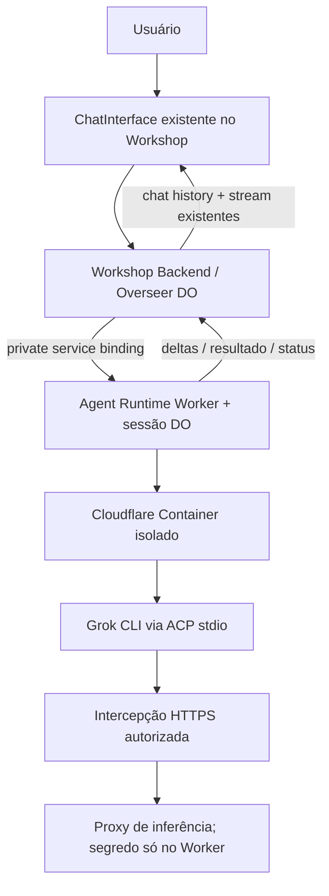

# Cloudflare OS — Roadmap de implementação incremental

> **Fonte de verdade para a SEQUÊNCIA e o escopo ativo** a partir de 2026-10-13. Aplicam-se sempre as invariantes de segurança do [SPECS.md](./SPECS.md) raiz. A documentação histórica [Unified v2](./docs/architecture/AGENT_PLATFORM_UNIFIED_V2.md) e [ACP v1](./docs/architecture/ACP_CONTRACTS_V1.md) não autoriza criar packages ou endpoints antes de a fase correspondente ser aprovada.
>
> **Estado atual:** Fase 1 PLANEJADA — não executada. A main não contém ainda um Worker/DO/Container Grok operacional; o único diretório de módulo novo preservado é `packages/agent-runtime/`, inicialmente com specs/plan e sem código, package.json ou deploy.

## Objetivo imediato

**Grok Build executando em uma Cloudflare Container/Sandbox isolada e conversando no chat que JÁ EXISTE no Workshop.** É todo o produto da primeira fase. O navegador fala com o Workshop existente; o Workshop autentica, guarda chat e eventos; um Worker/DO mínimo controla a instância Grok e seu protocolo ACP.

**Sem** novos Gatekeepers, MCP server/client, Tool Gateway, registries, agente autônomo, scheduler, subagentes, terminal web, editor de arquivos, R2 checkpoint, experimentos A/B ou Codex/OpenCode nesta fase. ACP é somente a conexão técnica entre supervisor e Grok; **ACP não é MCP**. Iniciar `session/new` com `mcpServers: []` na versão compatível testada.

## Fase 1 — Grok em Cloudflare Sandbox + chat (PRIORIDADE ÚNICA)

**Escopo aceito:** um usuário autenticado seleciona Grok no chat existente de seu workspace, envia texto, vê resposta incremental, status e erros; o histórico continua no mesmo Overseer DO. Um container de Grok isolado é iniciado sob demanda. É possível interromper uma execução/cancelar sem perder histórico. Primeira versão sem tarefas automáticas nem filesystem/terminal externo.

**Trabalho obrigatório por ordem:**

1. **Contratos/characterization:** mapear `AiChatMetadata`, métodos de criação/envio de mensagens, `ChatInterface`, `AiChatStreamEvent`, `AgentHooks.commitAgentStep` e o modelo do Overseer. Provar comportamento atual em testes. Criar o menor discriminator de engine por chat, default NATIVE, que não altere conversas antigas nem o `AgentSpawner`.
2. **Destilação com SHA fixo:** portar a execução relevante do [Grokbot PR #1](https://github.com/brasalabs6/grokbot/pull/1) no head de referência `9171b11c7269f6f305e99fd697a4dd885aad5459`: Container, launch Grok, ACP initialize/session/new/prompt/update/cancel, health supervision e interceptação de inferência. Usar fixtures comprovadas e revalidar versões atuais antes de deploy. NÃO copiar Next.js/auth/DB/Postgres/UI/replay/terminal legado por inércia.
3. **Único módulo novo mínimo:** implementar `packages/agent-runtime/` (Worker privado + DO para sessão + Container; cliente ACP e configuração Grok internos), com `package.json`, fonte, Dockerfile/manifesto de imagem, `cloudflare.config.ts`, Wrangler gerado e testes. **Não extrair acp-core, harness-grok ou agent-egress em packages separados nesta fase.**
4. **Rede segura:** Container sem acesso irrestrito à internet, interceptação HTTPS confiável antes de `start`, CA/TLS válida e proxy WorkerEntrypoint com modelo/destino allowlisted; chave real só no ambiente Worker. Selecionar modelo validado para a instalação; sem bypass TLS, sem secrets no container, sem `--always-approve` do smoke test em produção.
5. **Integração mínima com Workshop:** nova operação PRIVADA autenticada de chat para criar/vincular sessão e enviar prompt ao Runtime; user/workspace/agent IDs derivados da autoridade Workshop, não aceitos do browser. Registrar input/histórico e publicar output no pipeline chat existente. Separar confirmação de envio de conclusão; deduplicar eventos no Overseer e tratar timeout depois de dispatch como resultado desconhecido, nunca re-enviar cegamente.
6. **UI mínima:** seleção Native/Grok onde o chat existente já oferece engines/modelos (revisar UX real); renderizar texto parcial, conclusão, loading, erro, cancel, reconectar e histórico usando `ChatInterface` e atual RpcContext. Não construir um segundo chat/SPA.
7. **Validação:** testes de autorização, isolamento por workspace, stream/reconnect, concorrência, runtime indisponível, ACP inválido, erro de credencial, tool permission negada por default e regressão do chat nativo. Cloudflare staging E2E REAL: criar chat Grok -> Grok Container pronto -> enviar texto -> receber resposta -> fechar/reabrir browser -> confirmar histórico e ausência de vazamento de segredos.
8. **Gate:** marcar Fase 1 concluída SOMENTE com URLs de deploy de staging, commit, fixture Grok versionada, saída de build/test, evidência de isolamento e roteiro de rollback. Não declarar pronto com apenas SPECS.md.

**Artefatos de execução:** [Agent Runtime SPECS](./packages/agent-runtime/SPECS.md), [Agent Runtime plan](./packages/agent-runtime/plan.md), [Workshop Backend plan](./packages/workshop-backend/plan.md), [Workshop Shared plan](./packages/workshop-shared/plan.md), [Workshop Frontend plan](./packages/workshop-frontend/plan.md).

**Condição de sucesso:** uma conversa real de Grok funcionando na UI atual, num Container Cloudflare, sem afetar a experiência atual do agente nativo.

## Fase 2 — Estabilização da sandbox e funções já testadas no Grokbot (BLOQUEADA)

Iniciar apenas após gate F1. Avaliar, uma a uma, extração de PTY/terminal, arquivos, Git/diff, histórico de eventos detalhado, permissões interativas, checkpoint/restore, métricas e modelos. Primeiro reutilizar abstrações já existentes: Workshop Git/worktree e aprovações são distintos do FS Linux da sandbox; não confundir. Não criar Gatekeeper Computers se um escopo mínimo no Workshop atender os requisitos; somente propor novo Gatekeeper quando houver recurso realmente independente e após revisão de API. Validar cada F-001..F-017 com nova evidência, deferindo as que não se aplicam.

## Fase 3 — Agentes persistentes, tarefas automáticas e loops (BLOQUEADA)

Aproveitar `AgentSpawnerConfig`, `spawnCallable` e `deliverAgentCallback` atuais, mais `gatekeeper-scheduler`/hooks. Implementar gestão de agentes e tarefas duráveis SOMENTE nas lacunas reais identificadas por testes (budgets, pause/resume, lineage, operador, resultado terminal, 24/7 via retomadas limitadas). Não clonar o loop interno `runAgentLoopContinue`; não criar scheduler concorrente. Definir armazenamento/DO adicional apenas caso precise de nova autoridade e demonstrar por ADR.

## Fase 4 — Outros harnesses/protocolos e subagentes (BLOQUEADA)

Codex, OpenCode, outros protocolos nativos, drivers/cores customizados e observabilidade de subagentes. Extrair interfaces/engine adapters compartilhados a partir de **duas integrações reais**, não de abstração especulativa prévia. O contrato público do Workshop continua Cap'n Web; ACP/native são transportes internos. Adicionar controle de subagentes somente quando a versão do protocolo oferecer identidade, autorização e cancelamento verificáveis.

## Fase 5 — MCP Registry, ferramentas e APIs externas (BLOQUEADA)

**Projeto de referência real:** [`brasalabs6/mcp-registry`](https://github.com/brasalabs6/mcp-registry) (privado; commit de referência `ac8318a51b2a1c6f4522e76c9e7c21bc8500340d`). Esse projeto já cobre catálogo, instalações por agente, credenciais, MCP Streamable HTTP, data-plane routing, OpenAPI import, runtime de MCP e governança. **Não criar `agent-tool-registry`, `agent-tool-gateway` ou `agent-harness-registry` substitutos.**

Integração futura: revisar fronteiras entre tenant/workspace/agente do MCP Registry (origem NestJS/Postgres/Docker/MQTT e headers Brainstorm) e autoridade do Workshop (Cap'n Web, Gatekeepers, observer/approval). Fazer um adapter de serviço seguro, **não** confiar implicitamente em headers como `x-brainstorm-actor-user-id` nem migrar bancos por cópia. Preservar `mcp-shared` e atuais Gatekeepers MCP de BYO/Portal; decidir import/export conforme testes. Sem endpoints MCP novos na Fase 1.

## Fase 6 — Releases A/B, canary e escala (BLOQUEADA)

Somente depois de múltiplos harnesses/revisões reais: releases imutáveis, roteamento sticky, rollout canary, rollback, quotas e operação de produção. Reutilizar `scripts/release` e bindings/deploy já existentes. A/B experimental não entra no primeiro lançamento Grok.

## Regras de revisão de escopo

- Não criar package/Worker/DO/Gatekeeper para uma responsabilidade que os 32 packages existentes já possuem. Consultar [auditoria](./docs/architecture/EXISTING_MODULE_BOUNDARIES_AUDIT.md).
- Arquivos de especificação não significam implementação; todo gate exige testes/evidência.
- Se um novo módulo for necessário, documentar qual **estado novo e exclusivo** ele possui e por que a extensão do existente não basta.
- Cada fase ativa tem PRs, paths, critérios e evidências; iniciar a próxima apenas depois de encerrar a anterior.
- Todo novo input de arquitetura deve ser registrado no [USER_INPUT_LEDGER](./docs/architecture/USER_INPUT_LEDGER.md).
