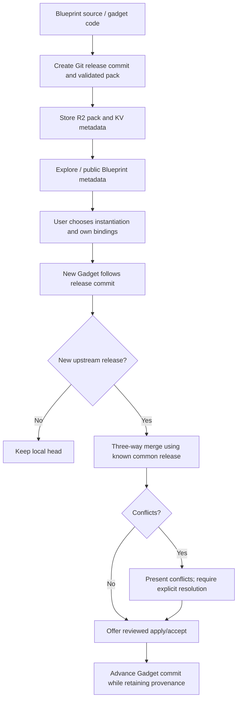
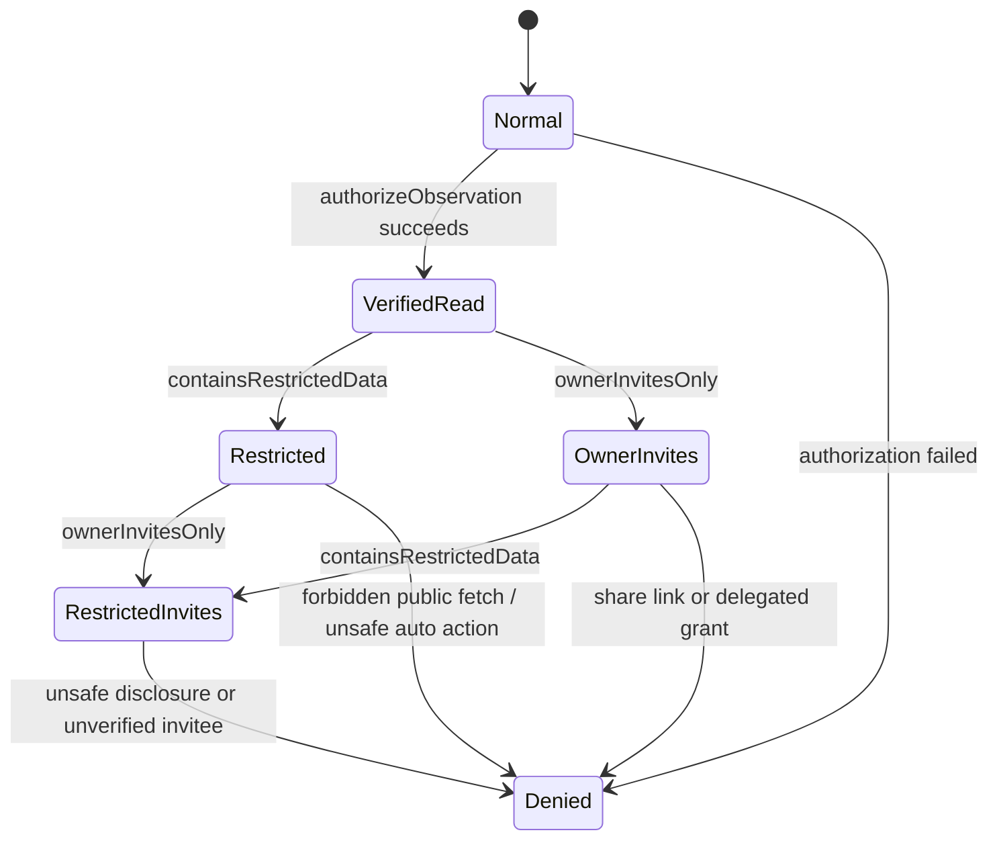
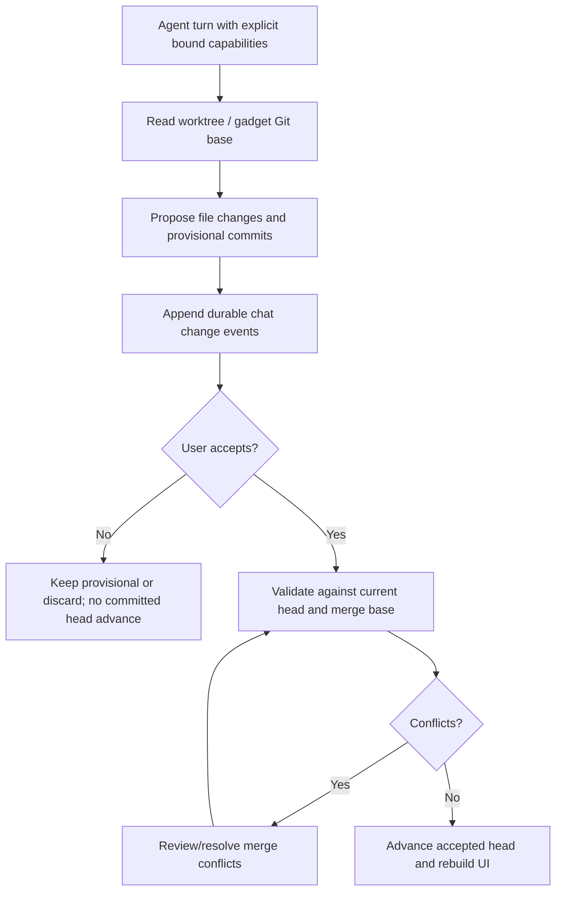

# Cloudflare OS — System Specification

> **Status:** Normative source of truth for the repository.
>
> This document defines the architecture, cross-package contracts, invariants, security model, runtime workflows, and change policy of Cloudflare OS. Package-level `packages/*/SPECS.md` files refine this specification for their package. A package spec MUST NOT contradict this file.

## 1. Authority and precedence

Cloudflare OS uses the following order of authority for intended behavior:

1. `SPECS.md` at the repository root — system-wide invariants and architecture.
2. `packages/<name>/SPECS.md` — package contracts and package-specific requirements.
3. Public TypeScript contracts in `@gadgets/workshop-shared`, package exports, Worker entrypoints, and generated `.d.ts` surfaces — executable interface definitions.
4. Tests — executable examples and regression constraints.
5. Implementation details — may change freely only when the contracts above remain satisfied.
6. README files — explanatory/operator documentation; they are not allowed to silently redefine a contract.

A behavior-changing pull request MUST update the affected spec in the same change. If code and a spec disagree, the disagreement is a defect: either restore the code to the documented contract or deliberately revise the spec and all affected consumers/tests.

Normative keywords **MUST**, **MUST NOT**, **SHOULD**, **SHOULD NOT**, and **MAY** have their RFC-style meanings.

## 2. Product model

Cloudflare OS is an AI productivity operating system built on Cloudflare Workers. Its core abstraction is a **workspace** managed by a durable kernel. A workspace can contain one or more **Gadgets**, external-service **Gatekeepers**, AI chat/agent threads, approvals, hooks, collaborators, and blueprint-derived outputs.

The OS analogy used by the repository is architectural, not cosmetic:

- **Kernel:** `packages/workshop-backend`.
- **Shell / first-party UI:** `packages/workshop-frontend`.
- **Public origin/router:** `packages/router`.
- **Device/capability drivers:** `packages/gatekeeper-*`.
- **Shared ABI/contracts:** `packages/workshop-shared`.
- **Processes:** sandboxed Gadgets hosted as dynamic Workers/facets.
- **Executables/templates:** Blueprints.
- **Capability configuration UIs:** `packages/configurator-ui` plus gatekeeper-generated iframe bundles.
- **Persistence helpers:** `packages/typed-storage`.
- **MCP protocol substrate:** `packages/mcp-shared`.
- **System verification:** `packages/integration-tests` and package-local tests.

The system MUST preserve this separation. External-service credentials and privileged account capabilities MUST NOT be passed directly to Gadgets or agents.

## 3. Workspace/package topology

Cloudflare OS is a pnpm workspace. The following is the complete set of packages present in main at architecture-alignment time. Only packages with a Wrangler deployment configuration are deployable Workers; a gatekeeper-* name alone does not make a package deployable.

| Domain | Packages | Authority |
| --- | --- | --- |
| Kernel | workshop-backend, workshop-shared | Durable identities, workspaces, RPC, approvals, capability ABI |
| First-party presentation | workshop-frontend, ui, configurator-ui | React shell, reusable hierarchical controls, sandboxed configuration UI ABI; never grants independent authority |
| Ingress/routing | router | Binding-discovered Gatekeeper proxy, backend API, assets and mail handling |
| Reusable integration primitives | gatekeeper-kit, mcp-shared | Provider-neutral nonce, credentials, actions, observations, MCP tool and OAuth trust boundaries; neither is a standalone Worker |
| Data/telemetry | typed-storage, observability, error-reporting | DO collection/index helpers, Worker logging/metrics/tracing and bounded error event schema |
| Blueprint/template library | bundled-blueprints | Reviewed Docs/Sheets/Slides formats and build-time client/server gadget libraries |
| Verification | integration-tests, workshop-evals | Real Worker/RPC harness and model+agent functional evaluations |
| External Gatekeepers | gatekeeper-cloudflare, gatekeeper-confluence, gatekeeper-context, gatekeeper-email, gatekeeper-github, gatekeeper-gitlab, gatekeeper-google, gatekeeper-homeassistant, gatekeeper-linear, gatekeeper-mcp, gatekeeper-mcp-portal, gatekeeper-notion, gatekeeper-scheduler, gatekeeper-slack, gatekeeper-spotify, gatekeeper-supabase, gatekeeper-x, gatekeeper-zoominfo | Scope-limited provider capabilities, durable connector accounts/facets, observations, approved actions and hooks |

This inventory contains 32 packages. The old backend-utils package has been retired: Worker telemetry/context integrations now live under @gadgets/observability and error shapes under @gadgets/error-reporting.

Each package has its own packages/<name>/SPECS.md. New packages MUST be added to this inventory and receive a package spec in the same behavior-changing PR. Shared API changes MUST first be represented in workshop-shared; provider-specific implementations cannot fork global security contracts.

## 4. Core runtime architecture

### 4.1 Durable kernel

`workshop-backend` is the authority for users and workspaces. Important durable boundaries include:

- `UserDurableObject` — per-user identity, sessions, connected accounts, model preferences, workspace index, blueprint/library state, output index and optional billing counters/state.
- `OverseerDurableObject` — per-workspace authority for workpieces, Gadgets, bindings, chats, code state, approvals, hooks, sharing and execution coordination.
- `AdminSettings` — deployment-level mutable configuration.
- `PendingLogin` — short-lived rendezvous for gatekeeper-backed sign-in.

Workspace workpieces share one sequential ID namespace. Gadget IDs and Gatekeeper IDs MUST NOT collide. Binding edges live on the Gadget/workspace relationship, not as global mutable metadata on a Gatekeeper.

### 4.2 Gadget isolation

A Gadget is untrusted workload code. The design MUST preserve these properties:

- Server-side Gadget code runs in a dynamically-created Worker/facet scoped to its workspace.
- Gadget code has no ambient internet or external-service authority. External access is introduced only through explicit bindings/capabilities.
- Client-side Gadget UI runs in a sandboxed iframe and communicates through explicit RPC/message channels.
- A Gadget MUST NOT receive OAuth refresh tokens, provider secrets, raw Gatekeeper account objects or deployment admin capabilities.
- A capability available in `env.NAME` MUST correspond to an explicit workspace/chat binding or a deliberately-provisioned ambient capability.

### 4.3 Frontend/backend RPC

The public Workshop API is Cap'n Web RPC over a WebSocket at `/api`.

- `PublicApi` covers unauthenticated/deployment discovery, login/signup, gatekeeper-backed sign-in and public blueprints.
- Successful authentication returns an `AuthenticatedApi` capability rather than exposing privileged HTTP endpoints.
- Long-lived workspace/Gadget capabilities are reached through RPC stubs.
- If a critical Durable Object connection breaks, the backend MAY close the WebSocket to force the frontend reconnect path; the frontend MUST recover by replacing the RPC session with bounded exponential backoff.
- Browser code MUST treat a new socket as unproven until a real RPC succeeds.

### 4.4 Router

Routing configuration is the installed binding set. The router MUST discover Gatekeepers from environment bindings named `GATEKEEPER_*`.

Path routing precedence:

1. `/gatekeeper/<binding-suffix>` and descendants → matching Gatekeeper Worker.
2. `/api`, `/api/*`, `/blueprint-screenshot`, `/blueprint-screenshot/*` → Workshop backend.
3. Remaining paths → static frontend assets when `ASSETS` exists.
4. Dev fallback without assets → backend.

Inbound Email MUST be forwarded only to `GATEKEEPER_EMAIL`; if that binding is absent, the message is rejected.

Adding a Gatekeeper SHOULD require deployment wiring/binding changes, not edits to a hard-coded router registry.

## 5. Gatekeeper capability model

Gatekeepers are the security boundary around external systems. They consist conceptually of:

1. **Vendor (`GatekeeperVendor`)** — describes a connector, starts connection or auto-provisioning, advertises supported resource types and TypeScript declarations.
2. **Connected account (`GatekeeperUser`)** — privileged per-human account capability holding or reaching credentials; only the Workshop may hold it directly.
3. **Resource Gatekeeper (`Gatekeeper<Session>`)** — workspace/facet-scoped capability for one resource or ambient singleton.
4. **Session** — narrow Gadget-facing RPC surface.
5. **Verifier (`GatekeeperUserVerifier`)** — capability used to prove an observer independently has required access.
6. Optional **Resource Configurator**, **Management App**, **Agent Catalog**, **Slash Commands**, and **Hooks**.

### 5.1 No ambient authority

A new Gadget/agent MUST have no external authority by default. Every external resource MUST be introduced through an explicit Gatekeeper binding or an admin/user-controlled ambient account policy.

### 5.2 Resource selection

`resolveRequestedResource()` in `workshop-shared/gatekeeper` is the single source of truth for resolving an agent-requested resource:

1. matching non-catch-all URL pattern;
2. `https://*` whole-instance fallback;
3. the only supported resource when exactly one exists;
4. otherwise fail with an actionable error.

Frontend and backend MUST NOT implement divergent selection precedence.

### 5.3 Connection security

Interactive `connectAccount()` and `reconnect()` flows MUST use cryptographically-random, single-use, time-bounded nonces and MUST verify them before accepting the browser flow. OAuth `state`/PKCE or equivalent provider protection MUST be used where applicable.

- Credential secrets MUST live inside the Gatekeeper's account Durable Object or deployment secret binding.
- Gatekeeper account objects MUST serialize refresh/revoke operations when provider rotation semantics make concurrency unsafe.
- OAuth access-token cache expiry MUST include a safety skew.
- A failed/abandoned first connection SHOULD self-clean with a bounded alarm.
- Auth-only sign-in grants MUST be transient unless a connector contract explicitly makes the sign-in grant persistent (Cloudflare billing is the intentional special case).
- `getAuthenticatedEmail()` MUST return only provider-verified identity suitable as an account key.

### 5.4 Observations

Every operation that returns protected external data to a Gadget is an **observation**.

The Gatekeeper MUST call `ObservationAuthorizer.authorizeObservation()` for every observation and MUST await it before returning protected data. It MAY fetch read-only remote data first in order to produce an accurate audit description, but authorization MUST happen before disclosure to the Gadget.

A Gatekeeper MUST fail closed when observer authorization cannot be proven.

ObservationDescription.containsRestrictedData enters restricted mode (manual approvals; no public-web fetches); ownerInvitesOnly separately forbids share links and delegated access. Both remain subject to observer verification.

### 5.5 Actions and human approval

Every operation with side effects is an **action**.

A Gatekeeper MUST:

1. allocate/store an action record;
2. submit it through `ApprovalQueue.submitAction()` with a complete human-readable `ActionDescription`;
3. return/simulate according to its package contract;
4. perform the external side effect only when `Gatekeeper.applyAction(actionId)` is invoked;
5. clean staged state on rejection;
6. implement `revertAction()` when a reliable inverse exists, or truthfully declare that no automatic revert is available.

There is **no mode in which a Gatekeeper may skip submission merely because an action is considered safe or auto-approvable**.

Auto-approval in the kernel requires both:

- the Gatekeeper marks the action `autoApprovable: true` and gives a stable `actionKind`; and
- the user has enabled an auto-approval rule for that Gatekeeper/action kind.

Auto-approval MUST drain actions in ascending action-ID order and MUST stop at the first manual gate or apply failure. It MUST NOT skip ahead.

### 5.6 Simulation

Gatekeepers that support optimistic simulation SHOULD overlay pending staged actions on subsequent reads so an agent can reason about its own proposed changes without waiting hours/days for human approval.

When simulation is not implemented, `ActionDescription.awaitDecision` SHOULD be true so the agent does not continue under a false world model.

Simulation MUST never itself perform the external side effect.

### 5.7 Hooks

Persistent hooks use `ApprovalQueue.bindHook()`.

- Registering a hook is an approval-controlled capability operation.
- Gatekeepers SHOULD encode all pre-enable configuration in a `HookController` capability/props.
- They MUST avoid durable external registration/state until `controller.enable()` is called.
- Event delivery starts a fresh hook session through `HookInitiator`, obtains the session-bound callback and approval/observation capability, authorizes the event observation, then invokes the callback.
- `disable()` MUST remove durable delivery state.

### 5.8 Observer/sharing verification

Workspace collaboration does not automatically imply external-resource access. Before a non-owner can observe data, the Gatekeeper policy MUST either:

- verify the observer has independent access through a `GatekeeperUserVerifier`; or
- explicitly reject observers for that connector/resource.

MCP connectors are intentionally owner-only because they cannot prove per-record authorization.

## 6. Sharing model

Workspace sharing is a permission graph managed by the Overseer.

- Roles are ordered: `build` > `use`.
- Effective access is computed from live reachability from the owner, not merely record existence.
- Share keys are random bearer secrets; only an HMAC-SHA-256-derived identifier is persisted.
- Revocation is intentionally lazy: edges/records may remain, but an unreachable collaborator MUST be denied on every `open()`.
- Revoked share links MUST not grant reachability.
- A user MUST NOT grant a role higher than their own effective role.
- `ownerInvitesOnly` is the owner-direct-invite sharing constraint enforced by the Overseer; `containsRestrictedData` independently requires restricted-data controls.

## 7. Agent and chat execution model

AI chat is durable workspace state coordinated by the Overseer.

- A chat has a frozen seed binding layer at creation; subsequent binding changes are reconstructed by replaying durable change messages.
- Agent code-mode runs with an explicit `env` containing only resolved workpiece/value bindings.
- Binding names MUST pass the shared identifier validator and MUST be protected from JavaScript reserved names/prototype-pollution hazards.
- Gadget creations, binding additions and code edits made by an agent can be provisional to a chat until the user accepts the corresponding change batch.
- The chat log is the authoritative history for proposed/accepted changes; materialized pending registry rows exist to make previews functional and MUST remain reconcilable with the log.
- Agent callback/hook values are transient capabilities and MUST not be treated as ordinary persistable secrets.
- Model-facing assistant state may be stored server-side for faithful replay/compaction, but private model metadata MUST NOT leak to clients.
- Chat compaction checkpoints are immutable replay accelerators, not a replacement source of truth for pending registry state.

## 8. Blueprints, Git releases and outputs

A Blueprint is portable source code, not a transferable privileged capability. Metadata is indexed in Workshop/User storage and public BLUEPRINTS KV; durable release content is stored in BLUEPRINT_CONTENT R2 as a validated Git pack. A Blueprint version is a release commit, identified by BlueprintMetadata.commitId, not simply an unversioned compressed archive. The backend's workspace Git store retains content-addressed Git blobs, trees and commits; Gadget records refer to commits. Existing pre-Git Blueprint content is read through the documented legacy snapshot-compatibility path rather than treated as newly authored history.

A release pack MUST validate object hashes, types, complete release tree, ancestor graph, bounds and file/path formats before it is imported into a workspace. An attacker-supplied pack MUST NOT inject arbitrary credentials or assume privileges. Release history contains explicit lineage and a release-merge marker so ordinary chat merge parents cannot be mistaken for published versions. Publishing unchanged code without newly merged releases MUST NOT mint redundant releases. Importing or instantiating a blueprint never binds another author's connected account: every binding is resolved against the receiving user's own account/resource choices.

Bundled Blueprints are generated by @gadgets/bundled-blueprints and installed on a deployment's first /api traffic. Their snapshot releases use deterministic parentless Git commits; the same files yield the same release hash in every deployment. Installed formats are subsequently curated by admin policy. A Gadget following a Blueprint may explicitly accept an update through a three-way merge that preserves its own edits and surfaces conflicts; it MUST NOT silently replace a user's code when an upstream release changes.



Outputs are listings/projections, not a source of authorization. Media endpoints MUST validate content types and enforce bounded body sizes/caching keyed to immutable content. See docs/blueprints.md, packages/workshop-backend/SPECS.md and packages/bundled-blueprints/SPECS.md.

## 9. Ambient accounts and management apps

Gatekeepers with `VendorDescription.autoProvisionsAccount` use deployment policy with three modes:

- `disabled` — unavailable/dormant; do not provision.
- `optional` — user opt-in; **default**.
- `enabled` — force-provision for all users and make non-removable through normal connector UX.

The provisioning policy helpers in `workshop-backend` are the system chokepoint; packages MUST NOT invent independent ambient defaults.

A connected account may advertise `providesUi`; such management UIs run as sandboxed `GatekeeperUiFrame`s. Admin status is passed fresh at each open and MUST not be cached as durable authority in a client iframe.

## 10. Sandboxed configuration/UI contract

Gatekeeper configurators and management apps are complete HTML documents hosted in `sandbox="allow-scripts"` iframes and receive only a narrow RPC capability.

Configurator state is iframe-owned. `@gadgets/configurator-ui` defines the module ABI:

- `initial`
- optional `initialValuesFromResourceUrl()`
- optional `isReady()`
- `resourceUrl()`
- synchronous `render()` using runtime-supplied primitives

`CheckboxList` encodes selected values as comma-separated strings; option values MUST NOT contain commas unless safely encoded first.

Workshop/server code SHOULD NOT import the configurator package because its ambient JSX contract is intended for sandboxed configurator bundles.

## 11. Persistence model

Durable Object persistence is the primary source of mutable runtime state.

`@gadgets/typed-storage` provides typed collections, unique/non-unique indexes, singletons, synchronous transactions and subscribers over `DurableObjectStorage.kv`.

Current contract limitations:

- typed-storage does **not** currently provide schema versions or automatic migrations;
- callers remain responsible for application-level migrations/backward-compatible reads;
- persistence changes MUST account for old stored rows and partially-completed operations;
- state machines that cross awaits MUST prevent duplicate or stale completion (generation numbers, claimed states, single-flight guards, etc.).

## 12. Observability and error reporting

Worker logging, tracing, ambient request context and metrics MUST use @gadgets/observability public subpaths. @gadgets/error-reporting defines the bounded sanitized error-event schema. The former backend-utils package is not present. Structured loggers SHOULD carry stable component and vendorId fields; never log OAuth tokens, prompts, model responses, user content, private URLs, secret headers or bearer share fragments.

AsyncLocalStorage context is scoped to the current async invocation and MUST be re-established at RPC, alarm, hook, queue or restart boundaries. Browser, iframe and Gatekeeper errors are diagnostics, not authenticated identity or approval evidence. A sandboxed Gatekeeper iframe MUST report through its Workshop host with appropriate source-window checks, not direct privileged telemetry from an untrusted context.

Optional ERROR_REPORTER and METRICS bindings MUST degrade to no-op when absent. METRICS events have one canonical actor-index record and optional secondary per-owner/workspace lookup records; analytics MUST count the canonical event once, never sum lookup replicas. Backend agent tracing emits per-invocation spans for invoke_agent, chat, execute_tool and tool_approval, with token counts but no prompt/tool payloads. Span lifetimes MUST NOT be represented as spanning unrelated Durable Object invocations.

## 13. Security invariants

The following are repository-wide MUSTs:

1. **Least authority:** no credential or external privilege without explicit capability introduction.
2. **Fail closed:** authorization/verifier uncertainty blocks disclosure or privileged action.
3. **No action-before-approval:** external writes only from `applyAction()` or equivalent approved hook activation.
4. **No credential leakage:** refresh tokens/secrets stay inside their Gatekeeper account or deployment secret scope.
5. **No cross-origin privileged API:** deployments using Cloudflare Access require same-origin API requests and a valid Access JWT.
6. **SSRF protection:** production backend keeps `global_fetch_strictly_public`; code that fetches arbitrary URLs MUST preserve private-network protections and package-specific URL validation.
7. **Nonce/replay protection:** browser connection flows use random, expiring, single-use nonce/state.
8. **Bound untrusted metadata:** provider/tool descriptions shown in approval UI are escaped/quoted/truncated so external text cannot forge trusted approval prose.
9. **Stable action identity:** policy keys use stable machine-readable action tags, separate from labels.
10. **Observer isolation:** sharing a workspace cannot bypass source-system authorization.
11. **Prototype-safe bindings:** agent/Gadget binding identifiers pass the shared validator.
12. **Idempotent ingress:** at-least-once external delivery paths MUST expose/use stable message keys and make duplicate handling safe.

## 14. MCP-specific global rules

MCP connectors share implementation in `mcp-shared` and MUST keep policy centralized there.

- Tool `readOnlyHint === true` classifies a call as a read; missing/false means action.
- A user-supplied BYO endpoint MAY use `readOnlyHint` for read-vs-action classification, but its annotations MUST NOT grant auto-approval.
- Auto-approvable MCP writes require a deployment-vetted server plus `destructiveHint === false` and `idempotentHint === true`.
- MCP bindings are owner-only unless a future verifiable sharing policy is explicitly designed and specified.
- Tool catalogs and generated types MUST be bounded.
- An MCP endpoint account owns all credentials and pins endpoint identity across reconnects, except controlled deployment portal repointing that invalidates old generations/facets safely.
- Tool-call results produced asynchronously after approval become observations when later delivered to the Gadget.

## 15. Build, development and deployment workflow

The repository uses pnpm workspaces.

Root expectations:

- `pnpm build` recursively builds packages.
- `pnpm test` runs root script tests plus recursive package tests.
- `pnpm dev-client` runs the Vite Workshop frontend.
- `pnpm dev-server` generates dev Wrangler configs and starts all discovered Workers.
- `pnpm run-local` is the local integrated mode with a built frontend.

`run-dev-server.js` MUST continue to discover `packages/gatekeeper-*` packages that contain `wrangler.jsonc`, generate their UIs before Worker bundling, wire `GATEKEEPER_*` service bindings, and pass deployment-only variables without requiring tracked secrets.

Gatekeeper OAuth client secrets MUST NOT be committed to `wrangler.jsonc`; they come from secrets/dev environment.

Generated files under `src/generated` are build outputs. Their source module/configurator code is authoritative.

## 16. Test contract

A behavior change is incomplete until relevant tests are updated/added.

Minimum expectations:

- Shared contract/helpers: focused unit tests.
- Durable state transitions: tests covering retries/interleaving/restarts where applicable.
- Gatekeeper observations/actions: tests proving observation authorization and delayed action application.
- OAuth/connect flows: invalid/expired/replayed nonce cases.
- Resource scoping: broad and narrow URL cases plus invalid resources.
- Sharing: permission graph and revocation behavior.
- Router: dynamic gatekeeper routing and API/assets precedence.
- Cross-package Gatekeeper changes: use `@gadgets/integration-tests` to boot the real Workshop backend plus real/fixture Gatekeepers where practical.

Docs-only changes do not require runtime test execution, but MUST be checked against current public source/contracts.

## 17. Compatibility and evolution

Changes to these surfaces are compatibility-sensitive:

- `workshop-shared` exported RPC/types and constants;
- Gatekeeper resource URL patterns;
- generated Gadget-facing `.d.ts` APIs;
- action-kind tags and semantics;
- Durable Object storage keys/record shapes;
- binding-name conventions (`GATEKEEPER_*`, Gadget env names);
- public routes (`/api`, `/gatekeeper/*`, blueprint screenshot paths);
- external message idempotency keys;
- blueprint archive/schema formats.

A breaking change MUST include migration/compatibility handling or an explicit coordinated version transition. Never silently reinterpret persisted state or a previously-issued capability URL.

## 18. Package dependency rules

- `workshop-shared` MUST remain runtime-neutral enough to be consumed by backend, frontend and Gatekeepers without importing privileged kernel implementation.
- Gatekeepers SHOULD depend on `workshop-shared` contracts and shared infrastructure, not on `workshop-backend` internals.
- `mcp-shared` owns MCP policy/common transport; the two MCP Gatekeepers add connector-specific endpoint/provisioning behavior.
- `@gadgets/observability` and `error-reporting` MUST remain best-effort infrastructure and MUST NOT acquire business authority.
- `configurator-ui` MUST remain a narrow sandbox ABI.
- `typed-storage` MUST remain storage infrastructure; application-specific schema semantics belong to consuming packages.
- `integration-tests` may know how to boot packages but MUST NOT become a production dependency.

## 19. Definition of done for architectural changes

A change touching architecture is complete only when all applicable items are true:

- [ ] Root and affected package specs remain accurate.
- [ ] Public types/RPC declarations match documented behavior.
- [ ] Security checks live at the authoritative boundary, not only in UI.
- [ ] Persisted-state compatibility is handled.
- [ ] Observation/action/hook semantics are preserved.
- [ ] Credentials remain encapsulated.
- [ ] Resource URL patterns and OAuth scopes are least-privilege and tested.
- [ ] Concurrency/retry/idempotency behavior is explicit.
- [ ] Generated artifacts are regenerated from source when needed.
- [ ] Unit/integration tests cover the new contract.
- [ ] New packages are added to this topology and receive their own `SPECS.md`.

## 20. Package specifications

Every package under `packages/` MUST contain a `SPECS.md`. Those documents describe the package mission, ownership boundary, exported surface, state, workflows, security requirements, configuration, tests, known limitations and change rules. When a new package is created, its spec is part of the package's minimum viable implementation.

## 21. Current-state change controls and cross-module flows

This chapter documents behavior introduced after the PR's original August 2026 baseline. The sections above remain normative subject to the current contracts here; duplicate or contradictory older descriptions MUST be reconciled, not implemented independently.

### 21.1 Browser connection is a staged, nonce-bound capability transfer

A Gatekeeper callback is not permission for whichever browser possesses a URL to activate a connected account. Workshop owns a one-time ticket plus per-flow nonce redeemed from the initiating session at /connect/handoff. An initial connect remains staged and a reconnect's new credentials remain in escrow until the exact Workshop commitReconnect(stageId) call. Handoff tickets are stored hashed, expire, are single-use and MUST NOT be sent in HTTP query strings, logs or analytics.

```mermaid
sequenceDiagram
  participant B as Initiating browser
  participant W as Workshop user/login DO
  participant G as Gatekeeper account DO
  participant P as OAuth provider
  B->>W: Start connect: origin-bound flow nonce
  W-->>B: Connect URL and local nonce
  B->>G: Start provider authorization
  G->>P: OAuth with state / PKCE
  P-->>G: Callback with code and state
  G->>G: Claim nonce; stage credential/connection generation
  G->>W: complete or reconnectComplete
  W-->>G: Short-lived one-time handoff ticket
  G-->>B: Redirect to trusted Workshop /connect/handoff#ticket
  B->>W: Redeem ticket with initiating session and flow nonce
  W->>G: Commit exact reconnect stage (when applicable)
  W-->>B: Confirm account linked or signed in
```

### 21.2 Sensitive observations and sharing

ObservationDescription.containsRestrictedData causes restricted mode: no public-web fetches and no action auto-approval; manual approval remains possible, with any incomplete action description visibly flagged. Git pushes with incomplete descriptions are refused. ownerInvitesOnly is a separate sharing restriction: only owner-direct collaborator invitations survive, while link-based/delegated reachability is removed. They are NOT synonyms. Existing observers and new collaborators require Gatekeeper verification and any explicit observer exclusions must be enforced before disclosure.



### 21.3 Chat, Git worktrees and Blueprint updates

Workspace Git state is content-addressed. Chat-private worktrees are first-class workpieces with a base commit, lazy file overlay and pending head advancements; they are NOT Gadgets and are NOT published/shared as Gadgets. Their head and pin advance through accepted changes, preserving chat history. Replaying rejected/abandoned provisional changes must not materialize approved workspace state. An upstream Blueprint release can be proposed and merged explicitly; unresolved file conflicts require a user/agent resolution before acceptance.



### 21.4 Mandatory verification across boundaries

Changes touching identity, token/stage state, public RPC, sharing/restricted data, action queues, Git histories, Blueprint packs or agent sandboxing require package-local tests plus appropriate Worker integration and security adversarial tests. The evaluation suite (workshop-evals) measures real agent tasks with restricted model egress and functional verifiers; a successful natural-language model response is not proof that a task passed. Production credentials MUST NOT be exposed to test fixtures or written into sources. The root instructions AGENTS.md and review security bar in REVIEW.md remain implementation guidance but do not override the explicit runtime authority of this specification.

## 22. Coverage inventory and maintenance

Each directory under packages/ has one SPECS.md. When creating or removing a package, update this inventory; remove specs belonging to deleted packages rather than leaving orphan documents. Current package specs cover all 32 modules, including bundled-blueprints, gitlab, gatekeeper-kit, x, observability, ui and workshop-evals. New security-sensitive features MUST document: entrypoints, authorities, persistent record ownership, user-visible success/failure paths, state transitions, replay/race defenses, required tests and deployment configuration. A Mermaid diagram is a design aid, not an independent substitute for those prose invariants.

## 23. Proposed multiagent domain modules (documentation-only)

The 2026-10-13 proposed multiagent architecture is documented in [Multiagent MCP Platform](docs/architecture/MULTIAGENT_MCP_PLATFORM.md), [domain contracts v1](docs/architecture/MULTIAGENT_MCP_CONTRACTS_V1.md), [security review](docs/architecture/MULTIAGENT_MCP_SECURITY.md) and [implementation plan / PDR traceability](docs/architecture/MULTIAGENT_MCP_IMPLEMENTATION_PLAN.md). ADRs [0004](docs/adr/0004-multiagent-domain-and-mcp-boundary.md) and [0005](docs/adr/0005-multiagent-data-and-delivery.md) are proposed pending review.

The following new `packages/*/SPECS.md` entries define **future** modules only: `agent-directory`, `agent-goals-tasks`, `agent-mailbox`, `agent-memory`, `agent-continuity`, `agent-audit`, `agent-automation`, and `mcp-domain-gateway`. The new `workshop-frontend/src/features/multiagent/SPECS.md` describes a future UI feature. These directories contain no runnable implementation and MUST NOT be inferred to be Wrangler deployment units. Existing packages and deployed contracts remain unchanged.

Any implementation MUST reuse Workshop workspace identity and Gatekeeper approval/observation policy, keep MCP server domain coordination separate from existing MCP client Gatekeepers, and preserve `ACP_CONTRACTS_V1.md` as the sole contract for managed harness session/run state. A task/event notification is not proof of remote execution. Until code and tests land, documentation statuses remain proposed, not delivered.
