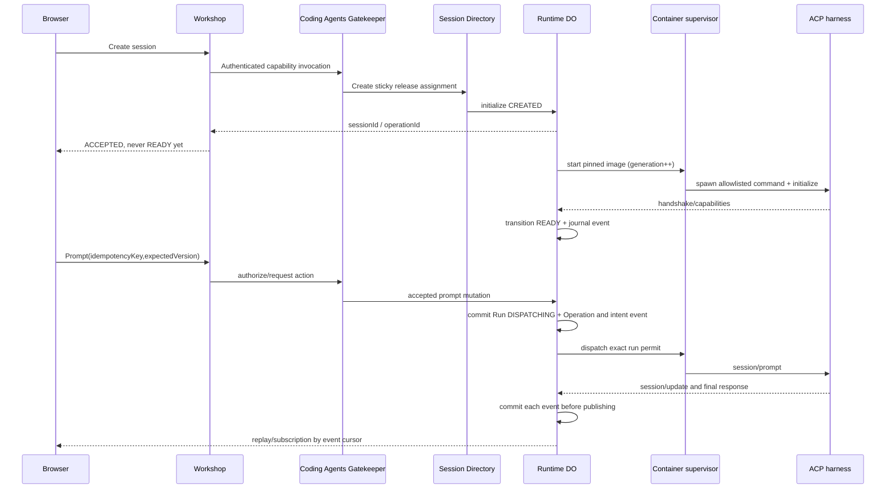

# ACP Platform — Canonical contracts v1

> **SUPERSEDED AS ACTIVE IMPLEMENTATION PLAN — 2026-10-13:** [ROADMAP](../../ROADMAP.md) authorizes only Grok-in-Cloudflare-Container + existing Workshop chat in Phase 1. This page is **historical research, migration backlog or earlier audit snapshot**, not permission to implement any removed package. See [simplification decision](./SIMPLIFICATION_DECISION.md). Existing security contracts in root SPECS.md remain authoritative.

> **Scope note (2026-10-13):** This v1 document specifies the ACP CLI session/runtime slice, not the entire autonomous agent platform. Canonical cross-engine AgentDefinition/Task/EngineDriver and AgentEvent contract is in [AGENT_PLATFORM_UNIFIED_V2](./AGENT_PLATFORM_UNIFIED_V2.md) with [machine-readable ACC schemas v2](./schemas/agent-platform-v2.schema.json). Existing v1 sessions require explicit migration, not silent reinterpretation.

**Status:** normative architecture contract, NOT implemented. **Date:** 2026-10-13.
**Scope:** Grok Build, Codex via codex-acp, OpenCode via ACP. Supersedes the design direction of cloudflare-os PRs #2/#3. Grokbot PR #1 is an extraction reference, not a release dependency.

## 0. Contract governance and invariants

- Protocol messages and persistent events are different envelopes. ACP remains JSON-RPC on process stdio; do not expose it directly to a browser.
- Browser → Workshop ingress → Gatekeeper authorization → Agent Runtime service binding → SessionRuntime DO → container supervisor → ACP harness.
- Workshop identity is canonical. Runtime never trusts workspace/principal fields from the browser or ACP payload.
- Runtime DO is authoritative for execution/session transitions, operation ledger, per-session event sequence and approval resolution. A separate **Session Directory** owns lookup/routing only; it MUST NOT edit execution state.
- Every remote mutation is idempotent at admission. A timeout after dispatch is NOT proof of non-execution. No automatic retry of ambiguous side effects.
- All persisted IDs are server-created opaque strings except foreign references validated against authenticated Workshop context.
- All serialized timestamps are RFC3339 UTC; integers for monotonic counters, bytes and durations; explicit `null` rather than ambiguous omission for terminal results.
- Version all external API envelopes, events, manifests, checkpoints. Unknown major versions fail closed. New optional fields are allowed only where specified.
- No raw provider credentials, shell environment secrets, full prompts, or unredacted tool output in telemetry, audit summaries, URLs or ticket claims.

## 1. Identity, ownership and routing

| Field | Type | Authority | Cardinality |
|---|---|---|---|
| `workspaceId` | opaque string | Workshop | 1:N sessions |
| `principalId` | opaque string | Workshop | actor of operation |
| `agentSessionId` | UUID/opaque server ID | Session Directory | 1:1 SessionRuntime DO |
| `agentRunId` | UUID/opaque server ID | Runtime DO | session has 0..N runs, <=1 active for v1 |
| `operationId` | UUID/opaque server ID | Runtime DO | 1 per accepted mutation |
| `sandboxGeneration` | positive int64 | Runtime DO | increment before every new container generation |
| `acpSessionId` | opaque string | harness | not an authorization identifier |
| `eventSequence` | positive int64 | Runtime DO | monotonic per agentSessionId, never reset |
| `releaseId` | immutable string | Release Registry | pinned at session creation |
| `terminalId` | opaque string | Runtime DO | bound to generation |
| `approvalId` | opaque string | Runtime DO | session/run/generation/tool-call binding |

**Session Directory row**: `{schemaVersion:1, agentSessionId, workspaceId, ownerPrincipalId, releaseId, runtimeTargetId, doKey, createdAt, directoryVersion, directoryState}`. `directoryState` = ACTIVE | TOMBSTONED; routing reads are workspace-authorized BEFORE returning a target. Create uses a unique `agentSessionId` constraint and insert-if-absent. A failed runtime provisioning keeps an ACTIVE directory entry; it does not create a second session. Tombstones prevent accidental ID reuse. `doKey` is internal and never returned to browser/agent.

**Routing:** the Workshop selects permitted release via registry, Directory atomically persists assignment, router resolves `runtimeTargetId` to preconfigured service binding. Targets must be deployed/registered before receiving traffic. Release changes affect NEW sessions only. Existing sessions keep their target through rollback. Removing an old target is forbidden while live sessions reference it; drain/explicit compatible migration first. Static registry metadata is not a substitute for live release health.

## 2. Data schema — logical authoritative records

These are platform logical schemas to be implemented in DO SQLite transactions. Exact SQL DDL is an implementation artifact with migrations, unique constraints and foreign keys reflecting these contracts. Internal `principalId` represents authenticated context, not an external authorizable claim.

```typescript
type SessionState = "CREATED"|"PROVISIONING"|"READY"|"RUNNING"|"WAITING_APPROVAL"|"IDLE"|"SUSPENDING"|"SUSPENDED"|"RESUMING"|"RECOVERING"|"DEGRADED"|"STOPPING"|"STOPPED"|"FAILED"|"DELETING"|"DELETED";
type RunState = "QUEUED_FOR_DISPATCH"|"DISPATCHING"|"RUNNING"|"WAITING_APPROVAL"|"CANCELLING"|"SUCCEEDED"|"FAILED"|"CANCELLED"|"TIMED_OUT"|"OUTCOME_UNKNOWN";
type OperationState = "PENDING"|"EXECUTING"|"SUCCEEDED"|"FAILED"|"TIMED_OUT"|"OUTCOME_UNKNOWN"|"SUPERSEDED";
type ApprovalState = "PENDING"|"APPROVED"|"DENIED"|"EXPIRED"|"CANCELLED";
type Session = {schemaVersion:1;agentSessionId:string;workspaceId:string;ownerPrincipalId:string;chatId:string|null;harnessId:"grok-build"|"codex"|"opencode";harnessVersion:string;profileId:string;releaseId:string;modelAlias:string|null;permissionPolicyId:string;state:SessionState;sessionVersion:number;sandboxGeneration:number;acpSessionId:string|null;createdAt:string;updatedAt:string;lastErrorCode:string|null};
type Run = {schemaVersion:1;agentRunId:string;agentSessionId:string;generation:number;idempotencyKey:string;requestHash:string;modelAlias:string|null;state:RunState;createdAt:string;startedAt:string|null;finishedAt:string|null;finalReason:string|null;lastEventSequence:number};
type Operation = {schemaVersion:1;operationId:string;agentSessionId:string;kind:"start"|"prompt"|"cancel"|"stop"|"checkpoint"|"restore"|"terminal"|"command"|"delete";idempotencyKey:string;requestHash:string;expectedSessionVersion:number;generation:number;state:OperationState;resultCode:string|null;createdAt:string;updatedAt:string};
type AgentEvent = {schemaVersion:1;agentSessionId:string;agentRunId:string|null;generation:number;sequence:number;eventId:string;occurredAt:string;type:string;payload:Record<string,unknown>};
type Approval = {schemaVersion:1;approvalId:string;agentSessionId:string;agentRunId:string;generation:number;toolCallId:string;rpcRequestId:string;summary:string;scope:string;state:ApprovalState;requestedAt:string;expiresAt:string;decidingPrincipalId:string|null;decidedAt:string|null};
type Checkpoint = {schemaVersion:1;checkpointId:string;agentSessionId:string;sourceGeneration:number;releaseId:string;imageDigest:string;compatibilityId:string;filesystemManifestUri:string;sha256:string;byteSize:number;status:"PREPARING"|"AVAILABLE"|"FAILED"|"RESTORING"|"RESTORED";createdAt:string};
```

**Indexes and constraints:** `Session(agentSessionId PK)`; `Run(agentRunId PK, UNIQUE(agentSessionId,idempotencyKey))`; `Operation(operationId PK, UNIQUE(agentSessionId,kind,idempotencyKey))`; `Event(PK(agentSessionId,sequence), UNIQUE(eventId))`; `Approval(approvalId PK, UNIQUE(agentSessionId,generation,toolCallId,rpcRequestId))`; `Checkpoint(checkpointId PK)`. At most one nonterminal run per session is enforced transactionally (partial unique index or equivalent). `sessionVersion` increases on every persisted lifecycle transition. An operation's idempotency request hash includes operation kind, normalized arguments, session and expected version; same key/different hash => CONFLICT.

## 3. Canonical private RPC envelope

Service binding payloads use a versioned envelope; the caller auth is a **trusted RPC capability**, not a browser-supplied `actor` object. All runtime RPCs must verify bound session, operation permissions, expiry and generation. Headers/fields alone are never trusted proof of identity.

```typescript
type RuntimeRequest<T> = {
 schemaVersion:1; requestId:string; agentSessionId:string; expectedGeneration:number|null;
 idempotencyKey:string|null; expectedSessionVersion:number|null; body:T;
};
type RuntimeResult<T> =
 | {schemaVersion:1;ok:true;requestId:string;result:T;sessionVersion:number;eventCursor:number}
 | {schemaVersion:1;ok:false;requestId:string;error:{code:string;category:"VALIDATION"|"AUTHORIZATION"|"CONFLICT"|"PROTOCOL"|"HARNESS"|"RUNTIME"|"EGRESS"|"STORAGE"|"UNKNOWN_OUTCOME";retryable:boolean;message:string;retryAfterMs:number|null;operationId:string|null}};
```

**Private methods** (no public unscoped equivalents):
- `createSession({manifestRef,profileId,workspaceSeed,chatId?}) -> {sessionId,operationId,state,releaseId}`: directory placement and DO CREATED transaction before provisioning.
- `getSession() -> {session,activeRun,capabilities}`: authorized observation.
- `start({idempotencyKey,expectedSessionVersion}) -> {operationId,state}`.
- `prompt({parts,modelAlias,idempotencyKey,expectedSessionVersion}) -> {agentRunId,operationId,state,eventCursor}`: require READY/IDLE, <=1 active run.
- `cancelRun({agentRunId,idempotencyKey}) -> {operationId,state}`: targets exact run/generation; cancellation acknowledgement does not prove side-effect rollback.
- `readEvents({afterSequence,limit}) -> {events,nextSequence,hasMore,retentionFloor}`: 1<=limit<=200, stable sorted order; if cursor < retentionFloor-1 return CURSOR_EXPIRED plus snapshot reference.
- `decideApproval({approvalId,decision,expectedState:"PENDING",idempotencyKey}) -> {state}`: compare-and-set, expiry and principal checks.
- `checkpoint/restore/stop/delete` -> accepted operation ID and status; completion follows journal, never claim synchronous success for unfinished work.
- `readFile({path,maxBytes})`, `listFiles({path,cursor,limit})`: separate Computer grant + observation authorization.
- `mintTerminalTicket({terminalId,origin})` -> single-use ticket, not a long-lived runtime bearer.
- `executeCommand({profileId,args,cwd,timeoutMs})`: separate Computer grant + approval policy; no implicit arbitrary `sh -c`.

**Error semantics:** HTTP-like transports use 400 VALIDATION, 401/403 AUTHORIZATION, 404 masked inaccessible resource, 409 CONFLICT/STALE_GENERATION, 410 CURSOR_EXPIRED, 413 SIZE_LIMIT, 429 QUOTA, 502 HARNESS/EGRESS, 503 RUNTIME_NOT_READY, 504 TIMEOUT/OUTCOME_UNKNOWN. Cap'n Web RPC returns equivalent typed errors; no arbitrary upstream stack traces.

## 4. Lifecycle transaction and dispatch semantics



**Ordering:** persist intent before external dispatch. After a crash between durable intent and ACP delivery, reconcile with supervisor/harness before deciding to retry; if receipt cannot be proven, mark OUTCOME_UNKNOWN and require operator action. Never replay an accepted prompt blindly. Container startup increments generation in the DO first, then issues a generation-bound permit. On a new generation, all old tickets, pending callbacks and process results are fenced. Browser disconnect has no impact on running process. Unexpected agent exit marks current run OUTCOME_UNKNOWN unless protocol evidence proves final status.

**Session state transitions:** CREATED→PROVISIONING→READY→RUNNING↔WAITING_APPROVAL→IDLE; READY/IDLE→SUSPENDING→SUSPENDED→RESUMING→READY; active states→STOPPING→STOPPED; error states →DEGRADED/RECOVERING/FAILED with typed cause; STOPPED/FAILED→DELETING→DELETED. New sessions after PROVISIONING failure may recover through explicit operation. Invalid transitions always CONFLICT with current state/version. Terminal run states are immutable except audited reconciliation OUTCOME_UNKNOWN→SUCCEEDED/FAILED/CANCELLED when evidence exists.

## 5. Persisted event protocol

DO transaction allocates `sequence = previous+1`, persists event and any state mutation atomically, THEN fan-outs to subscribers. Do not let ACP message IDs become platform event sequence. Public event payloads are normalized/filtered by subscription grants. Minimum event types:

| Type | Payload required |
|---|---|
| `session.state.changed` | `{from,to,reasonCode,sessionVersion}` |
| `run.accepted` | `{agentRunId,operationId}` |
| `run.state.changed` | `{from,to,reasonCode}` |
| `assistant.text.delta` | `{text,chunkIndex}` |
| `agent.plan.updated` | `{steps:[{id,title,status}]}` |
| `tool.started` | `{toolCallId,title,summary}` |
| `tool.updated` | `{toolCallId,status,summary}` |
| `approval.requested` | `{approvalId,summary,expiresAt}` |
| `approval.decided` | `{approvalId,decision}` |
| `checkpoint.state.changed` | `{checkpointId,status}` |
| `runtime.diagnostic` | `{code,category,retryable}` |

Use `schemaVersion` and per-type `payloadVersion` once schemas are generated. Raw ACP packets may be retained ONLY in separately protected, bounded diagnostic storage with retention and redaction; never return raw packets by default. Client applies events in sequence, de-duplicates by `(agentSessionId,sequence)`, detects gaps, fetches replay. Retention policy MUST publish `retentionFloor` and a consistent snapshot cursor. Stream transport is presentation only; polling replay always remains available.

## 6. ACP bridge contract and compatibility

ACP is newline-delimited JSON-RPC 2.0 over child stdin/stdout in the isolated Linux container. The supervisor independently captures stderr; stdout is protocol-only. Each newline frame is strict UTF-8 JSON with `jsonrpc:"2.0"`, bounded bytes, valid method/result/error semantics, request ID correlation and bounded outstanding queue. Any transport between supervisor and Runtime Worker is **private bridge framing** not ACP-over-WebSocket. Preserve request/notification distinctions.

**Required sequence:** process launch → `initialize` using version-specific schema → verify negotiated version/features → `session/new` (or `session/load` only if negotiated and persisted ID still valid) → `session/prompt` → `session/update` notifications → optional `session/request_permission` request/response → `session/cancel` on exact session → process shutdown. Dynamic model/mode operations may run only when negotiated. Unknown extensions are versioned diagnostics, not silently acted upon.

**Compatibility gating:** A tested Grok 1.0.50 probe used `protocolVersion:1`, `clientCapabilities`, `clientInfo` and `grok --no-auto-update agent ... stdio`. Hub's ACP manager is a useful implementation source but does not establish cross-version compatibility. Define fixture sets **per harness and pinned binary**. The adapter must declare `initializeRequestSchemaId`, `protocolVersionRange`, `observedCapabilities` and fixture SHA. Reject unknown incompatible versions; no silent fallback. Codex uses pinned codex-acp around Codex App Server; OpenCode uses pinned `opencode acp`. Neither is considered verified until passing its own real sandbox test.

## 7. Security and approval boundary

There are TWO distinct permission mechanisms:
1. **Workshop Gatekeeper actions/observations** controlling whether an agent or Gadget may create/control/inspect a CodingAgent or Computer capability. Respect `authorizeObservation`, `submitAction`, `applyAction` and the Workshop simulation semantics for deferred side effects.
2. **ACP harness tool permission** controlling a specific in-sandbox tool call. This is resolved by an explicit `Approval` tied to session/run/generation/toolCallId/rpcRequestId, expires, is decided via compare-and-set and responds exactly once. It MUST NOT be represented as an already-executed Gatekeeper action.

The authorization layer must not apply `submitAction` as a mere log-and-continue step for a live container mutation: until the Gatekeeper action is approved/applied, runtime side effects must NOT happen. A harness permission request cannot authorize a cross-workspace resource, bypass network policy or grant Computer access. Deny by default on expiry, requester disconnect, stale generation, unknown tool and missing decision. A human PTY is a separate privileged Computer grant, not covered by ACP tool permissions.

**Terminal ticket claims:** `{v:1,jti,principalId,agentSessionId,terminalId,generation,origin,iat,exp,capabilities:["terminal"]}`. Signed by trusted worker using environment secret; short lifetime (<=60s), nonce consumed atomically in Runtime DO, strict audience and origin checking, no URL query-string secrets, connection closes on generation change. Terminal output/input is bounded and logged as metadata, not indiscriminate raw contents.

**File grants:** canonical root path in policy, resolve path within container, reject `..`, absolute escapes, symlink traversal, races using safe open-relative primitives where available, limit bytes and binary handling. Git clone URLs have scheme/host allowlists and separate egress rules. Shell capabilities are explicitly higher privilege.

## 8. Release and rollout data

```typescript
type Release = {schemaVersion:1;releaseId:string;runtimeTargetId:string;imageDigest:string;harnessId:"grok-build"|"codex"|"opencode";harnessVersion:string;adapterVersion:string;protocolFixtureDigest:string;configSchemaVersion:string;permissionPolicyVersion:string;checkpointCompatibilityId:string;state:"CANDIDATE"|"ACTIVE"|"DRAINING"|"DISABLED";createdAt:string};
type Experiment = {schemaVersion:1;experimentId:string;controlReleaseId:string;variantReleaseIds:string[];weightsBps:number[];saltVersion:string;eligibleWorkspaceIds:string[];state:"DRAFT"|"ACTIVE"|"PAUSED"|"COMPLETED"};
```

Release registry rejects mutable image tags, unregistered worker bindings, incompatible checkpoint formats and missing fixtures. Selection is deterministic for eligible principal/workspace cohort using stable hash plus experiment/salt, persisting `releaseId` once per session. Weights sum to 10000 basis points. Pausing/disabling release stops new assignments, does not kill existing sessions. A/B metrics grouped by release, harness, workspace cohort (privacy-safe), success/failure/cancel/unknown outcome, tool-permission latency, boot time, usage/cost, checkpoint reliability. A/B tests never mix events/state across variants.

## 9. Checkpoint/restore format and consistency

```json
{"schemaVersion":1,"checkpointId":"ckpt_opaque","sessionId":"session_opaque","sourceGeneration":4,"releaseId":"release-immutable","imageDigest":"sha256:...","compatibilityId":"workspace-v1","createdAt":"2026-10-13T17:00:00Z","filesystem":{"archiveUri":"r2://private-bucket/checkpoints/ckpt_opaque.tar.zst","sha256":"hex-sha256","byteSize":12345,"root":"/workspace"},"acp":{"providerSessionId":"opaque-or-null","canLoad":false},"processMemoryRestored":false}
```

Checkpoint phase PREPARING: block new writes or establish provably consistent snapshot boundary; materialize archive to private R2 staging key; checksum; verify byte count and manifest; publish AVAILABLE transactionally. Restart/restore creates NEW generation, checks release + compatibility, verifies archive checksum before extraction, sanitizes paths/symlinks. Files restored != ACP conversation restored; only report full ACP restoration after successful `session/load` and verified handshake. Process memory and PTY processes are never claimed to survive. Crash mid-upload leaves an uncommitted artifact eligible for garbage collection, never AVAILABLE.

## 10. Egress and provisioning sequence

The tested Grokbot pattern uses Cloudflare Container `interceptOutboundHttps(approvedHostname, trusted WorkerEntrypoint)`, then `container.start({enableInternet:false,...})`. The ephemeral Cloudflare interception CA must be installed at startup into a trusted CA bundle without disabling TLS validation. The Worker validates fixed destination, scheme/path, permitted model, headers and body size; injects upstream secret from Worker environment only, sets `redirect:"manual"`, enforces deadlines, quotas and bounded response stream. No credential in image, prompt, process args, workspace snapshots or logs. Bootstrap Git/package downloads require explicit allowlisted routes/profiles and cannot inherit unrestricted inference access.

All three harnesses have independent provider-auth assessment. Codex ACP bridge auth may require provider-native credentials; until scoped, revocable short-lived credentials or a validated trusted proxy work, block production enablement. Record exact package/image SHA and verification evidence.

## 11. Required implementation evidence

- Runtime/DO: create, idempotency collision, concurrency, generation fencing, crash-before-dispatch ambiguity, event monotonicity, cursor expiry, checkpoint restore on fresh container.
- Gatekeepers: caller/workspace denial, authorization for every observation, deferred-action approval vs actual execution, observer sharing, denied Computer access.
- ACP: malformed/oversize frames, partial stream, server requests, protocol negotiation across three independent pinned harness fixtures; *real* initialize/new/prompt/tool/cancel E2E per harness.
- Egress: disallowed destination/model, redirects, DNS/private-IP bypass, session grants, key non-disclosure, quota.
- Product: full Grokbot F-001…F-017 capability mapping with target implementation, tests and source provenance; deferred features explicitly signed off.
- A/B: concurrent ACTIVE immutable releases, sticky routing and rollback without breaking already-assigned sessions.
- Production go/no-go: staging proof is not production proof; no automated migration from legacy Grokbot database; archive legacy repo only once source commit and extracted evidence are recorded.
