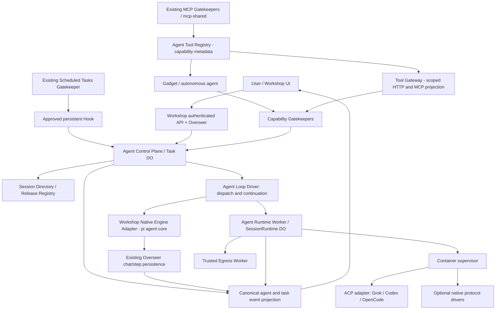
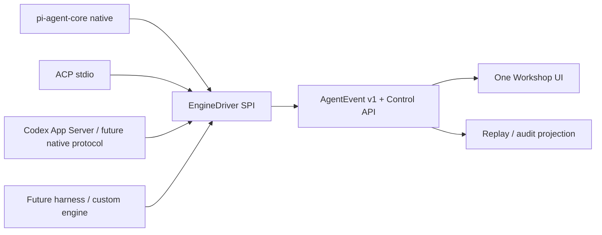
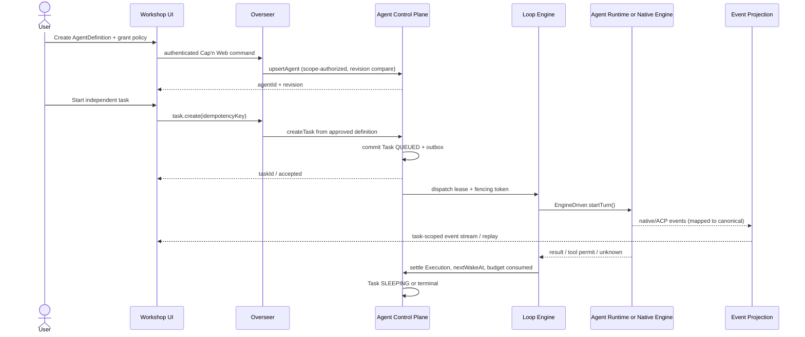
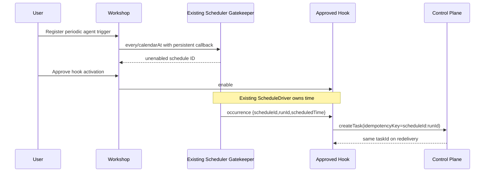
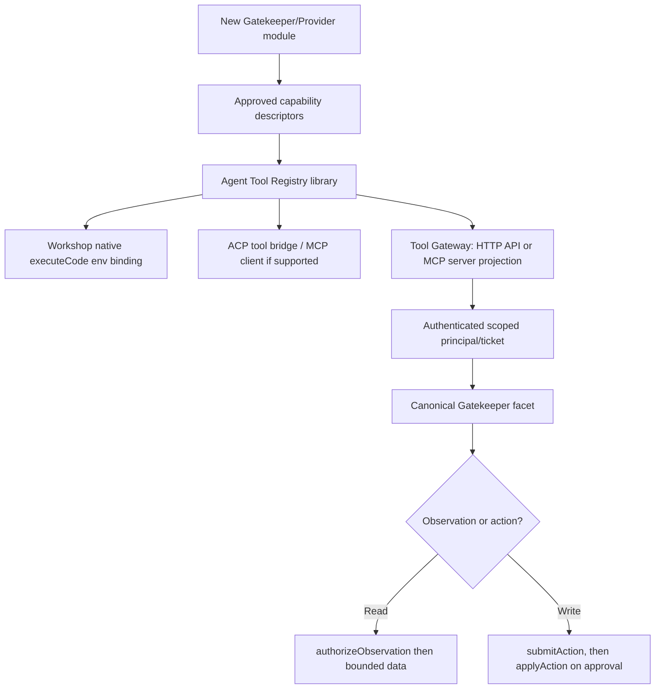

# Unified Agent Platform v2 — Specification

> **Architecture-correction note, 2026-10-13:** The [existing module ownership audit](./EXISTING_MODULE_BOUNDARIES_AUDIT.md), root SPECS.md §23, and actual Workshop/Gatekeeper code take precedence over speculative target ownership in this earlier v2 design. The 15 new package directories are documentation-only; module adoption is subject to no-overlap gates.

**Status:** TARGET DESIGN / IMPLEMENTATION PENDING. **Date:** 2026-10-13. **Normative dependency:** [ACP_CONTRACTS_V1](./ACP_CONTRACTS_V1.md) for legacy ACP-run envelopes; this document governs the extended agent/task/engine/tool abstraction. Where the two disagree on agent/task concepts, migrate the old contract with versioned compatibility, never silently reinterpret stored v1 rows.

## 1. Why alignment is required (verified repository behavior)

The Workshop already runs a real, distinct agent engine, not an ACP client:
- `packages/workshop-backend/src/agent.ts` uses `@earendil-works/pi-ai` and `@earendil-works/pi-agent-core` `runAgentLoopContinue`. It implements `runAgent`, tools, executeCode through capability bindings, durable step barriers and compaction.
- `packages/workshop-backend/src/overseer.ts` owns authoritative chat history, one turn per chat, queued callable-agent invocations, alarms, replay, approval queue and restart/reconstruction.
- `packages/workshop-shared/src/api.ts` already defines `AgentSpawnerConfig` and `newAgentSpawnerGatekeeper()`. A spawned chat gets a snapshot of explicitly granted `env` resource bindings, not broad workspace authority.
- `packages/gatekeeper-scheduler` already implements `ScheduleSession.every/calendarAt/runAt` through approved persistent hooks and a Durable Object alarm, with retry and occurrence IDs. **Do not create a second cron scheduler.**
- `packages/mcp-shared`, `gatekeeper-mcp` and `gatekeeper-mcp-portal` already implement MCP client connections, OAuth, scope, discovery, classification, action queue and observer restrictions. **Do not create a second MCP client trust model.**

Therefore the new architecture is a **shared domain contract and adapters around existing mechanisms**, not a wholesale migration of the Workshop's chat/agent loop into ACP.

## 2. Topology and ownership



**Authorities are not merged.** Workshop/Overseer owns identity, sharing, existing chat/step history and action approval; Control Plane owns AgentDefinition, independent Task, Trigger link, lineage, task-level run orchestration and budgets; Runtime DO owns CLI session, subprocess, operations and its event sequence; ScheduleDriver owns time recurrence and hook delivery; Gatekeepers own scoped tool-resource access and approval; Agent Tool Gateway owns protocol presentation only.

The UI reads one **canonical event model** but event provenance and storage remain authoritative in their respective subsystem. No cross-DO transaction is assumed.

## 3. One language, multiple protocol transports

Define **Agent Control Contract (ACC) v1**, a platform semantic contract, in `packages/agent-protocol`. It is NOT a competing wire protocol and is NOT ACP. It consists of:
1. Validated TypeScript/JSON Schema domain records; stable ID/provenance mapping.
2. A versioned discriminated `AgentEvent` envelope, typed tool/command/subagent/usage/approval payloads; replay/cursor semantics.
3. Engine SPI (`EngineDriver`) with `describeCapabilities, prepare, startTurn, submitInput, cancel, observe, reconcile, checkpoint, shutdown`. A driver MUST expose native capabilities and unsupported operations explicitly.
4. A versioned control RPC vocabulary (`agents.*, tasks.*, runs.*, loops.*, events.*, tools.*`) projected to existing Workshop Cap'n Web RPC for browser/Gadgets and narrow REST/MCP surfaces where granted.
5. A capability-aware projection for UI: general events + `protocolExtension` namespaced payload, declared schema and permission. Unknown extension stays opaque, labeled unverified; no silent discard of operationally significant messages.



Keep `acp-core` as ACP framing/protocol library, consumed by ACP drivers. The Workshop native engine does NOT speak fake ACP. It implements the SAME `EngineDriver`/event/control **semantics**, retaining its own pi provider/tool primitives. A future native Codex/Grok transport implements a new driver without changing the UI contract. Protocol extensions and passthroughs are always namespaced, validated and capability-gated.

### Engine capability handshake

```typescript
type EngineDescriptor = {
  v: 1; engineId: string; engineKind: "workshop-native"|"acp-cli"|"native-cli"|"custom";
  transport: "in-process"|"stdio-jsonrpc"|"private-rpc"|"provider-native";
  supportedProtocolVersions: string[]; modes: string[]; models: string[];
  capabilities: {
    prompt: boolean; sessionResume: "none"|"files-only"|"protocol";
    tools: boolean; terminal: boolean; files: boolean; git: boolean;
    subagents: "none"|"native"|"platform"|"both";
    approvalRequests: boolean; cancel: boolean; checkpoint: boolean;
    commands: string[]; extensions: {namespace:string;schemaRef:string}[];
  };
};
type AgentEventV1 = {
  schemaVersion: 1; eventId: string; agentId: string; taskId: string|null;
  executionId: string|null; runId: string|null; parentRunId: string|null;
  source: {engineId:string; transport:string; nativeSessionId:string|null; nativeEventId:string|null};
  streamId: string; sequence: number; occurredAt: string;
  visibility: "owner"|"authorized-observer"|"private-diagnostic";
  kind: "state"|"message"|"reasoning.summary"|"tool"|"command"|"approval"|
        "subagent"|"file"|"artifact"|"usage"|"heartbeat"|"checkpoint"|
        "protocol.extension"|"diagnostic";
  payloadVersion: number; payload: Record<string,unknown>;
};
type AgentCommandV1 =
  | {kind:"prompt";parts:InputPart[]}
  | {kind:"cancel";targetRunId:string}
  | {kind:"pause"|"resume"|"stop"}
  | {kind:"changeModel";modelId:string}
  | {kind:"approveTool";approvalId:string;decision:"approved"|"denied"}
  | {kind:"sendTerminalInput";terminalId:string;bytesBase64:string};
```

**Event ordering:** the source may generate different ID/sequence spaces; the projection assigns a stable stream sequence and stores `(source stream,source event id)->projection event id` dedup mapping. Task-level projection must not rewrite Runtime DO's persisted event sequence. A projection cursor may include a source offset vector to recover after a partial pump. Presence of a native protocol method in `commands` does not itself authorize use.

## 4. Agent, tasks, autonomous loops and subagents

```typescript
type AgentDefinition = {
  schemaVersion:1; agentId:string; workspaceId:string; ownerPrincipalId:string;
  displayName:string; instructionsRef:string; preferredEngineId:string;
  harnessId:string|null; profileId:string; defaultModelId:string|null;
  grantsRef:string; toolCatalogVersion:string; loopPolicyId:string;
  maxConcurrentTasks:number; maxChildDepth:number; maxTotalChildren:number;
  budget:{currency:"USD";maxCostMicros:number;maxTokens:number;maxWallMs:number};
  status:"DRAFT"|"ENABLED"|"PAUSED"|"ARCHIVED"; revision:number; createdAt:string; updatedAt:string;
};
type Task = {
  schemaVersion:1; taskId:string; workspaceId:string; agentId:string;
  source:{kind:"user-chat"|"api"|"schedule"|"hook"|"webhook"|"parent-agent";sourceId:string};
  parentTaskId:string|null;rootTaskId:string;depth:number;
  inputRef:string; grantsSnapshotRef:string; engineReleaseId:string;
  state:"QUEUED"|"CLAIMED"|"RUNNING"|"WAITING_APPROVAL"|"SLEEPING"|
        "PAUSING"|"PAUSED"|"CANCELLING"|"SUCCEEDED"|"FAILED"|"CANCELLED"|"OUTCOME_UNKNOWN";
  revision:number;lastExecutionId:string|null;nextWakeAt:string|null;
  currentLoopIteration:number;createdAt:string;updatedAt:string;completedAt:string|null;
};
type Execution = {
  schemaVersion:1; executionId:string;taskId:string;engineId:string;runId:string|null;
  attempt:number;fencingToken:number;leaseUntil:string|null;
  startedAt:string|null;completedAt:string|null;
  outcome:"PENDING"|"SUCCESS"|"FAILED"|"CANCELLED"|"UNKNOWN";
  checkpointId:string|null;
};
type Trigger = {
  schemaVersion:1; triggerId:string;agentId:string;
  kind:"manual"|"approved-schedule-hook"|"authorized-webhook"|"external-event";
  hookBindingId:string|null;sourceId:string;enabled:boolean;revision:number;
};
type LoopPolicy = {
  schemaVersion:1;loopPolicyId:string;kind:"single-turn"|"until-done"|"periodic"|
    "reactive"|"plan-execute"|"custom";
  maxIterationsPerTask:number;maxStepsPerWake:number;maxConsecutiveErrors:number;
  minSleepMs:number;maxTaskWallMs:number;
  termination:{kind:"result"|"time"|"iteration-limit"|"manual"|"budget"|"predicate";configRef:string|null};
};
type Delegation = {
  schemaVersion:1;parentTaskId:string;childTaskId:string;
  toolGrantsRef:string;budgetReservedMicros:number;spawnOperationId:string;
  state:"REQUESTED"|"AUTHORIZED"|"SPAWNED"|"DENIED"|"COMPLETED";
};
```

**24/7** means durable scheduling, continuation and monitoring, **not** one HTTP request or Container held open forever. A persistent agent can register approved schedules/react to events; each bounded execution may checkpoint, sleep and resume. Budgets, stop conditions, per-wake step/time limits, human pause, revocation and watchdogs are mandatory. No infinite spin, recursive subagent explosion, indefinite orphaned container or unlimited spend. If work must truly use a continuous live process, use runtime leases/heartbeat and explicit lifecycle TTL with supervisor reconciliation.

**Subagents:** child tasks are first-class persisted tasks, not merely a line in an ACP transcript. A native harness subagent must be observed and mapped to a parent-child graph if the protocol exposes identifiers; missing native identifiers result in read-only display of observed internal activity, never invented controllable child IDs. Platform-spawned children obtain a new Task/Execution, depth/maxChildren limits, a **strict intersection** of parent grants and explicit child grants, reserved budget, independent cancellation/replay. Parent cancellation policy determines whether it cascades; never assume all native subagents can be stopped.

## 5. State/sequence flows





**Reconciliation:** an accepted Task claim is durably recorded before external dispatch. After unknown dispatch, mark UNKNOWN and reconcile native evidence rather than re-send blindly. A DO alarm or dedicated dispatcher may scan due work with bounded batches, but it does not duplicate recurrence calculation already owned by ScheduleDriver. New self-continuation wakeups are task-owned, not scheduled Gatekeeper hooks.

## 6. Tool, external APIs and MCP module system



- Existing Gatekeeper is the **authority** for resource grant, observer verification, OAuth, audit and approval. A tool descriptor is metadata, never a capability.
- A service package can expose native Cap'n Web session, described REST endpoints and/or MCP tools by declaring a versioned `ToolManifest` and adapter; publication does not grant access.
- Reuse `mcp-shared` and existing MCP Gatekeepers for **consuming** third-party MCP endpoints. The new Tool Gateway concerns **exporting** selected Cloudflare OS capabilities as REST/MCP to authenticated external clients or to approved harness MCP clients.
- Never deserialize an RPC stub into JSON; gateway resolves a narrowly bound session-capability at request time under Workshop principal authorization. No web URL directly accesses the runtime DO.
- Capability-scoped API tokens with audience, TTL, tool/verb/resource scopes, revocation and rate limits. MCP `tools/list` filters by current grants; `tools/call` uses EXACT same action/observation enforcement as native calls. Remote metadata is untrusted; no false read-only promotion.
- Require deterministic idempotency and outcome handling for action calls; do not "auto-approve" because protocol is MCP or an agent called it.

## 7. UI views and native protocol extensions

One unified Agent detail view: overview/configuration, tasks, sessions/turns, history, timeline, subagent tree, terminal (Computer grant), files/Git, tool invocations, approvals, usage/budgets, schedules/triggers, heartbeats/recovery and release provenance.

Projection rules: text deltas, thinking summaries, commands/tool status, file edits, git diffs, subagent ancestry, model/mode, user notifications and native protocol extensions are normalized to AgentEventV1 plus declared extension. Renderers MUST escape untrusted content, ask for grants before terminal/file operations, and visually distinguish unverified native events from controllable platform children. An unsupported UI control is disabled with reason; protocol details remain inspectable to authorized operators in redacted diagnostic form.

## 8. Deployment units and packages

| Package | Kind | Owns | Must reuse |
|---|---|---|---|
| `agent-protocol` | library | ACC schemas/event mapping/EngineDriver SPI | workshop-shared RPC semantics |
| `agent-control-plane` | Worker + Agent/Task DOs | AgentDefinitions, Tasks, graph, budgets, triggers | Workshop identity |
| `agent-loop` | library/driver | bounded loop strategies and continuation decisions | existing pi engine rather than rewrite |
| `agent-harness-native` | adapter | pi-agent-core/Overseer compatibility | workshop-backend/src/agent.ts |
| `acp-core` | library | ACP JSON-RPC transport | protocol core for ACP only |
| `agent-harness-grok/codex/opencode` | adapters | versioned CLI/native drivers | ACC and ACP where applicable |
| `agent-harness-registry` | library | manifests + immutable release selection | Session Directory |
| `agent-runtime` | Worker/DO/Container | CLI execution and checkpoint | source generation fencing |
| `agent-egress` | private Worker | provider network authority | Grokbot tested interception |
| `agent-tool-registry` | library | manifest + discovery + scoped projections | Gatekeeper capability policy |
| `agent-tool-gateway` | Worker | authenticated REST and MCP *export* | mcp-shared and Gatekeepers |
| `gatekeeper-coding-agents` | Worker | narrow agent/task capabilities | existing approval/observation queue |
| `gatekeeper-computers` | Worker | sandbox Computer capabilities | terminal + file constraints |
| `gatekeeper-scheduler` | EXISTING Worker | approved cron/interval/one-shot hooks | do not replace |
| `mcp-shared + gatekeeper-mcp/portal` | EXISTING modules | MCP *import*, OAuth and trust | do not fork |
| `workshop-backend/shared/frontend/router` | EXISTING kernel/UI | identity/control integration | preserve current API compatibility |

**Deployment rule:** a library has no Wrangler config; only independently published Workers get `cloudflare.config.ts`, generated `wrangler.jsonc`, migration tags and release manifest entries. Any new Gatekeeper must follow `.agents/skills/write-gatekeeper/SKILL.md` and have its agent-facing capability interface reviewed before implementation.

## 9. Migration evidence and acceptance

- Preserve Grokbot `docs/FEATURE_SPEC_V1.md` F-001..F-017 and PR #1 source plus staging E2E in the traceability matrix; source features are not proof of target implementation.
- Port Grokbot process supervisor, ACP smoke fixtures, generation fences, signed terminal permits, model allowlists, file root safety and streaming behavior; deliberately reject old Next.js/Postgres auth/session authority.
- Distill Hub ACP manager/stdio, Codex App Server and harness catalog behavior; bridge must be tested rather than presumed equivalent.
- Preserve current Workshop `runAgent` tool set, executeCode bindings, change commit barriers, chat compaction, legacy AgentSpawner callable semantics, queued callbacks and approval/observer checks.
- Preserve existing Scheduler's persistent-hook approval, occurrence runId, timezone/DST handling and retry/dead semantics.
- Preserve existing MCP endpoint pinning, OAuth, BYO versus vetted portal trust, owner-only observer behavior, readOnlyHint classification and staged write approval.

Every implementation plan must include source commit/path, target path, schema migration, negative security test, real Cloudflare staging proof and explicit go/no-go. No 24-hour autonomous runner is done until pause/resume/revocation/budget exhaustion, duplicate scheduling and crash reconciliation work without human browser presence.

## 10. Decisions still requiring implementation-time validation

1. Exact durable storage placement of AgentDefinition/Task/Execution and service bindings; avoid double authority with Overseer. Cross-DO outbox/saga is required.
2. Native pi agent-core event mapping and whether current `runAgent` can be wrapped without invasive kernel refactor; benchmark against existing chat UX.
3. Actual supported ACP/native protocol versions and permissions/subagent event structures for pinned binaries.
4. Exported MCP server transport, authentication and revocation semantics at the Tool Gateway; do not assume existing MCP **client** functionality is a server.
5. Runtime budget accounting and continuous process/container limits.
6. Release names and router bindings must be reflected in generated deployment config and release manifest before claiming deploy readiness.

## 11. Multiagent MCP PDR alignment — responsibility audit

**Review addendum (2026-10-13), design-only:** [Code/source ownership inventory](./MULTIAGENT_RESPONSIBILITY_AUDIT.md), [coordination delta contracts](./MULTIAGENT_MCP_CONTRACTS_V1.md) and [implementation gates](./MULTIAGENT_MCP_IMPLEMENTATION_PLAN.md) supersede any separate proposal for `agent-directory`, `agent-goals-tasks`, `agent-automation`, `agent-audit`, `mcp-domain-gateway` or a parallel primary Agent UI.

PDR business deliverables are `WorkItem` + Goal/DAG/review, **distinct** from this spec's Control Plane engine execution `Task`/`Execution`. Workboard records, scheduling admission correlation and continuity projection belong in `agent-control-plane`, not another Agent/Task authority. Public `task.*` MCP methods are versioned Tool Registry **WorkItem aliases**, not implicit v2 execution Task access. ACC remains the cross-engine event projection; private outbox facts are not a second event language. Mailbox channels/offline receipts are a bounded gap distinct from Overseer chat/callable callbacks; structured workspace facts are conditional on a Context reuse/security gate. Existing tool gateway, Scheduler, Observability, notification service and Agent Sessions UI are reused.

No runtime status claims change because of this addendum. Every future implementation must preserve current native pi agent-core/Overseer behavior and the existing ACP, Gatekeeper and Scheduler compatibility tests.
