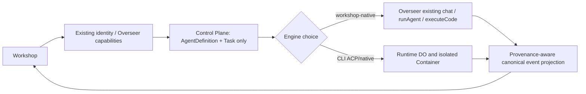
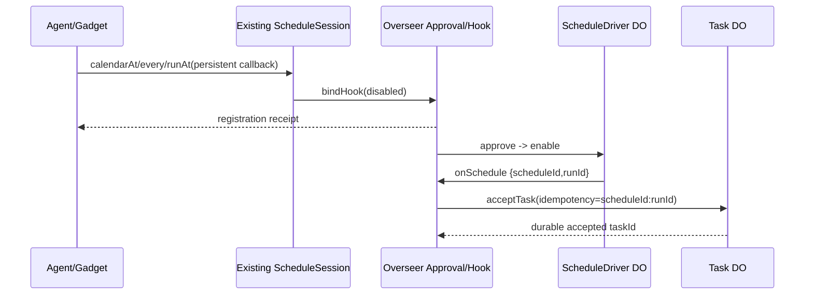
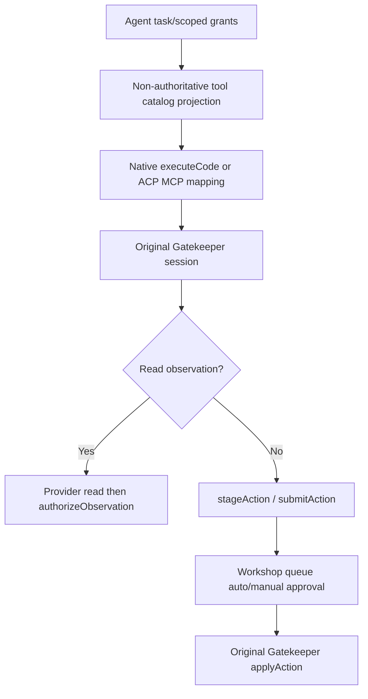

# Audit of existing modules and no-overlap boundaries — 2026-10-13

> **SUPERSEDED AS ACTIVE IMPLEMENTATION PLAN — 2026-10-13:** [ROADMAP](../../ROADMAP.md) authorizes only Grok-in-Cloudflare-Container + existing Workshop chat in Phase 1. This page is **historical research, migration backlog or earlier audit snapshot**, not permission to implement any removed package. See [simplification decision](./SIMPLIFICATION_DECISION.md). Existing security contracts in root SPECS.md remain authoritative.

**Status:** architecture review and corrective decisions; no executable implementation. **Reviewed branch:** `brasalabs6/cloudflare-os@9ad57f68ca1eb6f2e2c2ee313c4ff95d0d503a25`. **Requested by:** [user input U-008](./USER_INPUT_LEDGER.md). Root `SPECS.md` remains the highest-level platform normative contract; this review must be reconciled with it before implementation.

## 0. Evidence standard and exact inventory

A recursive Git tree review found **47 package directories**, of which **32 have package.json** and **15 have only SPECS.md and plan.md**. The 15 new paths are proposals, not runnable packages, not workspace packages, and not deployable Workers. Among the 32 existing packages, **20 have wrangler.jsonc** (potential Worker deployables, with generated config). The package-name prefix alone is not evidence of a Worker. Existing root specs inventory describing "32 packages" covers the original implemented packages, not the 47 current directories.

**Code-level inspected:** Workshop native agent and its pi-agent-core loop, Overseer, AgentSpawnerBinding type and callback implementation, shared API/Gatekeeper definitions, auto-approval, existing Scheduler DO+types, MCP classification, action kit, external message ingress, router, AI Gateway, notifications, Git worktrees, Context Library, tracing and release manifest. **Spec-level inspected:** existing Gatekeepers and utility packages below. Not every method of every provider was audited line-by-line: those remain integration test targets. This distinction matters; the matrix must not imply a security certification.

## 1. Existing module catalog: 32 actual packages

| Existing package | Responsibility confirmed by source/spec | How agent platform MUST reuse it |
|---|---|---|
| `workshop-backend` | Kernel, user/workspace DO, Overseer, agent chat/turns, approvals, sharing, Gateway, notifications, Git worktrees | Only authority for native Workshop chat, per-workspace sharing, native tool/change transactions and AuthenticatedApi |
| `workshop-shared` | Cap'n Web API ABI, Gatekeeper vendor/user/session/approval, AgentSpawnerConfig, external message contracts | Human/Gadget-facing API definitions; never define competing browser transport or clone session type |
| `workshop-frontend` | Existing React/Kumo shell, chat, provider, events, permissions, devices and shared routes | Add agent/task views as feature slices, reuse RPC/auth and approvals |
| `router` | Paths `/api/*` and `/gatekeeper/*`, assets, Email Routing; discovers bound Gatekeepers | Extend only explicitly for a new authenticated HTTP/MCP *export* ingress |
| `gatekeeper-kit` | OAuth/nonces/credential staging, action journal, simulation, observer handling, persistent hooks, common safe HTTP | Use existing mechanisms; no second action ledger or observer engine |
| `gatekeeper-scheduler` | ScheduleSession every/calendarAt/runAt, approved persistent hooks, ScheduleDriver DO/alarms, timezone/DST, stable runId | Owns **all external recurrence and hook activation**; task runner only consumes verified occurrences |
| `mcp-shared` | MCP CLIENT, OAuth, endpoint/SSRF, catalog, BYO/vetted tool classification, actions | Sole import/OAuth/trust classifier for MCP; do not clone inside tool registry |
| `gatekeeper-mcp` | User-selected BYO MCP endpoint, selected tool scopes, owner-only sharing, queued writes | Tool Registry projects allowed tools from its scoped session |
| `gatekeeper-mcp-portal` | Admin-configured portal, selected upstream serverId, live trust and endpoint repoint | Preserve separation from BYO connector; no portal-wide tool grant |
| `gatekeeper-context` | Durable context documents/skills, ambient catalog and management UI, sharing-domain boundaries | Agent memory/skills source; NOT new AgentDefinition store or global semantic memory clone |
| `gatekeeper-cloudflare` | User Cloudflare login, billing and Workers observability scoped reads | Reuse identity/telemetry grants; no new provider credential surface |
| `gatekeeper-github` | GitHub OAuth, repo/issues/PR resources, Git integration, gated mutations | Use to access remote repos, not anonymous Git HTTP or unscoped container GitHub tokens |
| `gatekeeper-gitlab` | GitLab OAuth, projects/issues/MRs, Git integration | Same as above, preserving provider-specific scope |
| `gatekeeper-google` | Google identity + Gmail/Docs/Drive/Calendar capability scopes | Reuse account-based tools/hook mechanisms, not a new Google adapter |
| `gatekeeper-email` | Deployment-local mailbox and inbound mail hooks, delivery authorization | Email-based task triggers must go through existing enabled hooks |
| `gatekeeper-slack` | Scoped Slack workspace/conversation/thread read/search | Existing observation enforcement; don't construct independent Slack MCP authority |
| `gatekeeper-notion` | Page/database/workspace scoped Notion OAuth, queued changes | Expose as authorized capability, not direct token |
| `gatekeeper-linear` | Linear workspace/team/issue GraphQL provider | Connector remains resource/scope owner |
| `gatekeeper-confluence` | Atlassian Confluence site/space/page capability | Connector remains read/action owner |
| `gatekeeper-supabase` | Project/organization introspection and bounded SQL read/write distinctions | SQL must never bypass staged action/authorized observation via agent tools |
| `gatekeeper-homeassistant` | HA instance/device/entity/service scopes with sensitive long-lived token | Agent tools may use only specifically granted resource operations |
| `gatekeeper-zoominfo` | B2B intelligence, enrichment credit-consuming operations | Tool invocation must preserve provider cost/credit and auth policy |
| `gatekeeper-x` | X account/post/list/profile, OAuth and mutating approval restrictions | No generic tool registry override of service-specific automation rules |
| `gatekeeper-spotify` | Spotify account/playlist/library/playback OAuth capabilities | No direct provider credentials in container |
| `observability` | Shared logger/trace/metrics/context, no durable authority | Emit correlated run/task metrics here, not second telemetry SDK |
| `error-reporting` | Shared typed error event shape | Reuse bounded structured diagnostics instead of new global error collector |
| `typed-storage` | Typed DO KV/collection/index/transaction helpers | Evaluate before introducing raw SQL or a second storage abstraction in Workshop-side DO |
| `bundled-blueprints` | Build-time reviewed Blueprint source artifacts | Do not turn into agent code registry or deployment scheduler |
| `ui` | Shared React controls and Kumo composition | Reuse UI controls for task timelines/trees/approvals |
| `configurator-ui` | Gatekeeper resource configurator ABI and sandbox forms | Resource selection UI uses existing configuration patterns |
| `integration-tests` | Worker and Gatekeeper RPC integration harnesses | Extend with native/CLI/task/approval/MCP end-to-end fixtures |
| `workshop-evals` | Agent model/behavior evaluation | Add protocol parity and autonomous-task evaluations, not new runtime |

**Other existing code with authority (not independent packages):** `workshop-backend/src/agent.ts`, `overseer.ts`, `agent-compaction.ts`, `auto-approval.ts`, `ai-gateway.ts`, `ai-models.ts`, `git-binding.ts`, `worktree-session.ts`, `notification-service.ts`, `external-message-gateway.ts`, `slash-commands.ts`, `gatekeeper-scheduler/src/schedule-driver.ts`, `mcp-shared/src/tools.ts`, `gatekeeper-kit/src/actions.ts` and `scripts/release/manifest-lib.ts`.

## 2. Overlap findings and revised boundaries (decision register)

| ID / severity | Previous spec risk | Evidence and current owner | Corrective decision |
|---|---|---|---|
| **B01 P0** | A new Agent Runtime or Agent Control Plane could directly execute/replay native Workshop turns | `workshop-backend/src/agent.ts` uses `runAgentLoopContinue` and `AgentHooks.commitAgentStep`; `overseer.ts` owns chat/activeAgent/recovery | Native turn execution, message private state, Git edit barriers, compaction and permissions stay in Overseer. Native ACC adapter is a thin **integration projection**, not an independent second runner |
| **B02 P0** | A new agent-spawning API could replace durable callable agents | `agent-spawner-binding.d.ts` `spawn` and `spawnCallable`; Overseer `deliverAgentCallback`; `AgentSpawnerConfig` in shared API | Preserve callable stub and argument semantics; optional Task link uses a stable operation/callback ID and cannot assume a callback delivers final outcome |
| **B03 P0** | New AgentLoop/Trigger scheduler duplicates Scheduler | `gatekeeper-scheduler/src/schedule-driver.ts` and `scheduler.ts` own alarms, hook enable, retry, calendar/DST and stable runId | Existing Scheduler exclusively calculates *external occurrence times*. Task DO may own its own **internal continuation wake** after an accepted task, never replicate calendar scheduling |
| **B04 P0** | New ToolRegistry/MCP gateway can reclassify tool effects | `mcp-shared/src/tools.ts` `classifyTool` and `gatekeeper-kit/src/actions.ts`; Gatekeeper `submitAction/authorizeObservation` | Tool Registry is a **read-only index/projection** of current grants/types/capabilities, not an authority or tool policy engine; execution calls original scoped Gatekeeper |
| **B05 P0** | Direct task/tool API could bypass approval/security via HTTP | `workshop-shared/src/gatekeeper.ts`, Workshop `authorizeCollaborator`, `router/src/index.ts` | User REST/MCP is a narrow *transport projection* onto authenticated Workshop/Gatekeeper capabilities. No direct web access to Task/Runtime DO. Gatekeeper action is staged until apply |
| **B06 P0** | General ingress might reuse a trusted internal gateway with forged identity | `workshop-shared/src/external-message-gateway.ts` explicitly trusts `callerEmail` supplied by gateway binding | **Never** expose ExternalMessageGateway to untrusted public MCP/REST callers. New ingress uses separate audience-bound authenticated credentials and identity resolver |
| **B07 P0** | AgentDefinition/Task share data authority with Workspace native chat | Overseer owns chat IDs/turns, original SessionRuntime spec owns CLI run/session, scheduler owns schedules | Control Plane owns **new** AgentDefinition and independent Task/Execution/lineage only. References existing chatId/scheduleId/CLI runId; no second copies of authoritative records |
| **B08 P0** | Grok/Codex approval callbacks conflated with Workshop actions | Gatekeeper actions queued, ACP `session/request_permission` synchronous and scoped to tool call | Separate approvals: Workshop action approval (capability mutation), ACP tool approval (in-container call), Computer grant (terminal/files). Explicit correlation and deny-on-expiry |
| **B09 P1** | ACC falsely advertised as universal wire protocol / duplicated Workshop ABI | `workshop-shared/src/api.ts` is Cap'n Web; native pi events differ from ACP JSON-RPC | ACC is semantic **domain/event vocabulary**; Workshop-shared stays browser RPC, ACP stdio stays ACP, native App Server uses its own transport via driver |
| **B10 P1** | A new agent catalog collides with Gatekeeper catalogs, context and slash commands | `Gatekeeper.getAgentCatalog`, `getTypeScriptTypes`, `getSlashCommandProvider`, `gatekeeper-context` context and `mcp-shared/catalog.ts` | Compose *views* from extant per-resource catalogs and scopes; keep catalog provenance/revision and do not make index authoritative |
| **B11 P1** | Two unrelated Git state implementations treated as one | Workshop `git-binding.ts`/worktree uses content-addressed chat Git overlays; CLI containers have physical Linux repositories | Explicit Git adapter/transfer boundary: metadata and snapshots linked but not silently mapped to the same repo/worktree; GitHub/GitLab remote authority in their Gatekeepers |
| **B12 P1** | Duplicate inference provider registry, credentials and spend accounting | `workshop-backend/src/ai-models.ts`/`ai-gateway.ts` own native model config, tokens/usage, credential retrieval | Agent Egress is *container network boundary only*; reuse policy/model aliases and normalized usage reporting with native Workshop. Do not replace native AI provider path |
| **B13 P1** | Duplicate notifications/diagnostics | `notification-service.ts`, `observability`, `error-reporting` and UI notification components | Reuse existing notification service/typed templates and observability; only add task-specific correlations and approved template/API additions |
| **B14 P1** | User-facing release IDs mixed with deployment build manifests | `scripts/release/manifest-lib.ts` and Cloudflare config generation own deployment manifests; harness registry defines session release pins | Distinguish **platform deployment release** vs **agent engine/image release**, with compatibility mapping, no alternate build/deploy pipeline |
| **B15 P1** | New protocols/tools imply all features are available | Native engine has executeCode; ACP harnesses have differing negotiated capability sets | Feature matrix = native capability ∩ adapter support ∩ runtime profile ∩ principal grants. Versioned extensions preserve detail; no invented controllable native child |
| **B16 P0** | Package specs imply deployable/implemented services | 15 new directories contain only `SPECS.md` and `plan.md`, no package.json, src, Worker entrypoints or wrangler config | Stop calling them implemented packages; all 15 remain **DOC_ONLY** until package build/config, tests and deployed Worker where relevant |
| **B17 P1** | New reusable agent library duplicates skills or prompt context storage | `gatekeeper-context` already owns Context Library/Skills and scope | AgentDefinition stores an instructions/context **reference** and explicit grants; knowledge documents remain Context Library resources |
| **B18 P1** | Duplicate hooks for email/Slack/webhooks or streaming | `gatekeeper-email` has persistent hooks; `external-message-gateway` and `gatekeeper-kit/hook-delivery-queue` already provide asynchronous ingress patterns | Use existing provider hooks for event triggers. A future webhook receiver is a reviewed narrowly authenticated Gatekeeper/ingress, not a generic write-any-task shortcut |
| **B19 P0** | Shared agent changes break code-mode isolation | Workshop dynamic Gadget WorkerLoader and protected `executeCode` tool own ephemeral worktree edits | Container shell permissions must never become ambient Code Mode capabilities, and existing Gadget Worker sandbox must not be replaced by Linux container execution |
| **B20 P1** | New schema/routing specs circumvent canonical spec precedence | Root `SPECS.md` says root > package > public ABI > tests, and `workshop-shared` has reviewed RPC types | Update root contract first, reconcile subordinate docs, then make minimal ABI changes and gate any breaking change with migrations and tests |

## 3. Definitive ownership of data and commands

| Object/concern | Sole writer / authority | Read/reference consumers | Must not write |
|---|---|---|---|
| User identity, workspace collaborator roles | User DO / Overseer (Workshop) | Control Plane, Gatekeepers, Runtime via scoped invocations | AgentDefinition DO, browser, raw ACP payload |
| Native chat, callback queue, model private reasoning, compaction, worktree change barrier | Overseer DO | Native ACC projection, Task read-model | Task DO, SessionRuntime DO, external MCP |
| New AgentDefinition/revision | Agent Control Plane (workspace-authorized) | Workshop, Gatekeepers, registry | Native chat store, Tool Registry, Scheduler |
| Independent Task, task state/iteration, task parent/child graph, spend reservations | Task DO | Workshop UI, Loop strategy, Gatekeepers | Native agent adapter, SessionRuntime DO, Scheduler |
| Scheduled recurrence/hook enable, occurrenceId | Existing ScheduleDriver/Overseer hook lifecycle | Task trigger link | Agent Loop, Task DO |
| CLI agent session, run and actual container generation | Agent Runtime SessionRuntime DO | Task DO as correlated external attempt, ACC projector | Overseer, Tool Registry, Scheduler |
| Native engine turn and result | Existing Overseer | Task DO as correlated attempt | Agent Runtime Container |
| Gatekeeper resource, scopes, external OAuth credentials, action stage/apply/revert, observers | Existing Gatekeeper + Overseer approval queue | Tool Registry index + Gateway projection | Tool Gateway, Agent Control Plane |
| ACP/native child activity | Native harness/supervisor source of truth | ACC observational events | Task graph (unless a new platform child Task is authorized/persisted) |
| Platform child task grant/budget/cancellation | Task DO via approved parent | Native/ACP engine bridge | Native subagent metadata, model/tool prompt |
| Model/provider config for native loop | Workshop user/admin AI model registry | Native engine, Egress mapping if shared policy approved | Agent Harness Registry |
| Container outbound credentials and network allowlist | Trusted Egress Worker | Container supervisor under scoped grant | Container image, Tool Registry |
| Package/Worker deployment metadata | Repo release tooling + generated wrangler | Harness Runtime Release mapping | Agent Control Plane A/B router |
| Agent runtime release assignment | Harness registry / Session Directory | Task DO, Runtime DO | Random per-run selector after session pinned |
| Device notification subscription and authenticated delivery | Existing Workshop notification service | Task projections via narrow typed notification request | New task notification DB |

**Cross-service invariants:** never fake distributed atomic transactions. An admission writes an intent plus outbox before dispatch, linked by idempotency key and fencing token. Every remote action permits `UNKNOWN_OUTCOME`. A running task does not imply CLI run success; callback enqueue ACK is not completion. Replay event projection has its own sequence, preserving native source IDs and source cursors without mutating original histories.

## 4. Corrected package target map: 15 proposals

| Document-only directory | Keep? | Strictly new responsibility | Dependency/implementation placement |
|---|---|---|---|
| `agent-protocol` | KEEP as library | ACC schemas, normalized event adapters and EngineDriver SPI | No Cap'n Web duplication; public client types reviewed in workshop-shared |
| `agent-control-plane` | KEEP but narrow | New agent definitions, independent tasks, lineage, budgets, task wakeups | No native chat/schedule/CLI run authority; Workshop identity checks |
| `agent-loop` | KEEP as **small strategy library** | Outer bounded task continuation decisions | No native pi inner loop and no calendar/time scheduler |
| `agent-harness-native` | KEEP as **thin integration seam** | Map existing native turn/status/events to ACC, reference task | Lives adjacent to existing Overseer hooks; no standalone runtime or new chat store |
| `acp-core` | KEEP | ACP stdio JSON-RPC framing, session methods and protocol negotiation | Does not own universal ACC model or browser transport |
| `agent-harness-grok` | KEEP | Tested Grok CLI protocol adapter / config | CLI specifics only; runtime/proxy elsewhere |
| `agent-harness-codex` | KEEP | Tested Codex ACP bridge or explicitly gated native protocol adapter | Separate genuine native/App Server driver; capability gating |
| `agent-harness-opencode` | KEEP | OpenCode ACP driver / config | CLI specifics only; no parallel auth/session store |
| `agent-harness-registry` | KEEP as metadata library | Runtime engine manifests, verified fixtures, immutable agent release selection | Distinct from Workspace AI model catalog and deployment release pipeline |
| `agent-runtime` | KEEP as Worker/DO/Container | Real CLI process/session/run, PTY, checkpoint, generation | Does not run Workshop pi-agent-core or own Task Definition |
| `agent-egress` | KEEP private boundary | Controlled Container inference/bootstrapping network and Worker-held secrets | Do not replace Workshop native AI Gateway; reuse policy map |
| `agent-tool-registry` | **NARROW** to non-authoritative projection library | Index and canonical descriptor views of already-granted Gatekeepers | NEVER classify or authorize tools; Gatekeeper/mcp-shared sole policy |
| `agent-tool-gateway` | KEEP optional Worker | Transport adapters for public scoped REST and inbound MCP server | No credential minting outside Workshop; same Gatekeeper actions; not outbound MCP client |
| `gatekeeper-coding-agents` | KEEP (API proposal only) | Narrow Gadget/agent capabilities over authorized new definitions/tasks | Review Cap'n Web API before implementation; do not replace AgentSpawner |
| `gatekeeper-computers` | KEEP (API proposal only) | Scoped PTY/files/terminal permissions for CLI sessions | No arbitrary shell from CodingAgents grant; reuse action framework |

### Package minimization gate

Before scaffolding any new package, verify (1) whether it introduces **new authoritative state or protocol/transport** not already owned; (2) whether existing package can expose a thin adapter/export instead; (3) whether a separate independent deploy reduces blast radius **without** giving it duplicated policy; (4) whether tests can prove equivalent security. If not, do not make it an independent Worker. In particular, avoid treating `agent-tool-registry` or `agent-loop` as deployed services or creating a persistent database of tool grants in either.

## 5. Critical workflow decisions

### 5.1 Native chat, autonomous task and CLI sessions are distinct

Native Task`.id` never substitutes for chatId. The adapter only posts accepted task input through a new **reviewed private Overseer capability** or an appropriately authorized existing AgentSpawner; direct calls to `runAgent` bypassing the Overseer are forbidden. Task success requires observed terminal turn evidence, not merely `spawnCallable` queue acceptance.

### 5.2 External schedule creates a task only through approved hooks

The schedule registration is not idempotent (documented in `gatekeeper-scheduler/src/types.d.ts`); the **task admission** is idempotent on `scheduleId:runId`. Avoid duplicate hooks on repeated setup. The user must enable the hook; no direct background task loop may silently register/activate external schedules.

### 5.3 External tool access and subagent delegation

An MCP server label or manifest `readOnlyHint` is **never** enough to bypass the existing `mcp-shared/tools.ts` classification. Tool projection may cache metadata but not grant authority. Native executeCode stubs cannot be serialized to JSON or trusted as a bearer URL. A Task-created subagent gets an intersection of parent grants, a budget reservation and a new execution identity; native harness child events are observational until explicitly controllable.

### 5.4 MCP server export is not MCP client import

- **Import (existing):** `gatekeeper-mcp` and `gatekeeper-mcp-portal` call external MCP endpoints via `mcp-shared` under original Gatekeeper authority.
- **Export (new, optional):** `agent-tool-gateway` may expose a narrow MCP server / authenticated HTTP front-end to selected Workshop capabilities. It MUST negotiate version and authentication, filter `tools/list` by current grants and route `tools/call` to the Gatekeeper action/observation system.
- **Entrypoint hardening:** The existing `ExternalMessageGateway` WorkerEntrypoint accepts `callerEmail` as a trusted binding-owned identity; it MUST NOT be repurposed for public Internet API submissions. Router `/api` currently routes to backend, `/gatekeeper/*` to bindings; adding public prefix requires explicit generated bindings, integration tests and review.

### 5.5 Two kinds of release and two kinds of Git

The platform release generated by `scripts/release/*` packages Worker builds/configuration. The agent release selects a pre-deployed runtime target and pinned image/harness manifest; it has its own ID but cannot invent an independent deployment target. The Workshop Git object store and chat-private worktree overlays are **not the same** as a real checked-out repository inside a Cloudflare Container. Synchronization/import/export is a separate, authorized contract with hashes and source attribution.

## 6. Readiness barriers: no implementation before these gates

- **G0 root authority**: root SPECS coverage table and normative precedence updated, 32 implemented vs 15 docs-only clearly stated.
- **G1 native parity**: characterization tests for Workshop `runAgent`, `AgentSpawner.spawnCallable` queue semantics, callback order, compaction, approval and worktree commits.
- **G2 capability API**: review Gatekeeper CodingAgents/Computers interface FIRST under `.agents/skills/write-gatekeeper/SKILL.md`; maintain narrow per-resource capability and observer contract.
- **G3 ACC schema**: align `agent-protocol` domain types with `workshop-shared` Cap'n Web public ABI, typed events/versions/fixtures and native-to-ACC replay proof.
- **G4 task semantics**: cross-DO Task→Overseer and Task→Runtime outbox, task receipt versus completion, grant intersection, budget, recurrences and UNKNOWN outcomes.
- **G5 MCP**: import policy reused; export server threat model/endpoint route and revocable audience-scoped authentication tested.
- **G6 runtime and legacy distillation**: immutable Grokbot source commit/test evidence, real Cloudflare Container/ACP/effectful tool/CA/egress E2E, then independent Codex/OpenCode pinned fixture runs.
- **G7 operations**: reuse existing observability, notifications, release manifests/config generation, integration/eval harnesses, A/B sticky routing and controlled rollback.
- **G8 archive**: only after immutable source trace and regression evidence; Grokbot is not archived. Closing PRs is not merging them.

## 7. Test suite ownership and explicit negative cases

| Test category | Existing reuse | Added evidence |
|---|---|---|
| Kernel contract and native loop | `workshop-backend` tests + `workshop-evals` | Event projection parity, no double turn, restored callback/grant |
| Approval/security and observer | `gatekeeper-kit`, `integration-tests` | New Gatekeepers (read/action/ACP vs Computer), revocation, sharing |
| Scheduling | `gatekeeper-scheduler` tests, DO alarms | `scheduleId:runId` dedup; hook disabled/revoked; DST |
| MCP tools | `mcp-shared`, `gatekeeper-mcp/portal` | Same trusted BYO classification; export auth, no bypass |
| Worktrees & Git | `workshop-backend` Git/worktree tests | Container repo no silent alias to Workspace worktree |
| Provider/network/billing | `ai-gateway` code and Grokbot staging source | Engine-specific provider auth, policy/quota interception, no secrets |
| Browser UX | `workshop-frontend` existing component/browser tests | Native/CLI parity, subagent display, pending vs succeeded |
| Release routing | `scripts/release` manifest golden tests | New Worker config only after package.json; pin assignments/drain |
| External ingress | ExternalMessageGateway and router | No `callerEmail` impersonation over public MCP/REST |

## 8. Audit limitations

This is a targeted cross-module architecture analysis based on verified source files, package specs, tree inventory and existing staging references. It does not include a full line-by-line security audit of all ~2,000 Git tree entries or a successful build/test run. Existing source functionality can have bugs and must be tested during implementation; **none of the 15 draft packages currently implements the promised runtime**. Full Go/No-Go requires future tests with real Cloudflare Worker/Container, proper deployment credentials and cross-module integration fixtures.
