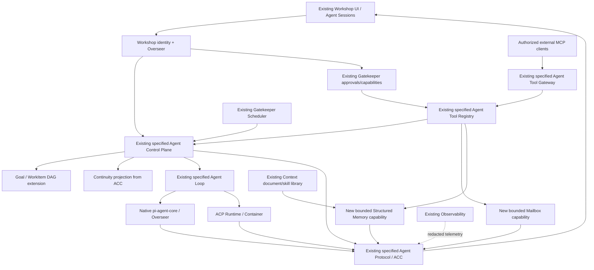

# Multiagent MCP — integration architecture (Unified Agent Platform v2 extension)

**Status:** revised design proposal; implementation pending. **Date:** 2026-10-13.
**Review baseline:** `main@9ad57f68ca1eb6f2e2c2ee313c4ff95d0d503a25`.
**Normative upstream:** [Unified Agent Platform v2](./AGENT_PLATFORM_UNIFIED_V2.md), [ACC agent-protocol](../../packages/agent-protocol/SPECS.md), [ACP execution contracts](./ACP_CONTRACTS_V1.md) and root [SPECS.md](../../SPECS.md).
**Evidence:** [responsibility and gap audit](./MULTIAGENT_RESPONSIBILITY_AUDIT.md); [PDR mapping and plan](./MULTIAGENT_MCP_IMPLEMENTATION_PLAN.md).

## 1. Corrected architecture decision

Extend **the already-specified Unified Agent Platform v2** to satisfy the attached multiagent MCP coordination PDR. Do NOT add alternative Agent Directory, Agent Goals/Tasks, Automation, Audit or MCP Domain Gateway packages. Their responsibilities already belong to `agent-control-plane`, `agent-loop`, `agent-protocol`, `agent-tool-registry`, `agent-tool-gateway` and existing Workshop/Gatekeeper/observability code.

The first PR draft was authored against an earlier inventory and proposed overlapping package names; those proposals are withdrawn. Existing new v2 components are **specifications only**, not evidence of deployed agent coordination. Scope additions must land in their existing package plans, implementation, schemas and tests.

Only two bounded **potential** new domain capabilities remain:
- `agent-mailbox` — workspace member-to-member durable channels/inbox/receipts, not the existing external-chat gateway or Overseer conversation.
- `agent-memory` — workspace-scoped, structured factual assertions/learning review, not the Context Library document/skill repository; reevaluate co-location with `gatekeeper-context` before authorizing a second persistent store.

Goal/Project/**WorkItem** DAG/review/claim and Continuity Ledger are **extensions inside the control plane**, using ACC event projections. They must not create a second generic `Task`/`Execution` state machine. UI uses the existing Workshop `features/agent-sessions` area.

## 2. End-to-end topology

**Important:** this diagram shows intended wiring; runtime components labelled specified are not yet deployed. Gatekeeper access is capability-scoped, not a blanket one-hop grant from an HTTP token. The Context↔Memory link is authorized read/optional human-reviewed promotion, not raw cross-DO writes. Observability is diagnostic and does not inject canonical state into ACC.

## 3. Exact owner responsibilities

| Owning module | Responsibility / no-duplicate rule |
|---|---|
| Workshop/User DO/Overseer | Human identities, workspace membership/sharing, chat content, native turns, compaction, callable-agent delivery, Gatekeeper actions and existing notifications |
| agent-control-plane (specified) | AgentDefinition, agent/task ownership, run admission, execution `Task` + `Execution`, triggers, subagents and budgets; **new** Goal/WorkItem DAG and continuity projection in this owner |
| agent-loop (specified) | bounded turn/continuation strategies, not recurring calendar schedule |
| agent-harness-native (specified adapter) | maps native pi-agent-core behavior to ACC; never copies chat state |
| agent-runtime / ACP (specified) | CLI session/process/sandbox, generation and run journal; WorkItem review not a run state |
| agent-protocol (specified) | ACC AgentEvent v1 / EngineDriver / projection schema; no second domain event protocol |
| agent-tool-registry (specified) | one ToolManifest and permission-aware discovery/projection catalog |
| agent-tool-gateway (specified) | one authenticated HTTP + MCP **server** export; existing MCP BYO/portal Gatekeepers remain import clients |
| gatekeeper-scheduler (implemented) | approved one-shot/calendar/interval triggers and unique occurrence run IDs |
| gatekeeper-context (implemented) | private/domain-shared document+skill collections and search, authorized agent reads |
| agent-mailbox (NEW capability) | ordered workspace agent/human message channels, offline inbox and ack; no sending arbitrary prompts into Overseer |
| agent-memory (NEW candidate) | workspace factual revisions and reviewed learning proposals, with no duplicate document/skill store |
| Observability (implemented) | metrics, logs and diagnostics, never domain event truth |
| workshop-frontend/features/agent-sessions (specified) | unified UI; expand with Task Workboard, inbox, learning, continuity and event views |

A "module" is an independent contract/policy boundary, not necessarily a separate Worker. The PDR explicitly avoids microservices for every P0 feature. Add deployment units only with a measured reason; package name and `SPECS.md` are not deployment proof.

## 4. Task nomenclature must be collision-free

Unified v2 `Task` = **execution instruction managed by Agent Control Plane**, with `Execution`, run/loop state, engine outcome, budget and unknown-outcome recovery.

PDR "task" = **human/agent deliverable** with goal, dependencies, due/priority, DoD, assignment, exclusive work claim and review. Name the persisted record `WorkItem`, with optional `WorkItemClaim`, `WorkItemDependency` and `WorkItemReview`. One WorkItem may correlate to zero or more execution Tasks. The MCP PDR public tool names `task.*` are **aliases to WorkItem operations** in `agent-tool-registry`, never direct unrestricted access to execution `Task`. Keep `workItemId` vs `taskId` vs `agentRunId` explicit and independent.

Delivery receipt, task review, externally effective provider action approval and ACP tool permission all have distinct semantics. No completion status in one domain may forge completion in another.

## 5. Events, state and mail delivery

Canonical *presentation* is ACC `AgentEventV1`. The owner of each state stores its own idempotency, revisions, journal/outbox records transactionally. Local outbox rows are an internal transport mechanism, not a competing system-wide `DomainEventV1`. The projection consumes redacted facts with source id/cursor/vector, dedupes and exposes an authorized replay stream. Observability metrics remain separate from business history.

Example: Control Plane atomically commits WorkItem assignment and outbox row; Mailbox later persists one notice with consumer `eventId` dedupe and receipt rows; notification delivery uses existing Workshop notification service only via approved typed template/API. Assignment success does not mean delivered, read, or executed. Cross-DO **exactly once** is never assumed.

## 6. Runtime, external agents and 24/7

An external MCP client can poll `task.next`/`message.pull`; MCP does not start its underlying process. The existing Agent Control Plane + Agent Loop, when implemented, will schedule bounded native/ACP runs, with Scheduler's approved hook for calendar time. No second autonomous-loop controller or arbitrary `agent.spawn` MCP tool is added by this proposal.

Long-running agents are persistently eligible for approved triggers and resumable executions, not infinite requests/containers. Subagents use the existing v2 lineage, budget, max-depth and scope-intersection rules; platform children and observed in-harness children are not conflated.

## 7. Implementation and governance

1. Review [responsibility audit](./MULTIAGENT_RESPONSIBILITY_AUDIT.md), [domain delta contracts](./MULTIAGENT_MCP_CONTRACTS_V1.md) and [security](./MULTIAGENT_MCP_SECURITY.md).
2. Implement existing v2 owners and ABI first: ACC, Control Plane, Tool Registry/Gateway, native/harness adapters. Preserve installed Workshop behavior via regressions.
3. Extend Control Plane workboard + continuity. Introduce Mailbox only for verified multiagent inbox gap. Introduce scoped facts/learning only after a Context capability/reuse proof.
4. Integrate into current Agent Sessions UI; avoid a new primary app.
5. Verify original PDR F01–F16/AC01–AC18 and staging negative security/DO failure tests before claiming success.

**This PR only changes docs/contracts.** No deployed runtime, migrations, tools endpoint, or acceptance test success is implied.
