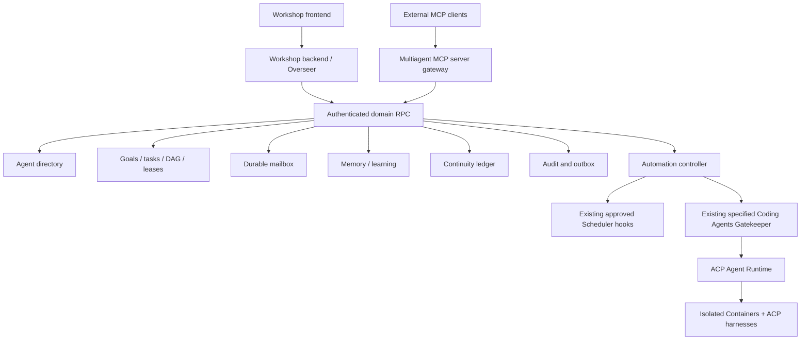

# Multiagent domain platform — Cloudflare OS

**Status:** proposed target architecture; not implemented. **Date:** 2026-10-13.
**Inputs:** the supplied multiagent MCP MVP PDR and technical specs (F01–F16, AC01–AC18), adapted to the Cloudflare OS kernel. **Authority:** root `SPECS.md` > package `SPECS.md` > executable contracts. This document is an integration overview; `MULTIAGENT_MCP_CONTRACTS_V1.md` defines the proposed domain wire/data contracts.

## 1. Decision

Implement domain-oriented, workspace-scoped multiagent coordination as independent Cloudflare OS modules with a shared domain contract and an outbound MCP **server** adapter. The Workshop kernel remains the authority for human identity, membership, capability grants, approvals and workspace lifecycle. Do not create a parallel Next.js identity system, PostgreSQL authority or second orchestration kernel.

- **MCP** is an agent-facing interface for discovering/calling domain tools and reading resources. A connected external MCP client is not necessarily executing or available for push.
- **Cap'n Web RPC** is the existing Workshop/Code Mode integration; first-party callers use the **same** domain services and policy checks as MCP, not separate business logic.
- **ACP** controls managed CLI harness process sessions. The existing `ACP_AGENT_PLATFORM.md` and `ACP_CONTRACTS_V1.md` own session/run state and event semantics; domain task IDs never replace `agentRunId`.
- **Gatekeepers** mediate external data/resources, observations and actions. Generic `gatekeeper-mcp` and `gatekeeper-mcp-portal` are MCP *clients*, not the new server endpoint. A new domain gateway MUST NOT borrow their account credential stores or reinterpret remote annotations.
- **Automation** is logical, bounded and restartable. Task assignment/message receipt cannot itself wake an external client. Managed wakeups require the independently specified ACP runtime; existing `gatekeeper-scheduler` supplies approved hooks/triggers.

## 2. Component diagram



```

## 3. Ownership and boundaries

| Module (proposed package) | Owns / authority | Does not own |
|---|---|---|
| `agent-directory` | Stable agent definitions, workspace grants, instance/presence projections | Workshop user accounts, ACP sessions, raw tokens |
| `agent-goals-tasks` | Goals, projects, DAG, task lifecycle, claims, evidence/reviews, task outbox | Running harness processes |
| `agent-mailbox` | Workspace channels, per-channel ordered messages, recipient receipts | Starting disconnected external agents |
| `agent-memory` | Versioned, sourced workspace memories and learning proposals/reviews | Context Gatekeeper's own collections or system instructions |
| `agent-continuity` | Versioned agent/workspace continuity projection and source cursor | Authoritative task status or ACP checkpoint |
| `agent-audit` | Redacted domain-event index, per-source outbox delivery/reconciliation | ACP SessionRuntime event journal |
| `agent-automation` | Approved wake intents, autonomy policies, scheduling integration, budget/fanout guards | Auth, ACP transport, Container/process lifecycle |
| `mcp-domain-gateway` | OAuth/protocol ingress, tool/resource catalog, domain routing and result projection | Domain persistence or granting authority |
| Workshop frontend feature | Dashboard, DAG, inbox, review, continuity, automation | Second API or authorization system |

`agent-goals-tasks` MUST keep DAG mutation + claims in a single transactional authority (a workspace-keyed Tasks Durable Object is preferred). `agent-mailbox` and memory-related domains may have separate DOs/Workers. Logical module separation does not automatically require separate deployable Workers on day one; Worker split decisions must respect the repository's Wrangler/service-binding conventions.

## 4. Workspace and identity

A `workspaceId` is issued and authorized by Workshop. A stable `agentId` describes a managed or external actor; an `agentInstanceId` binds it to a workspace/execution mode. An `agentSessionId` and `agentRunId` exist only for managed ACP runs. A `taskId` and `taskRunId` describe business work and correlate with (but do not alias) ACP runs. A `principalId` is derived from authenticated Workshop/API context, never from request-supplied actor fields.

An agent may have access to several workspaces only via explicit grants. Every request selects one; listing across workspaces requires aggregation of separately authorized pages. No IDs, URLs, generated MCP resources or event payloads are bearer authority.

## 5. Data, messaging and consistency

Canonical mutable domain records live in SQLite-backed Durable Object storage, not a shared cross-DO transaction. Every local mutation: validate principal/grant/quota + expected version, verify idempotency key/hash, write state + redacted audit event + outbox message in **one local transaction**, return committed state. A receiving module consumes events with `eventId` deduplication, at-least-once delivery, retry/backoff and dead-letter/repair visibility. The UI distinguishes `task assigned` from `inbox notification delivered`. The domain event stream is separate from ACP `AgentEvent`; links use `correlationId`, `agentSessionId` and `agentRunId` only after validation.

R2 is suitable for bounded, checksummed large artifacts/export and ACP checkpoints; it is not the live domain database. Cross-DO search/projections are eventual and must never override owner records.

## 6. Permission and approval invariants

- Authenticate and authorize each request independently at the ingress and privileged operation boundary; deny absent grants.
- Agents can never grant themselves wider permissions, mint credentials, decide sensitive human approvals or review their own task completion.
- Gatekeeper observations MUST use `authorizeObservation` and externally effective actions MUST use `submitAction`/`applyAction`; never describe a pending simulated action as completed.
- ACP tool permission requests are a distinct approval namespace bound to session/run/generation/tool call. Task review is a third, explicitly separate domain decision.
- Brokered identity for a managed agent is a constrained per-run/session principal whose effective scopes are the intersection of account/workspace grant, credential/connection scopes, policy, and delegated parent scopes.
- Include secret redaction, SSRF/redirect protections for any remote MCP egress, cross-workspace denial tests and bounded input/output/event sizes.

## 7. Runtime and scheduling

MVP coordination works for already-running external MCP clients: `task.next`/`message.pull` are polling reads, not wake guarantees. When the ACP runtime from the existing specs is deployed, `agent-automation` MAY create a managed run using a private, authorized Coding Agents capability. A wake intent records source, idempotency key, budget and cause before dispatch. Runtime `OUTCOME_UNKNOWN` must be reconciled; automatic replay of ambiguous side effects is forbidden. A 24/7 agent means persistently eligible for approved wakeups, not a permanently running Container. Subagents inherit intersected grants and budget/depth/fanout limits.

## 8. Delivery topology

Proposed packages:

- `packages/mcp-domain-gateway/SPECS.md`
- `packages/agent-directory/SPECS.md`
- `packages/agent-goals-tasks/SPECS.md`
- `packages/agent-mailbox/SPECS.md`
- `packages/agent-memory/SPECS.md`
- `packages/agent-continuity/SPECS.md`
- `packages/agent-audit/SPECS.md`
- `packages/agent-automation/SPECS.md`
- `packages/workshop-frontend/src/features/multiagent/SPECS.md`

Production deployment and package creation remain implementation work. Do not add `wrangler.jsonc` to a package merely to make it look independently deployable: deployable registration is explicit and reviewed.

## 9. Canonical related docs

- [Multiagent contracts v1](./MULTIAGENT_MCP_CONTRACTS_V1.md)
- [Security and threat model](./MULTIAGENT_MCP_SECURITY.md)
- [Implementation/acceptance matrix](./MULTIAGENT_MCP_IMPLEMENTATION_PLAN.md)
- [ACP platform](./ACP_AGENT_PLATFORM.md), [ACP contracts](./ACP_CONTRACTS_V1.md), [ACP migration matrix](./ACP_MIGRATION_MATRIX.md)
- [ADR 0004](../adr/0004-multiagent-domain-and-mcp-boundary.md), [ADR 0005](../adr/0005-multiagent-data-and-delivery.md)
- [Root architecture](../../SPECS.md), [Gatekeeper authoring](../../.agents/skills/write-gatekeeper/SKILL.md)
