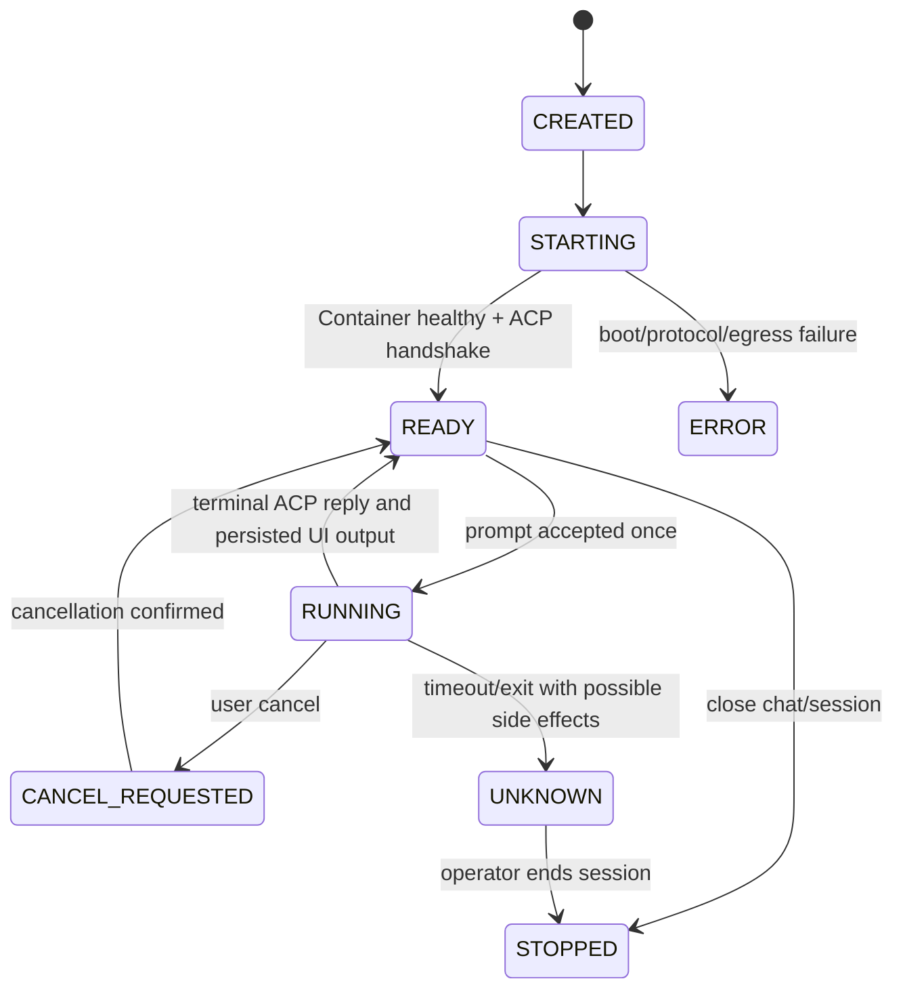

# Fase 1 — Contratos mínimos do Grok no chat existente

> **Status:** proposta executável, sem runtime implementado. Autoridade e fases: [ROADMAP](../../ROADMAP.md).

## Interfaces da primeira entrega

- Workshop `AiChatMetadata` recebe um discriminador **opcional e retrocompatível** de engine, valor default `native`. Escolha de Grok é explícita por chat, não inferida de qualquer model ID do usuário. A mudança exata deve ser revisada junto a `workshop-shared/src/api.ts` e contratos de persistência do Overseer.
- Estado mínimo vinculando `workspaceId + chatId` ao `grokSessionId` e generation do runtime. Workshop é dono do chat e do histórico, DO de runtime é dono do processo e da geração. Nenhum registro de AgentDefinition, Task, Agent Registry, MCP ou ferramenta é criado.
- Requisição privada (esboço, não ABI aprovada): `openChat(chatRef,idempotencyKey) -> {sessionRef,state}`, `sendPrompt(sessionRef,chatMessageSequence,text,idempotencyKey) -> {operationId,accepted}`, `cancel(operationId)`, `events(afterSequence) -> {events,nextSequence}`, `close(sessionRef)`. Referências são opaque e só trafegam em service binding autenticado do Workshop.
- Delta Grok ACP `session/update` vira evento de texto/estado do chat atual. Antes de publicar ao navegador, o Overseer persiste output com chave de dedup `(sessionRef, generation, runtimeSequence)` para evitar duplicação após reconectar. Não criar outra fonte autoritativa de transcript.
- Permit de runtime só vale para workspace/chat/geração autenticados pelo Workshop. O browser não recebe o endereço interno do Container nem credencial do modelo.
- Wire dentro do container: JSON-RPC 2.0 line-delimited via `grok ... agent ... stdio`, `initialize(protocolVersion:1)` testado no smoke Grokbot, `session/new({cwd,mcpServers:[]})`, `session/prompt`, notificações `session/update` e `session/cancel` quando suportado. Negociação real obrigatória, versão/CLI fixadas, limites para frames e stderr separado.

## Estados mínimos

**Acceptance vs success:** `sendPrompt` may confirm only persisted acceptance. A late, missing or ambiguous ACP response never becomes a fabricated answer; report typed UNKNOWN and do not re-send blindly. Reconnect replays persisted normalized events; browser disconnect is not session deletion. Existing native chat must keep its own behavior untouched.

## Explicitly NOT required in Fase 1

No MCP Registry or MCP Server, tools/list/tools/call, agent creation, new Gatekeepers, AgentSpawner changes, independent tasks, cron, A/B, PTY/web terminal, file manager, Git browser, upload, subagents, user-defined tool catalog, R2 checkpoint, multi-engine abstraction or full ACP client library package.

The CLI may internally call tools; the first MVP exposes no general tool privileges to browser/agents. Deny unsupported `session/request_permission` calls safely. The legacy Grokbot `--always-approve` smoke-only argument is prohibited in production.

## Extraction and E2E proof

Source: Grokbot PR #1 `9171b11c7269f6f305e99fd697a4dd885aad5459`:
- `services/sandbox-runtime/tools/acp-smoke.mjs`: tested ACP envelope with `protocolVersion:1`, `session/new`, prompt, JSON-RPC framing; fixture used `mcpServers:[]` and an unsafe-for-production `--always-approve` specifically for disposable smoke.
- `services/sandbox-runtime/src/ai-gateway.ts`: trusted WorkerEntrypoint, fixed model/host/path allowlist, credential kept as Worker binding and no redirect; validate current target endpoints/config rather than assuming they remain deployed.
- `services/sandbox-runtime/src/index.ts`: Container/runtime supervisor patterns and generation fencing; compare Cloudflare OS closed PR #2 API fixes (start readiness/getTcpPort).
- Reuse current `workshop-backend/src/overseer.ts` chat storage/permissions, `workshop-shared/src/api.ts` chat types and `workshop-frontend/src/ChatInterface.tsx` streaming UI. No Grokbot Next.js or DB migrations.

Required staging evidence: actual Container started, real initialize/new/prompt, incremental answer visible in Workshop, preserved/replayed history, cancellation/error, denied approval, per-user workspace isolation, and credential-safe egress.

