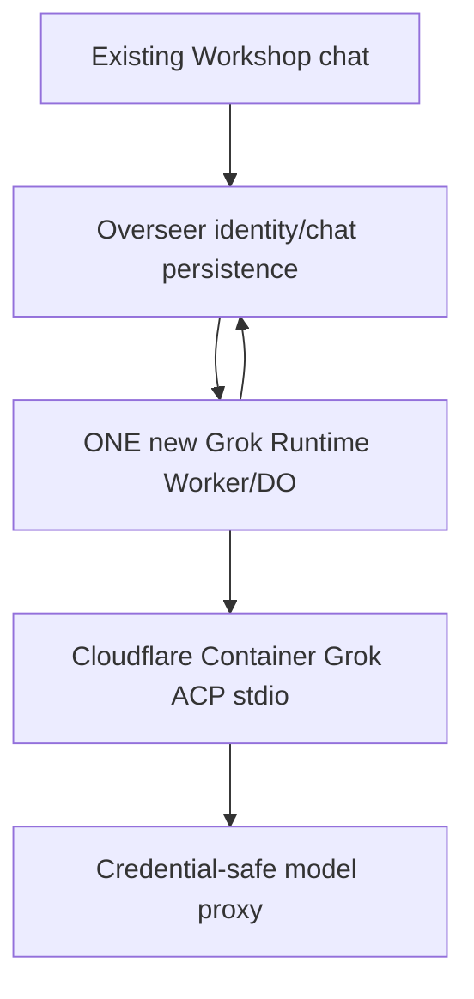

# Decisão de simplificação — Grok primeiro, sem módulos duplicados

**2026-10-13 · Estado: aprovada pelo usuário.** Referências: [ROADMAP](../../ROADMAP.md), [root SPECS](../../SPECS.md), [auditoria de responsabilidades](./EXISTING_MODULE_BOUNDARIES_AUDIT.md) e [inputs U-009](./USER_INPUT_LEDGER.md). Esta alteração é DOCUMENTAL; nenhum código executável foi removido.

## Inventário real e operações

Antes: 47 diretórios sob packages, 32 packages com package.json e 15 propostas contendo apenas SPECS.md + plan.md, sem TS, sem config Worker e sem implementação. Depois: 32 existentes + 1 diretório com spec/plan de novo runtime Grok, ainda não implementado. **28 arquivos de propostas removidos (14 × SPECS/plan); mais dois documentos redundantes de UI removidos.** Todos os arquivos permanecem recuperáveis pelo histórico Git.

| Diretório removido | Por que não será um package agora | Fonte existente/alternativa |
|---|---|---|
| `packages/agent-protocol` | ACC universal e schemas especulativos substituem/duplicam API Workshop sem segundo engine validado | `workshop-shared`, `AiChatStreamEvent`, Cap'n Web |
| `packages/agent-control-plane` | Novo AgentDefinition/Task DO antes de testar o AgentSpawner real | Overseer + AgentSpawner; tarefas autônomas em fase futura |
| `packages/agent-loop` | Duplica loop do pi-agent-core ou Scheduler sem evidência da lacuna | `runAgentLoopContinue`, `gatekeeper-scheduler` |
| `packages/agent-harness-native` | Adapter prematuro para motor que já roda no Overseer | `workshop-backend/src/agent.ts` |
| `packages/acp-core` | Generalização desnecessária para uma única CLI na primeira fase | Cliente ACP Grok interno em `agent-runtime` |
| `packages/agent-harness-grok` | Outro package para o único harness, sem ganhos de isolamento comprovados | Lançamento/configuração Grok internos ao `agent-runtime` |
| `packages/agent-harness-codex` | Codex fora da Fase 1 | Fase 4, driver conforme compatibilidade real |
| `packages/agent-harness-opencode` | OpenCode fora da Fase 1 | Fase 4 |
| `packages/agent-harness-registry` | Manifestos/múltiplas versões/exp. antes da necessidade e conflito com outros catálogos | Reutilizar scripts/release e manifest pin direto de Grok; avaliar MCP Registry na Fase 5 para **seu próprio domínio MCP**, sem confundir registry MCP com catálogo de engines |
| `packages/agent-egress` | Worker independente desnecessário para um único container/proxy inicialmente | WorkerEntrypoint de interceptação no `agent-runtime`; modelo nativo Workshop preservado |
| `packages/agent-tool-registry` | Reclassifica/reindexa sem necessidade Gatekeepers já funcionais; conflito futuro | Gatekeepers/ mcp-shared e `brasalabs6/mcp-registry` em Fase 5 |
| `packages/agent-tool-gateway` | Novo HTTP/MCP server/endpoint expressamente adiado | `brasalabs6/mcp-registry` e adapters Workshop em Fase 5 |
| `packages/gatekeeper-coding-agents` | Modelo novo de criação e autorização de agents duplica AgentSpawner | Workshop/Overseer, avaliar gaps após Fase 1 |
| `packages/gatekeeper-computers` | Terminal/Files não fazem parte da Fase 1, nova authority precoce | Container internamente e Gatekeepers existentes; só se criar scope novo na Fase 2 |

**Também removido:** `packages/workshop-frontend/src/features/agent-sessions/{SPECS.md,plan.md}` (feature só documental e UI alternativa desnecessária). O chat atual é `packages/workshop-frontend/src/ChatInterface.tsx`.

**Retido:** somente `packages/agent-runtime/{SPECS.md,plan.md}` de propostas novas; Worker/DO/Container e interface Grok internos ainda deverão ser implementados, com package.json/config/tests quando autorizado.

## MCP Registry existente — fonte do projeto real

[brasalabs6/mcp-registry](https://github.com/brasalabs6/mcp-registry) é repositório privado com `README.md`, `SPEC.md`, código fonte e `specs/PLAN.md`, head conferido `ac8318a51b2a1c6f4522e76c9e7c21bc8500340d`. Seu domínio inclui MCP marketplace, instalações por agente, chaves, credenciais, roteamento de tools/resources/prompts, OpenAPI import, worker Docker e governança; usa NestJS/Postgres/MQTT. É independente do Workshop, cujas autoridades de identidade/capability são distintas. Adoção/integração é trabalho da **Fase 5** (autenticação/tenant mapping/Cap'n Web ↔ serviço MCP). Não migrar tecnologia/runtime nem expor headers `x-brainstorm-actor-*` como identidade confiável sem avaliação.

## Fase 1 — fronteira estrita

ACP dentro do container é transporte de Grok; não é uma integração MCP. O Grokbot serve de material fonte, não de serviço paralelo de produção. Os módulos existentes `mcp-shared`, Gatekeepers, Scheduler, AgentSpawner, chat/overseer continuam com suas responsabilidades e sem alteração na Fase 1.

## Critério para novos packages futuros

Demonstrar com código e testes que a função não existe nos 32 packages atuais e que é necessária para a fase ativa. É proibido criar um novo serviço apenas para encapsular uma interface abstrata sem consumidor testado. Cada novo package requer tabela de autoridade, schemas, fluxo, plano, teste e atualização deste roadmap/input ledger.
