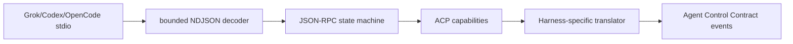

# ACP Core — SPECS

**Kind:** shared TypeScript library; not a Worker deployment.  
**Status:** specification; implementation pending.

## Responsibility

Provide the transport-independent, versioned protocol primitives shared by the runtime supervisor and harness adapters. This package is the only place that owns JSON-RPC framing, request correlation, ACP envelope validation and normalized protocol event types.

## Public contract

Export typed models for protocol envelopes, request IDs, initialize capabilities, session lifecycle requests, prompt/tool events, permission requests, cancellation, shutdown, protocol errors and normalized platform events. Keep platform domain IDs separate from ACP session IDs.

Required primitives:
- Incremental bounded JSON-RPC/NDJSON decoder and encoder.
- Request correlation map with timeout, cancellation and cleanup on disconnect.
- Notification dispatch and server-initiated request handling.
- Schema/version validation for events crossing a Worker or persistence boundary.
- Capability negotiation that records advertised versus effective capabilities.
- Error taxonomy separating protocol errors, harness exits, transport loss, authorization denials and unknown outcomes.
- Backpressure and limits for frame bytes, outstanding requests, event payloads and queued writes.

## Invariants

1. Reject malformed frames, invalid IDs and oversized payloads before JSON decoding or persistence.
2. Never assume event arrival order across a reconnect; assign platform event sequence at the authoritative SessionRuntime.
3. A cancelled request is not proof that the harness side effect did not occur.
4. No dependency on NestJS, DOM APIs, Node-only streams or a particular Cloudflare deployment.
5. No authorization decisions based on protocol payload fields.

## Tests and acceptance

Unit tests cover partial frames, multiple frames, invalid UTF-8, malformed JSON, oversized payloads, duplicate IDs, timeouts, cancellation races, disconnect with outstanding requests, server requests, backpressure and unknown message types. Contract fixtures are required for Grok, codex-acp and OpenCode. Typecheck and tests must run through the repository's package tooling before a consumer imports this package.


## Normative protocol contract

Use [ACP_CONTRACTS_V1](../../docs/architecture/ACP_CONTRACTS_V1.md) sections 3, 5 and 6. Export validators for `RuntimeRequest`, `RuntimeResult`, `AgentEvent` and per-harness protocol fixtures. A complete implementation supplies actual JSON schema files, typed discriminated unions, examples, compatibility ranges and negative fixtures; this descriptive package spec alone is not sufficient. The Grok 1.0.50 probe used a version 1 initialize envelope; do not copy Hub's initialize blindly. Distinguish JSON-RPC wire IDs from platform event sequences and ACP session IDs. Test frames crossing chunk boundaries, invalid UTF-8, duplicate outstanding IDs, unknown notifications and cancelled operations with unknown side-effect outcome.


## Unified Agent Platform v2 — executable implementation draft (2026-10-13)

**New normative scope:** [Unified Architecture](../../docs/architecture/AGENT_PLATFORM_UNIFIED_V2.md), [User input ledger](../../docs/architecture/USER_INPUT_LEDGER.md), [Implementation stages](./plan.md). This section extends the earlier ACP/session-only description to agent definitions, independent Tasks, loop strategies, native Workshop engine parity, pluggable protocol drivers, subagents and tools where relevant. It is an IMPLEMENTATION DRAFT, not deployed code.

### Data path and package dependencies



### Canonical interfaces and data shapes to implement

```typescript
type AcpFrame={jsonrpc:'2.0';id?:string|number;method?:string;params?:unknown;result?:unknown;error?:{code:number;message:string;data?:unknown}};
interface AcpConnection {initialize(request:unknown):Promise<NegotiatedProtocol>;request(method:string,params:unknown,deadlineMs:number):Promise<unknown>;onNotification(cb:(method:string,params:unknown)=>void):void;onServerRequest(cb:(id:string|number,method:string,params:unknown)=>Promise<unknown>):void;cancelPending(reason:string):void}
```

These records must be validated against versioned ACC/ACP JSON Schema at Worker boundary, mapped to existing Cap'n Web capabilities where human/Gadget RPC is used, and have typed retryable versus UNKNOWN outcome errors. The schema fragments above are drafts; generated final validation and migrations are acceptance requirements.

### Proposed source layout

```text
packages/acp-core/
  src/{index,framing,jsonrpc,session,handshake,capabilities,errors}.ts
  src/__fixtures__/{grok,codex,opencode}/*.jsonl
  src/__tests__/{framing,negotiation,requests,server-permission,backpressure}.test.ts
  SPECS.md
  plan.md
```

### Semantics and concurrency

ACP is only one driver transport. Keep JSON-RPC over supervisor-controlled stdio; normalize to AgentEventV1 using agent-protocol. Separate native message ID, ACP session ID, platform session ID and canonical run/child ID. Server-initiated session/request_permission is a blocking RPC answered only after the runtime's tool approval policy resolves.

**Destillation/reference:** Hub src/runtime/acp/acp-client.manager.ts; Grokbot services/sandbox-runtime/tools/acp-smoke.mjs and Grok ACP manager. Pin actual source commit and test fixture before copying, and update F-001…F-017 migration evidence. Distinguish existing Workshop capabilities from new target components; no duplicate identity, scheduler, approval or MCP-import framework.

### Acceptance

A change is done only with strict schemas, migrated/verified data shapes, tests for idempotent admission, partial protocol messages, replay and crash/reconciliation, deny-by-default resource grants, source provenance and staging E2E for deployed services. Verify that core Workshop Code Mode and Gatekeeper simulation tests remain green.


## Mandatory boundary revision (audit 2026-10-13)

See [Existing module authority audit](../../docs/architecture/EXISTING_MODULE_BOUNDARIES_AUDIT.md) and root SPECS §23. **No-overlap rule:** Owns ACP-specific JSON-RPC stdio framing/correlation only. It neither replaces Workshop Cap'n Web ABI nor implements a platform-wide wire protocol; source ACP session IDs must never become authorization or native chat IDs.

**Required preparatory implementation gates:** Compare Hub and Grokbot initialization fixtures with live pinned version; translate via agent-protocol into ACC; test server-initiated permission alongside Workshop action approval without double grant.

This is a reviewed design constraint. Neither this folder nor its plan constitutes a running module. Every completed plan step must link a source SHA, target commit, real contract/security tests and E2E proof where a Worker/Container is involved.
