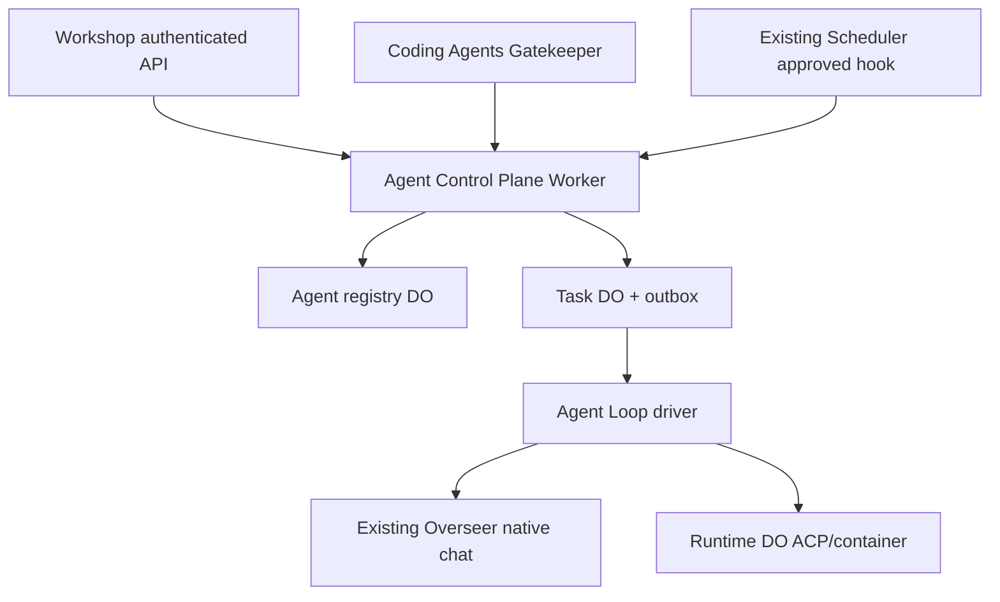

# Agent Control Plane — SPECS.md

> **Package:** packages/agent-control-plane · **Kind:** independently deployed Worker + AgentRegistry/Task Durable Objects · **Status:** architecture and implementation sketch, NOT deployed.

## 1. Mission and existing integration

Own reusable AgentDefinitions, independent Tasks, Execution lineage, Trigger references, bounded budgets and delegated subagent control while preserving Workshop identity, existing Overseer chats and runtime session truth.

**Primary reference:** [Unified platform architecture](../../docs/architecture/AGENT_PLATFORM_UNIFIED_V2.md), [canonical execution contracts](../../docs/architecture/ACP_CONTRACTS_V1.md), [user decisions](../../docs/architecture/USER_INPUT_LEDGER.md).

**Validated source / distillation:** Cloudflare OS Overseer/AgentSpawnerConfig, existing ScheduleDriver, Grokbot session/run lifecycle and Hub task orchestration references. Reuse existing policy without copying Next.js auth/Postgres.

## 2. Component and data flow diagram



## 3. Proposed public contracts and data shapes

```typescript
type AgentDefinition = {schemaVersion:1;agentId:string;workspaceId:string;ownerPrincipalId:string;displayName:string;instructionsRef:string;preferredEngineId:string;harnessId:string|null;profileId:string;grantsRef:string;loopPolicyId:string;maxConcurrentTasks:number;maxChildDepth:number;maxTotalChildren:number;status:'DRAFT'|'ENABLED'|'PAUSED'|'ARCHIVED';revision:number};
type Task = {schemaVersion:1;taskId:string;agentId:string;source:{kind:'user-chat'|'api'|'schedule'|'hook'|'webhook'|'parent-agent';sourceId:string};parentTaskId:string|null;rootTaskId:string;depth:number;state:'QUEUED'|'CLAIMED'|'RUNNING'|'WAITING_APPROVAL'|'SLEEPING'|'PAUSED'|'SUCCEEDED'|'FAILED'|'CANCELLED'|'OUTCOME_UNKNOWN';currentLoopIteration:number;engineReleaseId:string;revision:number};
type Execution = {schemaVersion:1;executionId:string;taskId:string;attempt:number;fencingToken:number;leaseUntil:string|null;outcome:'PENDING'|'SUCCESS'|'FAILED'|'CANCELLED'|'UNKNOWN'};
```

All serialized records need JSON Schema Draft 2020-12, strict validation at RPC boundaries, tests with positive/negative fixtures, schemaVersion and explicit backward-compatibility rules. These signatures are an implementation DRAFT, not a claim that runtime code exists. Stable scope/ownership IDs are generated by the authoritative server.

## 4. Implementation file draft

```text
packages/agent-control-plane/
  src/worker.ts
  src/agent-registry-do.ts
  src/task-do.ts
  src/storage/{migrations,definitions,tasks,executions,delegations,outbox}.ts
  src/services/{admission,scope,dispatch,consistency,budgets}.ts
  src/rpc/{agents,tasks,children,events}.ts
  src/__tests__/{idempotency,delegation,crash,grants,budget,revoke}.test.ts
  cloudflare.config.ts (when implementing Worker; Wrangler generated)
  SPECS.md
  plan.md
```

## 5. End-to-end processing and state rules

Create/revise AgentDefinition under Workshop-authorized identity. A task admission atomically snapshots policy/grants/release, persists Task+outbox and returns ACCEPTED. A bounded dispatcher claims with fencing token. Task lifecycle is authoritative here; CLI run state remains Runtime DO authority; native chat turns remain Overseer authority. Source projections merge only as read-model, never cross-DO transactional claims.

Proposed implementation MUST define admission → durable intent → dispatch → progress → completion and the uncertain-outcome recovery branch where operations have external side effects. Use typed errors, idempotency keys, optimistic revisions and generation/lease fences where relevant. No client-held state is authoritative.

## 6. Security, quotas and compatibility

Store grants as opaque capability-reference snapshots, not replayable user-supplied stubs. Parent-child grants are intersection; reserve budget atomically before spawn, cap lineage depth/count, revoke on parent/user revocation, and reconcile orphan outcomes.

Preserve the existing Workshop capability model, do not duplicate Gatekeeper or MCP policy, and do not directly expose Durable Objects to anonymous internet clients. Adapter-specific protocol events may be surfaced only via declared, validated extension namespaces.

## 7. Acceptance scenarios and artifacts

Task idempotency across schedule redeliveries, concurrent writes/expected revision, crash after outbox before dispatch, stale lease fences, depth/budget caps, pause/resume after restart, per-workspace denial and source-specific retention.

Attach source commit/paths and target commit/tests to the [migration matrix](../../docs/architecture/ACP_MIGRATION_MATRIX.md). For production, prove staging in real Cloudflare Workers/Containers when required. Source staging evidence alone does not establish target readiness.

## 8. Delivery plan

[Detailed per-package plan](./plan.md) contains ordered work, dependency gates, source extraction, migrations, verification and rollout. All plan checkboxes start OPEN; this document does not imply implementation.

