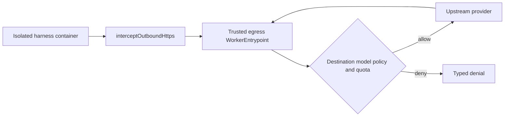

# Agent Egress — SPECS

**Kind:** private WorkerEntrypoint/service-bound module initially; separate Worker deployment when justified.  
**Status:** specification; implementation pending.

## Responsibility

Provide a trusted path from isolated harness processes to explicitly permitted inference/provider endpoints. Credentials and provider routing remain on the trusted side of the boundary. The runtime/container never receives reusable platform proxy credentials.

## Policy

Each request is authorized against the pinned release, session/run, selected model alias, provider allowlist, budget and environment. Default deny. Validate destination host and scheme, reject IP literals unless explicitly approved, block private/link-local/metadata ranges, reject redirects by default, and revalidate any permitted redirect before following. Never use a prompt-supplied URL as the upstream target.

Enforce connect/read/total timeouts, request and response byte caps, concurrency, rate limits and usage ceilings. Avoid forwarding caller-controlled headers to providers. Do not log authorization headers, API keys, raw prompts or full provider responses.

## Credential strategy

Preferred: Worker-side secret binding or existing approved inference proxy. Alternative: short-lived, narrowly scoped provider credential with documented expiration, storage, revocation and audit semantics. Never bake secrets into the image, command line, generated source, environment file shipped to the container or browser bundle.

## Observability

Record release, provider alias, session/run IDs, duration, token/cost estimates where available, status class and policy decision. Sanitize all provider error messages before logging. Usage data is not proof of billing correctness unless reconciled against the provider.

## Tests and acceptance

Positive tests for allowed models; negative tests for unapproved providers, redirect escapes, DNS/host manipulation, metadata access, private IPs, oversized responses, timeout, invalid ticket, cross-session request, quota exhaustion and secret redaction. Test staging/production secrets separately and verify deployment without displaying secret values.


## Normative egress setup

See [ACP_CONTRACTS_V1](../../docs/architecture/ACP_CONTRACTS_V1.md) sections 7 and 10. The Grokbot tested reference installs an explicit `interceptOutboundHttps(host, WorkerEntrypoint)` rule *before* `container.start({enableInternet:false})`; it also bootstraps trust in the ephemeral container CA. Carry this exact threat boundary into the first implementation, reviewing runtime API compatibility. Do not substitute arbitrary proxy URLs or give the CLI long-lived proxy API keys. Require a separately approved hostname policy for Git/dependency bootstrap. Wire model aliases to fixed upstream host/path and budget/rate limits; validate negative redirect/SSRF and connection-disconnect cases.


## Unified Agent Platform v2 — executable implementation draft (2026-10-13)

**New normative scope:** [Unified Architecture](../../docs/architecture/AGENT_PLATFORM_UNIFIED_V2.md), [User input ledger](../../docs/architecture/USER_INPUT_LEDGER.md), [Implementation stages](./plan.md). This section extends the earlier ACP/session-only description to agent definitions, independent Tasks, loop strategies, native Workshop engine parity, pluggable protocol drivers, subagents and tools where relevant. It is an IMPLEMENTATION DRAFT, not deployed code.

### Data path and package dependencies



### Canonical interfaces and data shapes to implement

```typescript
type EgressGrant={schemaVersion:1;agentSessionId:string;generation:number;releaseId:string;providerProfileId:string;allowedOrigins:string[];modelAliases:string[];maxRequests:number;maxTokens:number;maxCostMicros:number;expiresAt:string};
type EgressUsage={requestId:string;sessionId:string;providerId:string;modelId:string;inputTokens:number|null;outputTokens:number|null;costMicros:number|null;status:'SUCCESS'|'DENIED'|'UNKNOWN'}
```

These records must be validated against versioned ACC/ACP JSON Schema at Worker boundary, mapped to existing Cap'n Web capabilities where human/Gadget RPC is used, and have typed retryable versus UNKNOWN outcome errors. The schema fragments above are drafts; generated final validation and migrations are acceptance requirements.

### Proposed source layout

```text
packages/agent-egress/
  src/{entrypoint,policy,model-map,quota,headers,stream,telemetry}.ts
  src/__tests__/{allowlist,interception,ca-trust,redirect,ssrf,quota,secrets}.test.ts
  profiles/{grok,codex,opencode}.json
  cloudflare.config.ts when private Worker deployed
  SPECS.md
  plan.md
```

### Semantics and concurrency

The trust boundary is the Worker-held credential and allowlisted path/host: neither CLI nor harness adapter receives a long-lived provider secret. Provider/native authentication differs by engine; no blanket assumption that a generic proxy can impersonate native login. Egress policy applies to model inference and separate bootstrap dependency/Git hosts.

**Destillation/reference:** Grokbot PR#1 services/sandbox-runtime/src/ai-gateway.ts and interceptOutboundHttps + enableInternet:false; existing Workshop AI Gateway billing flow. Pin actual source commit and test fixture before copying, and update F-001…F-017 migration evidence. Distinguish existing Workshop capabilities from new target components; no duplicate identity, scheduler, approval or MCP-import framework.

### Acceptance

A change is done only with strict schemas, migrated/verified data shapes, tests for idempotent admission, partial protocol messages, replay and crash/reconciliation, deny-by-default resource grants, source provenance and staging E2E for deployed services. Verify that core Workshop Code Mode and Gatekeeper simulation tests remain green.


## Mandatory existing-module boundary / implementation gate (2026-10-13)

Audit: [EXISTING_MODULE_BOUNDARIES_AUDIT.md](../../docs/architecture/EXISTING_MODULE_BOUNDARIES_AUDIT.md), governing root SPECS §23. **Owner constraint:** Owns only trusted *container* external network/credential boundary and quota validation. Workshop ai-models.ts/ai-gateway.ts already own native provider request configuration and billing flows. Avoid a second unverified AI model catalog and duplicate cost state.

**Before beginning tasks in this package:** Define shared model policy mapping and usage correlation with Workshop, pin provider-specific routes, reject raw CLI secret credentials; test actual Cloudflare CA/interceptOutboundHttps, disallowed hosts/redirects and quota/restart.

The directory is DOC_ONLY until package.json, actual source, schema tests and correct Worker configuration are added. No new runtime is implemented by the spec revision. Every relevant plan item requires source→target evidence, typed contract checks, approval/identity threat tests and real worker E2E when applicable.
