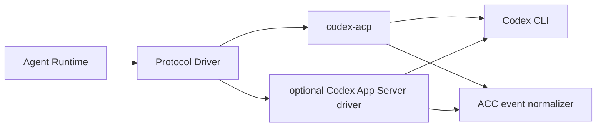

# Codex ACP Harness Adapter — SPECS

**Kind:** versioned adapter plus pinned runtime image configuration.  
**Status:** specification; implementation pending.

## Responsibility

Expose Codex through ACP using a pinned codex-acp bridge around Codex App Server. The Workshop kernel and agent-runtime public contract must not depend on Codex App Server message types.

## Launch and authentication

Pin the codex-acp package/binary and the compatible Codex version. Launch only from the allowlisted manifest. Isolate HOME/config per session and disable interactive browser flows in unattended containers unless an explicitly reviewed device/auth flow is used. Before implementation, document which authentication strategy is supported in Cloudflare containers and whether all inference can be routed through trusted egress.

Do not copy credentials from the Hub database or persist long-lived credentials in image layers, container backups, logs or browser storage. If provider-native auth is unavoidable, define scoped credential provisioning, expiration, revocation and session isolation first.

## Protocol mapping

Normalize ACP initialization, session creation, prompt, tool events, permissions, cancellation and shutdown. Model/mode controls appear only when negotiated. Translate Codex-specific errors into the shared error taxonomy while preserving sanitized diagnostic codes.

## Tests and acceptance

Real Cloudflare sandbox tests must cover initialize/new/prompt/events/cancel, file tool permissions, auth failure and expiry, no-browser behavior, reconnect, resource limits, egress policy and secret scans. Codex acceptance is independent from Grok acceptance.


## Version-specific executable contract

Canonical shape: [ACP_CONTRACTS_V1](../../docs/architecture/ACP_CONTRACTS_V1.md) §§2–6,10. Production manifest must contain `codexAcPBridgeVersion`, `codexCliVersion`, `bridgeBinarySha256`, `imageDigest`, `initializeRequestSchemaId`, `supportedProtocolRange`, `authStrategy`, `providerRoutes` and `fixtureSha256`. Use `codex-acp` with reviewed Codex App Server compatibility; never expose App Server protocol in Workshop RPC. Require sandbox fixture for native permission requests, tool events, cancellation and `session/load` behavior if supported; unsupported features return typed `UNSUPPORTED_CAPABILITY`. Explicitly record successful unattended, revocable authentication strategy; without that, keep release in CANDIDATE and disallow traffic. Hub's Codex App Server implementation is a reference, not evidence of ACP bridge production readiness.


## Unified Agent Platform v2 — executable implementation draft (2026-10-13)

**New normative scope:** [Unified Architecture](../../docs/architecture/AGENT_PLATFORM_UNIFIED_V2.md), [User input ledger](../../docs/architecture/USER_INPUT_LEDGER.md), [Implementation stages](./plan.md). This section extends the earlier ACP/session-only description to agent definitions, independent Tasks, loop strategies, native Workshop engine parity, pluggable protocol drivers, subagents and tools where relevant. It is an IMPLEMENTATION DRAFT, not deployed code.

### Data path and package dependencies



### Canonical interfaces and data shapes to implement

```typescript
type CodexProfile={schemaVersion:1;codexVersion:string;bridgeVersion:string|null;binarySha256:string;protocolDriver:'codex-acp'|'codex-app-server';authStrategyId:string;modelAlias:string|null};
type CodexCapabilityMap={supportsModels:boolean;supportsApprovals:boolean;supportsSubagents:boolean;supportsSessionResume:boolean;nativeMethods:string[]}
```

These records must be validated against versioned ACC/ACP JSON Schema at Worker boundary, mapped to existing Cap'n Web capabilities where human/Gadget RPC is used, and have typed retryable versus UNKNOWN outcome errors. The schema fragments above are drafts; generated final validation and migrations are acceptance requirements.

### Proposed source layout

```text
packages/agent-harness-codex/
  src/{index,driver,profile,auth,translation}.ts
  src/drivers/{acp,app-server}.ts
  src/__fixtures__/{codex-acp,codex-native}
  src/__tests__/{negotiation,auth,approvals,events,subagents,cancel}.test.ts
  SPECS.md
  plan.md
```

### Semantics and concurrency

Codex may expose richer native App Server semantics than ACP bridge; both must implement EngineDriver and one ACC event vocabulary. No accidental native protocol leakage into UI. Explicit namespaced protocolExtension provides detailed commands, tools, subagent ancestry and model controls only when supported and authorized.

**Destillation/reference:** Hub src/runtime/acp/acp-client.manager.ts and its Codex App Server integration (behavioral reference); Codex/codex-acp versions to pin and test. Pin actual source commit and test fixture before copying, and update F-001…F-017 migration evidence. Distinguish existing Workshop capabilities from new target components; no duplicate identity, scheduler, approval or MCP-import framework.

### Acceptance

A change is done only with strict schemas, migrated/verified data shapes, tests for idempotent admission, partial protocol messages, replay and crash/reconciliation, deny-by-default resource grants, source provenance and staging E2E for deployed services. Verify that core Workshop Code Mode and Gatekeeper simulation tests remain green.


## Mandatory boundary revision (audit 2026-10-13)

See [Existing module authority audit](../../docs/architecture/EXISTING_MODULE_BOUNDARIES_AUDIT.md) and root SPECS §23. **No-overlap rule:** Only Codex ACP/native driver translation and per-release compatible authentication. Hub App Server code is a reference, not proof of bridge compatibility. Runtime DO/AgentDefinition authority belongs elsewhere.

**Required preparatory implementation gates:** Validate codex-acp and native App Server independently; version fixtures, CAP/MCP extension schema, command/subagent event visibility, auth modes; no fallback to unverified native transport or unchecked credential injection.

This is a reviewed design constraint. Neither this folder nor its plan constitutes a running module. Every completed plan step must link a source SHA, target commit, real contract/security tests and E2E proof where a Worker/Container is involved.
