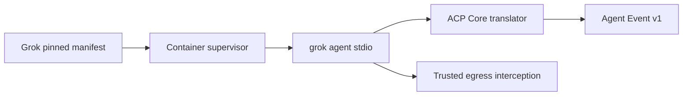

# Grok Build Harness Adapter — SPECS

**Kind:** versioned adapter plus pinned runtime image configuration.  
**Status:** specification; implementation pending in Cloudflare OS.

## Responsibility

Launch the supported Grok Build CLI ACP stdio process and normalize harness-specific metadata/events into acp-core. Reuse verified GrokBot runtime behavior as evidence and implementation reference, not as a reason to copy the old application architecture or secrets flow.

## Launch contract

Use a pinned CLI version, immutable image digest, explicit working directory and validated configuration schema. The launch command and args come from the reviewed manifest, never from a prompt or untrusted request. Keep provider credentials out of the profile file. If the harness requires TOML configuration, generate it from a validated allowlisted schema and never write proxy secrets to it.

## Protocol

Perform ACP initialize before declaring the session ready. Support session creation, prompt, cancellation, event mapping, tool-call permissions and shutdown where negotiated. Any native WebSocket transport is an optional adapter optimization and must not replace the common stdio ACP contract for the first release.

## Reuse and migration

Review GrokBot PR #1 runtime/session code for generation fencing, terminal, file operations, signed tickets and checkpoint behavior. Port only components compatible with Cloudflare OS service bindings, Gatekeeper authorization and current Sandbox APIs. Do not port a public bridge with bypassed authentication, embedded control-plane credentials or unrestricted egress.

## Tests and acceptance

Run real sandbox tests for initialize, new session, prompt, tool event, filesystem write, cancellation, permission round-trip, terminal, reload/replay and checkpoint restore. Document the exact tested image/CLI versions and mark staging evidence separately from production.


## Version-specific executable contract

Canonical platform envelopes and state fields: [ACP_CONTRACTS_V1](../../docs/architecture/ACP_CONTRACTS_V1.md) §§2–6,10. Distill Grokbot PR #1 (`services/sandbox-runtime/tools/acp-smoke.mjs`, `tools/run-grok.sh`, `Dockerfile`, `src/index.ts`) with an explicit source SHA. Proven development fixture: Grok 1.0.50, `grok --no-auto-update agent --no-leader --model <approved-alias> stdio`; the disposable smoke test used `--always-approve` and must **never** be generalized to interactive production permissions. Probe initialize includes `protocolVersion:1`, `clientCapabilities`, `clientInfo`. Use the CLI supported/verified exact schema, not a generic assumed ACP version. Tests must prove `session/new`, prompt/tool event, permission callback, cancellation, stdout framing, non-root launch and egress interception with no credentials in the container. Version pin is illustrative source evidence until the actual registry release pins tested image digest and CLI binary hash.


## Unified Agent Platform v2 — executable implementation draft (2026-10-13)

**New normative scope:** [Unified Architecture](../../docs/architecture/AGENT_PLATFORM_UNIFIED_V2.md), [User input ledger](../../docs/architecture/USER_INPUT_LEDGER.md), [Implementation stages](./plan.md). This section extends the earlier ACP/session-only description to agent definitions, independent Tasks, loop strategies, native Workshop engine parity, pluggable protocol drivers, subagents and tools where relevant. It is an IMPLEMENTATION DRAFT, not deployed code.

### Data path and package dependencies



### Canonical interfaces and data shapes to implement

```typescript
type GrokProfile={schemaVersion:1;binaryVersion:string;binarySha256:string;modelAlias:string;workspaceRoot:string;configTomlVersion:string;permissionMode:'interactive'|'policy';allowedProviderRoutes:string[]};
interface GrokDriver {probe():Promise<EngineDescriptor>;launch(profile:GrokProfile):Promise<{acpSessionId:string;generation:number}>;reconcile(runId:string):Promise<'SUCCEEDED'|'FAILED'|'OUTCOME_UNKNOWN'>}
```

These records must be validated against versioned ACC/ACP JSON Schema at Worker boundary, mapped to existing Cap'n Web capabilities where human/Gadget RPC is used, and have typed retryable versus UNKNOWN outcome errors. The schema fragments above are drafts; generated final validation and migrations are acceptance requirements.

### Proposed source layout

```text
packages/agent-harness-grok/
  src/{index,manifest,launch,config,driver,acp-translator,tool-permissions}.ts
  src/__fixtures__/{initialize,new,prompt,permission,tools,errors}.jsonl
  src/__tests__/{config,launch,acl,events,restoration}.test.ts
  SPECS.md
  plan.md
```

### Semantics and concurrency

Distill Grokbot tested Grok CLI behavior only. Default driver ACP; native Grok protocol path may be added as a second protocol driver when verified. Native subagent metadata must map into canonical parent/child graph with unsupported-control semantics where appropriate. Preserve generation fencing and trusted outbound interception; do not reuse Grokbot auth/Postgres or broad always-approve smoke flags.

**Destillation/reference:** Grokbot PR#1 services/sandbox-runtime/src/index.ts, ai-gateway.ts, tools/acp-smoke.mjs, tools/run-grok.sh, Dockerfile, Grokbot feature spec F-005..F-013; cloudflare-os PR#2 closed reference. Pin actual source commit and test fixture before copying, and update F-001…F-017 migration evidence. Distinguish existing Workshop capabilities from new target components; no duplicate identity, scheduler, approval or MCP-import framework.

### Acceptance

A change is done only with strict schemas, migrated/verified data shapes, tests for idempotent admission, partial protocol messages, replay and crash/reconciliation, deny-by-default resource grants, source provenance and staging E2E for deployed services. Verify that core Workshop Code Mode and Gatekeeper simulation tests remain green.


## Mandatory boundary revision (audit 2026-10-13)

See [Existing module authority audit](../../docs/architecture/EXISTING_MODULE_BOUNDARIES_AUDIT.md) and root SPECS §23. **No-overlap rule:** Only Grok CLI-specific protocol/config/translation (Grokbot extraction). CLI Linux supervisor, terminal, filesystem, egress and policy are owned by agent-runtime, gatekeeper-computers and agent-egress respectively. Do not port Grokbot Next.js/Postgres identity.

**Required preparatory implementation gates:** Trace Grokbot PR #1 pinned SHA and ACP smoke fixture; port CLI-specific commands and event maps, test deny tool permissions and provider intercepted HTTPS with runtime adapter; no --always-approve production flag.

This is a reviewed design constraint. Neither this folder nor its plan constitutes a running module. Every completed plan step must link a source SHA, target commit, real contract/security tests and E2E proof where a Worker/Container is involved.
