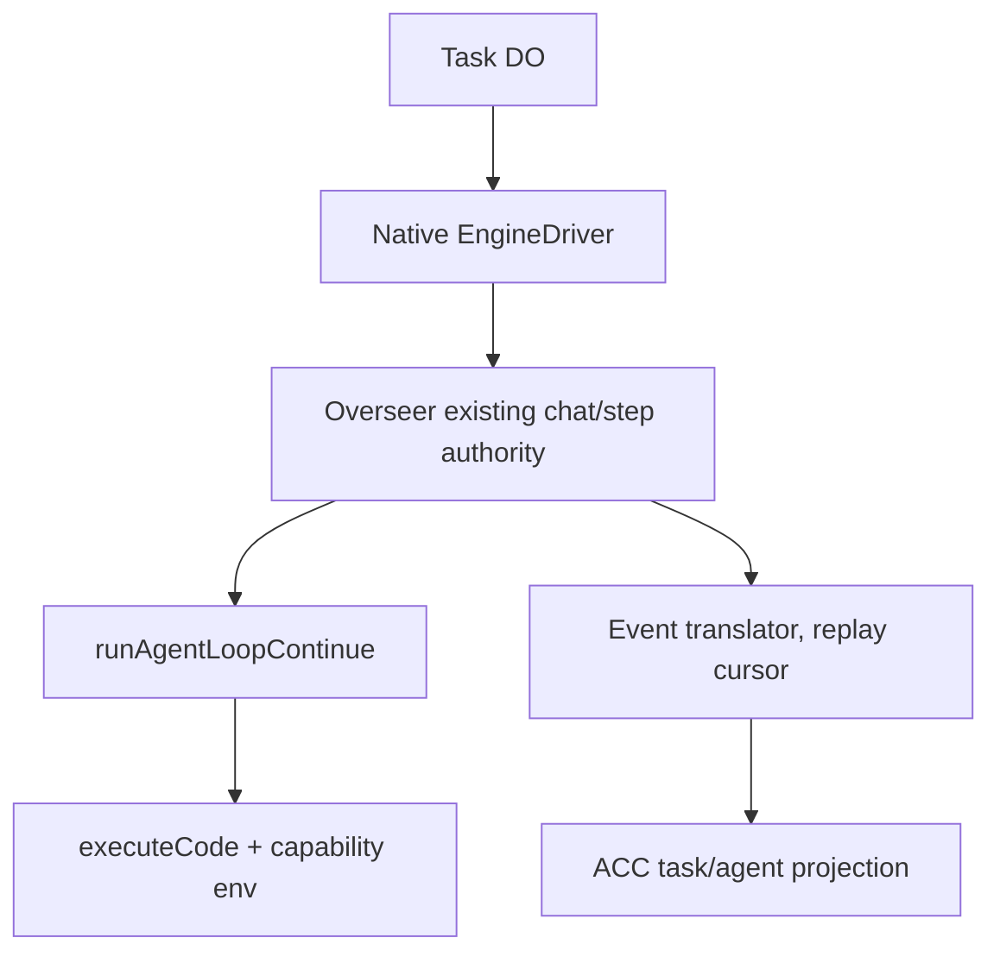

# Workshop Native Engine Adapter — SPECS.md

> **Package:** packages/agent-harness-native · **Kind:** adapter/library linked to existing Workshop backend · **Status:** architecture and implementation sketch, NOT deployed.

## 1. Mission and existing integration

Bridge existing pi-agent-core / executeCode / AgentSpawner native engine to ACC AgentEvents and EngineDriver methods without moving existing chats to ACP, changing pi-agent-core API or duplicating Overseer state.

**Primary reference:** [Unified platform architecture](../../docs/architecture/AGENT_PLATFORM_UNIFIED_V2.md), [canonical execution contracts](../../docs/architecture/ACP_CONTRACTS_V1.md), [user decisions](../../docs/architecture/USER_INPUT_LEDGER.md).

**Validated source / distillation:** packages/workshop-backend/src/agent.ts, overseer.ts, agent-compaction.ts, packages/workshop-shared/src/api.ts AgentSpawnerConfig; @earendil-works/pi-agent-core.

## 2. Component and data flow diagram



## 3. Proposed public contracts and data shapes

```typescript
interface NativeTurnBinding {workspaceId:string;chatId:number;agentId:string;taskId:string;initiatorCapabilityRef:string;lastStoredSequence:number}
interface NativeRunReceipt {taskId:string;chatId:number;turnId:string;accepted:boolean;overseerVersion:number;eventCursor:number}
interface NativeEventMap {chatId:number;chatMessageSequence:number;agentEventId:string;runId:string|null;provenance:'workshop-native'}
```

All serialized records need JSON Schema Draft 2020-12, strict validation at RPC boundaries, tests with positive/negative fixtures, schemaVersion and explicit backward-compatibility rules. These signatures are an implementation DRAFT, not a claim that runtime code exists. Stable scope/ownership IDs are generated by the authoritative server.

## 4. Implementation file draft

```text
packages/agent-harness-native/
  src/{index,driver,capabilities,event-mapper,callable-spawner-bridge,approval-map}.ts
  src/__tests__/{chat-parity,approval,spawner,compaction,replay,callbacks}.test.ts
  packages/workshop-backend/src/agent-platform/{bridge,projection}.ts (integration seam only)
  SPECS.md
  plan.md
```

## 5. End-to-end processing and state rules

Control Plane admits a native task; adapter uses authenticated existing Overseer chat/callable agent operation, not private runAgent direct invocation from outside workspace. Translate AiChatStreamEvent, tool calls, change previews, approvals and step completion to ACC while Overseer stays writer for chat and edit barriers.

Proposed implementation MUST define admission → durable intent → dispatch → progress → completion and the uncertain-outcome recovery branch where operations have external side effects. Use typed errors, idempotency keys, optimistic revisions and generation/lease fences where relevant. No client-held state is authoritative.

## 6. Security, quotas and compatibility

Preserve seed env snapshot and per-task callable capabilities; never make Gatekeeper objects ambient without user configuration. Preserve approval queue, executeCode sandbox and model-private reasoning redaction.

Preserve the existing Workshop capability model, do not duplicate Gatekeeper or MCP policy, and do not directly expose Durable Objects to anonymous internet clients. Adapter-specific protocol events may be surfaced only via declared, validated extension namespaces.

## 7. Acceptance scenarios and artifacts

Existing chat/AgentSpawner tool parity, callbacks queued behind turn, compaction restoration, apply/reject actions, shared observer permissions, model-private replay, no duplicate tool call on resume.

Attach source commit/paths and target commit/tests to the [migration matrix](../../docs/architecture/ACP_MIGRATION_MATRIX.md). For production, prove staging in real Cloudflare Workers/Containers when required. Source staging evidence alone does not establish target readiness.

## 8. Delivery plan

[Detailed per-package plan](./plan.md) contains ordered work, dependency gates, source extraction, migrations, verification and rollout. All plan checkboxes start OPEN; this document does not imply implementation.


## Source audit correction / mandatory no-overlap gate — 2026-10-13

**Governing evidence:** [32 existing module audit](../../docs/architecture/EXISTING_MODULE_BOUNDARIES_AUDIT.md), root SPECS.md §23, and current executable source. **Boundary:** The native adapter is a thin bridge next to Overseer; it must not execute runAgent from outside its authenticated AgentHooks context, create new chat/compaction/worktree stores, or override callable callback semantics. A spawnCallable queue ACK does NOT imply completed result.

**Implementation ordering:** Before implementation: capture AgentSpawnerBinding.d.ts true shape, Overseer deliverAgentCallback and #runAgentTurn; map native chat IDs and event sequences with no destructive migration; run parity tests for callbacks, step barrier, private modelData, compaction, observer ACL.

**Blockers:** no executable implementation until existing behavior is characterized; module files in this directory are currently planning documents only. For every feature, record source/target authority, typed schema, security negative test, crash/idempotency case and relevant integration evidence. If a proposed API duplicates current authority, revise the proposal first instead of implementing a duplicate.
