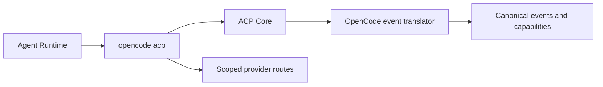

# OpenCode ACP Harness Adapter — SPECS

**Kind:** versioned adapter plus pinned runtime image configuration.  
**Status:** specification; implementation pending.

## Responsibility

Launch the official OpenCode ACP command with an isolated per-session configuration directory and normalize protocol behavior through acp-core.

## Launch and configuration

Pin OpenCode version and immutable image digest. Use the supported opencode acp stdio command. Generate provider/model configuration from validated manifests; do not assume every provider or model is enabled. Isolate config, caches, worktree and credentials between sessions. Provider access must use the approved egress policy or an explicitly reviewed short-lived credential flow.

## Protocol mapping

Negotiate ACP initialize capabilities. Implement session creation, prompt, events, cancellation, permission requests and shutdown where supported. Dynamic model and mode selection must reflect negotiated options. Unsupported features must be disabled and return a typed error instead of silently falling back.

## Tests and acceptance

Run real Cloudflare sandbox tests for initialize/new/prompt/tool events/cancel, file permissions, model/provider allowlisting, config isolation, egress bypass attempts, reconnect and container restart. Record exact tested CLI/adapter versions. Passing a mocked protocol fixture alone is not acceptance.


## Version-specific executable contract

Canonical shape: [ACP_CONTRACTS_V1](../../docs/architecture/ACP_CONTRACTS_V1.md) §§2–6,10. Production manifest pins OpenCode CLI version, image digest, executable hash, ACP protocol fixture checksum, model/provider mapping and isolated `HOME`/config/workspace location. Launch the version-tested `opencode acp` command with no runtime-supplied arbitrary arguments. Test initialization response, negotiated model/mode choices, `session/new`, prompt, permission callbacks, updates, cancel and restart semantics. Reconnection cannot claim ACP session restoration unless `session/load` is both negotiated and shown to work with the pinned version. Unknown provider/model IDs fail closed; isolate caches and egress per session.


## Unified Agent Platform v2 — executable implementation draft (2026-10-13)

**New normative scope:** [Unified Architecture](../../docs/architecture/AGENT_PLATFORM_UNIFIED_V2.md), [User input ledger](../../docs/architecture/USER_INPUT_LEDGER.md), [Implementation stages](./plan.md). This section extends the earlier ACP/session-only description to agent definitions, independent Tasks, loop strategies, native Workshop engine parity, pluggable protocol drivers, subagents and tools where relevant. It is an IMPLEMENTATION DRAFT, not deployed code.

### Data path and package dependencies



### Canonical interfaces and data shapes to implement

```typescript
type OpenCodeProfile={schemaVersion:1;binaryVersion:string;binarySha256:string;configSchemaVersion:string;modelAliases:string[];configRoot:string;workspaceRoot:string};
type OpenCodeSessionEvidence={initializeFixtureSha256:string;acpSessionId:string;supportsLoad:boolean;features:string[]}
```

These records must be validated against versioned ACC/ACP JSON Schema at Worker boundary, mapped to existing Cap'n Web capabilities where human/Gadget RPC is used, and have typed retryable versus UNKNOWN outcome errors. The schema fragments above are drafts; generated final validation and migrations are acceptance requirements.

### Proposed source layout

```text
packages/agent-harness-opencode/
  src/{index,manifest,driver,config,event-translator,permissions}.ts
  src/__fixtures__/{initialize,prompt,mode,tools,permission,subagents}.jsonl
  src/__tests__/{profile,events,cancel,capabilities,replay}.test.ts
  SPECS.md
  plan.md
```

### Semantics and concurrency

Use native supported opencode acp interface, version-locked. Map mode/model selection, command/timeline, tool approvals and potential child session events to ACC only after verifying native metadata. Workspace config, HOME and cache are per-session; do not silently treat session/new as restored session/load.

**Destillation/reference:** OpenCode CLI ACP behavior to verify from pinned executable; Hub ACP client as transport reference and Grokbot isolation model as sandbox reference. Pin actual source commit and test fixture before copying, and update F-001…F-017 migration evidence. Distinguish existing Workshop capabilities from new target components; no duplicate identity, scheduler, approval or MCP-import framework.

### Acceptance

A change is done only with strict schemas, migrated/verified data shapes, tests for idempotent admission, partial protocol messages, replay and crash/reconciliation, deny-by-default resource grants, source provenance and staging E2E for deployed services. Verify that core Workshop Code Mode and Gatekeeper simulation tests remain green.
