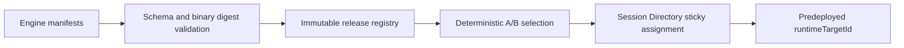

# Agent Harness Registry — SPECS

**Kind:** shared TypeScript library; not a Worker deployment.  
**Status:** specification; implementation pending.

## Responsibility

Store validated, immutable harness and runtime release metadata. It chooses a compatible, permitted manifest; it does not provision containers or infer unsupported capabilities.

## Manifest

Each manifest includes:
- stable harness ID: grok-build, codex or opencode;
- pinned CLI version, adapter version and immutable image digest;
- launch command/arguments and working directory;
- ACP transport and supported protocol range;
- configuration schema version and safe non-secret defaults;
- authentication strategy and allowed inference routes;
- default permission policy, resource requirements and health probe;
- checkpoint compatibility identifier and deprecation state.

Effective capabilities are the intersection of: manifest support, live ACP initialize result, runtime profile policy and user/session grants. Never expose a UI control solely because a static manifest lists a capability.

## Release selection

A release record pins runtime Worker target, image digest, harness manifest, policy version and experiment assignment. Selection validates eligibility and policy before a session is created. The resulting assignment is persisted for the lifetime of that session. Rollback prevents new assignments but does not silently move existing sessions.

## Validation

Reject mutable image tags, missing digests, duplicate IDs, unrecognized auth strategies, unsupported schema versions, commands outside the image's allowlisted launch catalog and a release with an incompatible checkpoint schema. Do not accept user-provided command strings as a manifest.

## Tests and acceptance

Test manifest schema validation, version compatibility, allowlist enforcement, deterministic cohort assignment, sticky session assignment, deprecation, rollback behavior and migration compatibility. The registry must return structured diagnostics rather than silently falling back to another harness.


## Release and routing schema

Use [ACP_CONTRACTS_V1](../../docs/architecture/ACP_CONTRACTS_V1.md) sections 1, 6 and 8 for `Release`, `Experiment` and `Session Directory`. The registry picks eligible immutable release metadata but never reroutes an existing session. A Worker/container release must have a deployed configured `runtimeTargetId` before activation. Manifest capability lists are upper bounds; the live handshake decides what the UI may expose. The registry must reject a missing protocol fixture digest and unverified adapters.


## Unified Agent Platform v2 — executable implementation draft (2026-10-13)

**New normative scope:** [Unified Architecture](../../docs/architecture/AGENT_PLATFORM_UNIFIED_V2.md), [User input ledger](../../docs/architecture/USER_INPUT_LEDGER.md), [Implementation stages](./plan.md). This section extends the earlier ACP/session-only description to agent definitions, independent Tasks, loop strategies, native Workshop engine parity, pluggable protocol drivers, subagents and tools where relevant. It is an IMPLEMENTATION DRAFT, not deployed code.

### Data path and package dependencies



### Canonical interfaces and data shapes to implement

```typescript
type EngineManifest={schemaVersion:1;engineId:string;engineKind:'workshop-native'|'acp-cli'|'native-cli'|'custom';harnessId:string|null;protocolDriverId:string;protocolVersionRange:string[];binarySha256:string|null;runtimeImageDigest:string|null;authStrategyId:string;capabilityFixtureDigest:string;toolPolicyRef:string;launchProfileId:string|null};
type Assignment={agentSessionId:string;releaseId:string;runtimeTargetId:string;directoryVersion:number;createdAt:string}
```

These records must be validated against versioned ACC/ACP JSON Schema at Worker boundary, mapped to existing Cap'n Web capabilities where human/Gadget RPC is used, and have typed retryable versus UNKNOWN outcome errors. The schema fragments above are drafts; generated final validation and migrations are acceptance requirements.

### Proposed source layout

```text
packages/agent-harness-registry/
  src/{engine-manifest,release,selector,capability-merge,verification}.ts
  src/__tests__/{manifest,compatibility,ab-pinning,rollback}.test.ts
  manifests/{grok,codex,opencode,workshop-native}.json
  SPECS.md
  plan.md
```

### Semantics and concurrency

Registry supports native Workshop engine and external ACP or native protocol drivers. Manifests are immutable source-derived configurations, not permission grants. Deployment RELEASE manifest (repository-wide) is distinct from AGENT runtime release and must be mapped explicitly. A session's stable assignment survives fallback, rollback and reconnection.

**Destillation/reference:** Hub harness catalog; Cloudflare OS existing build-release manifest and deploy wizard; Grokbot model aliases. Pin actual source commit and test fixture before copying, and update F-001…F-017 migration evidence. Distinguish existing Workshop capabilities from new target components; no duplicate identity, scheduler, approval or MCP-import framework.

### Acceptance

A change is done only with strict schemas, migrated/verified data shapes, tests for idempotent admission, partial protocol messages, replay and crash/reconciliation, deny-by-default resource grants, source provenance and staging E2E for deployed services. Verify that core Workshop Code Mode and Gatekeeper simulation tests remain green.
