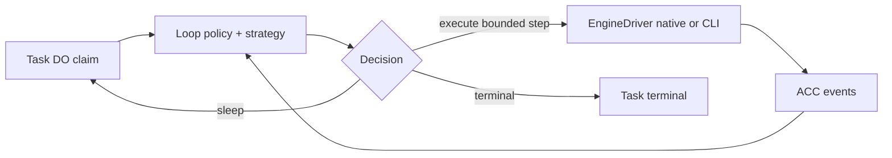

# Agent Loop Engines — SPECS.md

> **Package:** packages/agent-loop · **Kind:** shared strategies library (no persistent scheduler) · **Status:** architecture and implementation sketch, NOT deployed.

## 1. Mission and existing integration

Support pluggable loop strategies: one turn, until-done, periodic, reactive, plan-execute and custom policy-driven loops, without reimplementing the existing pi-agent-core inner model/tool loop or ScheduleDriver recurrence.

**Primary reference:** [Unified platform architecture](../../docs/architecture/AGENT_PLATFORM_UNIFIED_V2.md), [canonical execution contracts](../../docs/architecture/ACP_CONTRACTS_V1.md), [user decisions](../../docs/architecture/USER_INPUT_LEDGER.md).

**Validated source / distillation:** Existing Workshop runAgentLoopContinue in packages/workshop-backend/src/agent.ts, Overseer alarms; existing Gatekeeper Scheduler time recurrence and Grokbot lifecycle.

## 2. Component and data flow diagram



## 3. Proposed public contracts and data shapes

```typescript
interface LoopStrategy {id:string;version:string;plan(input:{task:Task;execution:Execution;policy:LoopPolicy;lastEventCursor:number}): Promise<LoopDecision>}
type LoopDecision = {kind:'EXECUTE';inputRef:string;checkpointRef:string|null}|{kind:'SLEEP';wakeAt:string;reason:string}|{kind:'SPAWN_CHILD';agentId:string;inputRef:string;budgetReservationMicros:number}|{kind:'COMPLETE';resultRef:string}|{kind:'FAIL'|'PAUSE';reasonCode:string};
type LoopPolicy = {schemaVersion:1;loopPolicyId:string;kind:'single-turn'|'until-done'|'periodic'|'reactive'|'plan-execute'|'custom';maxIterationsPerTask:number;maxStepsPerWake:number;maxConsecutiveErrors:number;minSleepMs:number;maxTaskWallMs:number};
```

All serialized records need JSON Schema Draft 2020-12, strict validation at RPC boundaries, tests with positive/negative fixtures, schemaVersion and explicit backward-compatibility rules. These signatures are an implementation DRAFT, not a claim that runtime code exists. Stable scope/ownership IDs are generated by the authoritative server.

## 4. Implementation file draft

```text
packages/agent-loop/
  src/{types,policy,registry,runner,budget,decision}.ts
  src/strategies/{single-turn,until-done,periodic,reactive,plan-execute}.ts
  src/__tests__/{iterations,retry,budget,restart,termination}.test.ts
  SPECS.md
  plan.md
```

## 5. End-to-end processing and state rules

Task DO claims execution; loop strategy decides at most maxStepsPerWake and persists lastCursor/iteration/nextWakeAt before relinquishing control. Scheduler Gatekeeper only triggers external recurrence; task-owned alarms drive continuation, never duplicate full recurrence. pi-agent-core's runAgentLoopContinue remains the inner turn loop.

Proposed implementation MUST define admission → durable intent → dispatch → progress → completion and the uncertain-outcome recovery branch where operations have external side effects. Use typed errors, idempotency keys, optimistic revisions and generation/lease fences where relevant. No client-held state is authoritative.

## 6. Security, quotas and compatibility

Hard iteration, wall-clock, cost/token and child budgets; explicit pause/resume and stop condition; unknown outcome does not mean safe-to-retry; never execute arbitrary policy code from untrusted AgentDefinition.

Preserve the existing Workshop capability model, do not duplicate Gatekeeper or MCP policy, and do not directly expose Durable Objects to anonymous internet clients. Adapter-specific protocol events may be surfaced only via declared, validated extension namespaces.

## 7. Acceptance scenarios and artifacts

Loop strategies with fake clock, budget exhaustion, spinning prevention, crash-between-steps, wake idempotency, unknown outcome, child limits, owner revocation and existing agent-core step semantics.

Attach source commit/paths and target commit/tests to the [migration matrix](../../docs/architecture/ACP_MIGRATION_MATRIX.md). For production, prove staging in real Cloudflare Workers/Containers when required. Source staging evidence alone does not establish target readiness.

## 8. Delivery plan

[Detailed per-package plan](./plan.md) contains ordered work, dependency gates, source extraction, migrations, verification and rollout. All plan checkboxes start OPEN; this document does not imply implementation.

