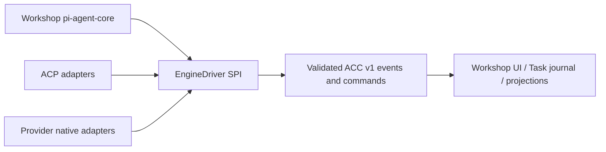

# Agent Control Contract (ACC) — SPECS.md

> **Package:** packages/agent-protocol · **Kind:** shared type/schema library · **Status:** architecture and implementation sketch, NOT deployed.

## 1. Mission and existing integration

Define one engine-neutral control and event vocabulary usable by the existing Workshop pi agent-core engine, ACP CLI harnesses, native-provider protocols, background tasks and external API projections. Transport independent: Cap'n Web remains Workshop RPC, ACP stays harness stdio, HTTP/MCP are projections.

**Primary reference:** [Unified platform architecture](../../docs/architecture/AGENT_PLATFORM_UNIFIED_V2.md), [canonical execution contracts](../../docs/architecture/ACP_CONTRACTS_V1.md), [user decisions](../../docs/architecture/USER_INPUT_LEDGER.md).

**Validated source / distillation:** Cloudflare OS packages/workshop-backend/src/agent.ts and packages/workshop-shared/src/api.ts; Grokbot services/sandbox-runtime/tools/acp-smoke.mjs; Hub src/runtime/acp/acp-client.manager.ts.

## 2. Component and data flow diagram



## 3. Proposed public contracts and data shapes

```typescript
export interface EngineDriver {
 describeCapabilities(ctx: BoundExecutionContext): Promise<EngineDescriptor>;
 prepare(ctx: BoundExecutionContext): Promise<PreparedEngine>;
 startTurn(ctx: BoundExecutionContext, input: AgentInput): AsyncIterable<AgentEventV1>;
 submitInput(ctx: BoundExecutionContext, command: AgentCommandV1): Promise<CommandAccepted>;
 reconcile(ctx: BoundExecutionContext, attempt: ExecutionAttempt): Promise<ReconciledOutcome>;
 shutdown(ctx: BoundExecutionContext): Promise<void>;
}
export type AgentEventV1 = {schemaVersion:1;eventId:string;agentId:string;taskId:string|null;executionId:string|null;runId:string|null;parentRunId:string|null;source:{engineId:string;transport:string;nativeSessionId:string|null;nativeEventId:string|null};streamId:string;sequence:number;occurredAt:string;kind:EventKind;visibility:Visibility;payloadVersion:number;payload:Record<string,unknown>};
```

All serialized records need JSON Schema Draft 2020-12, strict validation at RPC boundaries, tests with positive/negative fixtures, schemaVersion and explicit backward-compatibility rules. These signatures are an implementation DRAFT, not a claim that runtime code exists. Stable scope/ownership IDs are generated by the authoritative server.

## 4. Implementation file draft

```text
packages/agent-protocol/
  src/index.ts
  src/contracts/{agent,task,execution,event,command,capabilities}.ts
  src/schema/{agent,task,execution,event,command}.schema.json
  src/engines/{driver,registry,compatibility}.ts
  src/projection/{native,acp,provider-extension,replay}.ts
  src/__tests__/{schema,roundtrip,ordering,capabilities,extensions}.test.ts
  SPECS.md
  plan.md
```

## 5. End-to-end processing and state rules

Each engine adapter produces an ACC event with original native provenance; a projector assigns ordered per-stream sequence and deduplicates by immutable source event reference. Commands are authorized separately from capabilities. Unknown namespaced extension records are retained only under bounded, declared schemas.

Proposed implementation MUST define admission → durable intent → dispatch → progress → completion and the uncertain-outcome recovery branch where operations have external side effects. Use typed errors, idempotency keys, optimistic revisions and generation/lease fences where relevant. No client-held state is authoritative.

## 6. Security, quotas and compatibility

Never infer authority from engine metadata. Validate every event crossing process/Worker boundaries; never include raw reasoning/provider secrets in public projection. Explicitly map typed errors, token usage and prompt parts.

Preserve the existing Workshop capability model, do not duplicate Gatekeeper or MCP policy, and do not directly expose Durable Objects to anonymous internet clients. Adapter-specific protocol events may be surfaced only via declared, validated extension namespaces.

## 7. Acceptance scenarios and artifacts

Event normalization equivalence between Workshop/pi, Grok ACP, Codex ACP/native and OpenCode ACP fixtures; property tests for event ordering/dedup, incompatible schemas, unknown extension, protected reasoning data and serialization Cap'n Web versus JSON.

Attach source commit/paths and target commit/tests to the [migration matrix](../../docs/architecture/ACP_MIGRATION_MATRIX.md). For production, prove staging in real Cloudflare Workers/Containers when required. Source staging evidence alone does not establish target readiness.

## 8. Delivery plan

[Detailed per-package plan](./plan.md) contains ordered work, dependency gates, source extraction, migrations, verification and rollout. All plan checkboxes start OPEN; this document does not imply implementation.

