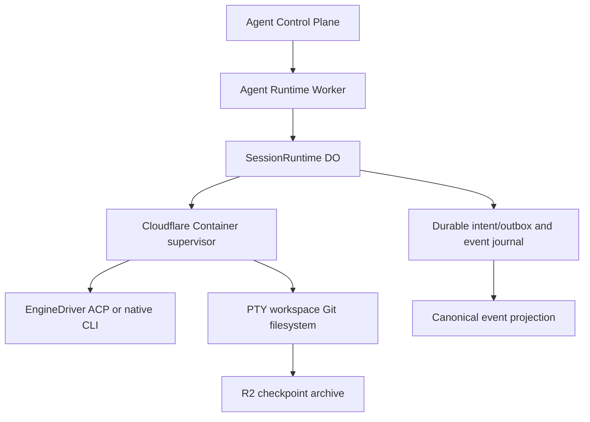

# Agent Runtime — SPECS

**Kind:** independently deployed Cloudflare Worker with SessionRuntime Durable Object and isolated Container.  
**Status:** specification; implementation pending.

## Responsibility

Own sandbox provisioning, session/run/operation state, ACP supervision, event journaling, PTY lifecycle, generation fencing, checkpoint and recovery. It is not the identity provider and must accept only authenticated service-bound or narrowly scoped ticketed calls.

## SessionRuntime Durable Object

One logical AgentSession maps to one authoritative DO identity. The DO owns a monotonic event sequence and durable session/run/operation/approval/terminal/checkpoint records. Each container start increments sandboxGeneration. All control messages and tickets carry session ID and generation; stale generations are rejected.

Every mutating request has an idempotency key and canonical request hash. Reusing the key with a different hash returns a conflict. Use optimistic session versioning or a DO transaction for concurrent state changes. A lease and heartbeat prevent two supervisors from acting as the current generation.

## Container supervisor

- Start only an image digest authorized by the release registry.
- Launch the manifest's allowlisted harness command, not caller-provided shell.
- Connect ACP stdio, PTY/tmux and bounded filesystem operations through the trusted sidecar.
- Enforce process, CPU, memory, disk, wall-time, output and concurrency quotas.
- Keep long-lived secrets outside the container; acquire upstream access through trusted egress.
- Capture sanitized diagnostics and explicit exit reason.
- Never report READY until the real ACP handshake succeeds and required capabilities are validated.

## Event journal and browser reconnect

Persist events before publishing them. Every event has schema version, session ID, optional run ID, generation, sequence, timestamp, type and bounded payload. Reconnect replays after a caller cursor; duplicate sequence numbers are forbidden. Browser disconnect does not cancel a run. Unknown or incompatible event schemas are surfaced as a protocol error and do not corrupt the journal.

## Recovery and checkpoints

Separate file snapshots from live process memory. A checkpoint records image/release compatibility, generation, filesystem manifest and checksums. Restore must be tested into a fresh container. If ACP state cannot be restored, report that limitation and reconstruct only through an explicit policy; never label a fresh session as a recovered session without provenance.

Use R2 for exported archives only after checksum validation and successful restore tests. A successful snapshot call or HTTP health response alone is not proof of durable recovery.

## Required endpoints / RPC

Private API contracts must cover create, status, prompt, cancel, event replay, checkpoint, restore, stop, terminal ticket minting and bounded file inspection. Public exposure is forbidden until the caller authentication and resource policy are reviewed.

## Tests and acceptance

Test concurrent create/prompt/cancel, idempotency conflicts, stale generations, supervisor crash, container exit, partial stream, DO alarm/lease recovery, replay after browser reload, event retention, checkpoint checksum failure, restore in a fresh container, cross-session ticket rejection and hard quota enforcement. Add real Cloudflare staging E2E for all three harnesses.


## Normative persisted contract and sequence

Follow [ACP_CONTRACTS_V1](../../docs/architecture/ACP_CONTRACTS_V1.md) sections 1-5, 8 and 9. Implement DO SQLite logical records `Session`, `Run`, `Operation`, `AgentEvent`, `Approval`, `Checkpoint` with documented uniqueness/transaction invariants. Implement the independent Session Directory as **routing only**, not a second run-state authority. Define migrations before deployment. Every accepted prompt writes intent transactionally before dispatch and never retries an ambiguous physical execution automatically. A persisted release resolves to a configured immutable runtime target; protect pinned sessions on rollback. Implement replay with `retentionFloor` and CURSOR_EXPIRED, not a silent empty list. Recovered files do not prove restored ACP process state.


## Unified Agent Platform v2 — executable implementation draft (2026-10-13)

**New normative scope:** [Unified Architecture](../../docs/architecture/AGENT_PLATFORM_UNIFIED_V2.md), [User input ledger](../../docs/architecture/USER_INPUT_LEDGER.md), [Implementation stages](./plan.md). This section extends the earlier ACP/session-only description to agent definitions, independent Tasks, loop strategies, native Workshop engine parity, pluggable protocol drivers, subagents and tools where relevant. It is an IMPLEMENTATION DRAFT, not deployed code.

### Data path and package dependencies



### Canonical interfaces and data shapes to implement

```typescript
type SessionRecord={schemaVersion:1;agentSessionId:string;taskId:string|null;workspaceId:string;releaseId:string;runtimeTargetId:string;engineId:string;state:string;sandboxGeneration:number;sessionVersion:number;createdAt:string};
type RuntimeDispatch={schemaVersion:1;operationId:string;taskId:string;agentSessionId:string;runId:string;idempotencyKey:string;requestHash:string;expectedSessionVersion:number;generation:number;permitRef:string};
type CheckpointManifest={schemaVersion:1;checkpointId:string;sessionId:string;sourceGeneration:number;imageDigest:string;compatibilityId:string;archiveUri:string;sha256:string;byteSize:number;acpResumeProof:string|null}
```

These records must be validated against versioned ACC/ACP JSON Schema at Worker boundary, mapped to existing Cap'n Web capabilities where human/Gadget RPC is used, and have typed retryable versus UNKNOWN outcome errors. The schema fragments above are drafts; generated final validation and migrations are acceptance requirements.

### Proposed source layout

```text
packages/agent-runtime/
  src/{worker,session-runtime-do,directory,dispatch,outbox,journal,recovery,checkpoint}.ts
  src/supervisor/{server,protocol-driver,process,pty,filesystem,git}.ts
  src/storage/{schema,migrations}.ts
  src/__tests__/{state,replay,stale-generation,crash,checkpoint,terminal}.test.ts
  cloudflare.config.ts (generated wrangler.jsonc)
  SPECS.md
  plan.md
```

### Semantics and concurrency

Execution authority for CLI subprocess sessions. Control Plane Task DO owns task policy and loops; Runtime DO owns session/run/operation states and container generation. Every cross-service dispatch persists intent and returns accepted receipt; true completion via journal. Native Workshop engine does not require container, so runtime must not become authority for existing Overseer chat.

**Destillation/reference:** Grokbot PR#1 sandbox-runtime DO, session generation and terminal/files code; closed Cloudflare OS PR#2 low-level Container API fix; legacy Hub ACP transport. Pin actual source commit and test fixture before copying, and update F-001…F-017 migration evidence. Distinguish existing Workshop capabilities from new target components; no duplicate identity, scheduler, approval or MCP-import framework.

### Acceptance

A change is done only with strict schemas, migrated/verified data shapes, tests for idempotent admission, partial protocol messages, replay and crash/reconciliation, deny-by-default resource grants, source provenance and staging E2E for deployed services. Verify that core Workshop Code Mode and Gatekeeper simulation tests remain green.
