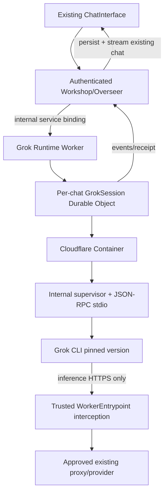

# agent-runtime — Grok Sandbox MVP (Phase 1 only)

> **STATUS: DOC_ONLY / NOT IMPLEMENTED.** The sole proposed new package during [Phase 1](../../ROADMAP.md). Avoid extracting a shared `acp-core`, `agent-harness-grok`, `agent-egress` or controller/registry until multiple proven consumers justify it.

## 1. Mission and ownership

Run ONE Grok Build CLI session per authorized Workshop chat in an isolated Cloudflare Container; expose private operations to Workshop backend and stream normalized status/text back to its EXISTING chat persistence and UI. This package owns runtime-only container process lifecycle, ACP request correlation and transient event replay. It owns **neither** workspace identities, native pi-agent-core/AgentSpawner chat state, permissions, the canonical chat transcript, MCP tools, nor a global agents catalog.

Source of truth: [ROADMAP](../../ROADMAP.md), [Phase 1 contract](../../docs/architecture/PHASE1_GROK_MVP.md), [existing ownership audit](../../docs/architecture/EXISTING_MODULE_BOUNDARIES_AUDIT.md).

## 2. Deployment and data diagram



**Code packaging:** one new deployable Worker package with Container image/supervisor and embedded Grok ACP driver. No external MCP endpoint; `session/new({mcpServers:[]})`. Worker external HTTP routes: none (health probes only if required, no public control). No additional Gatekeeper. Use deployment service binding and typed RPC, not browser tickets.

## 3. Minimal proposed TypeScript shapes (not implemented)

```typescript
type GrokSessionRef = string;  // internal, server generated; not a public identifier
type GrokState = "CREATED" | "STARTING" | "READY" | "RUNNING" |
  "CANCEL_REQUESTED" | "UNKNOWN" | "ERROR" | "STOPPED";
type GrokSessionRecord = {
  schemaVersion:1; runtimeSessionId:GrokSessionRef;
  workshopWorkspaceId:string; workshopChatId:number;
  cliVersion:string; imageDigest:string; generation:number;
  state:GrokState; acpSessionId:string|null; lastEventSequence:number;
  createdAt:string; updatedAt:string;
};
type GrokInput = {schemaVersion:1;chatMessageSequence:number;idempotencyKey:string;text:string};
type GrokEvent = {
  schemaVersion:1;runtimeSessionId:string;generation:number;sequence:number;
  kind:"text.delta"|"run.state"|"runtime.error"|"permission.denied";
  payload:{text?:string;state?:GrokState;code?:string};
  occurredAt:string;
};
type Accepted = {operationId:string;state:"ACCEPTED"|"ALREADY_ACCEPTED"};
interface GrokRuntimePrivateRpc {
  openChat(input:{workshopContextRef:string;chatId:number;idempotencyKey:string}):
    Promise<{runtimeSessionId:string;state:GrokState}>;
  sendPrompt(sessionId:string,input:GrokInput):Promise<Accepted>;
  readEvents(sessionId:string,afterSequence:number,limit:number):
    Promise<{events:GrokEvent[];nextSequence:number;hasMore:boolean}>;
  cancel(sessionId:string,operationId:string):Promise<Accepted>;
  close(sessionId:string,idempotencyKey:string):Promise<Accepted>;
}
```

The exact authenticated private RPC capability must be reviewed with `workshop-shared`/backend before implementation. `workshopContextRef` is an unforgeable bound RPC context/reference or server-provided capability, **not** a self-asserted caller identity string. If runtime stores identifiers, it must verify the trusted calling service binding, caller context and pinned workspace/chat scope.

## 4. Minimal transaction and ACP flow

```mermaid
sequenceDiagram
 actor User
 participant Chat as Existing Workshop chat
 participant O as Overseer
 participant R as GrokSession DO
 participant C as Cloudflare Container
 participant G as Grok ACP
 User->>Chat: Select Grok; send text
 Chat->>O: Existing authenticated chat RPC
 O->>O: Persist user message + selected engine per chat
 O->>R: openChat / sendPrompt idempotently
 R->>R: Commit intent before dispatch
 R->>C: Start container with safe outbound interception
 C->>G: spawn grok --no-auto-update agent stdio
 R->>G: initialize / session/new (mcpServers=[])
 G-->>R: negotiated protocol + sessionId
 R->>G: session/prompt
 G-->>R: session/update + result
 R->>R: Persist event sequence/replay
 R-->>O: scoped events
 O->>O: Dedup sequence; commit assistant output
 O-->>Chat: existing chat stream/history
```

- ACP newline-delimited JSON-RPC via stdio, separate stderr, bounded requests, negotiated version (Grokbot 1.0.50 smoke used `protocolVersion:1`), typed errors, no unsupported native callback authorization.
- One active prompt per runtime session. Every attempt has operationId and idempotency key. Timeout after dispatch => `UNKNOWN`, never automatic prompt replay; caller may close/start fresh manually.
- Workshop Overseer remains canonical chat writer. The DO event journal is delivery/recovery state, not a second cross-workspace chat database. Reconnect by workspace-authorized event replay and idempotent append to Workshop.
- Generation increments on restart. Process failure retains existing chat messages but *may not restore* Grok ACP session; do not promise `session/load` until proved.
- No Git import, shell/PTY web controls, files browser, spawned subagent, timer, external hooks, or MCP in Phase 1.

## 5. Process/network hardening

- Source Grokbot PR #1 pinned source SHA `9171b11c7269f6f305e99fd697a4dd885aad5459` and fixtures in `services/sandbox-runtime/tools/acp-smoke.mjs`.
- Reuse validated Container API invocation `container.start` + health wait + private bridge. Closed Cloudflare OS PR #2 was never merged, so its code must be reviewed/destilled before copying.
- Start with denied unrestricted Internet (`enableInternet:false`) and explicit `interceptOutboundHttps` WorkerEntrypoint allowlisted provider route; correct ephemeral CA and ordinary TLS verification. Provider credentials only in Worker secret binding; never command/env/config sent to CLI.
- No production `--always-approve` or `yoloMode:true` from smoke. First milestone is text conversation; unsafe tool requests receive explicit deny, and reply semantics are tested with real version.
- Rate, frame, response, log and session limits. No CLI process escape from isolated workdir. Stop/fence stale container on chat closure or revocation; no public sessions endpoint.

## 6. File layout draft

```text
packages/agent-runtime/
  package.json
  cloudflare.config.ts
  Dockerfile
  src/
    worker.ts                 # private service RPC
    grok-session-do.ts        # per-chat instance, generation + receipt + journal
    cli/{launch,protocol,events}.ts
    supervisor/{start,health,shutdown}.ts
    egress/{intercept,worker-entrypoint}.ts
    storage/{session,events}.ts
  tests/{acp-smoke,stream,reconnect,auth,egress,regression}.test.ts
  SPECS.md
  plan.md
```

Only create files as implementation is proved. Follow root release/config generation rules (`scripts/release`); no premature generalized runtime registry or multiple engines.

## 7. Acceptance gate

A real authenticated chat in the EXISTING Workshop UI selects Grok, launches one isolated Cloudflare Container, exchanges `initialize/session/new/session/prompt`, displays streamed text and stores/replays chat history. Cancel/error/revocation are visible and safe, no credentials leaked, no native runAgent regressions. Build, unit, integration and real Cloudflare staging E2E evidence must be linked. Until then **NOT IMPLEMENTED**.
