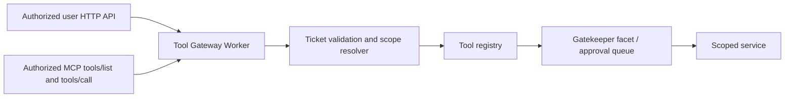

# Agent Tool Gateway (MCP/HTTP Export) — SPECS.md

> **Package:** packages/agent-tool-gateway · **Kind:** independently deployed authenticated Worker · **Status:** architecture and implementation sketch, NOT deployed.

## 1. Mission and existing integration

Publish deliberately selected, scope-bound agent/task/tool operations as user HTTP endpoints and an MCP server without exposing runtime DO or bypassing Workshop/ Gatekeeper authority; reuse existing MCP clients for imported tools.

**Primary reference:** [Unified platform architecture](../../docs/architecture/AGENT_PLATFORM_UNIFIED_V2.md), [canonical execution contracts](../../docs/architecture/ACP_CONTRACTS_V1.md), [user decisions](../../docs/architecture/USER_INPUT_LEDGER.md).

**Validated source / distillation:** Existing Workshop router, Cap'n Web auth, Gatekeeper/mcp-shared; mcp-shared is an MCP CLIENT implementation, not evidence a server already exists.

## 2. Component and data flow diagram



## 3. Proposed public contracts and data shapes

```typescript
type GatewayTicket={v:1;jti:string;aud:'agent-tool-gateway';principalId:string;workspaceId:string;resourceId:string;toolIds:string[];scopes:string[];exp:number;policyRevision:number};
type GatewayInvoke={schemaVersion:1;invocationId:string;toolId:string;input:Record<string,unknown>;idempotencyKey:string};
type GatewayResponse={schemaVersion:1;invocationId:string;status:'SUCCEEDED'|'PENDING_APPROVAL'|'FAILED'|'OUTCOME_UNKNOWN';resultRef:string|null;actionId:string|null;errorCode:string|null};
```

All serialized records need JSON Schema Draft 2020-12, strict validation at RPC boundaries, tests with positive/negative fixtures, schemaVersion and explicit backward-compatibility rules. These signatures are an implementation DRAFT, not a claim that runtime code exists. Stable scope/ownership IDs are generated by the authoritative server.

## 4. Implementation file draft

```text
packages/agent-tool-gateway/
  src/{worker,routes,auth,scopes,rate-limit,audit}.ts
  src/http/{agents,tasks,tools}.ts
  src/mcp/{server,tools-list,tools-call,session}.ts
  src/__tests__/{http,mcp,auth,revocation,ssrf,approval}.test.ts
  cloudflare.config.ts (then generated wrangler.jsonc)
  SPECS.md
  plan.md
```

## 5. End-to-end processing and state rules

Both /v1/agents/* HTTP and /mcp/agents MCP resolve a short-lived ticket to a current Workshop capability and tool scope. MCP tools/list is grant-filtered. tools/call maps to same invoker as user REST; result can be pending approval, not falsely synchronous. Long-running task creation responds accepted with taskId and status endpoint.

Proposed implementation MUST define admission → durable intent → dispatch → progress → completion and the uncertain-outcome recovery branch where operations have external side effects. Use typed errors, idempotency keys, optimistic revisions and generation/lease fences where relevant. No client-held state is authoritative.

## 6. Security, quotas and compatibility

Mandatory auth/expiry/revocation/nonce, scoped audience/verb/tool/resource/tenant, origin/CORS, request limits, rate limits, replay-safe idempotency, audit. No unrestricted public endpoint. Preserve OAuth/SSRF protections from mcp-shared for outbound client role; an inbound MCP server has separate transport/security requirements.

Preserve the existing Workshop capability model, do not duplicate Gatekeeper or MCP policy, and do not directly expose Durable Objects to anonymous internet clients. Adapter-specific protocol events may be surfaced only via declared, validated extension namespaces.

## 7. Acceptance scenarios and artifacts

Unauthorized HTTP/MCP, tool scope/excess claims, pending approval, revocation mid-call, content prompt injection and descriptions, replay, API version errors, private network egress not leaked.

Attach source commit/paths and target commit/tests to the [migration matrix](../../docs/architecture/ACP_MIGRATION_MATRIX.md). For production, prove staging in real Cloudflare Workers/Containers when required. Source staging evidence alone does not establish target readiness.

## 8. Delivery plan

[Detailed per-package plan](./plan.md) contains ordered work, dependency gates, source extraction, migrations, verification and rollout. All plan checkboxes start OPEN; this document does not imply implementation.


## Mandatory boundary revision (audit 2026-10-13)

See [Existing module authority audit](../../docs/architecture/EXISTING_MODULE_BOUNDARIES_AUDIT.md) and root SPECS §23. **No-overlap rule:** It is an *optional authenticated REST/MCP server export* for already-authorized Workshop capabilities; never a second MCP client/trust engine, Gatekeeper action queue or unscoped direct Task/Runtime API. In particular the existing ExternalMessageGateway trusts callerEmail and MUST NOT be used as public identity admission.

**Required preparatory implementation gates:** Inventory router prefixes /api and /gatekeeper, ExternalMessageGateway trusted-only RPC, and Workshop AuthenticatedApi; design audience-bound revocable ticket and current grant resolver; test tools/list and tools/call against real Gatekeeper action/observation, denial/revocation and anonymous impersonation.

This is a reviewed design constraint. Neither this folder nor its plan constitutes a running module. Every completed plan step must link a source SHA, target commit, real contract/security tests and E2E proof where a Worker/Container is involved.

## PDR MCP domain projection on the existing server gateway (design only)

The PDR's single remote HTTP MCP endpoint, resources, discovery and authenticated `tools/call` **belong to this Tool Gateway**. Do not create `mcp-domain-gateway` or a duplicate OAuth/resource catalog. Tool manifests and routing are from `agent-tool-registry`. Every WorkItem/Mailbox/Fact action routes to its *real* owner via a narrow, fresh Workshop-verified scope; IDs and resource URLs are selectors, never bearer credentials. `task.*` projects **WorkItem** rather than ACC execution `Task`. Device notifications remain Workshop-owned and external MCP BYO/Portal import trust remains `mcp-shared`-owned. Pin and test actual MCP server/client protocol, HTTP transport and OAuth audience/revocation versions before advertising compatibility.

Acceptance: two real MCP host clients, read/write parity with Workshop/Code Mode, cross-tenant negative suite, revoked grant mid-action, pending approval, idempotency mismatch, source cursor replay and honest UNKNOWN state. See [PDR plan](../../docs/architecture/MULTIAGENT_MCP_IMPLEMENTATION_PLAN.md).
