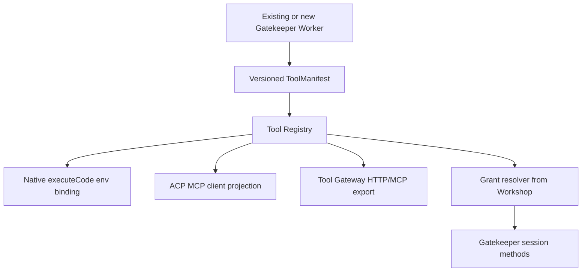

# Agent Tool Registry and Capability Projection — SPECS.md

> **Package:** packages/agent-tool-registry · **Kind:** shared manifest and tool binding library · **Status:** architecture and implementation sketch, NOT deployed.

## 1. Mission and existing integration

Describe pluggable tools and external resource modules once, then safely project authorized Gatekeeper sessions as Workshop native executeCode bindings, ACP/MCP client tools, limited user REST operations and a bounded discovery catalog.

**Primary reference:** [Unified platform architecture](../../docs/architecture/AGENT_PLATFORM_UNIFIED_V2.md), [canonical execution contracts](../../docs/architecture/ACP_CONTRACTS_V1.md), [user decisions](../../docs/architecture/USER_INPUT_LEDGER.md).

**Validated source / distillation:** Existing packages/workshop-shared/src/gatekeeper.ts, packages/mcp-shared/src/tools.ts, gatekeeper-mcp and gatekeeper-mcp-portal; Workshop executeCode bindings.

## 2. Component and data flow diagram



## 3. Proposed public contracts and data shapes

```typescript
type ToolManifest={schemaVersion:1;moduleId:string;version:string;resourceType:string;toolId:string;title:string;inputSchemaRef:string;outputSchemaRef:string;readOnlyHint:boolean;sideEffectKind:'OBSERVATION'|'ACTION';permissionScope:string;transportTargets:('capnweb'|'http'|'mcp'|'acp-mcp')[];maxInputBytes:number;maxOutputBytes:number};
type ToolInvocation={schemaVersion:1;toolId:string;grantRef:string;requestId:string;arguments:Record<string,unknown>;expectedCatalogVersion:string};
type ToolBinding={manifest:ToolManifest;capabilityRef:string;scopeFingerprint:string;currentPolicyRevision:number};
```

All serialized records need JSON Schema Draft 2020-12, strict validation at RPC boundaries, tests with positive/negative fixtures, schemaVersion and explicit backward-compatibility rules. These signatures are an implementation DRAFT, not a claim that runtime code exists. Stable scope/ownership IDs are generated by the authoritative server.

## 4. Implementation file draft

```text
packages/agent-tool-registry/
  src/{manifest,validator,registry,grant-resolver,projection,invoker,classification}.ts
  src/adapters/{workshop,acp-mcp,mcp-export,http-export}.ts
  src/__tests__/{grants,schemas,classification,revocation,redaction}.test.ts
  SPECS.md
  plan.md
```

## 5. End-to-end processing and state rules

A module exports metadata and a resource-granted Gatekeeper method; registry filters descriptors by caller's Workshop capability, not discoverable name alone. Tools that change state stage via submitAction and execute only via applyAction; observations authorizeObservation. New MCP import connectors rely on existing mcp-shared tool classification and OAuth.

Proposed implementation MUST define admission → durable intent → dispatch → progress → completion and the uncertain-outcome recovery branch where operations have external side effects. Use typed errors, idempotency keys, optimistic revisions and generation/lease fences where relevant. No client-held state is authoritative.

## 6. Security, quotas and compatibility

Never map an RPC stub directly to JSON; refuse tool metadata that widens resource scope or downgrades action to observation; preserve owner-only MCP restrictions and vetted/BYO annotation distinctions.

Preserve the existing Workshop capability model, do not duplicate Gatekeeper or MCP policy, and do not directly expose Durable Objects to anonymous internet clients. Adapter-specific protocol events may be surfaced only via declared, validated extension namespaces.

## 7. Acceptance scenarios and artifacts

Tool manifest schema, discover/list scope, live permission revocation, time-of-check vs apply, external HTTP/MCP parity, unknown tool, oversize inputs, no direct runtime bypass and observer restrictions.

Attach source commit/paths and target commit/tests to the [migration matrix](../../docs/architecture/ACP_MIGRATION_MATRIX.md). For production, prove staging in real Cloudflare Workers/Containers when required. Source staging evidence alone does not establish target readiness.

## 8. Delivery plan

[Detailed per-package plan](./plan.md) contains ordered work, dependency gates, source extraction, migrations, verification and rollout. All plan checkboxes start OPEN; this document does not imply implementation.


## Source audit correction / mandatory no-overlap gate — 2026-10-13

**Governing evidence:** [32 existing module audit](../../docs/architecture/EXISTING_MODULE_BOUNDARIES_AUDIT.md), root SPECS.md §23, and current executable source. **Boundary:** NARROWED: it is a non-authoritative projection/index of tool descriptions derived from current Gatekeeper Session capabilities and mcp-shared/catalog/tool classifier. No grant database, no policy engine, no shadow invocation authorizer, no trusting ToolManifest.readOnlyHint for side-effect classification.

**Implementation ordering:** Before implementation: reuse getAgentCatalog/getTypeScriptTypes/getSlashCommandProvider, mcp-shared classifyTool and tool-scope checks; resolve live grant before tools/list or invocation; stage actions on original Gatekeeper and add revoked-grant, BYO-unvetted, foreign observer adversarial tests.

**Blockers:** no executable implementation until existing behavior is characterized; module files in this directory are currently planning documents only. For every feature, record source/target authority, typed schema, security negative test, crash/idempotency case and relevant integration evidence. If a proposed API duplicates current authority, revise the proposal first instead of implementing a duplicate.

## Multiagent coordination tools — single-registry rule (design only)

Publish PDR `agent.*`/`workspace.*`/`goal.*`/`task.*`/`message.*`/`memory.*`/`learning.*`/`continuity.*`/`event.*` as **versioned ToolManifests in this existing registry**, not through an alternative MCP-specific catalog. Map public `task.*` exclusively to Control Plane `WorkItem` endpoints; execution `Task`/`Execution` require different explicit privileged tools. Revalidate actual caller grant, workspace, risk policy and schema on invoke. External source/context documents are untrusted; no readOnlyHint-based permission escalation. Use existing module owner and security contracts per [responsibility audit](../../docs/architecture/MULTIAGENT_RESPONSIBILITY_AUDIT.md).
