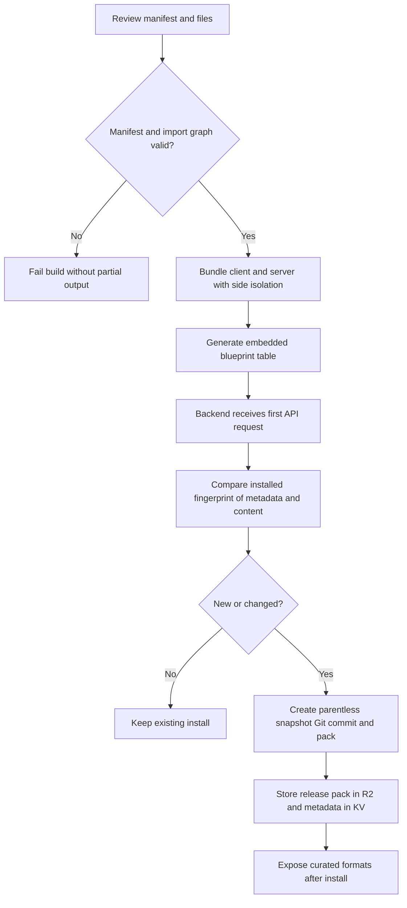
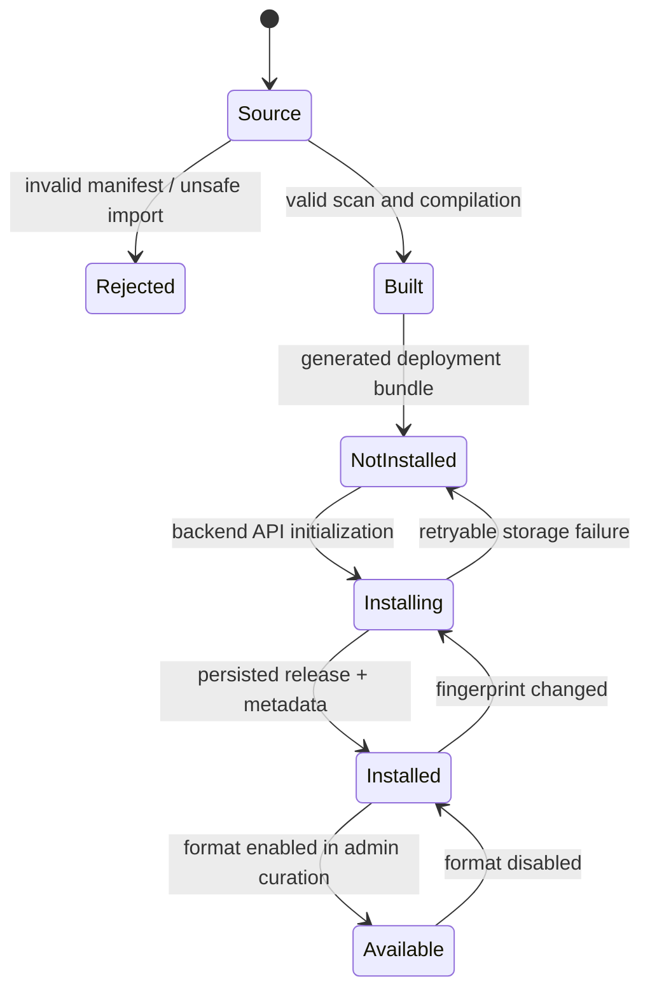

# Bundled Blueprints — Normative Specification

> Package: @gadgets/bundled-blueprints. Implementation: blueprints/, libraries/, src/{files,manifest,scan,generate}.ts; backend consumer: workshop-backend/scripts/build-bundled-blueprints.ts and src/bundled-blueprints.ts. This package is a build-time library, not a deployed Worker.

## Purpose and ownership
This package is the deployment's reviewed source tree for standard output formats and the self-contained libraries those formats import. It MUST NOT issue credentials, authorize gadget bindings, or become a separate runtime authority. The backend installs generated manifests and built files as ordinary Blueprint releases in BLUEPRINTS KV plus BLUEPRINT_CONTENT R2. 'Bundled' describes source provenance; an admin's format-list curation is distinct and MAY promote unbundled Blueprints or remove bundled ones.

## Source layout and compilation
Each blueprints/<name>/blueprint.json supplies a stable blueprintId, version, revision, presentation metadata, provenance and binding declarations. files/ is gadget code; __tests__/ is repository-only and MUST NOT be shipped. The standard document, spreadsheet and presentation formats live alongside shared libraries/ui, libraries/sync, libraries/pptx and libraries/zip. A blueprint's file tree MUST be scanned and manifest-validated before generation. The generation step produces a deterministic generated TypeScript module consumed by the Workshop backend; generated artifacts are not committed.

A TypeScript blueprint uses files/client.ts and files/server.ts as entrypoints, with eligible modules under files/lib/. These compile to single client.js and server.js outputs. Type declarations and internal TypeScript modules are build inputs, not installed files. Other non-module assets pass through. Library imports MUST use the public @gadgets/bundled-blueprints/libraries/<name>/client or /server subpath; only the corresponding side may use it. Client MUST NOT resolve cloudflare:workers; server MAY do so. Dynamic imports, require with nonliteral target, unresolved package imports, path traversal, external imports except library public exports, mixed JS/TS module trees, collision with generated filenames, declarations or extraneous TypeScript layouts MUST fail the build rather than changing the shipped semantics.

## Deterministic release and installation flow

A bundled release is a parentless, deterministic Git snapshot with fixed author, date and message. The same files MUST yield the same commit hash on separate installations; it MUST NOT accidentally depend on local Git metadata, creation time or the previous version. Every released pack MUST be loadable by the normal Blueprint reader. Installation is retriable and idempotent; a failed first attempt must not leave the service permanently claiming installation succeeded. A changed manifest presentation field and changed content MUST affect the installed-set fingerprint. Existing gadget instances are not silently modified when a bundled release changes: they take an explicit Blueprint-update path.

## State machine

## Security and compatibility invariants
Blueprints are user-authored executable code and MUST remain untrusted. A bundled manifest MUST NOT convey a live OAuth token, Durable Object stub, administrative grant or pre-approved Gatekeeper binding. Instantiation resolves the new user's resources through the normal capability selection and approval boundary. Stable blueprintId is immutable once a deployment has installed it: renaming the ID or changing a release hash without a deliberate migration strands existing followers. Typechecking MUST use separate Node, browser, Worker and test globals to prevent a client importing a server-only module.

## Verification requirements
Tests MUST cover invalid manifests, resource import boundaries, deterministic generation, side-specific TypeScript compilation, mixed-module rejection, content hash stability, bundled release installation/retry, admin format curation and upgrade without implicit gadget mutation. Run the package build through the root task graph and its Vitest suites. See packages/bundled-blueprints/README.md, docs/blueprints.md and libraries/README.md for operational detail.