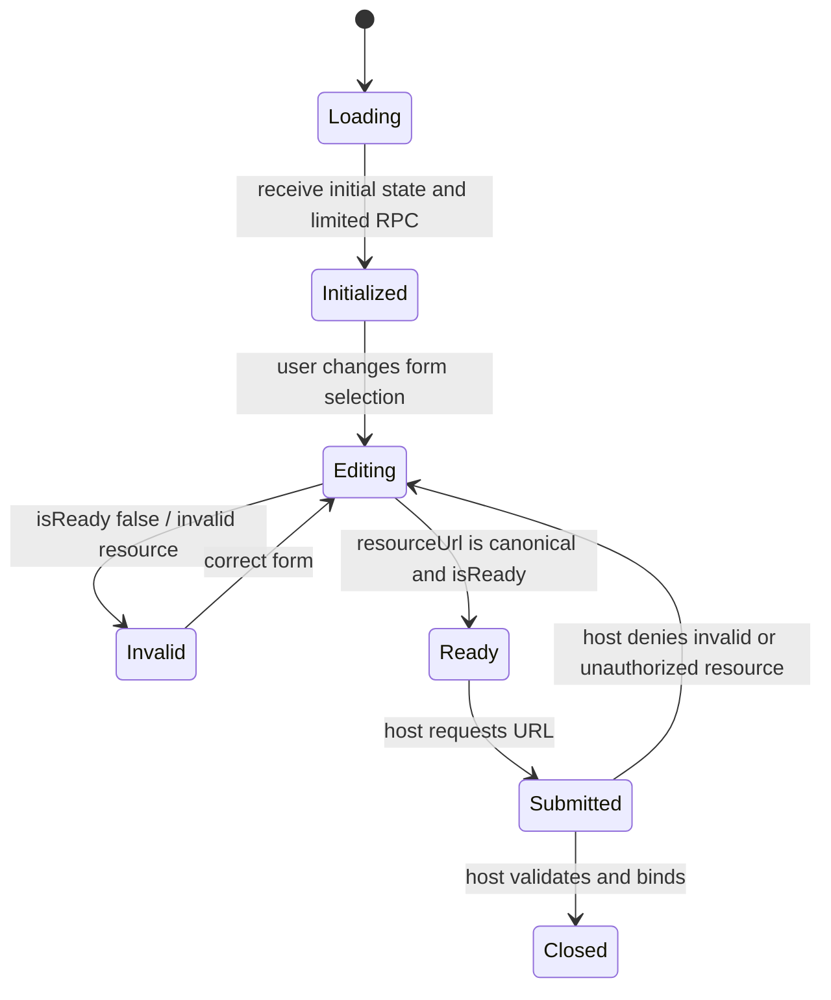

# `@gadgets/configurator-ui` Specification

> **Status:** Normative package specification. This package defines the source-level ABI used by sandboxed Gatekeeper resource configurators.

## 1. Mission

`configurator-ui` is a deliberately small UI DSL/contract for Gatekeeper-owned resource configuration forms. Configurator modules are compiled into self-contained sandboxed iframe applications by the repository build tooling. This package describes what those modules may render and how they translate form state into a concrete resource URL.

It is not a general application UI framework and MUST remain independent of React and Workshop business state.

## 2. State model

Configurator state is iframe-owned and flat:

```ts
Record<string, string | null | undefined>
```

The runtime passes the current values plus controlled mutation helpers to `render()`. A configurator MUST treat those values as the source of truth for its form. Gatekeeper RPC capabilities may resolve options/metadata, but they MUST NOT silently become a second independent form-state store.

## 3. `ConfiguratorUISpec` contract

Every configurator module implements the following conceptual contract:

- `initial` — initial field values.
- `initialValuesFromResourceUrl(context)?` — optional reverse mapping from an already-known concrete URL to editable form state.
- `isReady({ values })?` — optional synchronous readiness predicate.
- `resourceUrl({ values, ui })` — returns the canonical concrete resource URL represented by the current state.
- `render({ values, setValues, clearFields, ui })` — synchronously returns the UI tree using runtime-provided primitives.

`resourceUrl()` is security-relevant because the returned URL determines the scope later passed to the Gatekeeper. It MUST construct only URLs valid for the resource type represented by the configurator and SHOULD validate required/related fields before returning.

If `initialValuesFromResourceUrl()` is absent, the host runtime may seed fields from named URLPattern groups. Packages SHOULD implement the method only when the form field names and URL groups do not map naturally or an RPC is required for display state.

## 4. Gatekeeper capability

`ui` is an arbitrary, Gatekeeper-defined RPC capability. This package makes no assumptions about its method surface.

Configurator implementations MUST expose only the minimum RPC methods necessary for selection/display. A configurator iframe MUST NOT receive a raw connected-account capability, credentials, or the full Workshop API.

## 5. Runtime primitives

The package declares these sandbox runtime primitives:

- `Section`
- `Field`
- `TextInput`
- `RadioCards`
- `CheckboxList`
- `Autocomplete`
- `h`
- `Fragment`

Their source implementations intentionally throw because the actual implementations are supplied by the configurator sandbox runtime. Importing and invoking them outside that runtime is unsupported.

### `CheckboxList` encoding

The selected value is a comma-separated string because configurator values are flat strings. Therefore option values **MUST NOT contain commas** unless the configurator first applies an unambiguous encoding and decodes it when producing the resource URL. Otherwise one option can round-trip as multiple selections.

### Async options

`Autocomplete.loadOptions(query)` may perform asynchronous lookup. `CheckboxList.loadOptions()` loads the complete set and is intended only when that set is reasonably bounded. Configurators SHOULD avoid unbounded provider enumeration in either control.

## 6. Sandboxing contract

Compiled configurators are hosted by Workshop in a sandboxed iframe and communicate with their host/Gatekeeper only through explicit RPC/message channels defined by `workshop-shared`.

- Configurator code MUST assume it has no ambient Workshop authority.
- Host sizing/scroll/readiness behavior belongs to the configurator iframe/host protocol in `workshop-shared`, not to ad-hoc parent DOM access.
- The compiled bundle MUST remain self-contained for sandbox execution.

## 7. JSX boundary

The package supplies ambient JSX declarations specifically for configurator `.tsx` modules. Workshop application code and Gatekeeper server code SHOULD NOT import this package merely for utilities because doing so can collide conceptually and technically with React's JSX namespace.

Reusable server-side logic belongs elsewhere.

## 8. Build workflow

Gatekeeper packages containing `src/configurator/` are built through `scripts/build-gatekeeper-configurator.mjs`; local development rebuilds/watches them via `run-dev-server.js`. Generated iframe assets under a Gatekeeper's `src/generated/` are derived artifacts.

A change to this ABI MUST be coordinated with the compiler/runtime and every generated configurator that consumes it.

## 9. Testing requirements

Tests for this package or the configurator build runtime SHOULD verify:

- initial/readiness/resource URL semantics;
- URL reverse-seeding behavior;
- option-loading lifecycle/caching assumptions;
- comma-separated checkbox safety;
- failure isolation of Gatekeeper RPC calls;
- sandbox output remains self-contained.

Gatekeeper-specific configurators additionally require package tests for the concrete resource URL they produce.

## 10. Non-goals

This package does not own OAuth, account connection, resource authorization, persistent form storage, full-page Workshop UI, or Gatekeeper business logic.

## 11. Change checklist

- [ ] Flat value encoding remains backward-compatible or all configurators are migrated.
- [ ] New primitives are implemented by the sandbox runtime, not only declared here.
- [ ] No primitive requires ambient parent-window privilege.
- [ ] `resourceUrl()` semantics remain deterministic and scope-safe.
- [ ] Build tooling/tests and affected package specs are updated.

## 12. Current sandboxed configurator interaction flow

A configurator module runs inside an allow-scripts sandboxed iframe and owns its ephemeral form state. The host provides a narrow RPC capability and trusted UI primitives; the iframe must not obtain Workshop administrative authority, another account's credentials, or the parent page DOM. The typed spec provides initial state, optional initialValuesFromResourceUrl, optional isReady, resourceUrl and synchronous render. A returned resource URL is a proposed canonical resource identity and MUST be validated again by the Gatekeeper/Workshop before capability minting.



CheckboxList serializes selected comma-separated strings, so option values containing commas MUST be encoded safely or rejected. Distinguish display-only metadata from account-proven resource scope. Tests should cover malformed iframes, spoofed host messages, render exceptions, selection roundtrip and abandoned flow cleanup.
