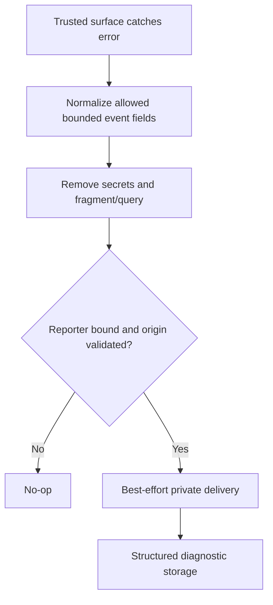

# `@gadgets/error-reporting` Specification

> **Status:** Normative package specification. This package defines the vendor-neutral diagnostic event contract shared by browser and Worker reporting paths.

## 1. Mission

`error-reporting` provides a stable, bounded representation of non-fatal/fatal application errors without coupling Cloudflare OS to a specific telemetry vendor. It normalizes browser-originated events and defines the event schema that backend reporting infrastructure forwards.

Telemetry is observational only. This package MUST NOT participate in authentication, authorization, approval, billing, resource selection, or other business decisions.

## 2. Event contract

The package's canonical event is the versioned `ErrorEventV1` family. Event data SHOULD identify:

- a stable source/component/surface;
- error name/message in bounded form;
- severity/handled status where available;
- capture mechanism;
- bounded stack/diagnostic details when safe;
- bounded scalar attributes.

Versioned event schemas MUST be evolved deliberately. Consumers MUST NOT reinterpret an existing version with incompatible semantics.

## 3. Browser telemetry trust model

Browser/client error reports are **untrusted diagnostic input**. A browser can fabricate any payload it can send.

Therefore:

- browser-reported identity, role, vendor, workspace, URL or error metadata MUST NOT be trusted as proof of authority;
- the server MAY enrich a report with trusted request-side context, but the original browser payload remains untrusted;
- unsupported/unknown fields SHOULD be dropped rather than forwarded blindly;
- parsers/normalizers MUST fail safely and MUST NOT throw into the application's primary path.

The Workshop frontend marker/version used for client reports is part of the compatibility surface and MUST be kept synchronized with the backend receiver.

## 4. Surfaces

Recognized first-party diagnostic surfaces include the Workshop shell and sandboxed Gatekeeper/configurator application contexts. Surface values are classification metadata, not a permission model.

Adding a surface SHOULD use a stable low-cardinality identifier rather than embedding resource IDs or user content.

## 5. Bounds and sanitization

All externally supplied text and attribute maps MUST be bounded before forwarding/storage. This is required to control:

- provider/logging cost;
- accidental leakage of large payloads;
- abuse through giant stacks/messages;
- cardinality explosions;
- downstream parser/display risks.

Attributes MUST remain scalar diagnostic values. Arbitrary nested application objects MUST NOT be accepted as telemetry attributes.

Secrets, credentials, raw request bodies, message bodies and full provider payloads SHOULD NOT be attached. Redaction at the source is preferred over downstream filtering.

## 6. Failure behavior

Normalization/report creation SHOULD be total over malformed input: invalid data is either safely reduced to a valid bounded event or rejected as telemetry without impacting the caller.

A reporting failure MUST NOT change the result of the user operation that triggered the report.

## 7. Relationship to `@gadgets/observability`

`@gadgets/observability/error-reporting` is the Worker-side delivery bridge. This package owns the neutral event shape/normalization; `@gadgets/observability` owns best-effort forwarding through deployment bindings.

The two packages MUST evolve together when the wire/event contract changes.

## 8. Testing contract

Tests SHOULD cover:

- malformed browser payloads;
- unknown fields/surfaces;
- maximum message/stack/attribute bounds;
- secret-sensitive inputs where redaction/omission is expected;
- stable version markers;
- normalizer no-throw behavior;
- serialization across Worker service boundaries.

## 9. Non-goals

This package does not select a telemetry backend, retry forever, provide distributed tracing, persist audit logs, or replace the security/audit trail produced by Gatekeeper observations/actions.

Application audit data and error telemetry are distinct contracts and MUST remain distinct.

## 10. Change checklist

- [ ] Existing event versions retain their meaning.
- [ ] New fields are bounded and low-risk.
- [ ] Browser data remains explicitly untrusted.
- [ ] No authorization/business logic consumes diagnostic assertions as truth.
- [ ] `@gadgets/observability` compatibility/tests are updated for wire changes.

## 11. Current reporting infrastructure

The Worker reporter is now `@gadgets/observability/error-reporting` rather than the retired `backend-utils/error-reporting` path. This package owns bounded serializable error event definitions and normalization; transport uses the optional ERROR_REPORTER binding. Client-originated reportedUserId is unverified and MUST NOT drive authentication, quota or authorization. `pageLocation` is reconstructed from origin and pathname only, not by truncating full href: query and fragment may contain bearer secrets. Gatekeeper management iframe errors are forwarded to the trusted Workshop host, which verifies source window and sandbox origin `null`, before reporting.

Never automatically capture user Gadget exceptions as first-party security telemetry without explicit trust partitioning. Test overflow, malformed exceptions, fake user IDs, iframe source spoofing, absent binding and errors on the reporting path.

## Grok MVP compatibility — 2026-10-13

This existing module's current implementation and authority remain unchanged in [Phase 1](../../ROADMAP.md). No new agent-platform package replaces it. Future reuse must be explicitly justified by tests and an approved phase.
