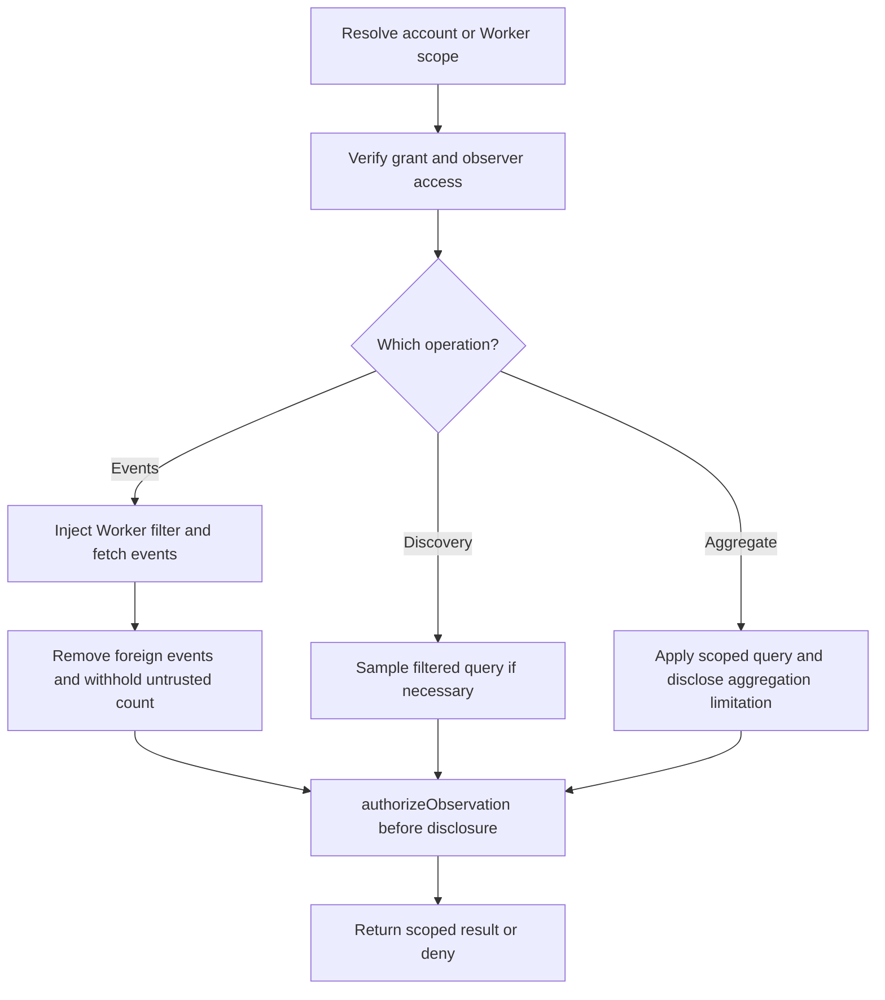

# Cloudflare Gatekeeper Specification

> **Package:** `@gadgets/cloudflare-gatekeeper`  
> **Status:** Normative package specification; inherits the root `SPECS.md` Gatekeeper and security contracts.

## 1. Role

This Gatekeeper connects a human Cloudflare identity to Cloudflare OS for Workshop sign-in, billing, and capability-scoped read-only Workers Observability:

1. verified-email authentication/sign-in;
2. access to the user's Cloudflare account/API token path used by the Workshop AI Gateway billing/top-up integration; and
3. bounded account-wide or single-Worker telemetry observations using an explicit observability grant.

It exposes URL-addressable account/Worker Observability resources. `getSupportedResources()` MUST describe them precisely; selecting Worker scope MUST NOT silently produce account-wide telemetry authority.

The package MUST remain an account/identity capability boundary; it MUST NOT leak the connected Cloudflare credential into Gadget or agent bindings.

## 2. Public Gatekeeper surface

The Worker exposes the standard Gatekeeper account lifecycle:

- `GatekeeperVendor.describe()`
- `connectAccount(callback, options?)`
- `getSupportedResources()`
- `getTypeScriptTypes()`
- connected account description/revoke/reconnect/authenticated-email verification

The connected account also implements the Workshop-only `CloudflareGatekeeperUser` extension from `workshop-shared/cloudflare-gatekeeper`, including `getUsableAccessToken()` for billing/inference infrastructure.

`getUsableAccessToken()` is privileged Workshop API. It MUST NEVER be forwarded into a Gadget session, generated Gadget TypeScript API, client iframe, agent prompt, or general management UI.

## 3. Authentication modes

`GatekeeperConnectOptions.scopes` controls the intended connection tier:

- `auth` — minimal/transient identity authorization sufficient to obtain a verified user email for sign-in.
- `full` — the persistent authorization used for the Cloudflare account integration.

The Workshop intentionally requests `full` when Cloudflare is used as a sign-in provider because the same flow also links AI Gateway billing. This is a system-level exception documented in the root spec; other auth Gatekeepers must not copy it by default.

## 4. OAuth workflow

The interactive browser flow MUST:

1. create a new account Durable Object for a first connection;
2. generate a cryptographically random initiation nonce;
3. store the nonce and callback inside the account object;
4. validate and consume the initiation nonce;
5. use OAuth state/PKCE protection for the provider round trip;
6. exchange the authorization code only after validating the expected state;
7. store persistent credentials only for the intended persistent connection mode;
8. call `GatekeeperConnectCallback.complete()` after successful connection;
9. on reconnect, preserve the account capability and stage the replacement credentials; only after Workshop redeems the initiating browser's single-use ticket and commits the exact stage may the live credentials and restoration status change.

Current nonce lifetimes are ten minutes for both initiation and OAuth stages. Nonce comparison is constant-time for equal-length random values. Access-token use includes an expiry safety window rather than waiting until the exact expiration instant.

Abandoned first-connect account state MUST be bounded/garbage-collected by the account flow.

## 5. Auth-only credential lifetime

An auth-only grant exists only to establish identity. It MUST NOT become a durable general Cloudflare capability. Temporary auth-only state SHOULD self-delete promptly after the login consumer has had an opportunity to retrieve the verified email.

## 6. Identity contract

`getAuthenticatedEmail()` MUST return only an email address the provider has established as belonging to the connected account and suitable for use as the Cloudflare OS login identity. It MUST return `null` when that guarantee cannot be made.

A friendly display value or browser-supplied email is not sufficient evidence.

## 7. Credential ownership

All provider tokens/refresh material belong to the account Durable Object (or deployment secret configuration where explicitly applicable).

- The frontend MUST never receive raw Cloudflare credentials.
- `UserDurableObject` stores the connected account capability, not a duplicated token.
- Billing code may request a short-lived usable access token through the Workshop-only account extension.
- Token refresh/rotation/reconnect/revoke operations MUST not race in a way that can resurrect stale credentials.

## 8. Resource model

The package advertises Cloudflare account- and Worker-level read-only Observability resources. Binding scope MUST match the resource selected, and a provider OAuth scope MUST NOT be confused with a specific Worker capability. Do not synthesize broad `https://*` Gadget authority from the connected billing account. No telemetry session exposes the Workshop-only billing credential.

## 9. Security requirements

- Connection/reconnection URLs MUST include unpredictable expiring nonce material.
- OAuth callback state MUST be bound to the intended account object/attempt.
- Tokens MUST be excluded from logs and error telemetry.
- Auth-only credentials MUST not be reused as persistent capability credentials.
- The Workshop-only access-token method MUST remain unreachable from untrusted Gadget code.
- Provider authorization/revocation failures MUST transition the Workshop account to an expired/unusable state rather than silently continuing with stale authority.

## 10. Build/configuration

The Worker entrypoint is `src/cloudflare.ts`, compiled/validated through the repository Gatekeeper Worker build conventions. Provider client credentials are deployment secrets/dev variables and MUST NOT be committed to tracked Wrangler configuration.

The local dev server may inject shared `CLOUDFLARE_OAUTH_CLIENT_ID` / `CLOUDFLARE_OAUTH_CLIENT_SECRET` values into this Worker's generated dev config.

## 11. Tests

Tests SHOULD cover:

- invalid, expired and replayed nonces;
- auth vs full connection modes;
- verified-email behavior;
- reconnect/expiry notifications;
- token refresh safety/rotation behavior;
- inability to surface the Workshop-only token API as a Gadget resource;
- empty Gadget resource catalog until explicitly changed.

## 12. Compatibility/change rules

The distinction between transient sign-in and persistent Cloudflare account authority is compatibility- and security-sensitive. Changes to scopes, identity semantics, account-token behavior or the Workshop-only extension MUST update `workshop-shared`, `workshop-backend` billing/auth consumers, tests and this specification together.

## 13. Current Cloudflare resource capabilities (main)

The old "identity and billing only" framing is superseded. The same Gatekeeper also supports read-only Workers Observability at account or Worker granularity. A user must explicitly grant `workers-observability.read`; billing grants alone are not sufficient. Account resources may query logs, events, aggregated metrics and traces; a Worker resource MUST inject an immutable service filter. In addition to trusting the remote filter, event reads MUST discard any events for another service, and MUST NOT return a provider-wide count if foreign-service events demonstrate that filtering was dropped. Filtered metadata discovery uses sampled filtered telemetry queries because upstream keys/values endpoints ignore their filter arguments. Cross-service aggregate trace summaries are account-only; known trace event lookup remains limited to the Worker service. Aggregations that cannot be verified after filtering require clear limitations, not invented isolation.

Provider errors sometimes echo caller-supplied filter values. Logs MUST record provider status/error codes rather than unsafe returned text, and must not disclose query contents. Paginated account selection MUST traverse pages rather than assuming the provider's first 20 results are complete. An observer must independently demonstrate Cloudflare access to the exact connected account or Worker; 5xx/transport failures deny rather than grant observation.

### Observability request flow

Sign-in Cloudflare grants intentionally differ from other providers: the billing connection may persist, but `getUsableAccessToken` remains exclusively Workshop-side. Add test coverage for cross-worker leakage, provider filter failures, observer denial, result metadata/aggregates and credential boundaries. See README.md and src/observability-*.ts.
