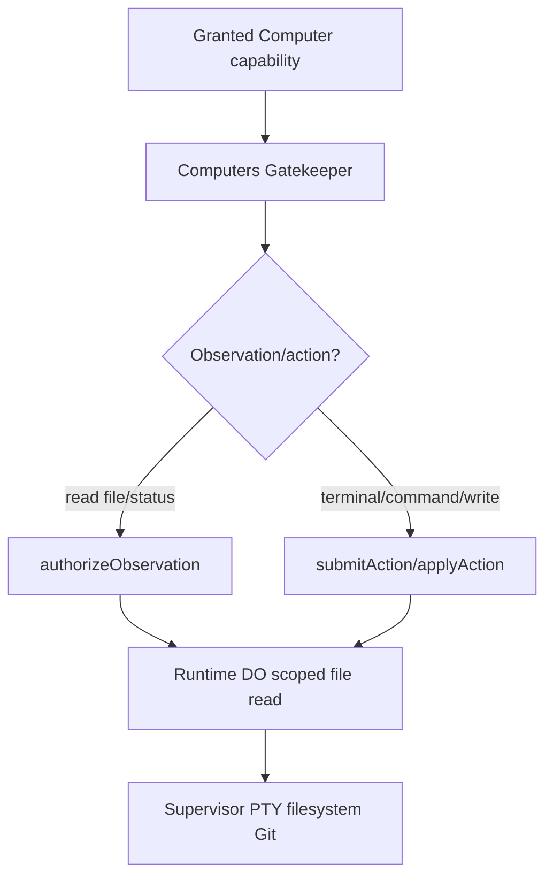

# Gatekeeper Computers — SPECS

**Kind:** independent Cloudflare Gatekeeper Worker following the repository's Gatekeeper authoring guide.  
**Status:** proposed API for review; implementation pending.

## Responsibility

Expose separately grantable computer capabilities for a session: bounded file inspection, terminal attachment, command execution when explicitly authorized, and checkpoint operations. It never owns the ACP run journal or provisions a new session.

## Capability granularity

A ComputerHandle binds one session and one generation plus an explicit set of capabilities: readFiles, terminal, executeCommand, checkpoint and restore. File grants include a canonical root and maximum read size. Command grants include an allowlisted command/profile, working directory, environment allowlist, runtime ceiling and output caps. Defaults are deny.

## Operations

- inspectFiles(path, limit) and readTextFile(path, maxBytes): observations, root-bound and path-normalized, with traversal/symlink protections and authorizeObservation.
- startTerminal(): human UI terminal only after user/session authorization; mint a short-lived single-use ticket bound to principal, origin, session and generation.
- runCommand(commandSpec): a side effect; submit for approval unless a narrowly defined policy explicitly permits it. Do not expose arbitrary shell or pass untrusted text to sh -c by default.
- checkpoint/restore: idempotent operations with manifest/checksum and release compatibility checks.
- previewPort(port): future capability, deferred until authenticated ingress and port allowlisting are implemented.

## Safety

Terminal tickets require expiry, nonce/JTI replay prevention, origin binding, principal/session binding and generation fencing. File operations must reject traversal, symlink escapes and oversized/binary payloads. Logs contain action metadata, not secret file contents or environment values.

## Implementation checklist

Follow the Gatekeeper authoring guide. Define src/types.d.ts and generated src/types.txt before implementation and review the public API first. Use canonical action/approval and observation contracts. Test cross-user/session denial, ticket replay/expiry, stale generation, path traversal, symlink escape, command timeout, output truncation, unauthorized ports and checkpoint integrity.


## Authority and terminal boundary

See [ACP_CONTRACTS_V1](../../docs/architecture/ACP_CONTRACTS_V1.md) sections 3 and 7. A terminal PTY with arbitrary input is a privileged human Computer capability; it MUST NOT be treated as a safe command allowlist or inherited from CodingAgents/ACP permission. Enforce short-lived single-use generation-bound ticket claims, nonce consumption, origin/principal/session binding and per-session terminal metadata. Bounded file list/read are observations, while writes and commands are actions requiring reviewed grant/approval. `src/types.d.ts` remains a proposed interface until validated against Cap'n Web and observer/approval requirements.


## Unified Agent Platform v2 — executable implementation draft (2026-10-13)

**New normative scope:** [Unified Architecture](../../docs/architecture/AGENT_PLATFORM_UNIFIED_V2.md), [User input ledger](../../docs/architecture/USER_INPUT_LEDGER.md), [Implementation stages](./plan.md). This section extends the earlier ACP/session-only description to agent definitions, independent Tasks, loop strategies, native Workshop engine parity, pluggable protocol drivers, subagents and tools where relevant. It is an IMPLEMENTATION DRAFT, not deployed code.

### Data path and package dependencies



### Canonical interfaces and data shapes to implement

```typescript
interface Computer {status():Promise<ComputerStatus>;readFiles(input:{paths:string[];maxBytes:number}):Promise<FileRead[]>;listFiles(input:{path:string;limit:number;cursor?:string}):Promise<FilePage>;requestTerminal(options:{terminalId:string;origin:string}):Promise<ActionReceipt>;executeCommand(cmd:{profileId:string;args:string[];cwd:string;timeoutMs:number}):Promise<ActionReceipt>};
type TerminalGrant={sessionId:string;terminalId:string;principalId:string;generation:number;origin:string;jti:string;exp:number}
```

These records must be validated against versioned ACC/ACP JSON Schema at Worker boundary, mapped to existing Cap'n Web capabilities where human/Gadget RPC is used, and have typed retryable versus UNKNOWN outcome errors. The schema fragments above are drafts; generated final validation and migrations are acceptance requirements.

### Proposed source layout

```text
packages/gatekeeper-computers/
  src/{types.d.ts,worker,account,facet,scope,actions,observations,tickets}.ts
  src/__tests__/{files,traversal,tty,permissions,observer,stale-token}.test.ts
  cloudflare.config.ts and generated src/types.txt
  SPECS.md
  plan.md
```

### Semantics and concurrency

Computer capabilities are separate from CodingAgent capabilities. Arbitrary PTY and shell require higher privilege than a prompt/tool approval. File read observations are bounded and root-safe; writing/exec/export actions honor Gatekeeper submit/apply. Ticket bound to principal origin session generation, single use and ≤60s.

**Destillation/reference:** Grokbot PTY/tmux terminal, file browser, signed permits; cloudflare-os PR#2 terminal/error UX; current Gatekeeper authoring guide. Pin actual source commit and test fixture before copying, and update F-001…F-017 migration evidence. Distinguish existing Workshop capabilities from new target components; no duplicate identity, scheduler, approval or MCP-import framework.

### Acceptance

A change is done only with strict schemas, migrated/verified data shapes, tests for idempotent admission, partial protocol messages, replay and crash/reconciliation, deny-by-default resource grants, source provenance and staging E2E for deployed services. Verify that core Workshop Code Mode and Gatekeeper simulation tests remain green.
