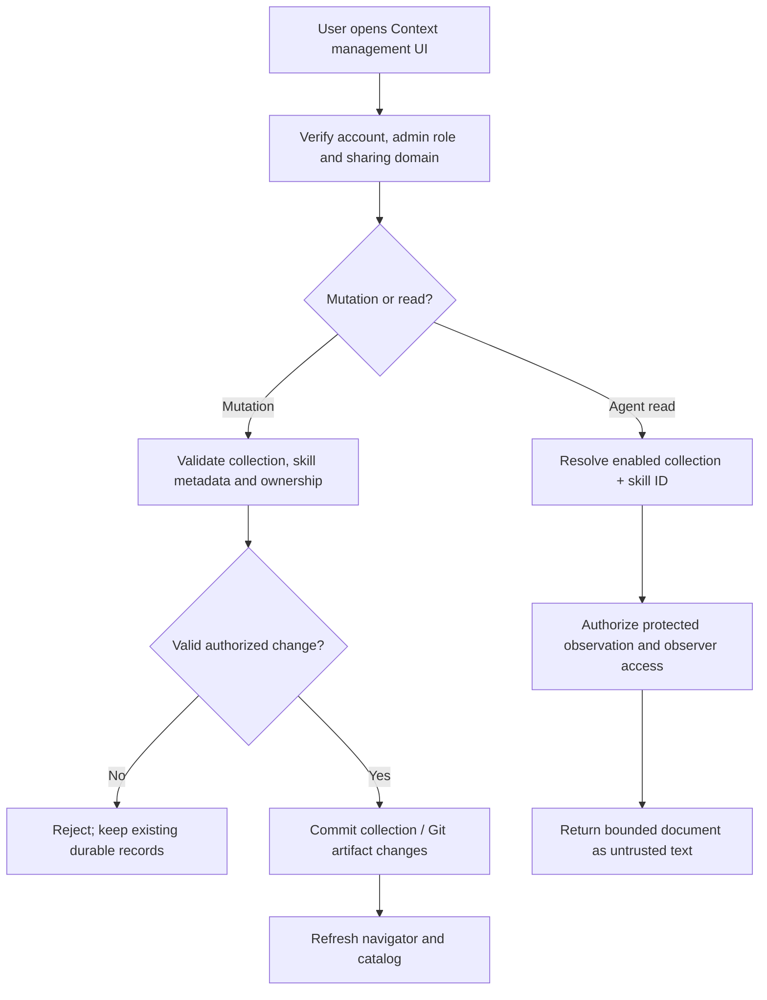

# Context Library Gatekeeper Specification

> **Package:** `@gadgets/gatekeeper-context`  
> **Status:** Normative package specification. This is an ambient, auto-provisionable Gatekeeper with both an agent-facing singleton and a sandboxed management app.

## 1. Mission

The Context Library provides durable user/workshop context and skills as a native Cloudflare OS capability. Unlike OAuth Gatekeepers, its authority and data live inside this deployment. It is designed as a read-oriented ambient library for agents plus a user-facing library management application.

It MUST remain isolated by the deployment's **sharing domain** so data belonging to one Workshop deployment/domain cannot be accidentally surfaced to another.

## 2. Worker surface

The package exports its core Durable Objects/entrypoints from `src/index.ts`, including the Context collection/library storage objects, registry, `GatekeeperVendor`, `ContextAccount`, verifier and resource Gatekeeper.

The Worker HTTP handler itself is not the primary data API; privileged access is through Worker RPC capabilities.

## 3. Account model

The vendor advertises `autoProvisionsAccount: true` and does not require OAuth or external credentials.

Account behavior:

- one auto-provisionable Context account per user;
- account description advertises an ambient singleton session and a management UI;
- no URL-addressed `SupportedResource` catalog is exposed;
- reconnect is unsupported because there are no provider credentials;
- no authenticated external email identity is supplied;
- revocation/deletion semantics MUST distinguish user-private data from data owned by the shared deployment/domain.

The root ambient provisioning policy is authoritative: `optional` is the default, `enabled` force-provisions, and `disabled` suppresses availability. This package MUST NOT auto-force itself independently of the kernel policy.

## 4. Sharing-domain isolation

The service binding carries a `sharingDomain` property identifying the Workshop/deployment namespace. All storage/registry decisions that distinguish shared/public context MUST incorporate this domain.

A missing or mismatched domain MUST fail closed rather than causing data from another domain to become visible.

Local development currently injects a single `sharingDomain: "dev"` binding prop from `run-dev-server.js`.

## 5. Agent-facing capability

The singleton resource is conceptually the user's Context Library and is exposed through an ambient Gatekeeper binding such as `CONTEXT`.

Current agent-facing operations are read-oriented and include the conceptual capabilities:

- search context/skills by query and optional collection scope;
- list collection/path contents;
- read a selected document/context item;
- progressive-discovery catalog entries for skills/resources;
- slash-command discovery/invocation where provided by the resource.

Every operation returning context content MUST be observation-authorized before disclosure to the Gadget/agent.

The ambient singleton MUST NOT expose management/deletion authority merely because the management app has it.

## 6. Management application

The account advertises a full-page management UI (`providesUi`, presented as Context & Skills). The UI runs as a sandboxed `GatekeeperUiFrame` and receives only its Gatekeeper-defined RPC capability.

The management application may perform user-authorized library management operations, but:

- it MUST not receive Workshop-wide privileged RPC;
- it MUST respect sharing-domain and ownership boundaries;
- any `isAdmin`-dependent functionality MUST use the fresh app-open context supplied by Workshop rather than persist an old admin decision as authority;
- frontend/browser state is never the authority for ownership.

## 7. Storage ownership

The package owns durable Context data structures and indexes required by its library/registry. User-private and domain-shared records MUST have explicit ownership semantics.

Account revoke/removal MUST NOT delete domain-owned/public collections simply because one user's ambient account is removed. Conversely, private data that is explicitly owned by that user's account may be cleaned up according to the account contract.

Storage schema changes MUST provide backward-compatible reads/migrations at the package level; `typed-storage` does not provide automatic schema version migrations.

## 8. Observer/sharing semantics

Because Context data can have collection-specific visibility, observer handling MUST reason about the actual observed collections/documents rather than treating all Context data as universally shareable.

The Gatekeeper tracks enough information to verify or constrain observer access. If a collaborator cannot be established as allowed to view an observed collection/item, disclosure MUST fail closed or the observer MUST be excluded through the shared observation policy.

## 9. Actions

The agent-facing Context singleton is currently read-only for the standard Gatekeeper action contract. It MUST NOT advertise ordinary auto-approvable mutations unless a future write API is explicitly specified.

Management-UI mutations are separate privileged user operations and MUST NOT be accidentally reachable through the ambient agent session.

## 10. Security invariants

- Sharing-domain isolation is mandatory.
- Ambient provisioning follows kernel policy; default is not forced authority.
- Agent-facing reads require observation authorization.
- Management authority is not inherited by the read singleton.
- User-private deletion cannot delete domain-owned shared data.
- Browser management UI is sandboxed and capability-limited.
- Context documents/skill text are untrusted content from the agent-security perspective and MUST NOT be treated as system instructions merely because they are stored in this package; skill/catalog presentation must preserve the agent framework's trust rules.

## 11. Build workflow

The package builds a single-file management app through `build-app.mjs`; generated app HTML is written into the Worker source tree as a derived asset for bundling. Local dev rebuilds/watches it automatically.

The package uses the shared Workshop/Gatekeeper, typed-storage, observability/error-reporting and library parsing/git dependencies declared by its manifest.

## 12. Tests

Tests SHOULD cover:

- auto-provision account lifecycle under optional/enabled/disabled policy integration;
- sharing-domain isolation;
- private vs shared collection ownership on revoke;
- search/list/read observation authorization;
- observer verification/exclusion by collection;
- management app RPC authorization;
- catalog/slash-command discovery bounds;
- storage compatibility/restart behavior.

## 13. Change rules

New Context write APIs, public-sharing modes, skill execution semantics or storage ownership classes are architectural changes. They require root/pacakge spec updates, explicit policy/observer treatment, storage migration design, sandbox API review and integration tests in the same PR.

## 14. Skill collections, navigator and synchronization

The current management application includes a hierarchical skill navigator with create, rename, move, delete, upload and collection editing. Private collections are account-owned; public collections are domain-scoped/admin-managed. Any operation involving a collection or Git-backed artifact MUST check the actor's management authority, domain and expected data revision on the server. A drag/drop or rename gesture in the shared UI is only a proposed mutation; visual state cannot override storage ownership.

A skill manifest is a literal `SKILL.md` with YAML frontmatter. `name` uses lowercase letters, numbers and single internal hyphens (at most 64 characters); `description` is nonempty and at most 1024 characters. Invalid YAML, absent frontmatter or ambiguous rename must fail rather than silently create a malformed skill. The agent catalog includes collection entries first and at most 150 skill entries; excess skills remain discoverable through the session list/search and the truncation signal. Slash commands carry explicit originating collection/path context, not privileged instructions. Skill text and documents are untrusted content; loading them MUST NOT elevate them to system-policy authority.

### Management and read flow

Collection/skill Git sync MUST preserve existing content when import/update fails, never cross sharing domains or delete public collections on private-account revocation. Tests MUST include upload/frontmatter parsing, rename preserving unrelated YAML, move/cycle guards, tree deletion, Git-backed synchronization, catalog cap/truncation, role/domain access and observer refusal. See src/agent-skill.ts and app/skills/.

## Cross-module agent-platform boundary audit (2026-10-13)

This package is a preexisting authority/consumer of agent-platform behavior. Refer to the [source-grounded no-overlap audit](../../docs/architecture/EXISTING_MODULE_BOUNDARIES_AUDIT.md) and root SPECS §23 before accepting any overlapping implementation. **Specific requirement:** AgentDefinition.instructionsRef and context/skill access MUST point to existing Context Library collection and use owner/workspace grants; do not implement a second global context/skills database as an agent platform feature.

Any downstream addition needs existing consumer regression tests plus scoped-auth/idempotency/race tests; a documentation reference is not proof of runtime implementation.
