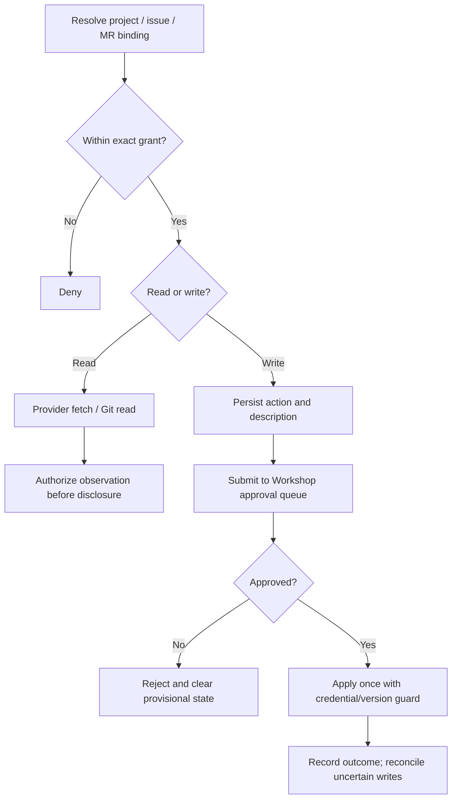

# GitLab Gatekeeper — Normative Specification

> Package: @gadgets/gitlab-gatekeeper. Source entrypoint: src/gitlab.ts; API, resource, session, cursor and transport rules: src/gitlab-*.ts. This is a deployed Gatekeeper Worker.

## Responsibilities and resources
GitLab exposes three independently grantable resource types: project, issue and merge request. A GitLab connection MAY target gitlab.com or a configured self-hosted instance. Each facet MUST enforce the precise selected resource scope even when the connected account token can see more. An issue or merge-request binding MUST NOT accidentally grant another issue/MR or the entire project. Read/search, review, discussion, Git worktree pulls and proposed pushes are controlled by the shared Gatekeeper observation/action contract.

## Identity and OAuth
Sign-in, only when gitlab is in the deployment AUTH_GATEKEEPERS allowlist, requests read_user and MUST accept only the confirmed primary email as account identity. Sign-in credentials are transient. Persistent connections request the GitLab API and Git-over-HTTPS permissions (api plus write_repository); no provider secret or token is handed to a Gadget. OAuth code exchange MUST use checked state/PKCE, one-use nonce, exact callback URL, credential-generation fences and the Workshop's single-use browser handoff ticket. Refresh-token rotation MUST be serialized and persisted atomically. GitLab may invalidate the previous access token on refresh: one read may be replayed after fresh credentials; a write MUST NOT be automatically replayed.

```mermaid
stateDiagram-v2
  [*] --> Disconnected
  Disconnected --> Authorizing: mint nonce + PKCE
  Authorizing --> AwaitingHandoff: exchange code and stage grant
  Authorizing --> Disconnected: cancelled / expired / invalid email
  AwaitingHandoff --> Connected: Workshop redeems ticket
  AwaitingHandoff --> Disconnected: ticket expires
  Connected --> Refreshing: token near expiry / auth rejection
  Refreshing --> Connected: replacement grant rotated
  Refreshing --> Expired: definitive invalid_grant
  Connected --> ReconnectStaged: new user grant obtained
  ReconnectStaged --> Connected: commitReconnect exact stage
  ReconnectStaged --> Connected: failed / expired stage; old grant retained
  Connected --> Revoked: revoke
  Expired --> Authorizing: user reconnects
```

## Git and action lifecycle
Repository code reads use the provider's Git smart-HTTP transport and scoped worktree API. Pending push must be a staged Gatekeeper action. Mutating issues, merge requests, discussions, reviews and pushing commits MUST be described for human approval before an external side effect. GitLab's requestChanges semantics MUST fail explicitly on unsupported server versions (before GitLab 19.2); never silently downgrade to a comment. Provider 3xx relocation of bound projects MUST NOT be followed with credentials or writes: require an explicit rebind after rename/transfer.

## Self-hosted endpoint security
GITLAB_URL (browser identity origin) and GITLAB_API_URL (Worker request origin) MUST be HTTPS origins without a path; localhost loopback HTTP is a development-only exception. Any Cloudflare Access service-token pair MUST be set together and MUST be attached only to the explicitly configured trusted API/git target, not to user-supplied redirects. OAuth and Git requests MUST follow strict host/redirect validation to avoid token exfiltration. A Worker Preview callback relay MUST use signed, short-lived state and approved preview hostnames.

## Simulation, observer and recovery
Staged actions MAY appear as optimistic changes in read results, but MUST be distinguishable from committed remote data. Every protected read MUST pass observation authorization and the configured observer verifier; third-party collaboration is not proof of resource access. Unknown-outcome Git pushes or provider mutations MUST be reconciled rather than blindly replayed. Revocation terminates future access, while stale callbacks and older connect generations MUST NOT revive it.

## Tests and definition of done
Exercise transient sign-in vs persistent connect, confirmed email, PKCE/nonce replay, handoff, reconnect/refresh rotation, self-hosted endpoint restrictions, Git pull/push authorization, per-resource isolation, reviewer version bounds, observer verification, approval rejection, uncertain write reconciliation and escaped approval text. No provider write may occur in an unapproved action path. See packages/gatekeeper-gitlab/README.md and plans/gitlab-gatekeeper.md.