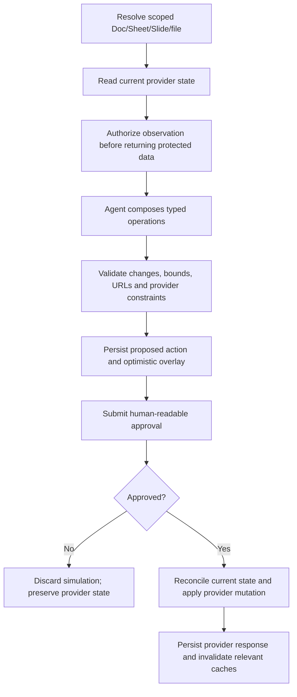
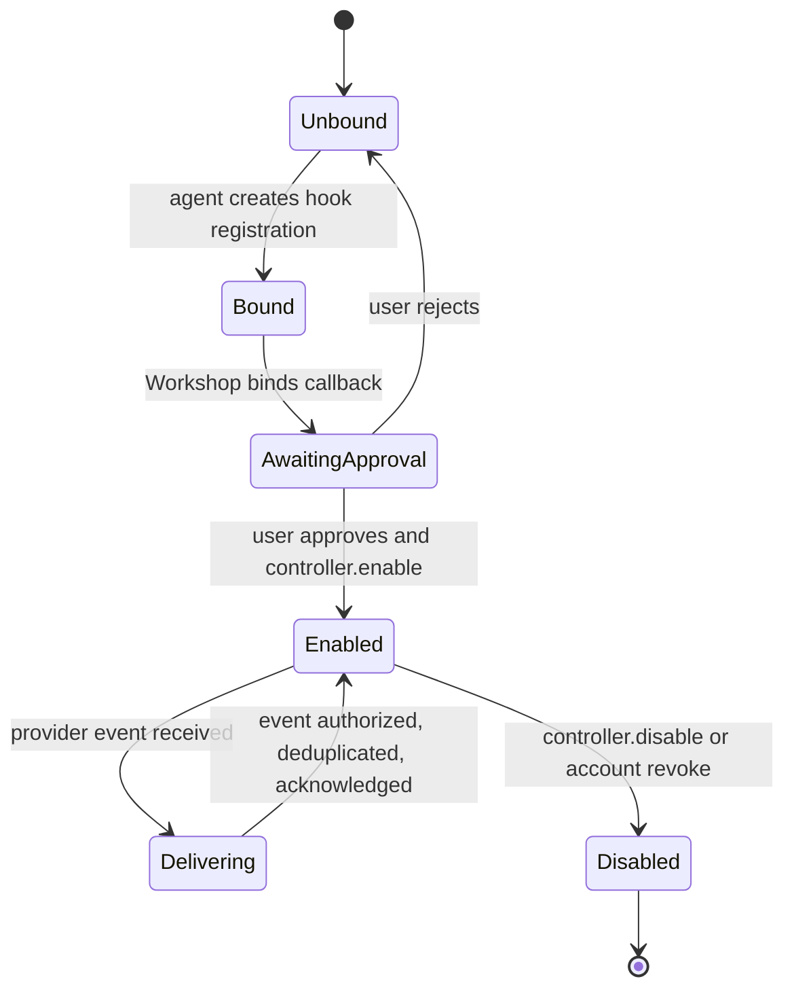

# Google Gatekeeper Specification

> **Package:** `@gadgets/google-gatekeeper`  
> **Status:** Normative package specification. This Gatekeeper consolidates multiple Google APIs behind explicit resource types and least-privilege resource grants.

## 1. Mission

The Google Gatekeeper provides OAuth-backed access to selected Google services while retaining credentials in one account capability. It also provides verified Google identity for Cloudflare OS sign-in.

The package supports several logically distinct resources and MUST preserve their authorization/scope boundaries rather than treating a connected Google account as universal Google authority.

## 2. Resource model

Current grantable resource families include:

- Gmail mailbox/account access;
- a Google Docs document;
- a Google Sheets spreadsheet;
- a Google Slides presentation;
- Google Drive account/file/folder resource scopes;
- Google Chat account/space/thread scopes;
- a Google Calendar/calendar scope;
- a Google BigQuery project.

The concrete `SupportedResource.urlPattern` definitions in source are the executable URL contract. Resource configurators MUST produce canonical URLs matching those patterns.

A grant for one document, sheet, presentation, Drive file/folder, Chat space/thread, calendar or BigQuery project MUST NOT silently authorize another resource.

## 3. OAuth scope model

Identity/auth scopes include the provider's OpenID/profile/email capabilities required for verified identity.

Capability scopes are assembled from the resource types requested at connect/ensure-resources time. Current resource needs include, conceptually:

- Gmail read/modify/label scopes needed by the Gmail API exposed by this package;
- Docs document access plus Drive metadata needed for resolution;
- Sheets read/edit access and Drive metadata for spreadsheet resolution;
- Slides presentation access and Drive metadata for presentation resolution;
- Drive file/folder read scope and metadata necessary for nested selection;
- Google Chat account/space/thread scope and hook permissions;
- Calendar list/event scopes matching the exposed API;
- BigQuery authority required to submit jobs while the Gatekeeper itself enforces the allowed query semantics.

The implementation MUST request no broader scope solely for convenience when a resource-specific set is available. Adding a resource requires updating resource→OAuth-scope mapping and ensuring an existing account can explicitly acquire the additional authorization through the standard account resource-expansion workflow.

## 4. OAuth/credential lifecycle

Connection and OAuth state use cryptographically random, expiring, single-use nonces (currently ten-minute stages). Token mint/exchange/revoke operations have bounded timeouts and refresh logic includes expiry safety.

The account Durable Object owns refresh/access tokens. Token minting SHOULD be coalesced/cached for a short bounded interval and MUST avoid provider stampedes. Repeated mint failure SHOULD use a bounded cooldown rather than hot-looping provider auth.

Reconnect MUST stage new credentials and keep the live grant unchanged until Workshop confirms the nonce-bound handoff ticket and calls commitReconnect(stageId); only then is restoration reported.

## 5. Sign-in identity

`getAuthenticatedEmail()` MUST return only a provider-verified Google email identity. OpenID claims used for sign-in MUST satisfy the provider verification signal; an unverified claim MUST NOT key a Cloudflare OS user.

Auth-only connection mode requests only the identity tier and is transient under the root contract.

## 6. Observation rules

All protected service data is an observation. This includes messages/threads, Docs content, Sheet values/metadata, Calendar data and BigQuery query results.

Every read method MUST await observation authorization before returning data to the Gadget. Fan-out, pagination, message bodies and table/query results MUST be bounded according to the concrete method contract.

Provider content is untrusted agent input even after access is authorized.

## 7. Action rules

Mutating Gmail/Docs/Calendar/etc. methods exposed by the generated API MUST use staged approval actions. The provider write occurs only from `applyAction()`.

Pending changes SHOULD be simulated where the package has a reliable overlay model. Otherwise the action description SHOULD set `awaitDecision` so the agent cannot assume the mutation happened.

Action descriptions MUST identify the Google service, concrete target and consequential proposed change.

## 8. BigQuery safety

BigQuery is a special resource because the provider job API can execute SQL with potentially broad effects.

The Gadget-facing BigQuery contract MUST remain read-oriented according to the package's current design. Query validation/enforcement MUST live server-side in the Gatekeeper/API layer; UI prompts or model instructions are not sufficient controls.

Dry-run/job validation may be used to understand cost/schema, but any future mutating SQL capability requires an explicit action design and this spec update before implementation.

## 9. Observer verification

A shared workspace collaborator must independently have access to each underlying Google resource. The verifier/resource checks MUST fail closed when the observer cannot access the bound document/mail/calendar/project.

A broad Google account connection is not itself proof that the collaborator can see a specific resource.

## 10. Configurator contract

Sandboxed configurators may query narrow Gatekeeper account RPCs to resolve Docs, Sheets, Calendars, projects or other options. They MUST return canonical URLs matching exactly one advertised resource type and must not embed credentials/provider tokens.

## 11. Security invariants

- Nonce/OAuth state is replay-protected.
- Provider-verified email only for sign-in.
- Credentials remain inside the account object.
- OAuth scopes are derived from requested resource capability.
- Every protected read authorizes before disclosure.
- Every side effect stages before application.
- BigQuery query restrictions are enforced server-side.
- Resource grants are narrow and observer-verifiable.
- Token retries/timeouts/cooldowns are bounded.

## 12. Build/configuration

Worker entrypoint: `src/google.ts`. Configurator assets are generated from source via the shared build script.

OAuth client credentials come from deployment secrets/dev vars. The root dev launcher maps shared Google credentials into generated dev config; tracked config MUST NOT contain secrets.

## 13. Tests

Tests SHOULD cover:

- auth/full resource scope derivation;
- adding resources to an existing account;
- verified-email handling;
- nonce/reconnect/token-refresh concurrency and failure cooldown;
- URL parsing/configurators for every resource family;
- observation authorization for each API;
- action staging/application for each mutating API;
- BigQuery read-only enforcement/adversarial SQL;
- independent observer verification.

## 14. Change rules

A new Google service/resource requires explicit URL pattern, OAuth scopes, account-resource expansion behavior, configurator, Gadget types, observation/action policy, observer verification and tests. It MUST NOT be added as an unscoped method on an existing broad account session merely to avoid defining the resource boundary.

## 15. Expanded Google Workspace surface (current main)

The initial spec predates Gmail/Drive/Chat/Slides/Sheets implementation depth. The deployed package provides separate sessions and configurators for Gmail, Docs, Sheets, Slides, Drive, Calendar, Google Chat and BigQuery. Each requested Google OAuth scope MUST be tied to the resource grant or hook being enabled. Transient verified-email sign-in is NOT the same as a persistent Workspace account grant.

### 15.1 Per-resource authority matrix

| Resource | Read scope | Mutating surface |
| --- | --- | --- |
| Gmail | Account/mailbox and scoped messages/threads, subject to Gmail visibility | Draft/send/label or related operations through staged approval; inbound new-message hooks require approved bind/enable |
| Drive | Selected account, file or folder with canonical scope and observer ACL checks | Drive read-only bindings do not imply arbitrary Drive writes; creating Google files is a separately described action |
| Docs | Selected document, comments/content as permitted | Typed edit batches using staged actions, with resulting content and drift/validation checks |
| Sheets | Spreadsheet or selected range/sheet, respecting canonical IDs and formulas | Structured cell, format and sheet operations, simulated before approved apply |
| Slides | Presentation/slides and presentation structure | Element, layout, shape/text mutations through validated staged proposals |
| Calendar | Selected calendar/events as permitted | Event actions with human description, no mutation by reading |
| Google Chat | Account, space or thread according to grant and thread scope | Messages and webhook-style notifications through approved action/hook lifecycle |
| BigQuery | Dataset/job/query resource with bounded read scope | Queries requiring write authority MUST NOT ride a 'read-only' observation path |

The matrix is an overview, not a claim that every Google API operation is exposed. Session method names/types under src/*.d.ts and tests remain the executable API definition.

### 15.2 Workspace document mutation flow

### 15.3 Google Chat and Gmail hooks
New-message hooks start as bound-but-disabled capability grants. Provider registration, event delivery cursor and persistent delivery MUST only be enabled on approved HookController.enable. Provider push notifications can be duplicated or arrive out of order; deduplication and durable cursor advancement must be handled before callback delivery, and callback observations require authorization. Disabling a hook must stop further user-visible callbacks and perform best-effort provider cleanup.

### 15.4 Credential, sharing and idempotency invariants
All token changes follow nonce/PKCE, Workshop origin-and-session-bound handoff, exact reconnect credential staging/commit and generation fencing. Folder-contained Drive scope MUST not be generalized to arbitrary account-wide files. Slides/Sheets optimistic simulations MUST distinguish pending changes from provider-confirmed values. Every observer must independently prove appropriate permission for the observed file/message/calendar/space scope or be refused. Dangerous or provider-credit-consuming BigQuery operations must not be mislabeled as plain read operations.

### 15.5 Verification
Exercise Drive file/folder scope and nested lookup, chat thread/space identity, Gmail pagination and hooks, Docs/Slides/Sheets editing simulations/rejection/commit, OAuth refresh and handoff replay, observed-content exclusion and binary/document-size bounds. See packages/gatekeeper-google/README.md, docs/google-chat-capabilities.md and package-local workerd tests.