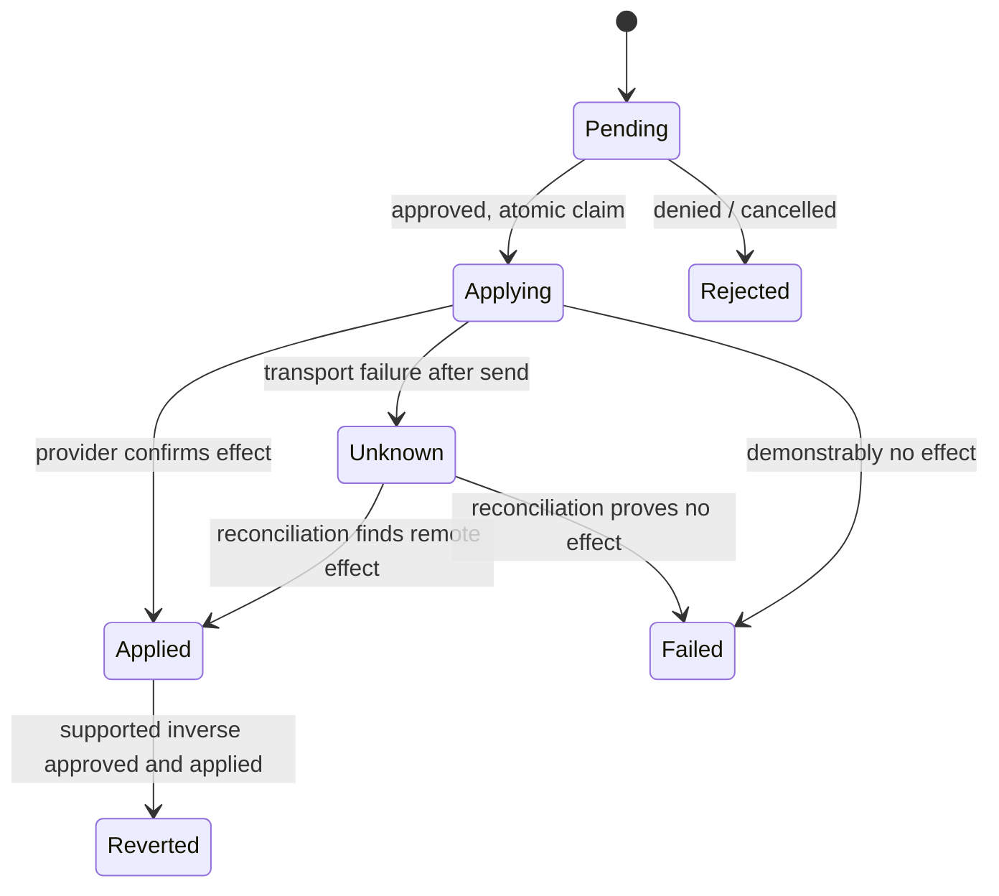
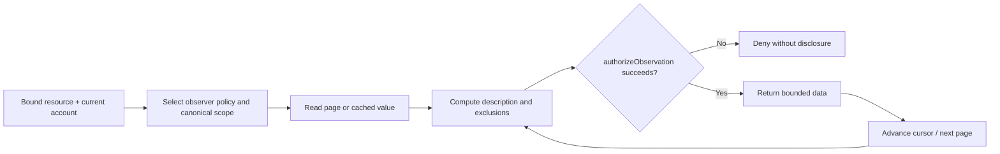

# Gatekeeper Kit — Normative Specification

> Package: @gadgets/gatekeeper-kit. A shared library of independent leaf modules; NOT a deployable Worker. Layer 2 base classes or a gatekeeper assembly are not shipped and MUST NOT be documented as implemented.

## Scope and ownership
This package supplies reusable primitives for nonce/handshake/handoff, credential staging and refresh, provider OAuth, action journals and files, observation tracking, cursor pagination, authority-sensitive caches, simulation, endpoint hardening, Git transport, delivery queues and concurrency. Import only public subpaths from package.json. Provider implementations own actual connected account Durable Objects, resource facets, policy scope, identity and provider-specific errors. Workshop alone mints/redeems completion tickets. A leaf-module import MUST NOT weaken or replace either authority.

## Connect and reconnection state machine

```mermaid
stateDiagram-v2
  [*] --> NoAttempt
  NoAttempt --> Initiated: random expiring initiation nonce
  Initiated --> OAuthPending: claim initiation + store PKCE and generation
  OAuthPending --> Claimed: claim callback nonce synchronously
  OAuthPending --> Expired: timeout / replay
  Claimed --> InitialStaged: initial grant; generation still matches
  Claimed --> ReconnectStaged: refreshed authorization escrow
  Claimed --> Expired: grant superseded / invalid
  InitialStaged --> TicketPending: complete once
  ReconnectStaged --> TicketPending: reconnectComplete stageId
  TicketPending --> Activated: Workshop redeems ticket / exact reconnect commit
  TicketPending --> Expired: TTL elapsed
  Activated --> [*]
  Expired --> [*]
```

A callback MUST claim the nonce before the first await. OAuth exchanges MUST bind PKCE and the exact redirect URI to that attempt. Connect and reconnect MUST carry a connection generation so an old callback cannot overwrite a newer credential. Initial completion MUST execute once; a failed completion RPC does not prove Workshop did not stage its ticket. Reconnect data MUST remain inaccessible to live sessions until commitReconnect(stageId) consumes the exact live escrow. Mismatched/expired IDs MUST NOT alter a newer stage. Teardown MUST clear local state before awaiting provider best-effort revoke.

## Credential and action state

The actions leaf MUST persist staged state, serialize application and journal the result. Provider code MUST supply truthful approval descriptions, side-effect calls, optimistic simulations and idempotency/reconciliation policies. On unknown result, blind replay can duplicate a remote write and MUST NOT occur. Connection fences MUST prevent applying stale-credential actions. Action files MUST be bounded, integrity-checked, deleted with their referring action and orphan-pruned where required. An unshipped revert implementation MUST NOT be advertised.

## Observations and cursors

Observer helpers MAY track known collection scopes and explicit exclusions, but the caller MUST run the authorization gate for every protected read and choose accurate provider-specific ACL verification. Page hooks MUST not leak data before authorization. Pagination MUST have bounded page counts/results and handle provider continuation without repeating or skipping records. Cache entries MUST be keyed by all authority dimensions, TTL-bound and fenced against stale fills during reconnect/revoke.

## Independent leaves, not a framework
The shipped exports include ./actions, ./action-files, ./auth-retry, ./cache, ./connect-handshake, ./connect-nonce, ./connect-pages, ./credential-expiry, ./credential-stage, ./credentials, ./cursors, ./endpoint, ./git-diff, ./git-objects, ./git-transport, ./hook-delivery-queue, ./http-errors, ./observers, ./oauth-client, ./preview-oauth, ./response-body, ./serial-queue, ./simulation and ./single-flight. Provider-specific adapters MAY bypass one leaf only if they provide its safety guarantees themselves; mixing ad-hoc state with a leaf's durable journal/fence without coordination is forbidden.

## Threat model and testing
Host validation, SSRF protections, signed preview OAuth state, no unsafe redirects, secrets in errors, stale in-flight refreshes, duplicated callbacks, concurrent applies, hook redelivery, cache partition and observer-gate failures are part of this package's threat model. Unit and Worker tests MUST cover these independently and through a conformant sample gatekeeper. Full sequences and implementation constraints are in README.md, USAGE.md and the exported JSDoc; proposed Layer 2 classes in plans/gatekeeper-kit.md remain non-normative until implemented.