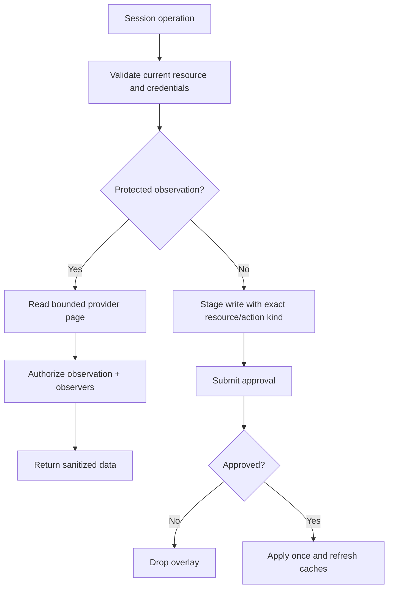

# Linear Gatekeeper Specification

> **Package:** `@gadgets/linear-gatekeeper`  
> **Status:** Normative package specification; inherits the root Gatekeeper observation/action/credential contracts.

## 1. Mission

The Linear Gatekeeper exposes capability-scoped access to a connected Linear workspace, team, or issue. It normalizes Linear's GraphQL API into stable Gadget-facing TypeScript session types while keeping OAuth credentials and provider-specific API details inside the Worker.

## 2. Resource model

Current resource granularities are:

- **Workspace:** `https://linear.app/:workspace`
- **Team:** `https://linear.app/:workspace/team/:teamKey{/:rest}*`
- **Issue:** `https://linear.app/:workspace/issue/:issueId{/:rest}*`

Workspace is the broadest grant. A team grant MUST limit team/project/cycle/issue operations to that team. An issue grant MUST remain limited to that issue and directly-related data/actions required by the session contract.

Canonical resource parsing MUST check workspace/team/issue identity server-side even if the configurator already produced the URL.

## 3. OAuth lifecycle

The connector uses Linear OAuth with the provider scopes currently required by its read/write session (`read`, `write`).

Connection flow requirements:

- random 32-byte initiation and OAuth nonce material;
- ten-minute expiration for both nonce stages;
- constant-time comparison of fixed-length nonce values;
- one-hour abandonment timeout for incomplete first connection;
- access-token refresh before expiry using the current safety skew;
- reconnect replaces credentials while retaining the same connected account capability;
- token refresh/revoke errors update account credential state rather than silently continuing.

`CLIENT_ID` and `CLIENT_SECRET` are deployment secrets, not repository data.

## 4. API normalization

The package translates raw Linear GraphQL records into the stable exported session model: workspaces, teams, projects, cycles, issues, comments, users, labels, workflow states and priorities.

Normalization MUST:

- map unknown enum-like provider values to documented safe fallback values rather than unchecked casts;
- preserve canonical IDs/URLs needed for later scope validation;
- bound descriptions/snippets and page sizes;
- convert timestamps consistently;
- avoid leaking raw provider GraphQL implementation details as part of the stable public API unless deliberately specified.

Current pagination defaults to 50 and is capped at 250 items per requested page. Changes to these limits must account for Workers response/subrequest constraints.

## 5. Observation workflow

All Linear metadata and content returned to the Gadget is protected data. Every read method MUST await observation authorization before returning results.

Where useful, the Gatekeeper MAY query Linear first so the approval/audit description identifies the actual issue/team/project, but no provider data may be disclosed to the Gadget if authorization fails.

## 6. Actions

Create/update/comment operations exposed by the session are side effects and MUST use the shared staged-action contract.

The package MUST:

1. validate that the target belongs to the bound workspace/team/issue scope;
2. persist an action record with enough data for apply/reject/revert behavior;
3. call `submitAction()` before any Linear mutation;
4. simulate the pending change on later reads where supported;
5. perform the GraphQL mutation only from `applyAction()`;
6. discard/reverse simulated staged state on rejection;
7. accurately report whether a mutation can be reverted.

Action descriptions MUST identify the affected issue/team/project and material fields being changed.

## 7. Metadata cache

Provider metadata may be cached briefly to reduce repeated GraphQL calls. The current metadata TTL is about one minute. Caches are optimization only and MUST NOT become authorization authority.

Mutations that affect cached objects MUST invalidate/update relevant cache generations so stale metadata is not served indefinitely.

## 8. Resource configurators

Workspace, team and issue configurators are compiled sandbox apps. They may use a narrow RPC capability to enumerate/resolve provider objects. They MUST return canonical URLs matching the exact `SupportedResource` type selected and must not widen the grant.

Generated UI HTML is build output; configurator source and this specification are authoritative.

## 9. Observer/sharing policy

A collaborator opening a shared workspace must independently satisfy the Linear resource access checks defined by the verifier. The Gatekeeper MUST fail closed for private teams/issues when independent observer authorization cannot be established.

A workspace-level account connection is not proof that a collaborator has access to every team/issue observed through the owner's credentials.

## 10. Security invariants

- OAuth nonce/state is random, expiring and single-use.
- Credentials remain inside the account Durable Object.
- Resource identity is revalidated on the server.
- Page sizes/fan-out are bounded.
- Every protected read authorizes before disclosure.
- Every side effect stages before provider mutation.
- Cache data never overrides live resource-scope checks.
- Observer access is independently verified or denied.

## 11. Build/configuration

Worker entrypoint: `src/linear.ts`. Resource configurator bundles are generated by the shared configurator build pipeline. The package uses `@gadgets/observability` for structured observability and `workshop-shared` for Gatekeeper contracts.

## 12. Tests

Tests SHOULD cover:

- OAuth nonce/reconnect/token refresh;
- workspace/team/issue URL parsing and cross-scope rejection;
- pagination clamp/default behavior;
- enum normalization fallback;
- observation authorization;
- create/update/comment stage/apply/reject/revert;
- simulation/cache invalidation;
- private-resource observer verification;
- configurator canonical URLs.

## 13. Change rules

Any new Linear entity or mutation added to the Gadget session requires scope rules, normalized public types, bounded pagination, observation/action semantics, observer treatment, configurator support when selectable, tests and this spec update in the same PR.

## 14. Updated connector contract and user approval flow

The worker must preserve workspace, team and issue resource distinctions while translating provider API pagination and search responses. A team binding is not an unrestricted workspace grant, and an issue binding must not mutate unrelated issues. Every provider read invokes observation authorization before disclosure; collaborators require independent provider ACL proof. Provider search/list cursors must be bounded and stable under partial pages or rate-limit errors. Editing issue fields, creating comments or writing other Linear objects always stages an action and requires an explicit approved apply, even if the local cache simulates that change.

Connection and reconnect use single-use nonces and Workshop's ticket-bound handoff; the reconnect grant remains staged until its stage ID is committed. No leaked tokens in provider error logs. Tests must cover account/team/issue scope, absent access, cursor continuity, pending overlays, action sequence, reconnect concurrency and approval denial.
