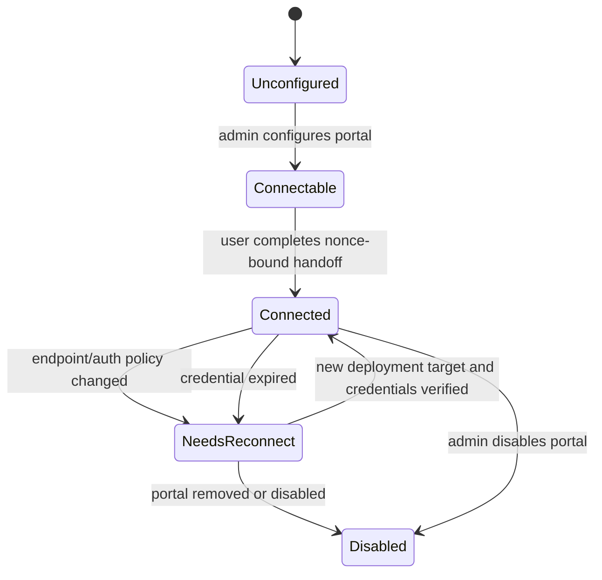

# MCP Server Portal Gatekeeper Specification

> **Package:** `@gadgets/mcp-portal-gatekeeper`  
> **Status:** Normative connector specification. Shared MCP protocol/policy belongs to `@gadgets/mcp-shared`; this package specifies deployment-controlled portal behavior.

## 1. Mission

This Gatekeeper connects the Cloudflare OS deployment's configured MCP server portal. A portal is one deployment-controlled MCP endpoint that fronts multiple upstream MCP servers. Cloudflare MCP Server Portals is the primary target architecture.

This package is intentionally separate from the generic MCP connector because:

- the endpoint is chosen by deployment configuration, not user input;
- one connected portal can represent many upstream servers;
- every Gadget grant must select one upstream server;
- deployment policy may explicitly trust portal annotations;
- portal authentication may be OAuth or a preissued deployment token.

## 2. Availability/configuration

The vendor reads live portal configuration from deployment variables. If no portal is configured, it MUST advertise zero supported resources so Workshop hides the connector rather than offering a broken connection.

Portal configuration includes, as applicable:

- endpoint URL;
- display name;
- authentication mode (`oauth`, preissued token, or other supported shared kind);
- preissued token secret;
- whether tool annotations are deployment-vetted for policy;
- local-development insecure-fetch override.

Secrets MUST never be placed in generated resource URLs, browser frames, logs or Gadget sessions.

## 3. Connection workflow

`connectAccount()` creates an MCP account object and nonce-protected URL. The user does **not** choose an endpoint: the connection handler reads the deployment configuration and authorizes that configured portal.

The shared `McpAccountBase` workflow applies:

- random expiring single-use nonce;
- connection generation invalidation across awaits;
- OAuth discovery/exchange when required;
- account-owned credentials;
- bounded cleanup of abandoned first connections.

A preissued token is read from **live deployment configuration**, not persisted as a copied account secret. It MUST only be returned when current configuration still names the exact endpoint that the account/facet expects.

## 4. Repoint/auth-change behavior

Deployment configuration may legitimately repoint the portal endpoint or change its authentication strategy. This is the controlled exception to MCP endpoint immutability.

The contract is fail-closed:

- existing facets minted against the old endpoint MUST refuse use after a deployment repoint;
- existing facets MUST refuse when current authentication mode is incompatible with the account's connected state;
- the UI/user is directed to reconnect;
- reconnect may adopt the new **deployment-provided** endpoint;
- connection generation advances before network awaits so stale old-endpoint requests cannot receive a new portal token;
- credentials/session state for the old endpoint are invalidated when repointed.

A user-controlled URL MUST never be able to exploit this deployment repoint exception.

## 5. Portal resource scope

The portal advertises one connector resource representing the configured portal, but a concrete binding MUST be scoped to exactly one upstream server behind it.

A grant without an upstream `serverId` is too broad and MUST be rejected.

Scope validation MUST:

1. confirm the requested URL matches the currently configured portal endpoint/resource;
2. require an upstream server identifier;
3. fetch/reconcile the portal's upstream server list and tool catalog;
4. validate the selected server/tool subset against a complete catalog;
5. persist only the selected upstream/tool scope in the facet props;
6. generate Gadget TypeScript only for tools permitted by that scope.

No Gadget may receive a binding that silently spans every server behind the portal.

## 6. Trust/annotation policy

Tool classification is centralized in `mcp-shared/tools`.

The deployment decides current `ServerTrust` through portal configuration:

- unvetted portal/server annotations behave like BYO for auto-approval purposes;
- a deployment-vetted portal MAY allow shared MCP policy to mark a write auto-approvable only when the common requirements hold (`destructiveHint === false`, `idempotentHint === true`, non-read call);
- `readOnlyHint === true` controls read classification under the shared MCP rule.

Trust is live deployment policy and MUST NOT be frozen permanently into an account record. Withdrawing trust must take effect without reconnecting the account.

## 7. Session/action behavior

The concrete Gadget session uses `McpSessionBase` exactly like generic MCP:

- list/read calls are observations;
- writes stage and submit before execution;
- provider tool invocation occurs only from approved `applyAction()`;
- MCP actions do not claim generic revert;
- unsimulated writes await the approval decision;
- asynchronously-produced applied results are authorized as observations when delivered.

Action-kind namespace/scoping MUST prevent approval rules for one portal/server/tool from accidentally applying to another connector or upstream server.

## 8. Sharing policy

Portal MCP bindings are currently **owner-only**, even if the portal endpoint itself is organization-managed. Authentication to the portal is not enough to prove that another Cloudflare OS collaborator may see the exact records observed with the owner's portal identity.

`addObserver()` MUST refuse until a future policy can verify per-resource visibility. Deployment trust in tool annotations does **not** imply sharing trust.

## 9. Configurator

The sandboxed portal configurator lists upstream servers and, where applicable, their permitted tools. It MUST require a concrete upstream selection and a complete catalog before tool-subset submission.

The frame receives no portal token/OAuth credential.

## 10. Security invariants

- Endpoint comes only from deployment config.
- Missing config hides the connector.
- Every binding names one upstream server.
- Full endpoint identity is checked, not only origin.
- Repoint/auth changes invalidate old facets and require reconnect.
- Static token is never sent to a stale endpoint.
- Annotation trust is live deployment policy and separate from sharing.
- All MCP observations/actions use shared policy/state machines.
- Bindings remain owner-only.

## 11. Build/configuration

Worker entrypoint: `src/portal.ts`. Local development may pass through `MCP_PORTAL_URL`, `MCP_PORTAL_NAME`, `MCP_PORTAL_AUTH`, `MCP_PORTAL_TOKEN`, `MCP_PORTAL_TRUST_ANNOTATIONS`, and `MCP_ALLOW_INSECURE` from the shell/root `.dev.vars` into generated dev config.

Tracked configuration MUST NOT contain the portal token.

## 12. Tests

Tests SHOULD cover:

- hidden/unconfigured vendor behavior;
- OAuth vs static-token portal connection;
- static-token endpoint binding safety;
- deployment repoint and auth-mode change fail-closed/reconnect behavior;
- required upstream-server scope;
- portal server/catalog reconciliation and truncation;
- trusted vs untrusted annotation auto-approval policy;
- action-kind isolation across upstream servers;
- unconditional observer refusal.

## 13. Change rules

The portal MUST remain a separate connector from generic MCP unless a future architecture can preserve these distinct trust and endpoint-provenance rules without mode confusion. Any proposal for cross-server grants, portal-wide authority or collaborator sharing requires a root security-spec update and adversarial tests.

## 14. Deployment trust changes and endpoint repoint state

MCP Portal target and trust settings are deployment authority, unlike generic user-supplied MCP server configuration. A portal connection can be repointed only when the new endpoint is the currently approved deployment target; a server or credential change MUST invalidate the old connection generation, facets, cached catalog policy and staged actions before reconnecting. The portal's vetted annotation mode MUST remain revocable immediately without needing a user to disconnect first. A write is auto-approvable only when the shared mcp-shared classification permits it AND an explicit user auto-rule applies; staged submission always happens.

All upstream tools remain constrained by the selected portal-server resource scope. Retiring trust MUST prevent auto-application to already-pending but newly disallowed actions. Failed portal introspection is not permission to fall back to a generic unvetted endpoint. Tests MUST exercise trust withdrawal without reconnect, old-generation in-flight completion, endpoint repoint, per-server scoping, expired auth and simulated action outcomes.
