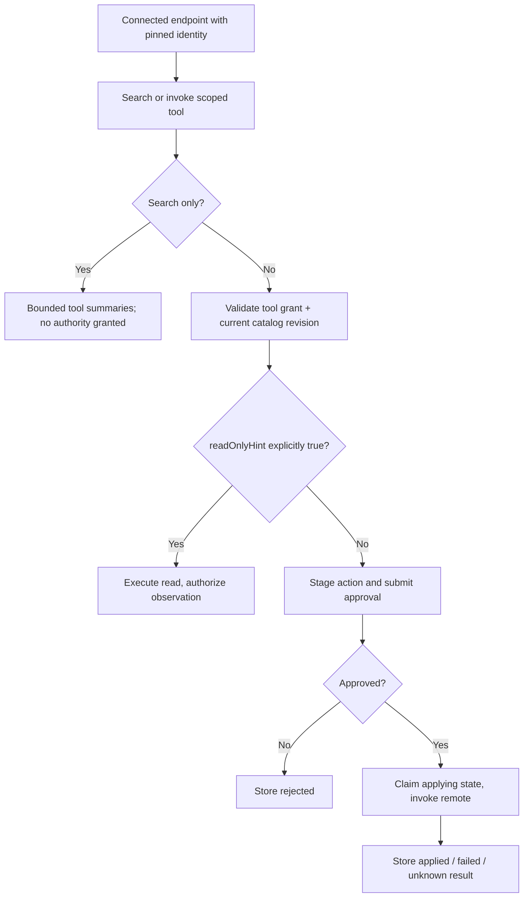
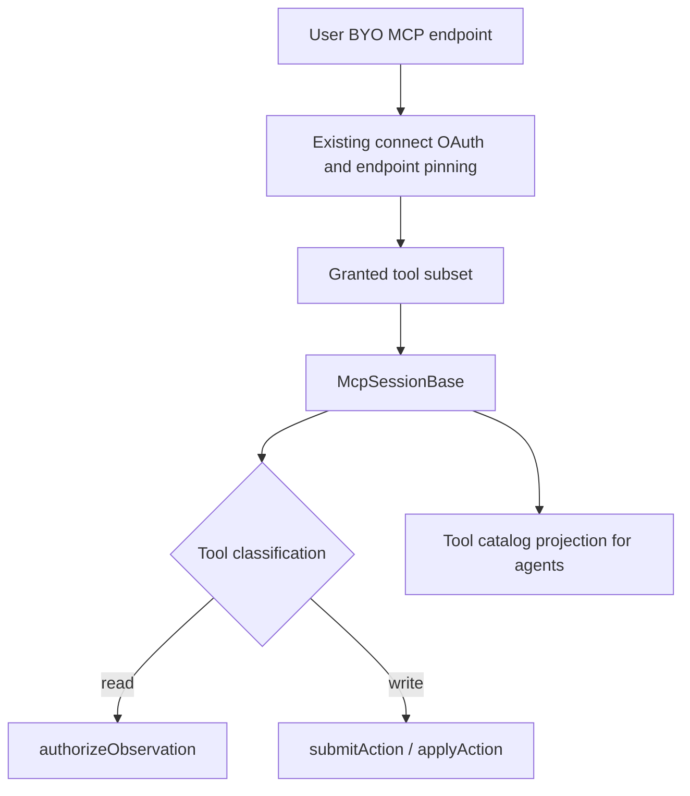

# Generic MCP Gatekeeper Specification

> **Package:** `@gadgets/mcp-gatekeeper`  
> **Status:** Normative connector specification. Shared MCP protocol/policy belongs in `@gadgets/mcp-shared`; this package specifies only the user-supplied-endpoint connector behavior.

## 1. Mission

This Gatekeeper lets a user connect an arbitrary Model Context Protocol server endpoint and bind a selected set of its tools into a Gadget. It is the **BYO endpoint** connector: the user chooses the server URL, so the deployment does not vouch for the server's trustworthiness.

The package MUST NOT merge conceptually with `gatekeeper-mcp-portal`: a user-supplied endpoint and a deployment-controlled multi-server portal have different trust, scoping and reconnect rules.

## 2. Trust boundary

The connector's MCP `ServerTrust` is `"byo"`.

Consequences:

- a tool is treated as a read only when `annotations.readOnlyHint === true`;
- an absent/false `readOnlyHint` is an action;
- server annotations MUST NEVER make a write auto-approvable on this connector;
- all other annotation-derived auto-approval claims are inert;
- server/tool names, descriptions and arguments displayed in approval UI are untrusted and MUST pass the centralized `mcp-shared` sanitization/bounds.

Tool classification MUST remain centralized in `mcp-shared/tools`, not reimplemented here.

## 3. Endpoint connection workflow

A new connection creates an `McpAccount` Durable Object and nonce-protected connect URL. The browser may choose an endpoint only on first connection.

Workflow:

1. verify the initiation nonce before rendering/processing the endpoint form;
2. validate the user-supplied endpoint through `mcp-shared/endpoint`/fetch policy;
3. persist the endpoint only once an intended connection attempt has safely progressed according to the shared account state machine;
4. probe the endpoint to discover unauthenticated vs OAuth access;
5. perform MCP OAuth discovery/dynamic client registration/code exchange when required;
6. store all resulting credentials only in `McpAccount`;
7. complete the Workshop account connection;
8. on reconnect, reauthorize the **same** user-selected endpoint.

A reconnect MUST NOT accept a replacement URL from a stale/malicious browser form. User-selected endpoint identity is pinned for the lifetime of that connected account.

## 4. Endpoint safety

User input is an SSRF-sensitive boundary. Endpoint validation and MCP fetch helpers MUST enforce the shared URL/host/scheme policy.

`MCP_ALLOW_INSECURE` may deliberately relax scheme/localhost rules for local development when configured. It MUST NOT default to weakening production endpoint validation.

Full endpoint identity matters: two MCP servers on the same origin but different paths may be unrelated. Scope/credential checks MUST compare the complete endpoint semantics used by `mcp-shared`, not merely host/origin.

## 5. Resource and tool scope

The connected account corresponds to exactly one MCP endpoint. A resource grant may further restrict which tools are available through the binding.

The resource URL fragment/scope representation defined by `mcp-shared/scope` is authoritative.

- A requested resource naming a different endpoint MUST be rejected.
- Tool selection MUST be validated against a complete bounded catalog.
- A portal-style `serverId` upstream scope MUST be rejected and the user directed to the MCP Portal connector.
- Generated per-resource TypeScript MUST expose only tools allowed by the binding scope.

The vendor-level `getTypeScriptTypes()` returns transport-neutral MCP base types; per-tool overloads are generated on the concrete resource Gatekeeper.

## 6. Catalog bounds

Tool discovery is bounded by shared MCP limits. A catalog too large/truncated to safely validate a user-selected tool subset MUST fail the selection workflow rather than pretending the unseen portion does not exist.

Catalog policy fingerprints/revisions are generated by the shared package so policy changes at the endpoint can be detected consistently.

## 7. Session behavior

The Gadget-facing MCP session follows `McpSessionBase`:

- `listTools()` authorizes the tool catalog as an observation before returning it;
- a read-classified tool call executes and then authorizes the resulting observation before disclosure;
- an action-classified call is staged and submitted, never executed inline;
- the call returns a pending action identifier/status;
- the provider tool runs only when `applyAction()` claims/applies the stored action;
- an applied result is observation-authorized when the Gadget later retrieves it;
- MCP actions currently have no generic inverse and therefore advertise no automatic revert;
- unsimulated pending MCP writes use `awaitDecision` semantics.

## 8. Sharing policy

Generic MCP bindings are **owner-only**.

`addObserver()` MUST refuse collaborators because authenticating another person to the same server/host does not prove they are authorized to see the data fetched with the owner's credential. The verifier exists only to satisfy the structural account contract and is not evidence that sharing is safe.

The supported collaboration pattern is to publish/share a Blueprint and let each user connect their own MCP account.

## 9. Credential/state correctness

`McpAccountBase` generation/claim semantics are part of this connector's contract:

- nonces are single-use and claimed before the first await;
- stale connection/OAuth/refresh completions MUST NOT write into a newer connection generation;
- abandoned first connections self-clean;
- tokens/transport session identifiers remain account-owned;
- duplicate approval/apply must not invoke an MCP write twice merely because Worker requests interleave.

## 10. Configurator

The sandboxed MCP resource configurator lists the endpoint's tools, classifies them for display and emits a tool-scoped resource URL. It MUST require a complete catalog before allowing selective scope submission.

The iframe receives a narrow RPC capability; it never receives credentials.

## 11. Build/configuration

Worker entrypoint: `src/mcp.ts`. The package depends on `mcp-shared` for transport, OAuth, policy, session, scope and generated-types logic. Configurator UI is built with the shared Gatekeeper configurator pipeline.

Deployment variables include the Gatekeeper public `BASE_URL` and optional insecure-local-development setting. Provider OAuth metadata is discovered from the MCP server rather than stored as a fixed app-specific client secret in this package.

## 12. Tests

Tests SHOULD cover:

- endpoint validation/SSRF restrictions and insecure dev override;
- nonce replay/interleaving and reconnect endpoint pinning;
- public vs OAuth MCP server connection;
- tool catalog bounds/truncation;
- tool-scope canonicalization and rejection of portal server scope;
- BYO annotation classification and absolute prohibition on annotation-based write auto-approval;
- read observation and staged action/apply/result-observation flow;
- double-apply/unknown-outcome handling;
- unconditional observer refusal.

## 13. Change rules

Do not add connector-local interpretations of MCP annotations, OAuth, tool scopes or action-state behavior. Those belong in `mcp-shared` so generic MCP and MCP Portal remain consistent. Any proposal to make BYO MCP shareable or annotation-auto-approvable is a security architecture change requiring root spec revision, a verifiable policy design and adversarial tests.

## 14. Current shared MCP search and staged lifecycle

User-supplied MCP endpoints are never 'vetted' solely because their server advertises annotations. Reads are classified only by `annotations.readOnlyHint === true` and still require observation authorization. Every other tool is an action; it MUST stage an action record, submit a human description and execute only on approved apply. The current shared search normalizes case, dashes, underscores and camelCase, with 200-character queries and up to 20 results, without expanding the granted tool set. Catalog refresh must not allow tool name reuse/annotation edits to silently bypass the granted revision.



SSRF, redirect and endpoint pinning apply to OAuth discovery as well as tool fetch. A reconnect for generic MCP MUST preserve the chosen endpoint identity. Missing observer record access proof means collaboration is refused. Tests MUST include untrusted server metadata, action-description Markdown spoofing, catalog drift, stale OAuth attempt, endpoint redirect and duplicate application.


## Unified Agent Platform integration contract — 2026-10-13

**Status:** incremental integration SPEC and IMPLEMENTATION DRAFT, not a runtime change. **Normative:** [Unified Agent Platform v2](../../docs/architecture/AGENT_PLATFORM_UNIFIED_V2.md), [User input and evidence ledger](../../docs/architecture/USER_INPUT_LEDGER.md). For this package see the [ordered plan](./plan.md). Existing behaviors documented above remain authoritative until a reviewed, backwards-compatible migration is implemented.

### Component and control flow



### Proposed integration data schema and API changes

```typescript
type ImportedMcpToolRef={accountBindingId:string;endpointFingerprint:string;toolName:string;catalogPolicyRevision:string;resourceScope:string;classification:'read'|'action'}
```

Validate at boundaries, add JSON Schema where values cross Worker/process/storage, specify schema version and migrations. This is a draft shape to be reconciled with actual public types and Cap'n Web support before modifying kernel interfaces.

### Implementation file map

```text
packages/gatekeeper-mcp/
  src/mcp.ts and inherited mcp-shared classes (reuse)
  src/agent-platform-catalog.ts (optional metadata bridge)
  src/__tests__/{agent-access,scope,classification-revocation}.test.ts
  SPECS.md
  plan.md
```

### Ownership, loops, security and backwards compatibility

Generic MCP Gatekeeper already imports untrusted user-selected endpoints. Agent platform consumes resource-granted tools via Gatekeeper session; adding tool registry must not alter OAuth account ownership, BYO readOnlyHint classification, staged action, scope and observer refusal.

**Legacy/source comparison:** Existing Generic MCP Gatekeeper SPECS and mcp-shared; bound user-supplied endpoint, owner-only observers, no annotation-based auto-apply. Preserve all already-tested features and evidence. Do not introduce a parallel scheduler, MCP client policy, login authority, Cap'n Web transport or user-facing run-loop persistence.

### Definition of done

Source→target traceability, schema fixtures, existing test parity and new negative boundary tests, authenticated staging proof for new cross-worker behavior and migration-aware rollback. **Detailed steps:** [plan.md](./plan.md).
