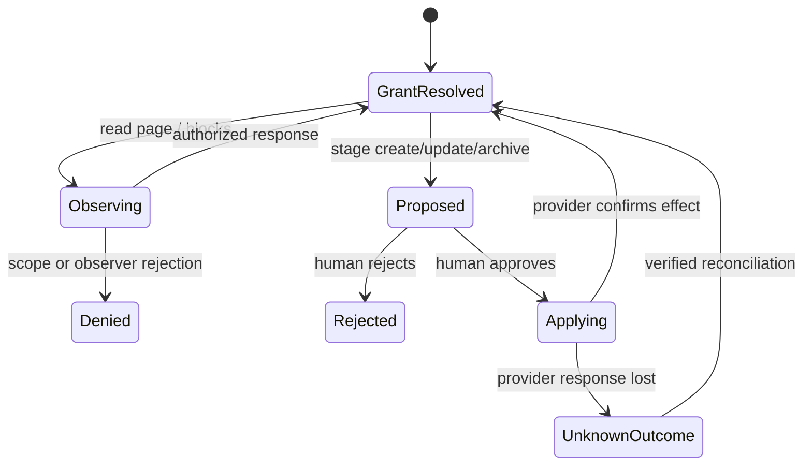

# Notion Gatekeeper Specification

> **Package:** `@gadgets/notion-gatekeeper`  
> **Status:** Normative package specification; inherits the root Gatekeeper contracts for credentials, observations, staged actions, simulation and observer policy.

## 1. Mission

The Notion Gatekeeper provides capability-scoped access to a user's Notion workspace, an individual page, or a database. It implements the complete Cloudflare OS Gatekeeper lifecycle: OAuth, read authorization, staged writes, optimistic simulation, cache management, reconnect/revoke, resource configuration and observer verification.

## 2. Resource model

Current resource types are:

- **Notion Workspace:** whole-instance catch-all `https://*`;
- **Notion Page or Database:** `https://www.notion.so/:path+`.

The whole-workspace grant may search/read/edit any object made available to the connected Notion integration. An item grant MUST remain constrained to the selected page/database and the related descendants/rows that the session contract explicitly defines.

Notion object IDs extracted from URLs MUST be parsed/canonicalized server-side; configurator output is not sufficient authority by itself.

## 3. OAuth state machine

The connector uses OAuth 2.0 with a Durable Object account that owns all credentials and connection state.

Current timing contract:

- 32-byte random nonce material;
- initiation nonce lifetime: ten minutes;
- OAuth nonce lifetime: ten minutes;
- incomplete first-connect cleanup: one hour.

The flow MUST validate/consume the expected nonce stage, exchange authorization code only for the active attempt, and notify Workshop only after credentials/account metadata are durable enough to use.

Reconnect prepares the existing account for a fresh authorization flow and replaces credentials without changing the Workshop account capability. Expired/revoked credentials MUST be surfaced through the callback expiry/restoration contract.

## 4. Observation workflow

Every protected Notion read MUST call `authorizeObservation()` before returning data to the Gadget. This includes:

- search results;
- page/database metadata;
- rendered page content;
- database schema/rows;
- users and comments;
- children/related objects exposed by the session.

The implementation MAY fetch/cache read-only data before authorization to produce accurate descriptions, but authorization MUST happen before disclosure.

## 5. Action state machine

Notion mutations are stored/staged actions. The package's action store and simulation helpers are part of the authoritative workflow:

1. normalize and validate the intended operation against the bound resource;
2. allocate/stage a `NotionAction` with enough payload/pre-state for later handling;
3. submit a human-readable action description;
4. expose the staged change through simulation overlays where supported;
5. execute the Notion API write only from `applyAction()`;
6. on reject, discard/undo the simulated proposal;
7. on revert, attempt the provider-side inverse using retained action state;
8. update/invalidate affected caches after apply/revert.

Create/update/delete/content/comment/property operations MUST NOT bypass this path merely because the API call is simple.

## 6. Simulation contract

The package deliberately simulates pending writes so the Gadget sees a coherent proposed world before human approval.

Simulation covers the supported page/database/search/comment/content/metadata/property views implemented by `notion-actions` helpers. Multiple staged actions MUST overlay deterministically in action order.

Known limitations in list/search simulation MUST remain documented in the generated Gadget-facing declarations. The package MUST NOT pretend a simulated list is exact when provider pagination/filter semantics make exact reconstruction impossible.

Simulation never performs a Notion mutation.

## 7. Caching

Page/database responses and rendered Markdown/content may be cached in Durable Object storage to reduce provider calls.

Caches are optimization, not authority. A mutation apply/revert affecting cached data MUST invalidate or advance the affected cached representation. Authorization checks and resource-scope checks MUST not be skipped because a value came from cache.

## 8. Configurators

The package provides separate sandboxed configurator flows for workspace and item resources. Configurator RPC may search/resolve Notion objects, but it receives no raw OAuth credentials.

For an item grant, the resulting URL MUST resolve to one concrete Notion page/database object. For the whole-workspace grant, the UI must make the breadth explicit rather than disguising it as an item selection.

## 9. Observer/sharing policy

A Notion collaborator must independently be authorized for the observed workspace/page/database under the verifier policy. The fact that the owner's Notion integration can access a page is not proof that a Cloudflare OS collaborator may see it.

Restricted resources MUST fail closed. When precise per-observation restrictions are necessary, the package SHOULD use the shared observer exclusion semantics rather than leaking protected content first.

## 10. Security invariants

- OAuth nonces are random, expiring, single-use and constant-time compared for fixed-length values.
- Credentials stay inside the account Durable Object.
- Item URLs are canonicalized and scope-checked server-side.
- Every protected read authorizes before disclosure.
- Every mutation stages/submits before provider execution.
- Simulation is side-effect-free.
- Cache hits do not bypass authorization.
- Observer access is independently verified or denied.
- Provider content inserted into action/audit descriptions is bounded and treated as untrusted text.

## 11. Build/configuration

Worker entrypoint: `src/notion.ts`. Item/workspace configurator assets are built by the shared Gatekeeper configurator pipeline. `CLIENT_ID` and `CLIENT_SECRET` are deployment secrets/dev variables and MUST NOT be tracked.

The local dev launcher may inject shared Notion OAuth credentials into generated dev configuration.

## 12. Tests

Tests SHOULD cover:

- nonce stage/expiry/replay and reconnect;
- workspace vs page/database scoping;
- URL/Notion ID parsing;
- observation authorization across every read family;
- stage/simulate/apply/reject/revert for supported mutations;
- overlay ordering and documented list limitations;
- cache invalidation after action transitions;
- restricted-resource observer verification;
- configurator prefill/canonical URLs.

## 13. Change rules

Any new Notion mutation requires a complete stored-action design, approval description, simulation/await-decision decision, revert truthfulness, cache coherence, generated API update and tests. Any broadening of item-resource descendants must be explicitly specified rather than inferred from provider convenience.

## 13. Block/page state and consent boundaries

Notion sessions must preserve the exact granted page/database scope and any nested-block restrictions, not substitute a broad account capability because the user's integration token technically permits it. Rendering page or block content is a protected observation, including metadata and child-page traversal. A write to a page, database property or block must be staged with a precise human-readable description, then applied through the Gatekeeper approval queue; staged state MAY be projected into subsequent reads but must not be represented as provider-confirmed state. Lists must be page-bounded, avoid disclosure beyond the grant and handle deleted/archived resources as explicit failures rather than reusing stale cache content.

OAuth or interactive connect completion must use the nonce/session-bound Workshop handoff, including stage-only reconnect. Tests must cover deep block pagination, scope mismatch, observer verifier behavior, action rejection, ambiguous updates, concurrent page revisions and provider transient errors.
