# Scheduled Tasks Gatekeeper Specification

> **Package:** `@gadgets/gatekeeper-scheduler`  
> **Status:** Normative package specification. Scheduler is an ambient, auto-provisionable Gatekeeper whose persistent registrations use the shared **hook** approval model rather than the action queue.

## 1. Mission

The Scheduled Tasks Gatekeeper lets a workspace register persistent callbacks that run on recurring interval schedules, timezone-aware calendar schedules, or one-shot times. It is a platform capability owned by the deployment, not an external OAuth account.

Its central invariant is: **creating a schedule is binding a persistent hook**. Schedule registration MUST NOT bypass the human hook-approval lifecycle, and no driver activation may exist before the hook controller is enabled.

## 2. Account/provisioning model

The vendor advertises:

- `autoProvisionsAccount: true`;
- `providesAuth: false`;
- no interactive `connectAccount()` flow;
- no URL-addressed resources;
- one ambient singleton session (`ScheduleSession`);
- a sandboxed management app (`Scheduled`).

Creation mints an opaque Scheduler account capability with its own account identifier. Kernel ambient provisioning policy remains authoritative (`optional` default, `enabled`, `disabled`).

There are no credentials to reconnect. `reconnect()` MUST fail explicitly. `getAuthenticatedEmail()` returns no external identity.

Revoking the account MUST remove/revoke the account's driver state and all schedule activations.

## 3. Gadget-facing resource/session

The ambient Gatekeeper describes the resource as:

- URL/identity: `scheduler://tasks`;
- suggested binding: `SCHEDULER`;
- session type: `ScheduleSession`;
- hook callback type: `ScheduledTaskHook`.

The concrete facet is workspace-scoped. Its inherited Durable Object ID MUST represent the workspace scope, not the account ID. The current implementation explicitly sanity-checks that these are not the same.

## 4. `ScheduleSession` workflow

The current session provides these scheduling operations:

- `every(everyMs, callback, options)` — recurring elapsed interval anchored at registration time;
- `calendarAt(rule, callback, options)` — timezone-aware calendar recurrence;
- `runAt(when, callback, options)` — one-shot schedule;
- `list()` — list enabled schedules for the current workspace.

Schedule input MUST be normalized by the scheduler core before persistence/approval. Invalid intervals, calendar rules, dates/timezones or occurrence constraints MUST fail before binding an unusable hook.

Occurrence limits apply only to recurring schedules; a one-shot schedule MUST reject recurring occurrence options.

## 5. Hook registration state machine

Registering a schedule MUST follow this order:

1. capture a consistent registration timestamp;
2. normalize the schedule and presentation options;
3. allocate a unique schedule ID;
4. construct a `ScheduleHookController` whose props contain all activation data needed later;
5. call `ApprovalQueue.bindHook(controller, callback, metadata)`;
6. return the schedule ID without enabling external driver state;
7. only when the Overseer approves and calls `controller.enable(initiator, target)` may the driver persist/activate delivery;
8. `controller.disable()` removes driver state for that schedule.

The hook controller MUST record the Gadget target metadata supplied by the Overseer when enabling so later events return to the intended Gadget/session.

## 6. Driver contract

`ScheduleDriver` owns durable schedule activation and account/workspace indexes. It is addressed by the Scheduler account identity while individual schedule records remain workspace-scoped.

Driver operations MUST be idempotency-aware across Worker retries and must not create duplicate deliveries merely because `enable()` is retried. Disabling/revoking must remove enough state that no further callbacks are delivered for the disabled schedule.

The driver is the persistent execution mechanism; the `ScheduleSession` itself is not durable delivery state.

## 7. Observation/action semantics

`list()` returns protected workspace schedule metadata and MUST call `authorizeObservation()` before returning the list.

Scheduler currently defines **no Gatekeeper action queue operations**:

- `getAutoApprovableActions()` returns none;
- `applyAction()` rejects because Scheduler submits no actions;
- `rejectAction()` rejects because Scheduler submits no actions;
- `revertAction()` rejects because Scheduler submits no actions.

This is intentional: schedule creation/removal authority is represented by approved hook activation/disable, not by pretending hook registration is an ordinary action.

## 8. Event delivery

When a schedule fires, the driver/controller path MUST use the stored `HookInitiator` to start a fresh hook session and recover the persistent callback in a new session-bound context.

The scheduled event is an observation. Before callback data is delivered, the new `ApprovalQueue`/authorizer MUST authorize the occurrence.

Delivery logic SHOULD be robust to at-least-once runtime triggers. Schedule/occurrence identity MUST be available to make duplicate handling safe when the runtime can redeliver.

## 9. Management app

The account advertises a read-only schedule management app. `ScheduleManagementApi.list()` lists schedules across the current account using bounded management pagination/options.

The management iframe receives only a narrow management RPC capability. It MUST NOT receive the Workshop API or the underlying driver namespace directly.

Admin/user context from Workshop is not itself permission to synthesize schedules outside the hook approval path.

## 10. Observer/sharing policy

The current Scheduler Gatekeeper accepts collaborators under its low-stakes observer policy and stores no independent observer state. This is safe only because the session exposes schedule metadata and callback registration scoped to the current workspace and does not expose an external user's private third-party dataset.

If future schedules contain sensitive external payloads or identities, this observer policy MUST be revisited explicitly.

## 11. Security invariants

- No OAuth/credential path exists.
- Ambient provisioning follows kernel policy.
- Workspace facet scope cannot collapse into account scope.
- Schedule inputs are normalized before registration.
- No durable delivery state exists before hook `enable()`.
- `disable()`/revoke remove delivery authority.
- Schedule listing is observation-authorized.
- No ordinary action method is used to bypass hook approval.
- Management UI is sandboxed and narrow-capability.

## 12. Build workflow

Worker entrypoint exports are routed through `src/index.ts` / `src/worker.ts`. The management application is bundled by package `build-app.mjs` into generated Worker-consumable HTML and rebuilt/watched by the root dev launcher.

Timezone/calendar behavior relies on the package's temporal support and MUST remain deterministic across Workers/runtime upgrades.

## 13. Tests

Tests SHOULD cover:

- interval/calendar/one-shot normalization and invalid inputs;
- timezone and occurrence-bound semantics;
- hook bind-before-enable invariant;
- enable/disable idempotency;
- account/workspace isolation;
- list observation authorization;
- firing a schedule through a fresh hook session;
- duplicate trigger resilience;
- revoke removes all activations;
- management list pagination;
- explicit failure of unsupported action/reconnect methods.

## 14. Change rules

Do not model schedule registration as an immediate side effect or ordinary Gatekeeper action without a deliberate architecture revision. New schedule types must fit the normalized `ScheduleSpec`/driver model, define durable occurrence semantics, preserve hook approval and update agent-facing types/tests/specs together.

## 15. Durable occurrence delivery and management UX

The scheduler uses approved persistent hooks, not a normal mutating Gatekeeper action. The current management SPA may list scheduled registrations, but no management control can secretly bypass `bindHook` and `enable`. Schedule normalization MUST distinguish elapsed intervals, calendar rules (with explicit timezone) and one-shot instants, preserving occurrence limits and rejecting recurrence options for one-shot schedules. A schedule controller is scoped to the originating workspace, while the account driver stores activation indexes and a shared alarm; revocation must disable all matching live activations.

```mermaid
stateDiagram-v2
 [*] --> Proposed
 Proposed --> Bound: normalized schedule + callback stored
 Bound --> Enabled: Workshop approves hook and calls enable
 Bound --> Rejected: user declines
 Enabled --> Due: alarm reaches next occurrence
 Due --> Dispatching: fresh session and observation authorization
 Dispatching --> Enabled: recurring callback ACK; compute next occurrence
 Dispatching --> Complete: one-shot callback ACK
 Dispatching --> Retry: delivery failed; durable retry decision
 Retry --> Enabled: retry handled without duplicate callback
 Enabled --> Disabled: disable / revoke
 Complete --> [*]
 Disabled --> [*]
```



Every delivered callback must use a fresh HookInitiator session rather than stale stored RPC stubs. Protect against alarm duplication, stale schedule generations, timezone/DST transitions and concurrent disable during dispatch. Tests SHOULD include restart and forced alarm retry, normalization bounds, list authorization, idempotent enable/disable, and no post-revoke invocation.


## Unified Agent Platform integration contract — 2026-10-13

**Status:** incremental integration SPEC and IMPLEMENTATION DRAFT, not a runtime change. **Normative:** [Unified Agent Platform v2](../../docs/architecture/AGENT_PLATFORM_UNIFIED_V2.md), [User input and evidence ledger](../../docs/architecture/USER_INPUT_LEDGER.md). For this package see the [ordered plan](./plan.md). Existing behaviors documented above remain authoritative until a reviewed, backwards-compatible migration is implemented.

### Component and control flow

```mermaid
sequenceDiagram
 participant A as Agent Owner
 participant W as Workshop
 participant S as Existing ScheduleSession
 participant O as Approved Hook
 participant T as Task Control Plane
 A->>W: Register autonomous trigger
 W->>S: calendarAt/every/runAt(callback)
 S-->>W: disabled hook / scheduleId
 A->>W: approve activation
 W->>O: enable callback
 S->>O: occurrence runId
 O->>T: createTask(idempotency=scheduleId:runId)
 T-->>O: stable taskId; no duplicate
```

### Proposed integration data schema and API changes

```typescript
type AgentScheduleLink={schemaVersion:1;agentId:string;triggerId:string;scheduleId:string;hookBindingId:string;workspaceId:string;source:'approved-scheduler-hook';state:'BOUND'|'ACTIVE'|'DISABLED';revision:number};
type AgentScheduleOccurrence={scheduleId:string;runId:string;scheduledTime:number;actualTime:number;timeZone:string;idempotencyKey:string}
```

Validate at boundaries, add JSON Schema where values cross Worker/process/storage, specify schema version and migrations. This is a draft shape to be reconciled with actual public types and Cap'n Web support before modifying kernel interfaces.

### Implementation file map

```text
packages/gatekeeper-scheduler/
  src/agent-trigger-adapter.ts (thin integration, only if necessary)
  src/__tests__/{agent-hook-admission,task-dedup,disabled-trigger}.test.ts
  src/{schedule-driver,controller}.ts (reuse; no replacement)
  SPECS.md
  plan.md
```

### Ownership, loops, security and backwards compatibility

Use existing ScheduleDriver for calendar/elapsed-time triggers, with explicit hook approvals and per-occurrence stable runId. An enabled hook may create a new Task via Control Plane with scheduleId:runId idempotency; never activate a hidden cron row or duplicate scheduler. Owner disabled/revoked hook prevents new Task admission. Agent Loop handles intra-task steps and sleeping separately.

**Legacy/source comparison:** Existing ScheduleSession.every/calendarAt/runAt, hook bindHook->enable, ScheduleDriver single alarm and retry policy, README and SPECS. Preserve all already-tested features and evidence. Do not introduce a parallel scheduler, MCP client policy, login authority, Cap'n Web transport or user-facing run-loop persistence.

### Definition of done

Source→target traceability, schema fixtures, existing test parity and new negative boundary tests, authenticated staging proof for new cross-worker behavior and migration-aware rollback. **Detailed steps:** [plan.md](./plan.md).


## Integration corrective decision — source audit 2026-10-13

Reference: [Existing module boundary audit](../../docs/architecture/EXISTING_MODULE_BOUNDARIES_AUDIT.md); root SPECS §23 takes precedence. **Confirmed current authority:** ScheduleDriver owns all elapsed/calendar/once recurrence, HookController approval, account-wide alarm, stable runId, retries/DST. Agent Task DO is NOT a scheduler; only accepts deduped runId-triggered jobs and independently controls continuation of already accepted Task.

**Required next implementation checkpoint:** Prototype approved persistent callback linkage without rewriting ScheduleDriver; registration itself is NOT idempotent; task admission must be scheduleId:runId idempotent. Test duplicate delivery, disabled hook, revoke, timezone DST and interaction with task cancellation.

Do not change the existing implementation solely because a draft package exists. Preserve current tests, RPC and storage compatibility; any new state machine needs explicit idempotency, observer/action semantics, crash recovery and rollback acceptance. New agent-platform modules are not deployed.
