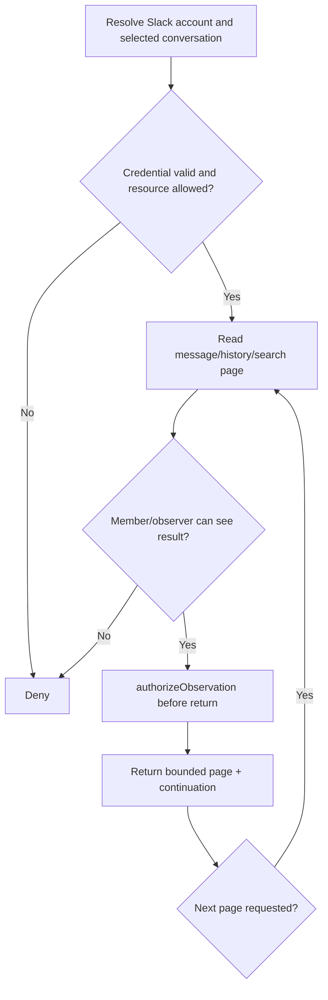

# Slack Gatekeeper Specification

> **Package:** `@gadgets/slack-gatekeeper`  
> **Status:** Normative package specification. The current Gadget-facing Slack capability is read-oriented and every returned message/member/search result is a protected observation.

## 1. Mission

The Slack Gatekeeper connects a user's Slack account and exposes scoped read access to a workspace, a single conversation, or a single thread. It is designed for summarization, monitoring and search while preventing a connected user token from becoming unbounded workspace authority inside a Gadget.

## 2. Resource model

Current grantable resources are:

- **Workspace:** whole connected Slack workspace, represented by the catch-all `https://*` resource after account resolution;
- **Conversation:** `https://app.slack.com/client/:teamId/:conversationId`;
- **Thread:** `https://*.slack.com/archives/:conversationId/:messageId`.

Each advertised resource is `grantable`. Resource-specific OAuth scope mapping is part of the security contract.

A conversation/thread binding MUST NOT expose unrelated channels/DMs merely because the underlying user token has additional Slack scopes.

## 3. OAuth scope model

Identity resolution requires `users:read`. Resource access adds only the required capability scopes.

Current resource requirements include the applicable channel/group/IM/MPIM read/history scopes, with workspace access additionally requiring team/search capabilities and conversation/thread access constrained to their required history/search scopes.

`connectAccount(options.resourceUrlPatterns)` MUST validate every requested pattern against the known grantable resource set. Unknown patterns are an error.

A resource is considered granted only when **all** Slack scopes required for that resource were actually granted. The package MUST not surface a resource after partial provider consent.

## 4. OAuth/credential lifecycle

The browser flow uses a random single-use initiation nonce and OAuth nonce, currently ten minutes each. Access-token refresh uses an expiry safety margin.

Slack refresh tokens may rotate. Refresh, reconnect and revoke operations MUST be serialized through the account object so a concurrent request cannot consume/replace the same rotating credential out of order.

The account Durable Object owns all provider credentials; tokens MUST not be copied into Workshop/Gadget/client state.

## 5. Read-only session contract

The current session is observation-oriented. It reads Slack conversations, history, threads, users/members and search results; it does not define ordinary Gadget-facing Slack writes as approved actions.

Therefore:

- every data-returning method MUST call `authorizeObservation()` before disclosure;
- the package MUST NOT advertise side-effecting methods as reads;
- adding a Slack mutation later requires the full root staged-action workflow rather than direct `chat.postMessage`-style provider calls.

## 6. Bounded provider access

The package enforces explicit bounds to protect Workers and Slack APIs. Current important limits include:

- history page size: 50;
- user/conversation/member page size: 100;
- search page size: 20;
- maximum thread replies: 1000;
- maximum reply pages: 20;
- maximum search query size: 1000 bytes;
- maximum concurrent outgoing request fan-out: 5, keeping below the Workers concurrent subrequest constraint used by this implementation.

Fan-out helpers intentionally fail closed on a failed observer-access subrequest rather than returning a partial result that might hide an authorization failure.

Changes to these limits MUST consider both provider pagination and Workers runtime constraints.

## 7. Observation/observer semantics

Slack content can be private (private channels, DMs, MPIMs). A Cloudflare OS collaborator does not inherit the owner's Slack visibility.

Resource reads MUST authorize the observation. Observer verification/access checks MUST ensure collaborators are allowed to see the relevant Slack conversation/thread; batch checks must fail closed when any necessary access check cannot be completed.

A workspace-wide Slack binding is especially sensitive and MUST not be shareable on the assumption that all collaborators belong to the same Slack workspace.

## 8. Resource configurators

Workspace, conversation and thread configurators are sandboxed iframes. They may use narrow RPC methods to discover Slack options but MUST not receive the OAuth token.

The generated resource URL MUST include the team/conversation/thread identity required for server-side scope validation. The workspace catch-all must resolve against the connected account's concrete workspace rather than allowing the user to type arbitrary universal authority.

## 9. Security invariants

- OAuth nonce/state is random, expiring and single-use.
- Rotating credential updates are serialized.
- A resource is exposed only when all required provider scopes were granted.
- Narrow resources are enforced server-side.
- All content reads are observation-authorized.
- Private-channel/DM observer checks fail closed.
- Provider fan-out is bounded and does not return partial authorization results.
- No Gadget-facing mutation exists unless explicitly added under the action contract.
- Tokens/body content are not logged as diagnostics.

## 10. Build/configuration

Worker entrypoint: `src/slack.ts`. Resource configurators are generated through the shared configurator build pipeline.

`CLIENT_ID` and `CLIENT_SECRET` are deployment secrets/dev vars. The root dev launcher may inject shared Slack credentials into generated dev config.

## 11. Tests

Tests SHOULD cover:

- resource-pattern→scope derivation and unknown patterns;
- partial OAuth consent hiding unsupported resources;
- nonce/reconnect/rotating-refresh concurrency;
- workspace/conversation/thread URL parsing;
- private channel/DM observer checks;
- pagination/thread/search bounds and concurrency cap;
- observation authorization on every read family;
- absence/failure of unsupported mutation paths;
- configurator canonicalization.

## 12. Change rules

A new read must define its resource applicability, provider scopes, bounds and observer checks. A new Slack write must be introduced as a staged action with stable action kind, approval text, apply/reject/revert/await-decision semantics and tests; direct mutation from a session method is prohibited.

## 14. Current Slack read-only authority and provider limits

The current package supports a read-focused Slack surface. Do not assume that Slack OAuth write scopes or a mutation endpoint exist merely because other Gatekeepers support queued actions. Reads/listing/search of conversations and messages MUST respect selected resource/channel authorization and independent observer access. Pagination MUST bound page size and follow provider cursors accurately, including token expiry, channel membership loss and rate-limit handling. Any future write, reaction or Slack event-hook feature needs a new explicit Gatekeeper action/hook contract and a corresponding spec update before deployment.

Slack message text is untrusted input, not agent instruction. Logs MUST exclude tokens, message bodies, channel-private names and search queries where they can reveal user content. Tests should cover membership revoked mid-page, cursor loops, duplicate page items, rate limits and observer failures.
