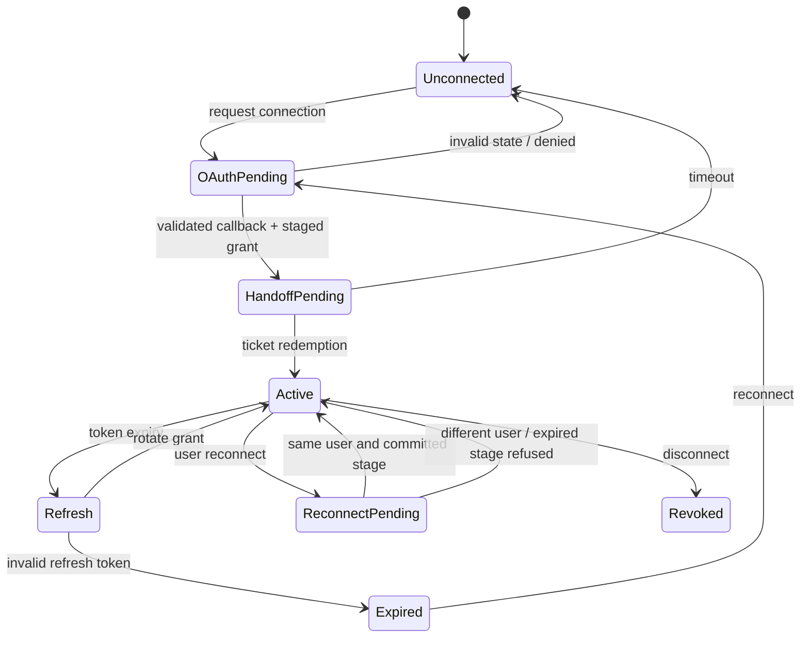
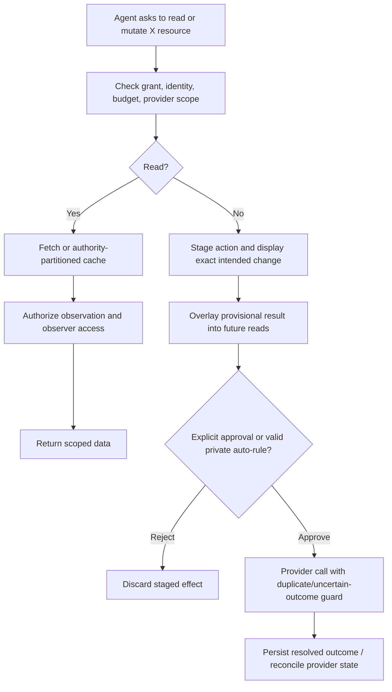

# X Gatekeeper — Normative Specification

> Package: @gadgets/x-gatekeeper. Worker entrypoint src/x.ts; provider and approval modules src/x-*.ts.

## Purpose, grants, privacy
Four supported resource grants MUST remain distinct: X Account (whole connected account), X Post (one post plus allowed conversation operations), X List (one list and permitted ownership-dependent operations), and X Profile (public profile and posts; read-only). Binding a profile MUST NOT permit account mutations; binding a post MUST NOT permit arbitrary other posts. Canonical URL matching and provider-account identity are verified before session creation. Private data such as bookmarks, mutes, protected posts and private lists MUST NOT become visible to a collaborator lacking the same X-user authorization.

## Credential lifecycle
Use OAuth 2.0 with per-attempt PKCE and single-use state; on callback, stage credentials and complete the Workshop handoff, never trust a completion URL alone. Reconnect MUST verify the same X user identity before replacing the grant. Rotated refresh tokens MUST be committed atomically. Definite invalid credentials enter the expired state, require user reconnect and notify Workshop without a notification storm. Response and exception/log paths MUST suppress tokens and private timelines.

## Read, billing, and action authorization
Read operations include timelines, mentions, search, bookmarks, likes, posts and list data as permitted by the bound resource and provider. Cache keys MUST include the account/grant authority; cache entries MUST honor per-family TTL and credential-generation fences. The deployment's X_DAILY_READ_LIMIT defaults to 2000 billable reads per connection and resets at UTC midnight; zero disables this limit. Read budget is shared across all gadgets and bindings on that connection. API rate-limit and depleted prepaid-credit errors MUST be surfaced with truthful retry/reset information, never unboundedly retried.

Public engagement operations (posts, replies, likes, reposts, follows and other non-private engagement) MUST always await explicit human approval, in addition to X platform policy. Private reversible operations such as bookmarks, mutes and reply hiding MAY be flagged auto-approvable only if their specific semantics permit and a user configured a matching auto-approval rule. Agent-generated replies are subject to provider approval requirements even when a human approves an individual action. Every write MUST be staged and submitted even if eligible for auto-approval.

## Uncertain outcomes and simulation
A lost response after publishing a post is NOT proof of failure. Reconciliation MUST search for the already-created post before another send, preserving at-most-once publication semantics where the provider supports it. Actions with unknown outcome MUST NOT be treated as safely rejected. Simulated local state MUST remain reversible on rejection and MUST NOT count as completed external write. Revert is provided only for actions with a safe, implemented inverse and must be described accurately.

## Observer/sharing policies
Every protected observation MUST be authorized before disclosure. A collaborator may use an independently connected X account only when it can directly access the bound public/shared resource. Account-private observations require same-identity matching; grants do not become public merely because a workspace is shared.

## Verification
Tests MUST cover exact URL/resource scoping, per-connection daily read quota, cache TTL/grant isolation, token refresh/reconnect identity, observation authorization, manual vs permitted private auto-approval, optimistic overlays, request failure/rate limits, provider-credit errors and ambiguous post reconciliation. Update docs when provider rates, permissions or account policies change; numeric vendor charges in README are operational examples, not timeless contract values.