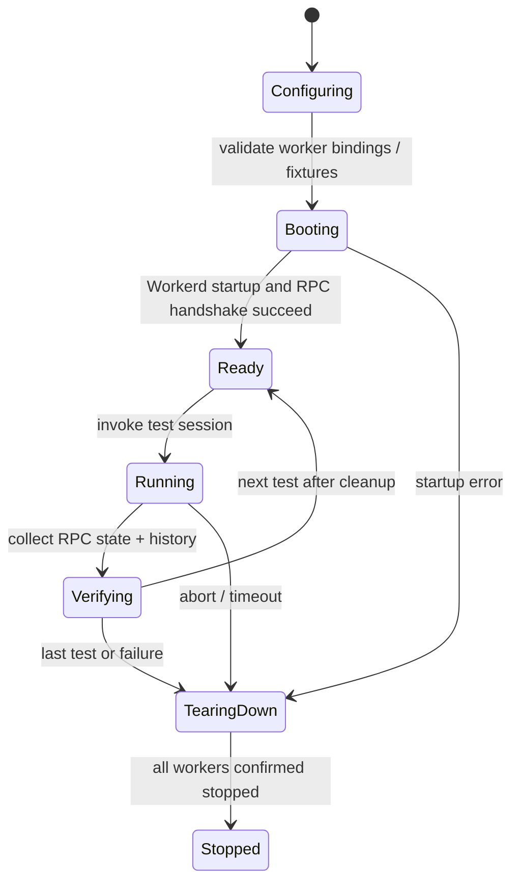

# `@gadgets/integration-tests` Specification

> **Status:** Normative package specification for the reusable cross-package Worker integration-test harness.

## 1. Mission

`integration-tests` boots the real `workshop-backend` together with one or more real Gatekeeper Workers under Wrangler's `createTestHarness`. Its purpose is to verify production Worker/RPC paths without every Gatekeeper package inventing a separate, drifting integration harness.

This package is test infrastructure only and MUST NOT become a production dependency.

## 2. Public exports

The package currently exposes:

- `./harness` — Worker boot/configuration helpers;
- `./network-interceptor` — controlled external-network interception for tests;
- `./rpc-client` — helpers for driving the Workshop RPC surface.

New public test utilities SHOULD remain generic and reusable across Gatekeepers.

## 3. Harness topology

`startHarness()` accepts a list of `GatekeeperSpec`s. Each spec defines:

- `binding` — the service-binding suffix;
- `dir` — Gatekeeper package directory containing `wrangler.jsonc`;
- optional `patch(config)` — test-only config mutation.

The harness:

1. reads and validates each real Wrangler config;
2. pins build cwd/main so generated Worker entrypoints resolve in an inline harness config;
3. boots `workshop-backend` as the primary Worker;
4. boots only the requested Gatekeepers;
5. injects backend service bindings as `GATEKEEPER_<binding>` pointing to each Gatekeeper's `GatekeeperVendor` entrypoint;
6. runs with password auth available and the test admin identity configured;
7. removes the Worker Loader when Gadget code execution is not part of the test scenario;
8. returns the running harness URL and direct named-Worker dispatch helper.

This wiring MUST stay behaviorally aligned with production/dev binding discovery. A test must not pass through a fake registry path that production does not use.

## 4. Binding/vendor identity

The binding suffix is converted by Workshop into the vendor ID by the normal `GATEKEEPER_*` discovery convention. Test code MUST choose a binding that reflects the expected vendor identity and SHOULD assert behavior through the same RPC surface used by real clients.

The bundled fixture Gatekeeper exists to test Workshop behavior without depending on an external provider.

## 5. Real-code-path requirement

The default integration approach is **real Worker code + mocked/intercepted external provider boundary**, not a mock of Workshop/Gatekeeper internals.

A new Gatekeeper integration suite SHOULD be created by pointing this harness at the package and providing provider/network fixtures. It SHOULD NOT fork/copy the harness implementation unless the runtime topology genuinely differs.

## 6. Configuration validation

The harness intentionally validates only the Wrangler fields it reads/rewrites and leaves unrelated config fields intact for Wrangler itself to validate. This prevents the test package from becoming a second full Wrangler schema.

A malformed touched field SHOULD fail early with an actionable config error.

## 7. Network determinism

Tests that would otherwise call live provider APIs SHOULD use the package's network interception facilities or provider fixtures. Integration tests MUST be deterministic, must not consume real user/provider credits and MUST NOT require production secrets in CI.

OAuth/provider tests SHOULD simulate the provider endpoints at the network boundary while retaining the real Gatekeeper account/nonce/RPC state machines.

## 8. Isolation

Each test/harness instance SHOULD own isolated Worker/Durable Object state and be explicitly stopped/disposed. Tests MUST NOT depend on execution order or state from another suite.

Direct `fetchWorker(name, ...)` dispatch is allowed for exercising a Gatekeeper's own HTTP/OAuth entrypoint; Workshop behavior SHOULD still be exercised through the backend public RPC when that is what production clients use.

## 9. Required scenarios

The harness is the preferred place for cross-package contracts such as:

- Gatekeeper discovery from `GATEKEEPER_*` bindings;
- account connect/complete/expiry/reconnect;
- resource configurator integration where practical;
- observation authorization and collaborator verification;
- staged action submit/apply/reject behavior;
- hooks and persistent callback delivery;
- ambient account provisioning;
- auth Gatekeeper sign-in;
- backend/Gatekeeper RPC compatibility after shared-contract changes.

## 10. Security/test integrity

- Test-only patches MUST NOT be copied into production configuration.
- Network interception MUST be explicit; a missing interceptor SHOULD fail rather than silently call a real provider.
- Secrets/tokens used in fixtures are synthetic.
- Tests SHOULD assert negative/fail-closed behavior, not only successful paths.
- A passing integration test MUST not depend on bypassing shared approval/observer checks.

## 11. Compatibility

Because consumer packages may import these helpers, exported test utility signatures are compatibility-sensitive inside the monorepo. Breaking changes SHOULD update all consumer suites in the same PR.

The harness's assumptions about backend config, generated main paths and Gatekeeper service binding conventions MUST be updated together with the corresponding runtime packages.

## 12. Change checklist

- [ ] Test topology still matches real Worker/service-binding topology.
- [ ] No live-provider secret/credit is required.
- [ ] Config patches are test-only and bounded.
- [ ] New Gatekeeper patterns can reuse the common harness.
- [ ] Cross-package contract changes gain a regression scenario here where useful.

## 14. Shared Worker harness and real agent sessions

The harness starts and stops the actual configured Workers and Durable Objects used by integration tests, with RPC clients, predictable input bindings, network interception and mock-model support. Setup MUST have explicit teardown to prevent leaked running Workers or callbacks. Tests must not silently fall back to a production Gatekeeper or use live production OAuth secrets. Agent session helpers SHOULD expose observable state/history and acceptance semantics closely enough for downstream workshop-evals to verify real agent changes, including post-accept reload.

Test-case isolation must reset Durable Object state where required; assertions must not rely on an unready socket or stale capability stub. Package-level and Worker tests are different suites, and generated entrypoints may require prep steps. The experimental evaluation package consumes this harness but owns model selection, budgets and scoring. Cover startup failure, worker restarts, cleanup after exception, mock model divergence, RPC retry boundaries and egress restrictions.
