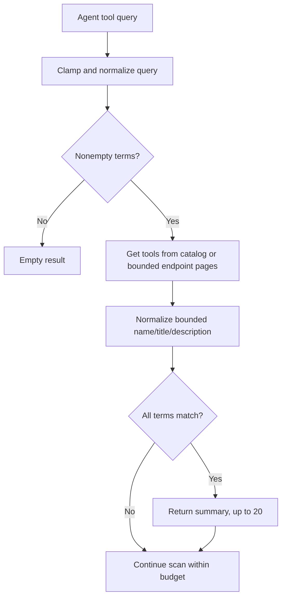

# `@gadgets/mcp-shared` Specification

> **Status:** Normative shared MCP specification. This package is the single implementation/policy substrate consumed by the generic MCP and MCP Portal Gatekeepers.

## 1. Mission

`mcp-shared` centralizes every rule that must be consistent across MCP connectors: endpoint validation, OAuth/account lifecycle, transport/session handling, tool discovery and generated types, tool trust/classification, action state, scoping, portal helpers, approval descriptions and owner-only sharing policy.

Connector packages MUST NOT fork these rules locally. Differences between connectors are expressed through endpoint provenance/configuration, trust and scope inputs to the shared abstractions.

## 2. Public modules

The package exports focused subpaths for account/action state, catalog/client/connect-nonce/connection, endpoint/fetch, facet/session/session-method generation, OAuth/HTTP callbacks, portal helpers, schema-to-TypeScript conversion, scope, tool classification, sharing policy, user abstractions and types/utilities.

Consumers SHOULD use those public modules rather than reach into private source files.

## 3. Endpoint/account ownership

`McpAccountBase` owns one connected endpoint and every credential/session secret for it.

The connection state machine MUST preserve these rules:

- first-connect links use random, expiring, single-use initiation nonces;
- a nonce is synchronously **claimed before the first await** so interleaving Durable Object requests cannot both complete one attempt;
- connection generations advance before network/OAuth work so stale in-flight operations cannot install credentials after a newer reconnect/repoint;
- OAuth state, code verifier, registered client data and tokens stay in the account object;
- abandoned first connections are cleaned up after a bounded timeout;
- public/no-auth, OAuth and deployment-token endpoints are represented explicitly by `ServerAuthKind`;
- user-selected endpoints are immutable across reconnect;
- only a deployment-controlled target may perform the controlled repoint exception, which invalidates old credential/session state first.

## 4. Endpoint/fetch security

MCP endpoint fetches are SSRF-sensitive.

Shared endpoint/fetch helpers MUST:

- validate allowed schemes/hosts/URLs according to deployment mode;
- preserve full endpoint identity, including meaningful paths;
- block unsafe/private targets by default;
- allow insecure/localhost behavior only through explicit local-development configuration;
- never send a static deployment token to an endpoint that no longer matches the live deployment target.

Connector code MUST use these helpers rather than raw unrestricted `fetch()` for MCP transport/auth discovery.

## 5. Tool trust and classification

`tools.ts` is the **single trust boundary** where server-provided tool annotations become policy decisions.

### 5.1 Classification

- `annotations.readOnlyHint === true` → tool mode `read`.
- Any other value, including absent annotation → mode `action`.
- `classifiedBy` records whether the read decision came from the server annotation or a default policy path.

### 5.2 Auto-approval

A write is `autoApprovable` only when **all** are true:

1. the endpoint/server is deployment-vetted (`ServerTrust === "vetted"`);
2. the tool is not read-only;
3. `destructiveHint === false`;
4. `idempotentHint === true`.

A BYO/user-supplied endpoint can never use its annotations to auto-approve a write.

No connector may independently reinterpret these annotations.

## 6. Catalog limits and policy revision

A server catalog is bounded to `MAX_TOOLS_PER_SERVER` (currently 200 tools). Tool selection/type generation MUST not proceed as if a truncated catalog were complete when completeness is required for safe scoping.

`catalogRevision()` fingerprints tool names plus every annotation that feeds policy. Descriptive copy is intentionally excluded so harmless copy edits do not look like policy changes.

Consumers SHOULD use this stable revision to detect that endpoint policy claims changed underneath an existing grant.

## 7. Untrusted approval text

MCP server names, tool names/descriptions and tool-call arguments are untrusted input that is rendered in human approval UI.

The shared description builder MUST:

- strip/neutralize Markdown structure that could forge trusted headings/fences;
- quote server-supplied descriptions;
- bound description, argument and inline-name lengths;
- safely stringify arguments;
- state the provenance of the read/action classification;
- show endpoint/tool identity without allowing server text to continue in the application's trusted voice.

Current important bounds are approximately 600 characters of server description, 4000 characters of rendered arguments and 120 characters for inline server/tool/endpoint text.

## 8. Tool/resource scope

`scope.ts` defines how an endpoint and optional server/tool subset become a concrete binding scope.

The scope implementation MUST ensure:

- the binding cannot call a tool outside its selected set;
- action-kind policy tags are namespaced by a caller-supplied scope tag so approvals cannot bleed across endpoints/connectors;
- endpoint equality uses the shared canonical semantics;
- portal upstream server scope and generic endpoint scope cannot be confused;
- generated Gadget types expose only the granted tools.

## 9. Gadget session contract

`McpSessionBase` is the Gadget-facing execution core.

### Reads

`listTools()` and read-classified calls are observations. A read tool may execute remotely before authorization only to obtain the result; the result MUST NOT be returned until `authorizeObservation()` succeeds.

### Actions

Action-classified calls:

1. validate tool/args against the binding catalog;
2. stage a durable `StoredAction`;
3. submit an `ActionDescription` with `implementsRevert: false`, `awaitDecision: true`, stable action kind and centralized auto-approval verdict;
4. return a pending action ID/status;
5. execute only from the Gatekeeper's approved apply path;
6. store resulting status/result/error;
7. authorize the applied result as a new observation when later returned by `getActionResult()`.

The generic MCP protocol does not define an inverse operation, so shared MCP actions MUST NOT claim automatic revert.

## 10. Action-store correctness

Stored action states include `pending`, `applying`, `applied`, `rejected`, and `failed`.

The `applying` claim exists to prevent a second concurrent approval/apply from invoking the same remote tool twice. Failure handling MUST distinguish safely-retryable failures from unknown-outcome failures where the remote write may already have happened; unknown outcome MUST NOT be automatically retried as if nothing happened.

Durable state transitions that cross network awaits MUST remain restart/interleaving-safe.

## 11. OAuth protocol

The shared OAuth implementation uses MCP's authorization discovery/client registration protocol and stores OAuth client/discovery/token state in the account object.

- OAuth errors exposed to users MUST be sanitized.
- Refresh rotation must persist replacement refresh tokens.
- Rejected/expired credentials must notify the Workshop account lifecycle once, without hot-looping duplicate expiry notifications.
- Reconnect invalidates prior transport/session generations.

## 12. Sharing policy

MCP bindings are currently **owner-only**. `observerRefusalMessage()` documents the reason: authenticating another collaborator to the same service does not prove they can read the exact data observed using the owner's credentials.

Both generic and portal Gatekeepers MUST use this shared refusal policy until a verifiable per-record sharing model is designed.

Publishing a Blueprint so each user connects their own account is the supported sharing alternative.

## 13. Generated TypeScript

MCP JSON Schemas are transformed into bounded Gadget-facing TypeScript declarations. Type generation MUST:

- preserve tool names/input requirements enough for correct invocation;
- remain within catalog/output complexity bounds;
- not execute or trust schema text;
- scope methods to the selected tool grant;
- retain base MCP result/action status types.

Schema constructs that cannot be represented safely SHOULD degrade conservatively rather than producing misleadingly-narrow types.

## 14. Logging

MCP log helpers MUST avoid credentials, OAuth secrets and unbounded tool arguments/results. Endpoint host/server identifiers may be logged in normalized bounded form for diagnostics.

## 15. Tests

Tests SHOULD cover:

- nonce claim/replay/interleaving;
- connection generation and stale OAuth/refresh writes;
- endpoint validation/SSRF rules;
- public/OAuth/static-token account paths;
- deployment repoint safety;
- classification truth table for every annotation combination/trust mode;
- catalog bounds/revision stability;
- Markdown/prompt-injection sanitization of approval descriptions;
- scope/tool anti-widening;
- read authorization and action lifecycle;
- duplicate apply and unknown-outcome retry behavior;
- generated TypeScript bounds;
- owner-only observer policy.

## 16. Change rules

Any change to annotation trust, endpoint equality, action retry semantics, OAuth credential handling or sharing affects both MCP Gatekeepers and is security-sensitive. It MUST update `gatekeeper-mcp`, `gatekeeper-mcp-portal`, tests and relevant root specs in the same change.

## 16. Shared bounded tool search and discovery

The shared `src/tool-search.ts` is the single implementation for matching both a fully loaded catalog and paginated endpoint discoveries. Queries use normalized camelCase, snake_case, dashes and whitespace, and a tool matches when every unique normalized query term occurs in the combined name/title/description. Query text is bounded to 200 characters; searchable provider fields are bounded to 4000 characters; at most 20 tool summaries are returned by one search. An empty query MUST not match everything. A cursor-based server scan MUST use the same predicate as an in-memory search so the same query does not return contradictory results by code path.

Search results advertise tools, not authority to execute them. Invocation MUST still pass the existing pinned scope, live annotation classification, action staging and observation authorization. Tests MUST check case, word separators, long malicious descriptions, query truncation, empty query, endpoint pagination and identical cross-connector matches.
