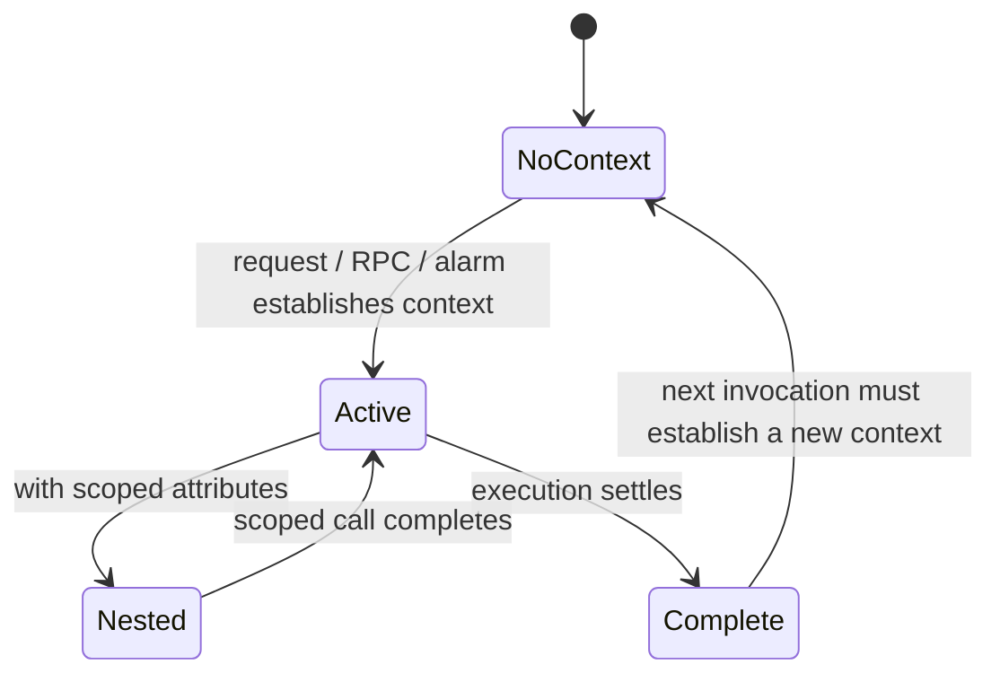
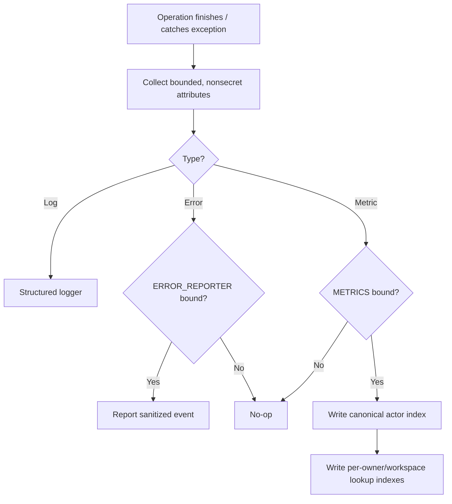

# Observability — Normative Specification

> Package: @gadgets/observability. Shared Cloudflare Workers library, not a Worker or deployable endpoint. Replaces the former backend-utils observability helpers.

## Public module boundaries
Public subpaths are ./logger, ./observability-context, ./tracing, ./error-reporting, ./metrics and ./metrics-schema. All consumers MUST import explicit public subpaths. Logger must run in Workers without requiring AsyncLocalStorage; only consumers importing observability-context require nodejs_als or nodejs_compat. An observability context's ambient metadata lives in the current asynchronous execution chain, not in a global durable registry. Child contexts MAY add scoped attributes and inherit them through context.with(); get() returns only currently available fields.

## Context lifecycle

No component MUST assume a context propagates across a Durable Object restart, independent invocation, RPC, queue delivery, scheduled alarm or hook session. Each receiving boundary is responsible for reconstructing safe, minimal correlation data. No context field is authorization or identity proof by itself.

## Logging and trace contracts
The logger MUST include stable structured attributes (for example component and, for a Gatekeeper, vendorId) rather than unbounded string concatenation. Caught exceptions MAY be recorded as error fields only after verifying their messages and causes cannot contain credentials or user payload. NEVER log requests/responses, model prompts, share-link fragments, OAuth tokens, provider headers or secret material. Tracing MUST preserve parent/child operation correlation where a runtime invocation permits it and MUST NOT invent cross-invocation parentage.

## Reporter and metrics delivery
The optional ERROR_REPORTER binding receives bounded, sanitized error events. Absence of that binding makes reportIssue(...) a safe no-op; it MUST NOT throw solely because telemetry is disabled. The optional METRICS Analytics Engine binding similarly makes metric recording a no-op when absent. The import-free metrics-schema.ts is authoritative for field layout; dashboards must use named schema columns rather than assume blob position. An event's actor index is the canonical copy to count, and additional owner/workspace indexes are lookup replicas. Queries and rollups MUST avoid counting the replica copies as new events.

## Error-reporting separation
@gadgets/error-reporting owns the event shape and normalization; this package owns Worker-side reporting integration. A reported browser user ID is not authenticated identity. Browser and sandboxed-iframe reporting must traverse the Workshop host and its origin/window checks, not grant Gatekeeper or Gadget authority. Error events and metrics are diagnostics, never a source of approval state, business data or access rights.

## Tests and changes
Verify context nesting/restoration, missing-binding no-op, bounded serialization, duplicate metrics index semantics, schema compatibility, logging secret redaction, worker runtime compatibility and instrumentation under RPC/DO boundaries. Any new attribute with high cardinality or sensitive content requires explicit privacy and query-cost review. Follow README.md, REVIEW.md and source JSDoc.

## Grok MVP compatibility — 2026-10-13

This existing module's current implementation and authority remain unchanged in [Phase 1](../../ROADMAP.md). No new agent-platform package replaces it. Future reuse must be explicitly justified by tests and an approved phase.
