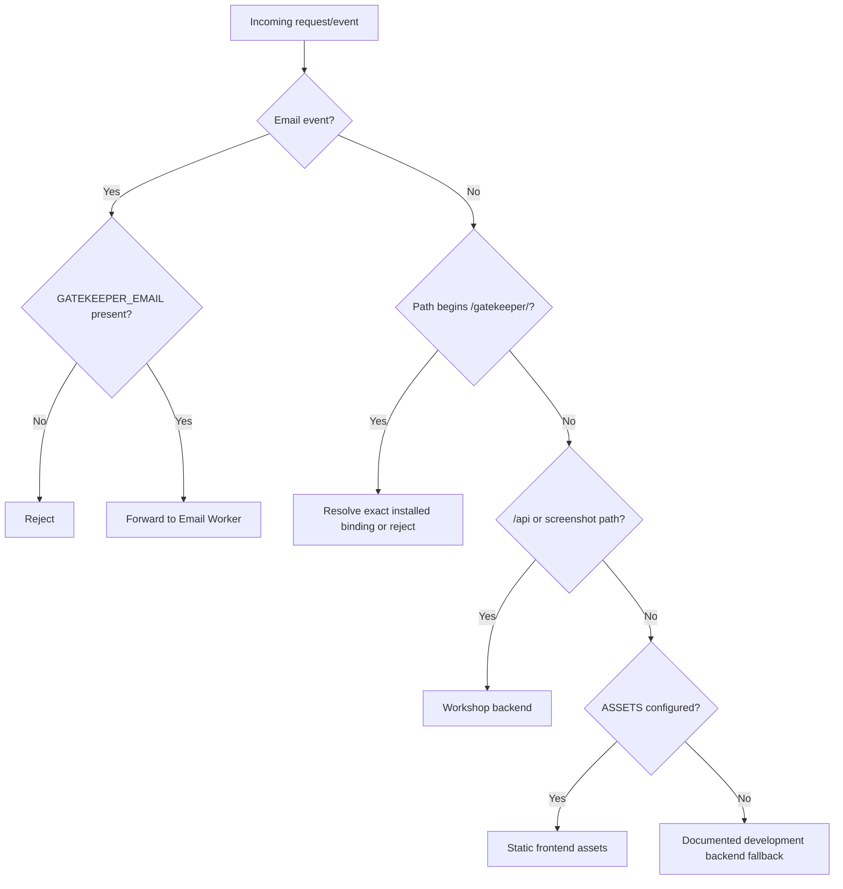

# `@gadgets/router` Specification

> **Status:** Normative package specification for the public-origin routing Worker.

## 1. Mission

`router` is the thin public-origin multiplexer for Cloudflare OS. It routes requests to installed Gatekeepers, the Workshop backend or static frontend assets without duplicating the backend's business logic or maintaining a separate connector registry.

**The installed service-binding set is the routing configuration.**

## 2. Environment contract

Required/optional bindings:

- `WORKSHOP_BACKEND: Fetcher` — required backend service;
- `ASSETS?: Fetcher` — production frontend static asset binding;
- `GATEKEEPER_*` — dynamically-discovered Gatekeeper Worker services;
- `GATEKEEPER_EMAIL?` — additionally expected to implement the Email event handler when Email ingress is installed.

A new ordinary Gatekeeper SHOULD be installable by adding a `GATEKEEPER_<NAME>` service binding, without editing router source.

## 3. Gatekeeper route derivation

For every environment key beginning with `GATEKEEPER_`:

1. remove the prefix;
2. lowercase the suffix;
3. replace `_` with `-`;
4. route `/gatekeeper/<derived-suffix>` and descendants to that service's `fetch()`.

Examples:

- `GATEKEEPER_GITHUB` → `/gatekeeper/github`
- `GATEKEEPER_MCP_PORTAL` → `/gatekeeper/mcp-portal`

The router MUST forward the original request so Gatekeeper OAuth/connection handlers see the public origin/path expected by their `BASE_URL` contract.

## 4. HTTP routing precedence

Current authoritative precedence:

1. matching Gatekeeper path prefix → matching Gatekeeper Worker;
2. `/api` and `/api/*` → `WORKSHOP_BACKEND`;
3. `/blueprint-screenshot` and `/blueprint-screenshot/*` → `WORKSHOP_BACKEND`;
4. all remaining requests → `ASSETS` when configured;
5. otherwise (development/local topology without router assets) → `WORKSHOP_BACKEND`.

Gatekeeper OAuth callbacks live under their own `/gatekeeper/<name>/...` routes. The backend does not own generic `/auth/*` callbacks.

A new backend-owned public path must be added here only when routing it through frontend assets would be wrong. Such additions require matching backend/spec/tests.

## 5. SPA/static asset behavior

In production the router may serve `workshop-frontend` through the `ASSETS` binding. Frontend fallback behavior belongs to the asset configuration; the router itself should remain unaware of application route details.

In development the router can run without `ASSETS`; non-backend/gatekeeper requests then fall through to the backend. `run-dev-server.js` and `run-local` determine whether frontend traffic is served by Vite or backend assets.

## 6. Email ingress

The Worker implements an Email event handler.

- If `GATEKEEPER_EMAIL` is installed, forward the incoming Email event to that service's `email()` entrypoint.
- If it is absent, explicitly reject the message with an explanatory reason.
- The router MUST NOT parse message bodies or implement mailbox business logic.
- Delivery/observation/hook/idempotency semantics belong to `gatekeeper-email`.

This ensures Email routing configuration cannot silently accept messages that no Gatekeeper will process.

## 7. Security boundary

The router is intentionally thin, but route mistakes can bypass intended Workers. Therefore:

- Gatekeeper prefix matching MUST require either exact prefix or prefix followed by `/`; a name prefix such as `/gatekeeper/foo-evil` must not match `/gatekeeper/foo`.
- API requests MUST not fall through to static assets.
- Gatekeeper connection/OAuth requests MUST not fall through to the backend/frontend.
- The router MUST NOT add privileged identity headers or reinterpret authorization.
- It MUST NOT expose environment/binding enumeration to clients.
- Email without a configured handler fails closed.

Authorization remains the responsibility of the destination Worker.

## 8. Dev/deploy workflow

Root `wrangler.jsonc` uses this package as the dev router entrypoint. `run-dev-server.js` discovers Gatekeeper packages and generates a dev router config containing one service binding per discovered Gatekeeper.

Production deployment generation MUST preserve the same naming convention so route behavior does not diverge between dev and production.

## 9. Tests

Tests SHOULD cover:

- dynamic routing for one and multiple `GATEKEEPER_*` bindings;
- underscore-to-hyphen conversion;
- exact-prefix boundary behavior;
- `/api` and blueprint screenshot precedence over assets;
- arbitrary SPA path routing to assets;
- dev fallback with no `ASSETS`;
- Email forwarding with `GATEKEEPER_EMAIL`;
- explicit Email rejection without it;
- adding an unrelated environment key does not create a route.

## 10. Non-goals

`router` does not authenticate users, validate OAuth state, render frontend HTML, execute business RPC, hold connected-account credentials, choose installed vendors, or implement a Gatekeeper registry beyond service bindings.

## 11. Change checklist

- [ ] Binding naming remains the source of Gatekeeper routing truth.
- [ ] Route precedence cannot send privileged paths to assets/the wrong Worker.
- [ ] New backend public paths are covered in backend/router specs and tests.
- [ ] Email continues to fail closed when uninstalled.
- [ ] Dev and production wiring derive equivalent routes.

## 14. Current origin and email routing

The router's authority comes from deployment bindings and public-origin config, not application text or a client-selected Worker. Gatekeeper paths derive the target from the installed GATEKEEPER_* service bindings. The router MUST never interpret a missing Gatekeeper binding as permission to forward arbitrary user-provided URLs. /api and Blueprint screenshot requests reach Workshop backend; remaining paths serve installed frontend assets or the explicit development fallback. Email ingress has a distinct Worker event route: with no GATEKEEPER_EMAIL binding it fails closed.

Proxying must preserve required methods and WebSocket upgrades but avoid treating untrusted headers as proof of authentication. Tests MUST cover unknown/malformed Gatekeeper suffix, conflicting route prefixes, Email absence, API WebSocket handshake, assets fallback and provider OAuth callback routes.

## Phase-gated Grok integration — 2026-10-13

> **Current roadmap:** [ROADMAP.md](../../ROADMAP.md). **Status:** Fase 1 SEM ALTERAÇÕES. Future agent/tool/registry/loop specs previously appended here were speculative and have been removed from the active package spec. Historical material survives in Git history. The 32 existing packages and their working contracts are preserved.

**Ownership:** Router público existente /api, /gatekeeper e assets deve permanecer intocado: o Grok Runtime é acessado apenas por binding PRIVADO do Workshop, não por rota pública.

**Current MVP integration:** No implementation work for this package during Phase 1. Future integration depends on a separate phase gate and verified source reuse.

**Non-goals in Phase 1:** Agent Registry, MCP Registry integration, tool gateways, scheduling, autonomous tasks, Codex/OpenCode, new Gatekeepers, generalized ACC and A/B. The only new docs-only runtime module is `packages/agent-runtime`. See [Phase 1 implementation](../../docs/architecture/PHASE1_GROK_MVP.md) and [this package's plan](./plan.md).
