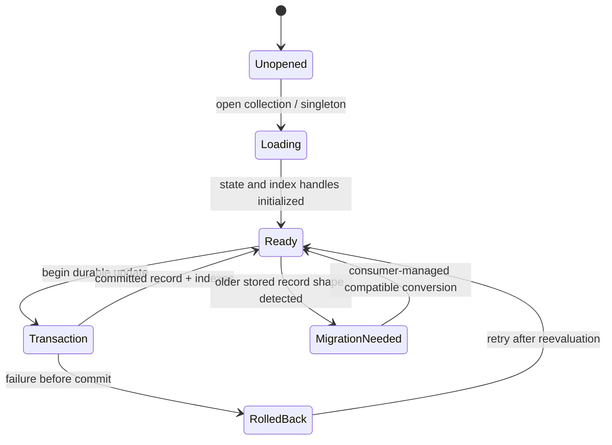

# `@gadgets/typed-storage` Specification

> **Status:** Normative package specification for the typed Durable Object storage abstraction.

## 1. Mission

`typed-storage` provides a small strongly-typed persistence layer over the synchronous Durable Object `storage.kv` API. It standardizes collections, indexes, singletons, key ordering, synchronous transactions and change subscribers without taking ownership of any application-specific schema or migration policy.

It is infrastructure. Consumers remain responsible for the semantic meaning and lifecycle of their records.

## 2. Core model

`createTypedStorage(storage, schema)` maps one Durable Object storage namespace into:

- named **collections** of typed records;
- optional **unique indexes**;
- optional **non-unique indexes**;
- named **singletons** with typed defaults;
- a synchronous transaction surface;
- subscribers used to maintain derived/index state consistently with record mutations.

A collection schema defines how its primary key is derived, either from a record property or a function. Index definitions derive secondary keys from records.

## 3. Primary-key contract

Supported key domains include the key types implemented by the package (notably strings and integer-like ordered keys used by Cloudflare OS stores).

Encoded storage keys MUST preserve the required ordering semantics used by `list()`/range scans. Numeric key encoding MUST not produce lexicographic order bugs such as `1, 10, 2` when the consumer expects numeric ordering.

Prefixing/escaping MUST ensure collection/index/singleton namespaces cannot collide even when application keys contain common delimiter characters.

A primary key is the identity of a record. Mutating fields that contribute to the primary key is conceptually a delete+insert and MUST update indexes accordingly.

## 4. Collection operations

Collection APIs support the normal typed storage operations used by consumers: lookup, put, delete, list/range iteration and index access.

Semantics:

- `get()` returns the record for exactly one primary key or absence;
- `put()` writes one logical record and atomically updates all declared indexes;
- `delete()` removes the logical record and its index entries;
- `list()` returns records in the underlying encoded-key ordering and honors supported bounds/options;
- index lookup returns the current primary record(s), not an independently-authoritative copy.

Consumers MUST NOT manually mutate internal prefixed/index keys behind the abstraction while also expecting indexes to remain correct.

## 5. Unique indexes

A unique index maps one secondary key to at most one record/primary key.

A `put()` that would violate uniqueness MUST fail rather than silently overwrite another logical record's index ownership. Index maintenance and primary-record write MUST occur in one synchronous transaction so partial index state is not externally visible.

Consumers SHOULD use unique indexes only for invariants that truly belong inside one Durable Object. Cross-Durable-Object uniqueness requires a different coordination design.

## 6. Non-unique indexes

A non-unique index maps one secondary key to zero or more records. Its entries MUST remain synchronized as records are inserted, updated or deleted.

Index iteration ordering is an implementation contract only where explicitly exposed/documented. Application logic SHOULD NOT depend on incidental internal key formatting.

## 7. Singletons

Singletons provide a typed value with a declared default and `get()`/`put()`-style behavior. They are appropriate for per-Durable-Object state such as counters, flags, cursors and small configuration values.

Defaults are logical defaults; consumers MUST distinguish whether they require evidence that a value was explicitly persisted. A schema change that changes a default can alter the interpretation of old objects and therefore requires compatibility analysis.

## 8. Transactions and atomicity

The package builds on synchronous Durable Object storage and `transactionSync` semantics.

All mutation of one logical record plus its indexes MUST be atomic inside the current Durable Object. Subscribers/index-maintenance callbacks invoked as part of a mutation MUST observe a coherent before/after transition.

This package does not turn network/RPC operations into transactions. Consumer state machines that perform `await` between durable changes MUST use explicit claimed states, generations, idempotency keys or compensating logic.

## 9. Subscribers

Subscribers are used to react synchronously to collection changes and maintain related derived storage where configured.

Subscribers MUST:

- run inside the same synchronous transaction when correctness depends on atomicity;
- avoid network/async effects inside the storage transaction;
- be deterministic for the same record transition;
- not recursively create uncontrolled mutation cycles.

A subscriber is not an external event bus.

## 10. Schema/migration contract

**Current limitation:** `typed-storage` does not provide built-in schema versions, declarative migrations, automatic record rewriting, or compression/version negotiation.

Therefore every consuming package MUST own its persistence compatibility. When a record shape changes, the consumer must use one or more of:

- backward-compatible optional fields/default interpretation;
- explicit one-time migration code;
- lazy migration on read/write;
- new collection/singleton names plus coordinated copy/transition;
- Wrangler Durable Object class migration where class topology changes.

A TypeScript type edit alone is **not** a storage migration.

Adding automatic migrations/versioning to this package would be an architecture change and MUST specify failure/restart/idempotency semantics before use.

## 11. Durable Object isolation

All keys/indexes managed by one `createTypedStorage()` instance live within one Durable Object's storage. This package provides no cross-object queries, joins, transactions or global secondary index.

Consumers such as Workshop deliberately denormalize/push indexes into User/Overseer objects where global-looking UI needs cheap reads. That design remains application-level.

## 12. Data safety

- Storage values may contain RPC/persistent-capability-compatible values only when the Workers runtime permits them and the consuming contract deliberately does so.
- Secrets persisted through this package remain the consuming package's responsibility; typed-storage does not automatically encrypt/redact values.
- Application code MUST NOT expose raw storage keys/records to untrusted clients merely because they are typed.
- Index keys derived from sensitive values SHOULD be assessed for metadata leakage inside debugging/export paths.

## 13. Performance expectations

The abstraction SHOULD remain close to native synchronous DO storage costs.

- Prefer bounded prefix/range scans over materializing entire large collections.
- Indexes SHOULD exist when they eliminate repeated full scans for a stable access pattern.
- Schema authors SHOULD avoid redundant indexes with no real query path.
- Large blobs belong in R2/other appropriate storage rather than arbitrary collection records when Worker/DO limits make them unsuitable.

The package MUST NOT introduce hidden network calls.

## 14. Testing contract

Tests SHOULD cover:

- string/integer primary-key encoding and ordering;
- prefix/delimiter collision resistance;
- put/get/delete/list;
- unique index conflicts;
- non-unique index update/removal;
- record updates that change index keys;
- singleton defaults and persistence;
- atomic rollback on transaction/index failure;
- subscriber ordering/consistency;
- old-record compatibility scenarios in consuming-package tests.

## 15. Compatibility

The generated on-disk key format is compatibility-sensitive for existing Durable Objects. A change to prefix/key encoding, index representation or singleton naming can make existing data unreadable and MUST include migration/backward-read strategy.

The TypeScript API exported from the built package is also a broad monorepo dependency and SHOULD avoid gratuitous breaking changes.

## 16. Non-goals

This package does not provide:

- cross-Durable-Object transactions;
- SQL/query planning;
- automatic schema migrations today;
- distributed locks;
- blob storage;
- external change streams;
- application-level authorization.

## 17. Change checklist

- [ ] Existing encoded keys remain readable or are migrated.
- [ ] Index changes preserve atomicity/uniqueness.
- [ ] No async/network effect is introduced inside synchronous transactions.
- [ ] Consumer migration responsibility remains explicit.
- [ ] Performance remains bounded for expected collection sizes.
- [ ] Package and affected consumer tests/specs are updated.

## 14. Migration ownership and transactional invariants

Typed storage provides a type-safe facade over DurableObjectStorage.kv, not an automatic migration/versioning engine. Changing a TypeScript schema declaration cannot rewrite records already persisted under an old shape. Consumers MUST explicitly implement backward-compatible readers or ordered migrations, and document the migration as an application-level change. Unique and nonunique indexes must remain synchronized with collection record mutations within the intended transactional boundary. A failed transaction must not expose partially committed index rows or counters as authoritative state.

Do not store RPC capabilities or secrets as plain JSON simply because a typed collection accepts the TypeScript type. A subscription callback does not replace durable storage and must be invalidated on reconnect or DO restart. Tests cover concurrent transactions, unique index conflicts, partial writes, reverse index lookup, versionless old-record reads, multiple collections and restart persistence.
