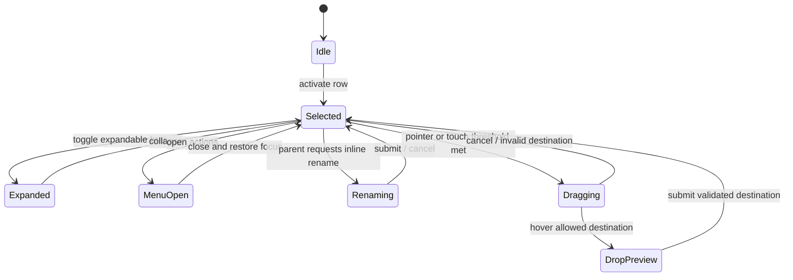
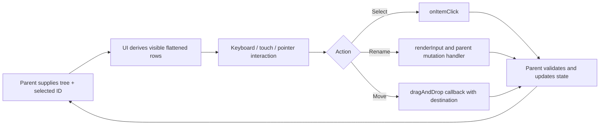

# Shared React UI — Normative Specification

> Package: @gadgets/ui. Library only; no backend, Worker, persistence or authentication authority. Current public exports include root and ./hierarchical-list, implemented under src/HierarchicalList/.

## Mission and dependencies
Provide reusable interactive controls shared by Workshop and Gatekeeper management apps. Kumo components and design tokens remain foundational primitives; React 19, Phosphor icons and Motion are implementation dependencies, not hidden state authorities. Generic navigation/tree interactions belong here, while provider/account mutations and durable business state belong to consuming applications.

## HierarchicalList contract
The library renders nested items, explicit selection, branch expansion, optional expand-all mode, keyboard/pointer navigation, optional contextual actions, inline rename, and optional drag/drop for mouse and touch. Inputs such as items, label, selectedId, expandAll, dragAndDrop, rename and callbacks define behavior; mutations must be communicated through callbacks and reflected back in parent-owned state, not persisted in the UI package.

The flattened displayed order MUST be deterministic for a given tree and expansion state. A row's semantic identity comes from its stable item ID, not its array index. A branch's children MUST NOT be accidentally moved beneath itself. Drop destinations MUST be validated by the application/domain before persistence; visual drop affordance alone does not grant permission.

## Interaction state machine

Rename MUST avoid replacing the menu trigger until focus restoration completes. After Enter or Escape, focus SHOULD return to the relevant row when focus has not intentionally moved elsewhere; Tab/blur MUST NOT hijack focus. A menu or inline rename MUST suppress conflicting row actions. Touch dragging needs a threshold, handles where configured and cancellation on gesture conflict. Reduced-motion preferences MUST remove unnecessary transitions without disabling operability.

## Controlled mutation flow

The component MUST distinguish interactive rows from passive message rows, disabled actions, nested branch controls and contextual menus. aria roles, meaningful label, keyboard reachability, visible focus states and pointer/touch parity are required. Decorative icons and drag affordances MUST NOT be read as primary row content. Consumers should maintain authoritative validation of names, permissions, cycle prevention and server effects.

## Compatibility and verification
Keep exported prop types and callback semantics stable; coordinate breaking changes with Workshop and Context Library consumers. Unit/component tests MUST cover expansion, selection, disabled/passive rows, hierarchical ordering, keyboard focus, context-menu closure, rename focus, drag/drop destination and touch cancellation, alongside reduced-motion and accessible labeling. Build via package task graph and Vitest. Do not import Gatekeeper credentials or the Workshop RPC directly into this package.