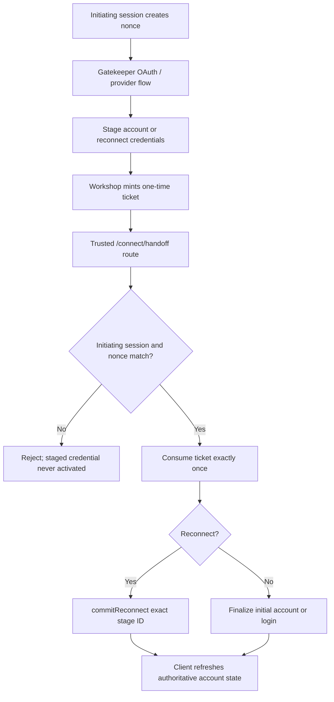
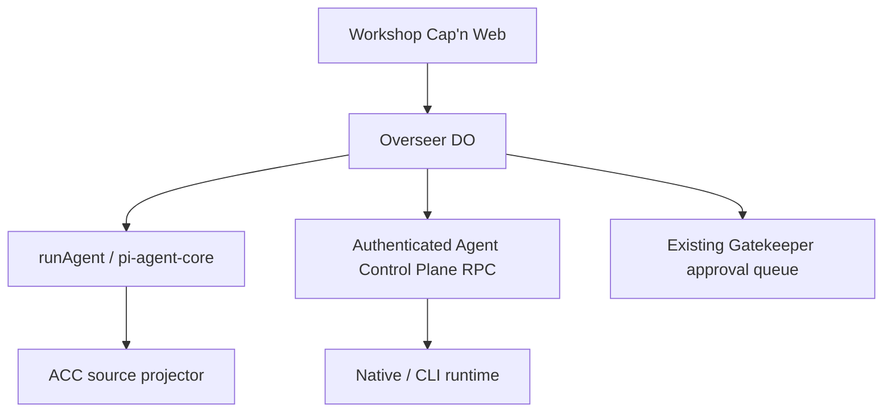

# Workshop Backend Specification

> **Package:** `@gadgets/workshop-backend`  
> **Status:** Normative package specification for the Cloudflare OS kernel. This package is the principal server-side authority for users, workspaces, Gadgets, agents, sharing, approvals, Blueprints and deployment coordination.

## 1. Mission

`workshop-backend` is the durable kernel of Cloudflare OS. It authenticates users, owns per-user and per-workspace durable state, brokers all Gatekeeper capabilities, executes/coordinates sandboxed Gadgets and AI agent turns, enforces observation/action/sharing policy, manages Blueprints/outputs and exposes the Cap'n Web API consumed by the Workshop frontend.

The backend MUST remain the authority for security-sensitive state. Frontend state, agent prompts and iframe UI are never substitutes for backend enforcement.

## 2. Worker/runtime topology

The production Worker entrypoint is generated by `capnweb-validate` from `src/server.ts` and referenced by Wrangler as `.wrangler/validate/src/server.ts`.

Important Worker runtime configuration includes:

- `global_fetch_strictly_public` — production SSRF defense for global outbound `fetch()`;
- `allow_irrevocable_stub_storage` — persistent capability/runtime support used by the system;
- `enhanced_error_serialization`;
- `nodejs_compat` for AI provider SDKs/Puppeteer dependencies;
- Browser binding `BROWSER` for PDF/browser export;
- KV namespaces `BLUEPRINTS` and `AVATARS`;
- R2 bucket `BLUEPRINT_CONTENT`;
- Worker Loader binding `LOADER` for dynamically-created Gadget code;
- optional Gatekeeper/Workers AI/service bindings generated at deploy/dev time.

The backend MUST preserve private-network/SSRF protections for arbitrary web-fetch paths. Development-specific localhost access must not be mistaken for production behavior.

## 3. Durable Object classes

### 3.1 `UserDurableObject`

One deterministic user object per normalized login identity. It owns:

- account/profile state;
- password/session authentication material;
- AI model configuration/preferences;
- onboarding state;
- connected Gatekeeper account capabilities and credential-expiry metadata;
- workspace index and shared-workspace listings;
- Blueprint ownership/library/pins;
- denormalized output index;
- optional Cloudflare billing account/balance and daily limit counters.

### 3.2 `OverseerDurableObject`

One workspace authority. It owns:

- workspace metadata and workpiece registry;
- Gadget records and their bindings;
- Gatekeeper facets/resources;
- Yjs/code versions and proposed/accepted code changes;
- chats, model-facing replay state and compaction checkpoints;
- action queue/audit state and auto-approval rules;
- persistent hooks/callback bindings;
- sharing graph/share links/collaborators/presence;
- Gadget execution/facet lifecycle;
- output synchronization and workspace-level policies.

### 3.3 `AdminSettings`

Deployment-wide mutable configuration including signup policy, ambient Gatekeeper modes, output/format offers, branding/configuration and other admin-owned state.

### 3.4 `PendingLogin`

Short-lived rendezvous Durable Object used by Gatekeeper-backed sign-in. The browser receives a `LoginAttempt` capability, not the DO ID.

Wrangler DO migrations are compatibility-sensitive. Current class-migration history includes the User/Overseer classes, AdminSettings and PendingLogin.

## 4. Public HTTP surface

The backend owns only specific public paths:

- `/api` — Cap'n Web RPC session;
- `/api/client-errors` — bounded untrusted browser error telemetry ingress;
- `/blueprint-screenshot/<id>` — immutable Blueprint screenshot delivery;
- site-logo endpoint defined by the site-logo module;
- frontend assets only when the deployment intentionally binds them directly to this Worker.

Everything else returns 404 unless assets are deliberately configured.

Gatekeeper OAuth callbacks do **not** live under backend `/auth/*`; they are routed to each Gatekeeper Worker under `/gatekeeper/<vendor>/...`.

## 5. RPC session and reconnect contract

`/api` constructs a `PublicApiImpl` using `newWorkersRpcResponse()`.

The backend may detect loss of a critical workspace Durable Object RPC connection and close the client WebSocket to trigger frontend recovery. Until native broken-stub handling replaces this workaround, this behavior is part of the recovery contract.

A broken session MUST NOT be silently reused as if all capability stubs were still valid.

## 6. Authentication

Cloudflare OS supports deployment-selectable authentication paths.

### 6.1 Session token

Password/Gatekeeper sign-in ultimately yields a session token encoded for the client as `username:token`. The raw random token is not stored; the User DO stores a SHA-256 token identifier. Authentication hashes the presented token and verifies it against the session collection.

New session tokens use cryptographically-random 32-byte material.

### 6.2 Password accounts

The frontend derives the password hash using the shared Argon2id contract; the User DO stores an additional SHA-256 of that derived hash. Password comparison uses a full-byte comparison without early value-dependent exit beyond length.

Password login/signup MUST be disabled when deployment policy requires Cloudflare Access or explicitly disables password auth.

Account creation MUST honor `AdminSettings.signupsEnabled`.

### 6.3 Cloudflare Access

When `CF_ACCESS_AUD` is configured:

- `/api` requires `Origin === request origin`;
- the Access JWT MUST validate against deployment configuration;
- the JWT MUST contain an email;
- user identity is derived from verified Access context, not browser-supplied input;
- first-use account creation occurs only if signups are enabled.

Cross-origin privileged API access is rejected.

### 6.4 Gatekeeper-backed sign-in

`PublicApi.startGatekeeperLogin(vendorId)`:

1. requires the vendor in the deployment auth allowlist;
2. resolves an installed Gatekeeper binding;
3. requires `VendorDescription.providesAuth`;
4. creates a unique `PendingLogin` DO;
5. hands the Gatekeeper a callback capability containing the pending ID in server-side props;
6. calls `connectAccount()` with `auth` scopes for ordinary providers, except Cloudflare where `full` is intentionally requested/persisted for AI Gateway billing;
7. returns `{url, attempt}` where `attempt.wait()` awaits the login result.

The client never receives the PendingLogin DO ID.

## 7. User storage contract

`UserDurableObject` currently uses typed collections for:

- AI models;
- workspaces/Gadgets metadata;
- connected accounts;
- sessions;
- owned Blueprints;
- library Blueprints;
- output index.

And singletons for profile/creation/password state, model preferences, onboarding, output-backfill cursor/state, next account ID, pinned Blueprints, daily LLM usage and Cloudflare billing state.

Storage shape changes MUST support existing rows. `typed-storage` does not perform migrations automatically.

Connected account records store the **Gatekeeper account capability**, description/vendor ID and credential lifecycle flags, not duplicated provider OAuth tokens.

Auto-provisioned accounts are protected from ordinary manual disconnect because deleting the account capability may destroy provider-local user data (e.g. Context/Scheduler).

## 8. Gatekeeper discovery/provisioning

Installed vendors are discovered from `GATEKEEPER_*` service bindings. Vendor ID is derived from the binding suffix. There MUST NOT be a separate hard-coded canonical vendor registry that can diverge from deployment bindings.

Ambient vendors use deployment policy:

- `disabled` — do not offer/provision;
- `optional` — user opt-in, default;
- `enabled` — force-provision for all users and prevent ordinary removal.

`provisioning-policy.ts` is the backend chokepoint for these decisions.

Connected account listing/subscription SHOULD tolerate one temporarily-failing vendor without breaking all connectors; unavailable vendors are surfaced/filtered safely and logged.

## 9. Workspace/workpiece model

A workspace has one shared sequential `WorkpieceId` namespace. Gadget and Gatekeeper workpieces cannot collide.

### Gadget record

A Gadget record contains identity/title/output metadata, a default binding name, binding edges and optional pending-creation ownership (`chatId`, later stamped sequence).

### Gatekeeper record

A Gatekeeper record contains resource display metadata, class/facet information, optional hook data and its creation specification. Legacy binding metadata on Gatekeeper records exists only for old-storage migration and MUST NOT become the current source of truth.

### Binding record

Bindings belong to a **Gadget edge**: `binding name → target workpiece`, with optional Blueprint annotation and pending change metadata.

A Gatekeeper can therefore be bound differently by multiple Gadgets without global binding metadata conflicts.

## 10. Provisional agent changes

Agent-created Gadgets, binding additions and code updates can be provisional to one chat.

Rules:

- the originating chat may use its own pending Gadget/binding immediately for preview/testing;
- other chats/mainline/shared `use` views treat another chat's pending entry as nonexistent for reads;
- a pending binding name still reserves the name for conflicting writes;
- the durable chat `changes` message is the source of truth for acceptance/reversion;
- registry `pending` rows materialize the proposal so it can execute before acceptance;
- sequence stamping ties the row to the persisted change message;
- crash reconciliation MUST either recover a proposal backed by durable chat history/tool call or reap orphaned unstamped state.

There must never be two independent authoritative sources for whether a provisional creation is accepted.

## 11. Binding names and agent environment

Every name introduced into a Gadget/agent JavaScript `env` MUST pass shared `validateBindingName()`.

Fallback/generated names are sanitized to ALL_CAPS identifier form and suffixed for uniqueness, but final validity always comes from the shared validator.

The agent's environment is explicit capability state:

- seed bindings are captured at chat creation/start preparation;
- later bindings are reconstructed by replaying durable chat changes;
- value/callback bindings are distinguished from workpiece bindings;
- deleted/inaccessible workpieces are removed/rejected at materialization time;
- no arbitrary process/environment variable becomes an agent capability.

## 12. Gadget execution isolation

Gadget server code is loaded/executed as dynamically-created Worker/facet code through the Worker Loader. It MUST receive only explicitly-built environment bindings.

The code-mode harness supports Worker RPC and persistent hook callback construction. The current placeholder persistent-stub workaround MUST fail loudly if a placeholder is invoked before being restored from storage; it is storage-only until the runtime provides a better sealing/restoration API.

Gadget/browser UI remains sandboxed on the frontend side; backend capability delivery must assume Gadget code is untrusted.

## 13. AI agent lifecycle

Agent turns are durable chat operations coordinated by Overseer.

Key rules:

- only one relevant running-agent state is allowed per chat under the implemented concurrency model;
- callbacks arriving while an agent runs are queued and delivered after the active turn according to chat ordering;
- transient callback RPC stubs are not persisted as ordinary values;
- model calls use the selected model/config and optional AI Gateway route;
- usage/cost accounting is updated with authoritative provider/gateway information when available;
- cancellation/restart/failure paths must resolve/reject outstanding callback promises rather than leak them forever;
- tool/code execution only sees the explicit reconstructed bindings.

## 14. Agent replay and model-private state

Server-side stored assistant messages preserve provider/model/reasoning metadata needed for faithful future replay. Tool arguments are de-duplicated where the durable tool-call record is already authoritative.

This model-facing snapshot is **server-only**. Clients receive the client-visible chat body, never private provider reasoning/signatures/modelData fields.

Model changes across turns are handled through the AI layer's message transformation, not by rewriting historical provider provenance.

## 15. Chat compaction

Compaction reduces model prompt size while preserving durable semantic replay.

A `CompactionCheckpoint` is immutable and contains:

- compacted boundary;
- model-generated summary;
- reconstructed named binding state;
- next change ID;
- observed code version;
- merged accepted/proposed Yjs updates needed as replay base.

Pending Gadget creations/binding rows are deliberately not duplicated into the checkpoint because their registry rows plus chat log already carry the authoritative lifecycle.

Compaction MUST preserve the ability to replay/revert according to the durable chat history and MUST NOT leak model-private snapshots to clients.

## 16. Observation enforcement

The Overseer supplies `ApprovalQueue`/`ObservationAuthorizer` capabilities to Gatekeeper sessions.

When a Gatekeeper calls `authorizeObservation()` the backend enforces:

- current workspace owner/collaborator role;
- observer exclusions/verifier results;
- `containsRestrictedData` restricted-action/public-fetch policy and independent `ownerInvitesOnly` share-link/delegation policy;
- relevant audit/action history semantics.

When `containsRestrictedData` applies, the affected context enters restricted mode: block public-web fetches, require manual action approval and flag incomplete action descriptions; refuse incomplete Git pushes. When `ownerInvitesOnly` applies, only owner-direct invitations remain usable, with share links and delegated reachability disabled. These flags are independent; currently admitted observers must still pass verification. Do not treat restricted data as automatic blanket sharing prohibition.

Gatekeeper provider code is responsible for calling the authorizer on every read; Overseer is responsible for enforcing the call when received.

## 17. Action queue and audit

Overseer persists proposed actions with sequential IDs and lifecycle states. Approval decisions are attributed to the resolving user/authority and produce durable log entries/subscriber updates.

Applying an action calls the corresponding Gatekeeper facet's `applyAction()`; rejection calls `rejectAction()`; reversion calls `revertAction()`.

The backend MUST NOT invoke `applyAction()` before approval/valid auto-approval eligibility.

### Auto-approval

Auto-approval requires two independent facts:

1. the action description says `autoApprovable === true` and supplies a stable action-kind tag;
2. the user has an enabled rule for that Gatekeeper/tag.

`AutoApprovalDrainer` runs one logical drain per Gatekeeper, processes ascending action IDs, rechecks state before apply and **stops at the first manual gate or apply failure**. It never skips ahead.

Auto-approval is attributed to the user who enabled the rule.

## 18. Hooks

Overseer owns persistent hook binding between Gatekeeper controllers and Gadget callbacks.

- Binding a hook is an approval operation through the Gatekeeper `ApprovalQueue`.
- Persistent callback stubs/restore params are stored through the runtime mechanisms required for later sessions.
- Approval calls controller `enable()` with a `HookInitiator` bound to the correct workspace/Gadget target.
- Firing a hook starts a fresh session/approval context and returns the re-bound callback.
- Disable/revoke removes hook authority.

Session-scoped callbacks MUST NOT be reused after their session ends.

## 19. Sharing permission graph

Sharing is managed by `SharingManager` over collaborator/share-key storage.

### Roles

Roles are ordered `build > use`. A caller cannot grant a role higher than their own effective role.

### Reachability

Access is recomputed from live reachability from the owner on every open. A collaborator record existing in storage is not sufficient authority.

### Lazy revocation

Revocation severs/invalidates granting edges/links without cascading deletion. Downstream users who lose their only path simply become unreachable and are denied. Re-adding an edge can restore transitive access.

This lazy model is intentional and reversible; records may accumulate for future GC.

### Share keys

Raw share keys are random bearer secrets and are never stored server-side. Storage uses an HMAC-SHA-256-derived identifier with fixed domain-separation key. Copied keys may alias one logical share link.

Revoked links do not grant reachability and cannot be redeemed.

### Gatekeeper observers

Workspace sharing alone never grants external-resource access. Opening a shared workspace must configure/verify each Gatekeeper observer according to that Gatekeeper's verifier policy. A failed verifier denies/excludes access; it must not be ignored for UX convenience.

## 20. Blueprints

Blueprint metadata and content are split between KV (`BLUEPRINTS`) and R2 (`BLUEPRINT_CONTENT`).

The backend owns:

- public/library/user metadata reads;
- archive parse/build/sanitization;
- instantiation into a new workspace/Gadget;
- binding assignment/configuration;
- screenshots and output-format metadata;
- bundled output-format Blueprint installation through `AdminSettings`.

Bundled format Blueprint installation is triggered on API traffic because deployment alone does not wake the DO. The operation is idempotent/coalesced; partial failure resets the process-local trigger so a later request retries.

A Blueprint MUST never carry live provider credentials/capabilities. Instantiation resolves declared bindings through the current user's selected accounts/resources/models.

## 21. Outputs

Workspace outputs are denormalized/pushed into each user's `outputs` collection for cheap listing. Workspace-owned fields such as title/activity/ownership are joined from the user workspace index on read so the denormalized output row does not become stale authority for those fields.

Legacy/pre-existing workspaces are backfilled in bounded pages (currently 16 workspaces per catch-up pass) with a durable cursor. Catch-up MUST be resumable/idempotent.

## 22. Avatars and media

Avatar uploads are stored in KV outside the User DO for global access. Current backend limits avatars to 100 KiB and accepts only JPEG/PNG based on magic bytes. MIME declarations alone are not trusted.

Blueprint screenshots are served only for expected image types, with a safe fallback content type and immutable cache headers for immutable content keys.

Large durable binary Blueprint content belongs in R2, not User/Overseer typed-storage records.

## 23. Management apps and admin authority

Accounts advertising `providesUi` appear as Gatekeeper management applications. `listGatekeeperApps()`/`getGatekeeperApp()` first ensure relevant ambient accounts are provisioned according to policy.

`isAdmin` is derived from deployment `ADMINS` configuration and the current authenticated user and is supplied **fresh each app open**. A sandboxed app must not retain a previous `isAdmin` value as durable authorization.

`getAdminApi()` returns an admin capability only when the current user passes the backend check. Merely navigating to an admin route in the frontend grants nothing.

## 24. Cloudflare AI Gateway/billing

Optional platform-hosted inference can use the connected Cloudflare Gatekeeper account for account selection/balance/top-up routing.

- OAuth tokens remain in the Cloudflare Gatekeeper account.
- Backend billing code obtains a usable token through the Workshop-only extension.
- selected account ID/name and cached balance live in User DO state;
- usage/balance/free-tier limits are enforced server-side when enabled;
- UI display is advisory, not enforcement.

Provider cost/accounting errors must not mint unauthorized inference capability.

## 25. Web fetch and SSRF

Agent/Gadget web-fetch capability is a high-risk outbound network boundary.

- Production Worker compatibility keeps global fetch strictly public.
- URL validation/formatting MUST preserve blocking of private-network/origin-bypass SSRF.
- Dev behavior allowing localhost is not evidence that production should.
- Fetched content is untrusted agent input and must be bounded/formatted before model exposure.
- `containsRestrictedData` prevents public-web fetches and requires manual approval for outbound actions; `ownerInvitesOnly` restricts share-link/delegated visibility independently.

## 26. Browser/PDF export

Browser export uses the Cloudflare Browser binding/Puppeteer path. Rendering must remain bounded and should not allow arbitrary untrusted URLs to turn the browser service into an SSRF proxy. Gadget/workspace output rendering should use the intended internal rendering contract.

## 27. External message gateway

`ExternalMessageGateway` is a service-binding RPC entrypoint for trusted external channel integrations.

The backend must preserve idempotency using stable Gadget/chat/message keys because external transports may retry after lost acknowledgement. The trusted caller identity is trusted **because the entrypoint is a trusted service binding**, not because an arbitrary string field is intrinsically trustworthy.

The gateway maps external messages into canonical workspace/chat operations and supplies a callback path for Gadget responses without bypassing normal user/workspace authorization.

## 28. Observability/error reporting

Backend components use structured observability contexts and loggers. Context MUST be re-established at RPC/alarm/hook/activation boundaries.

Client error ingestion is untrusted bounded telemetry and cannot change business state. Backend issue reporting failures are best-effort and must not fail primary operations.

Secrets, model/provider tokens, OAuth credentials, raw private message bodies and large arbitrary provider payloads MUST NOT be logged.

## 29. Concurrency/idempotency requirements

Cloudflare Durable Object requests may interleave at `await`. Every state machine crossing awaits must explicitly prevent stale/double completion.

Patterns used by the kernel include:

- pending/claimed/applying states;
- sequence stamping tied to durable chat log;
- per-Gatekeeper single-flight auto-approval drains;
- immutable compaction checkpoints;
- idempotent Blueprint format installation;
- durable cursors for backfill;
- stable external message keys;
- Gatekeeper-owned credential generations.

New async state machines MUST define their interleaving/crash recovery semantics before implementation.

## 30. Build/development

Package build scripts generate:

- browser runtime where needed;
- Cap'n Web validated Worker entrypoint;
- bundled format Blueprints;
- test/integration artifacts.

`run-dev-server.js` dynamically injects installed Gatekeeper service bindings, optional deployment vars, admin dev identity and optional Workers AI binding. The checked-in backend Wrangler config intentionally does not enumerate all Gatekeepers.

Generated `.wrangler/validate`/format assets are derived. Source contracts/specs remain authoritative.

## 31. Tests

Required coverage SHOULD include:

- password/session/Access/Gatekeeper login security;
- signup policy;
- connected account lifecycle/ambient provisioning;
- workspace open/share-key/verifier behavior;
- permission graph/lazy revocation/role delegation;
- binding-name pollution cases;
- provisional Gadget/binding crash reconciliation;
- chat replay/compaction/change accept/revert;
- action submit/apply/reject/revert and auto-approval ordering;
- persistent hooks;
- Blueprint archive/instantiation/output indexing/backfill;
- AI usage/billing boundaries;
- web-fetch SSRF protection;
- external-message idempotency;
- admin capability checks;
- storage migration/backward compatibility.

Cross-Gatekeeper workflows SHOULD use `@gadgets/integration-tests`.

## 32. Compatibility-sensitive surfaces

Treat changes to these as migrations/API transitions:

- User/Overseer/Admin/PendingLogin storage shapes and DO migrations;
- public/authenticated/Overseer RPC methods;
- session/password token encoding;
- binding/workpiece IDs and names;
- action IDs/states/action-kind policy;
- chat/change/compaction records;
- share-key hashing/permission graph semantics;
- Blueprint archive/KV/R2 layout;
- output index/backfill state;
- Gatekeeper binding/vendor ID derivation;
- public paths and asset routing assumptions.

## 33. Definition of done

A kernel change is complete only when:

- [ ] backend authority remains server-side;
- [ ] storage compatibility/migration is explicit;
- [ ] every async state machine has retry/interleaving semantics;
- [ ] Gadget/agent capabilities remain least-privilege;
- [ ] observation/action/hook/sharing invariants are preserved;
- [ ] Gatekeeper credentials remain encapsulated;
- [ ] SSRF and same-origin auth protections are not weakened;
- [ ] frontend/shared/Gatekeeper ABI changes are coordinated;
- [ ] tests cover success and fail-closed paths;
- [ ] root and affected package specs are updated.


## 34. Post-August kernel contracts: Git, connect handoff, notifications, and restricted mode

The original sections above define the persistent capability kernel; this section specifies the newer code paths introduced in main. Any reference to an unversioned Blueprint archive is now subordinate to the commit/pack release format in docs/blueprints.md. Worker telemetry integrates through @gadgets/observability, not the removed backend-utils package.

### 34.1 Code as immutable Git objects
A workspace Overseer stores canonical content-addressed SHA-1/zlib Git objects in its durable gitObjects collection. Gadget mainline content is addressed by a commit. The object store is intentionally refless: gadget records, chat pins and Blueprint release metadata are the controlling references, rather than Git refs, HEAD, or a global index. Object identity and pack validation MUST be verified at all ingestion boundaries. Each code edit builds objects before changing the authoritative workpiece head so a failed write cannot leave a dangling committed head.

Chat-private worktrees are workpieces of type worktree, not Gadget facets: they have a base commit and lazily materialized touched-file overlay. Their head/pin is bound to the originating chat for their full lifetime, and worktree state MUST NOT appear to collaborators in ordinary workpiece subscriptions. Only acceptance advances authoritative code; abandon/reroot/rollback MUST reconcile chat log, pending records and commit ancestry. Two-parent merge commits are not automatically Blueprint releases: explicit release-merge headers identify published lineage.

```mermaid
stateDiagram-v2
  [*] --> AcceptedHead
  AcceptedHead --> SessionOverlay: agent reads/edits paths lazily
  SessionOverlay --> PendingCommit: append worktree/Gadget commit event to chat
  PendingCommit --> AcceptedHead: reject or cancel; do not advance mainline
  PendingCommit --> Conflict: accept finds divergent base
  Conflict --> PendingCommit: resolve code conflicts
  PendingCommit --> AdvancedHead: validate and accept
  AdvancedHead --> SessionOverlay: next agent turn
```



### 34.2 Connect and sign-in capability transfer
Auth/vendor enablement is deployment-only configuration: AUTH_GATEKEEPERS and DISABLE_PASSWORD_AUTH MUST remain environmental, not mutable AdminConfig. Gatekeeper-backed login accepts verified provider email; sign-in is not automatically a persistent account connection. Connect, reconnect and sign-in callbacks stage a two-minute, hashed, one-time Workshop handoff ticket; the browser must redeem it with the initiating session's nonce. Staged reconnect credentials become live ONLY after the exact GatekeeperUser.commitReconnect(stageId) invoked by Workshop. A callback URL by itself never grants account authority. See src/connect-handoff.ts and docs/connect-handoff.md.



### 34.3 Restricted observations and approvals
On authorized observation with containsRestrictedData, the Overseer enters restricted behavior for the affected Gadget/context: no public-web fetch and no action auto-approval, while complete, manually-reviewed action descriptions are required. An incomplete description must be conspicuous to the reviewer; an incomplete Git push is refused. ownerInvitesOnly additionally disables link-based and delegated sharing but allows directly invited observers after authorization. The flags are independent. The resource remains protected by the Gatekeeper's verification and observer-exclusion contract. Regression tests MUST exercise use-role users, missing observers, mid-session changes and restart persistence.

### 34.4 Device notifications and AI telemetry
Device notification registrations use an opaque install-bound one-time registration id that is consumed by the central notification service; the backend persists only its opaque subscription id and scoped device key, not an APNs device token or Dashboard OAuth credential. Outbound notification requests are signed with a private installation key; notifications are templated rather than arbitrary provider text. Agent spans (invoke_agent, chat, execute_tool, tool_approval) contain counts and status only, and never prompts or tool data. An invocation's trace ends with the Durable Object invocation. All logs/metrics/errors are diagnostic, never durable authority.

### 34.5 Verification obligations
Run Git object/pack validation, chat/worktree acceptance/reroot/restart, private-worktree subscriber exclusion, Blueprint proposal/conflict, staged handoff replay and expiration, notification registration, restricted action controls and observer tests. The matching frontend/shared contracts and package docs MUST be updated in the same change. Historical migration records in src/storage-schema do NOT confer automatic migrations to @gadgets/typed-storage.

## Unified Agent Platform integration contract — 2026-10-13

**Status:** incremental integration SPEC and IMPLEMENTATION DRAFT, not a runtime change. **Normative:** [Unified Agent Platform v2](../../docs/architecture/AGENT_PLATFORM_UNIFIED_V2.md), [User input and evidence ledger](../../docs/architecture/USER_INPUT_LEDGER.md). For this package see the [ordered plan](./plan.md). Existing behaviors documented above remain authoritative until a reviewed, backwards-compatible migration is implemented.

### Component and control flow



### Proposed integration data schema and API changes

```typescript
type NativeAgentTaskLink={schemaVersion:1;workspaceId:string;chatId:number;agentId:string;taskId:string;nativeTurnId:string|null;lastProjectedChatSequence:number;createdAt:string};
type UserTaskCommand={schemaVersion:1;idempotencyKey:string;expectedAgentRevision:number;agentId:string;command:'create-task'|'pause'|'resume'|'cancel';inputRef:string|null};
```

Validate at boundaries, add JSON Schema where values cross Worker/process/storage, specify schema version and migrations. This is a draft shape to be reconciled with actual public types and Cap'n Web support before modifying kernel interfaces.

### Implementation file map

```text
packages/workshop-backend/
  src/agent-platform/{native-turn-bridge,event-projection,control-plane-binding,task-admission}.ts
  src/__tests__/{native-event-parity,task-auth,spawner-compatibility}.test.ts
  SPECS.md
  plan.md
```

### Ownership, loops, security and backwards compatibility

Remain owner of Workspace identity, per-chat history, action queue/observer verification, native pi-agent-core turn, edit/change barriers and compaction. A thin native bridge creates independent tasks only with authorized principal/grant and maps existing chat events; it must not copy the whole ChatHistory into a new task DO or turn on a second native agent scheduler.

**Legacy/source comparison:** Existing src/agent.ts runAgentLoopContinue + step commit barrier, src/overseer.ts alarms/pendingAgentCalls/approval/replay, src/agent-compaction.ts, src/agent-spawner-binding import, scheduler callbacks. Preserve all already-tested features and evidence. Do not introduce a parallel scheduler, MCP client policy, login authority, Cap'n Web transport or user-facing run-loop persistence.

### Definition of done

Source→target traceability, schema fixtures, existing test parity and new negative boundary tests, authenticated staging proof for new cross-worker behavior and migration-aware rollback. **Detailed steps:** [plan.md](./plan.md).


## Integration corrective decision — source audit 2026-10-13

Reference: [Existing module boundary audit](../../docs/architecture/EXISTING_MODULE_BOUNDARIES_AUDIT.md); root SPECS §23 takes precedence. **Confirmed current authority:** The existing native runAgent / pi-agent-core loop, Overseer chat/compaction/Git step barriers, current AgentSpawner and ApprovalQueue remain source of truth. The new Control Plane must call only authenticated reviewed integration capabilities; do not move model-private chat data or invoke native runAgent out-of-context.

**Required next implementation checkpoint:** Map AgentSpawnerBinding.d.ts and Overseer #runAgentTurn/deliverAgentCallback; add characterization and cross-DO idempotency/receipt-vs-completion tests before adding public RPC; keep permission data and native model config server-owned.

Do not change the existing implementation solely because a draft package exists. Preserve current tests, RPC and storage compatibility; any new state machine needs explicit idempotency, observer/action semantics, crash recovery and rollback acceptance. New agent-platform modules are not deployed.
