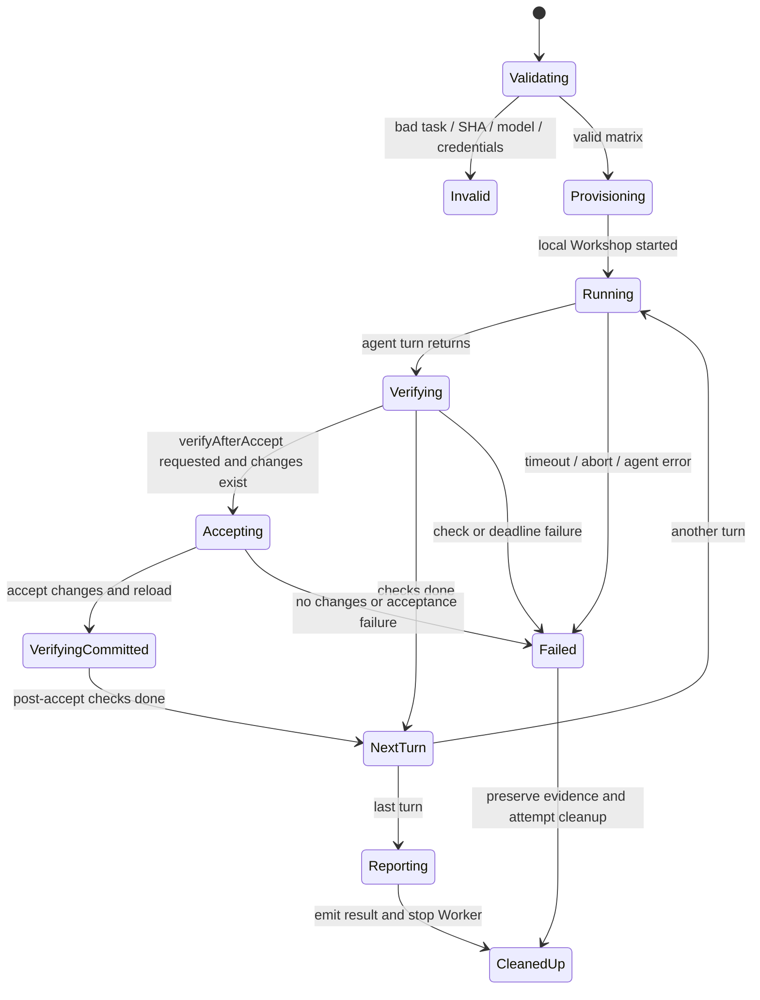
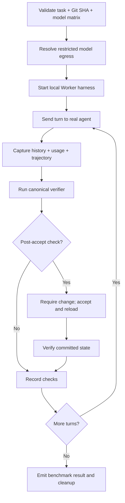

# Workshop Evaluations — Normative Specification

> Package: @gadgets/workshop-evals. A local/in-CI experiment harness built on @gadgets/integration-tests and vitest-evals. Not a deployed production Worker.

## Goal and scope
Run real Workshop agent tasks against a constrained local Worker test environment and record functional success, trajectory, model use and reproducible provenance. This suite measures model+agent behavior, not merely mocked tool output. A task has a stable slug ID and one or more nonempty turns; each turn contains a prompt and functional verification callback, optionally a post-accept verification. Prompt text contributes to taskVersion (SHA-256), so prompt changes MUST yield new experiment identity. The evaluated Git commit MUST be a valid full 40-character SHA. A dirty local checkout is rejected unless the caller intentionally supplies an explicit commit identity.

## Preflight, model access and budgets
Models MUST be resolved through the published SUGGESTED_MODELS catalog, and the eval matrix MUST validate that WORKSHOP_EVAL_TRIALS is a positive integer. The documented default model is gpt-6-luna; different models MUST be labeled incomparable to its published baseline unless intentionally used as a new baseline. Local model access can use an AI Gateway through Workers AI binding, HTTPS with token, or direct Workers AI API; transport and provider compatibility MUST be checked before inference. Direct access cannot serve non-Cloudflare providers. HTTPS-only inference requires the appropriate API token.

The currently declared limits are 28 minutes of agent execution and 4 minutes of verification per task, split across turns, with a 40-minute test timeout. Aborts and deadlines MUST stop evaluation and mark failure without silently recording success. Local inference network egress MUST be restricted to the configured model/account/gateway routes; approved cost-log reads MAY be permitted for the same account.

## Trial lifecycle

## Evidence and grading
Functional checks MUST carry stable identifiers, pass/fail and JSON-serializable evidence. Transcript events MUST reflect actual Workshop history: agent messages, tools, errors, state changes and any accepted updates. If a prompt was sent but not recorded in history because execution failed, the harness MUST account for it truthfully. Usage totals should carry forward cumulative cost/tokens when a later turn omits totals rather than zeroing them. Model turns, tool calls and tool errors are separate metrics. Successful agent prose alone MUST NOT satisfy a failing verifier. Post-accept checks MUST evaluate the reloaded accepted code rather than an uncommitted preview.

## Cleanup and safety
The outbound network interceptor MUST remain active while any Worker runtime might still execute model-authored code; do not remove guards before confirmed shutdown. Abort cleanup is best effort but failures MUST be surfaced. Eval config and results MUST never include inference API secrets. Tests MUST cover invalid model IDs, dirty worktrees, transport matrix, budget exhaustion, cancellation, teardown, missing accepted changes, verifier failures and deterministic task versioning. Workflow entrypoints: package scripts evals, evals:ui, test:run; see src/config.ts, target.ts, harness.ts, verifier.ts, transcript.ts, budgets.ts and repository .github/workflows/workshop-evals*.yml.