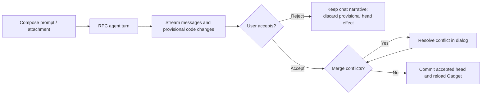
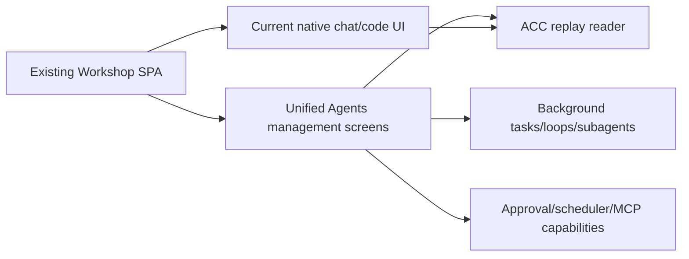

# Workshop Frontend Specification

> **Package:** `@gadgets/workshop-frontend`  
> **Status:** Normative package specification for the first-party Cloudflare OS shell/UI. The frontend is a client of backend/Gatekeeper capabilities and MUST NOT become the authority for security-sensitive state.

## 1. Mission

`workshop-frontend` is the React shell for Cloudflare OS. It manages routing, login/onboarding UX, WebSocket RPC lifecycle, workspace/Gadget UI, agent chat, approval/sharing/connectors/admin interfaces, sandboxed Gadget/Gatekeeper frames, deployment branding/theme and client-side diagnostics.

It is intentionally a **fat SPA** in presentation/orchestration, but server-side authority remains in `workshop-backend` and Gatekeepers.

## 2. Technology/runtime

The package uses the current repository frontend stack, including:

- React 19;
- Vite;
- TanStack Router with generated route tree;
- Cap'n Web browser RPC client;
- Yjs-backed collaborative/code state where consumed by workspace UI;
- Kumo/UI dependencies and project CSS/theme system;
- Monaco/code editing where applicable;
- frontend error-reporting infrastructure.

Build/dependency upgrades MUST preserve browser/runtime compatibility with sandboxed iframe and WebSocket RPC behavior.

## 3. Entry/bootstrap contract

`src/main.tsx` performs the top-level boot sequence:

1. install Workshop browser error reporting;
2. apply persisted theme mode;
3. create the initial Cap'n Web WebSocket RPC session;
4. register broken-RPC handling;
5. construct the TanStack router;
6. render React under the frontend error boundary and global providers;
7. asynchronously fetch deployment config;
8. optionally perform dev-only auto-login when explicitly enabled.

The app SHOULD render even when the backend is unavailable; connectivity/login error UI is preferable to a permanent blank screen.

## 4. Backend endpoint resolution

The browser connects to `/api` using WebSocket RPC.

Host resolution:

- explicit `VITE_BACKEND_HOST` wins when configured;
- when the Vite dev server is opened on localhost, the default backend is `localhost:8787`;
- otherwise backend RPC is same-host as the frontend.

Protocol is `wss:` under HTTPS and `ws:` under HTTP.

Production deployment SHOULD prefer same-origin frontend/backend/router topology, especially when Cloudflare Access is enabled, because the backend enforces same-origin API requests.

## 5. RPC connection lifecycle

Connection management intentionally lives outside React effect lifecycle to avoid React StrictMode's development double-mount creating competing sockets.

Authoritative reconnect behavior:

- initial reconnect backoff starts at 1 second;
- quick repeated failures double the backoff up to 10 seconds;
- a sufficiently stable connection resets the backoff;
- on `onRpcBroken`, frontend marks the connection lost and eventually replaces the global `PublicApi` stub;
- replacing the socket does **not** immediately declare recovery;
- the UI clears `connectionLost` only after a real RPC succeeds and calls the restoration marker.

Components that cache RPC-derived capabilities MUST be prepared for a top-level session replacement. A capability from a broken WebSocket MUST NOT be assumed valid after reconnect.

## 6. Deployment configuration

After each initial/reconnected public stub is available, the frontend calls `getServerConfig()`.

This config controls deployment-level presentation/features such as site branding, auth choices and UI configuration. It is re-fetched after reconnect so a restarted backend with updated deployment configuration becomes visible.

Frontend configuration is presentation/discovery data. It MUST NOT replace backend enforcement of signup/auth/admin/limits.

### Branding

- deployment accent color is applied to runtime CSS variables;
- deployment site logo URL is cache-busted appropriately for updates;
- favicon follows the deployment logo when configured.

The frontend MUST sanitize/handle branding resources as untrusted network/content inputs according to browser constraints; branding cannot grant script authority.

## 7. Authentication client contract

The frontend stores the current session token in browser local storage under the established auth token key and presents it to `PublicApi.authenticate()` on future sessions.

- A local-storage token is a bearer credential and MUST not be logged, included in telemetry, query strings or iframe messages.
- Backend authentication remains authoritative; presence of a local token does not mean the user is authenticated until RPC succeeds.
- Logout/invalid-session handling must remove or stop using the invalid token and return to an unauthenticated state.

### Password derivation

Password flows MUST use the shared password-hashing contract from `workshop-shared`/the existing frontend utility. UI code MUST NOT silently change Argon2 parameters or derive a different username/salt representation.

### Gatekeeper sign-in

Gatekeeper sign-in opens the URL returned by `startGatekeeperLogin()` and waits on the returned `LoginAttempt` capability. The frontend does not inspect or manufacture PendingLogin identifiers.

### Development auto-login

`VITE_DEV_AUTO_LOGIN=true` may create/login a configured development user (defaulting to the documented local dev credentials) before normal UI auth checks. This behavior is **development-only** and MUST NOT activate in production merely because localhost-like data appears in user content.

## 8. Routing

The app uses TanStack Router with the generated `routeTree`.

Router defaults include:

- scroll restoration;
- intent-based route preloading;
- zero preload stale time so route data can revalidate according to route loaders/state.

Routes are UI navigation only. Admin, workspace, Gatekeeper-app or shared-workspace routes MUST still acquire server capabilities and handle authorization denial.

Generated route tree output MUST be regenerated from route source according to the package tooling rather than hand-edited as a second source of truth.

## 9. RPC/provider hierarchy

Top-level React providers include:

- theme provider;
- RPC/connection-state context;
- server-config and server-config-error contexts;
- router provider;
- frontend error boundary.

Components SHOULD obtain RPC state through the shared context/hooks rather than create ad-hoc independent `/api` connections. This prevents connection storms and inconsistent auth/reconnect state.

## 10. Workspace/Gadget UI authority

The frontend renders workspace metadata, Gadget code/UI, agent chat, outputs, bindings and proposed changes received from the backend.

It MAY optimistically render local UI state, but acceptance/rejection and persistence MUST be confirmed through the Overseer/backend RPC.

A UI button being disabled is not a security check. All operations that require owner/build/admin/resource authority MUST remain validated server-side.

## 11. Sandboxed Gadget UI

Client-side Gadget UI runs inside a sandboxed iframe, not in the Workshop React DOM with ambient application authority.

The host supplies only the intended RPC/message capability to the Gadget frame. The frame MUST NOT receive:

- authenticated Workshop root API capability;
- raw Gatekeeper connected-account objects;
- browser local-storage session token;
- arbitrary parent DOM access;
- deployment admin capability unless an explicit narrow Gadget contract is designed (currently not part of the model).

Iframe messages MUST validate source/session/channel as required by the hosting implementation.

## 12. Sandboxed Gatekeeper configurators/apps

Resource configurators and Gatekeeper management apps are complete HTML documents supplied by the Gatekeeper and hosted in sandboxed `allow-scripts` iframes.

Workshop host responsibilities include:

- establish the `GatekeeperUiFrame.ui` RPC channel;
- provide initial requested resource data where applicable;
- collect the selected resource URL;
- maintain readiness state;
- coordinate iframe content/layout height;
- notify viewport/window-size changes;
- forward scroll where needed;
- dispose capabilities/listeners when the frame closes/unmounts.

The host MUST treat iframe HTML as untrusted provider/package content and rely on sandbox/capability boundaries rather than same-origin trust.

## 13. Connected accounts/resources UI

Connector UI is driven by backend-reported installed vendors/accounts/resources. The frontend MUST NOT maintain a canonical hard-coded vendor list that can diverge from `GATEKEEPER_*` deployment bindings.

Resource request/preselection MUST use the shared resolution semantics from `workshop-shared` so frontend selection and backend enforcement cannot disagree.

Account expiration/reconnect state is backend authority. UI may subscribe/react but must not locally mark credentials restored without successful backend/Gatekeeper confirmation.

## 14. Approvals/actions

Approval UI renders durable action descriptions/status from Overseer.

Requirements:

- show enough target/change information for meaningful approval;
- accurately distinguish pending/applied/rejected/reverted/failed state;
- do not expose an Apply/Approve path to callers without server-granted authority;
- auto-approval settings are persisted/enforced by backend, not localStorage;
- action-kind labels are display text; policy identity is the stable backend tag;
- an action with `awaitDecision` should keep agent/UI semantics consistent with the fact that the side effect has not occurred yet;
- untrusted provider text embedded in descriptions is already expected to be bounded/sanitized by Gatekeepers, but frontend rendering MUST still use safe Markdown/HTML handling.

## 15. Sharing UI

The frontend can manage collaborators, roles and share links through Overseer RPC.

- Effective access/role is backend permission-graph output.
- Frontend MUST not infer access merely from a cached collaborator row.
- Raw share keys are bearer secrets and SHOULD be shown/copied only through the intended user action; they MUST not be put in telemetry/logs.
- Revocation success must be confirmed by backend.
- Observer-configuration failures from Gatekeepers must be surfaced rather than ignored to force workspace open.

## 16. Agent chat UI

The chat UI consumes durable messages/stream events from Overseer and sends user messages, slash commands, attachments and change decisions through RPC.

- Streamed partial text is presentation until the durable backend message/state confirms it.
- Private server-side model replay data/reasoning snapshots are not part of the frontend contract and MUST not be requested/exposed.
- Agent-running/cancel/error states should follow backend state rather than invent independent competing turn state.
- Callback/tool/action progress should use stable message/action IDs from backend.

## 17. Attachments and binary input

The frontend SHOULD validate obvious attachment size/type constraints before upload for UX, but backend validation is authoritative.

Client-provided MIME type, filename and image metadata are untrusted. The frontend MUST not bypass backend validation by embedding unsupported files in another message shape.

## 18. Admin UI

Admin routes/features MUST first acquire/confirm admin state through authenticated backend RPC (`amIAdmin()` / `getAdminApi()` or the package's current wrapper).

Hiding admin navigation from non-admins is UX only. Any admin write must use the server-issued admin capability.

Gatekeeper management apps receive fresh `isAdmin` context through the backend at open time; the frontend must not grant admin by modifying iframe context locally.

## 19. Usage/billing UI

Cloudflare usage, account selection, balance and optional free-tier state are fetched from backend APIs. The frontend can guide the user through account selection/top-up but cannot decide whether a model call is funded/allowed.

Billing tokens remain in the Cloudflare Gatekeeper/backend and MUST never reach browser state.

## 20. Error reporting

`installWorkshopErrorReporting()` and the React root/error boundary capture diagnostic browser failures.

Browser telemetry is untrusted. The client SHOULD:

- send bounded normalized errors through the designated backend endpoint/reporting API;
- mark handled/fatal/capture mechanism accurately where possible;
- avoid session tokens, credentials, chat/provider payloads and other secrets;
- prevent telemetry failure from crashing the primary UI.

`onUncaughtError` at the React root reports fatal uncaught errors through the shared reporting path.

## 21. Connection/offline UX

When the RPC connection is lost, the UI SHOULD visibly represent degraded connectivity and avoid presenting stale writes as successful. Reads already rendered may remain visible as cached UI, but new security-sensitive mutations must await a live backend capability/result.

The reconnect path SHOULD preserve user context where possible without reusing revoked RPC stubs.

## 22. Theme/accessibility/responsiveness

Theme mode is persisted locally and deployment accent color is applied at runtime. Visual state MUST remain separate from application authority/state.

New components SHOULD preserve keyboard/focus semantics and responsive behavior across desktop/mobile layouts. Sandboxed iframe sizing must not create unbounded viewport growth or trap scrolling/focus.

## 23. Build/development

Primary workflows:

- Vite dev server via root `pnpm dev-client`;
- frontend production build as part of root recursive build;
- `run-local` serves the pre-built frontend through the integrated Worker topology;
- production may bind `dist` as static assets to router/backend according to deployment generation.

Generated files (e.g. route tree) are derived from source/tooling.

Frontend environment variables beginning with `VITE_` are browser-visible. **Secrets MUST NEVER be placed in a `VITE_*` variable.**

## 24. Tests

Tests SHOULD cover:

- backend host/protocol resolution;
- RPC reconnect/backoff and no duplicate StrictMode sockets;
- restoration only after a successful RPC;
- auth token lifecycle and invalid-session behavior;
- password derivation compatibility;
- Gatekeeper sign-in popup/attempt cancellation/result;
- shared resource-resolution parity;
- sandboxed Gadget/configurator message/RPC lifecycle;
- action approval and sharing UI state from backend;
- admin capability gating;
- deployment config refetch/branding;
- error boundary/reporting no-secret behavior;
- route/auth behavior across reconnect;
- accessibility/responsive critical flows.

## 25. Compatibility-sensitive surfaces

Treat these as coordinated changes:

- auth token storage key/format;
- shared password hash behavior;
- `/api` host/path/protocol;
- Cap'n Web RPC interface usage;
- sandbox frame message/RPC protocol;
- generated route IDs/paths used in deep links;
- action/share/connectors state shapes;
- Blueprint/output route/link conventions;
- deployment config/feature-flag fields.

## 26. Definition of done

A frontend change is complete when:

- [ ] server remains the authority for security/business state;
- [ ] no new secret is stored/logged/exposed to iframe/browser env;
- [ ] reconnect handles stale RPC capabilities correctly;
- [ ] shared contract helpers are reused instead of forked;
- [ ] untrusted HTML/Markdown/provider content is sandboxed/safely rendered;
- [ ] loading/error/offline states are explicit;
- [ ] critical interactions are accessible/responsive;
- [ ] tests and this spec reflect new workflows;
- [ ] backend/shared specs are updated for cross-package contract changes.


## 27. Current UI contract: handoff, editor history, models, and shared primitives

These requirements describe UI features added since the original spec. A browser route or React state is not an independent source of access, user identity or approvals.

### 27.1 Connection/handoff lifecycle
The /connect/handoff page is a Workshop-origin redemption page, not the provider OAuth callback. Its URL fragment carries a ticket; redeem using the flow nonce and initiating Workshop session, then erase the fragment. A provider popup alone MUST NOT mark the account connected. Frontend MUST wait for Workshop's successful initial connect or exact-stage reconnect commit. Account subscriber state is re-derived from backend RPC; React components MUST dispose obsolete RpcStubs during auth/rpc resets. Share secrets and handoff fragments MUST NOT enter pageLocation error telemetry or UI logs.

```mermaid
stateDiagram-v2
  [*] --> Disconnected
  Disconnected --> Opening: user requests connect / OAuth
  Opening --> ProviderPending: provider popup starts
  ProviderPending --> Handoff: gatekeeper returns one-time Workshop ticket
  Handoff --> Verified: redeem with original session and nonce
  Handoff --> Error: missing nonce / expired ticket / wrong session
  Verified --> Connected: backend account update observed
  Error --> Disconnected: retry from new start
  Connected --> Reconnecting: refresh permissions / credential expiry
  Reconnecting --> Connected: exact staged restore committed
  Reconnecting --> Connected: uncommitted stage discarded; old grant unchanged
```



### 27.2 Composer and chat change UX
Chat composer, attachments, model selector, code-change notices, change conflict dialogs and Blueprint proposal/update affordances must compose through the shared RPC session. Local optimistic content MUST be visibly provisional until an authoritative change batch is accepted. Worktrees are chat-private code objects and cannot be shown as ordinary public/shared Gadgets. Explicit acceptance of merged Blueprint code MUST retain local modifications or present an unresolved conflict, never silently discard an edit. A user's draft/attachment identity MUST survive UI rerender where safe, but unuploaded binary bytes MUST NOT be included in telemetry or model context without user action.



### 27.3 Shared UI and admin settings
New shared components live in @gadgets/ui, including controlled HierarchicalList tree/select/rename/drag interactions; domain-specific persistence and permission checks remain in the consuming screen. Model provider/gateway administration is authenticated server-side; form validation and tests are convenience, not authority. Public auth availability follows deployment config, which cannot be rewritten from the admin models panel. Reduced motion, touch accessibility, keyboard focus restoration after popup/context-menu closure, error boundaries and reconnect UX are required for affected screens.

### 27.4 Verification
Test ConnectHandoffPage, AuthContext/RpcContext replacement, stale stub disposal, account subscriptions, admin model gateway form validation, attachments, accepting Blueprint merges with conflicts, mobile touch drag, keyboard focus, sensitive-data reporting and restricted approval notices. Do not test only a static render of state transitions.

## Unified Agent Platform integration contract — 2026-10-13

**Status:** incremental integration SPEC and IMPLEMENTATION DRAFT, not a runtime change. **Normative:** [Unified Agent Platform v2](../../docs/architecture/AGENT_PLATFORM_UNIFIED_V2.md), [User input and evidence ledger](../../docs/architecture/USER_INPUT_LEDGER.md). For this package see the [ordered plan](./plan.md). Existing behaviors documented above remain authoritative until a reviewed, backwards-compatible migration is implemented.

### Component and control flow



### Proposed integration data schema and API changes

```typescript
type AgentNavigationLink={workspaceId:string;agentId:string|null;taskId:string|null;chatId:number|null;engineKind:'workshop-native'|'acp-cli'|'native-cli'|'custom'}
```

Validate at boundaries, add JSON Schema where values cross Worker/process/storage, specify schema version and migrations. This is a draft shape to be reconciled with actual public types and Cap'n Web support before modifying kernel interfaces.

### Implementation file map

```text
packages/workshop-frontend/
  src/features/agent-sessions/ (new unified screens described in nested SPECS.md)
  src/router/ (route integration; inspect existing layout)
  src/__tests__/agent-navigation.browser.test.tsx
  SPECS.md
  plan.md
```

### Ownership, loops, security and backwards compatibility

Integrate new feature-owned agent management into existing SPA navigation and Cap'n Web connection provider, using current Kumo UI patterns and avoiding a second authentication, query cache or approval interface. Native Code Mode must keep its current conversation UX; new Agent task drill-down is additive.

**Legacy/source comparison:** Existing Workshop frontend SPECS, Kumo/@gadgets/ui, Grokbot dashboard/chat/file/terminal UI and F-001..F-017. Preserve all already-tested features and evidence. Do not introduce a parallel scheduler, MCP client policy, login authority, Cap'n Web transport or user-facing run-loop persistence.

### Definition of done

Source→target traceability, schema fixtures, existing test parity and new negative boundary tests, authenticated staging proof for new cross-worker behavior and migration-aware rollback. **Detailed steps:** [plan.md](./plan.md).
