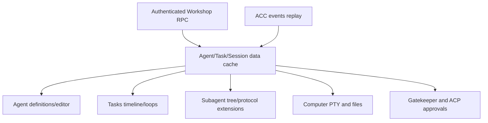

# Workshop Agent Sessions UI — SPECS

**Kind:** feature specification inside the existing Workshop frontend.  
**Status:** specification; implementation pending.

## User goals

Create and manage persistent CLI agent sessions from the Workshop without replacing existing Code Mode, Gadgets or the current model-provider chat. A session can be attached to a workspace and optionally associated with a chat, but session identity is independent from chat identity.

## First-release screens and states

- Session list with owner/workspace, harness, pinned release, current status, last activity and error indicator.
- Create-session flow with harness, approved runtime profile, workspace/repository target and permission policy.
- Session chat showing user prompts, normalized assistant/tool events, tool permission requests and explicit run status.
- Approval dialog with bounded command/tool summary, requested scope, expiry and decision history.
- Terminal panel connected to a real PTY using a short-lived ticket.
- Read-only file explorer scoped to the granted root.
- Checkpoint/restore and stop controls with progress and clear failure state.
- Release/experiment metadata for authorized operators.

## Streaming and reconnection

The backend/DO is authoritative. On mount or reconnect, fetch status and replay events after the last sequence cursor. Deduplicate by session ID and sequence. A browser disconnect never cancels a run. Show OUTCOME_UNKNOWN distinctly and provide a reconciliation action rather than claiming success or failure without evidence.

Use the existing Workshop transport patterns wherever possible. Terminal transport is specialized and separately ticketed; do not expose the runtime's private control endpoint directly to the browser.

## UX/security requirements

- Do not show model or mode controls unsupported by the live ACP handshake.
- Render tool output as untrusted content; escape HTML and avoid automatic execution of links/commands.
- Keep credentials and raw runtime secrets out of client state.
- Distinguish pending approval, running, failed, cancelled and recovered sessions.
- File browsing is read-only for the first release; write operations occur through the harness/tool authorization path.
- Provide accessible keyboard controls, loading/empty/error states and responsive layout.

## Acceptance

Browser E2E covers create, prompt, streaming, approval round-trip, terminal attachment, file inspection, refresh/replay, cancellation, session stop, denied access and a recoverable runtime failure for each supported harness. Mock UI tests do not replace real Cloudflare staging E2E.


## Canonical UI wire/replay contract

Consume the authorized `RuntimeResult`, `AgentEvent`, `RunState` and `SessionState` shapes defined in [ACP_CONTRACTS_V1](../../../../../docs/architecture/ACP_CONTRACTS_V1.md). Store `lastSeenSequence` per session for reconnect; deduplicate `(agentSessionId,sequence)` and explicitly handle CURSOR_EXPIRED with consistent snapshot/refetch. Display OUTCOME_UNKNOWN without automatic retry; preserve pending permission request identities and expiry. Provide Git status/diff, operation progress, logs and notification behavior from Grokbot F-001–F-017 as explicit migration checklist items rather than silently omitting them. Terminal must use a separately granted Computer capability and single-use ticket.


## Unified Agent Platform v2 — executable implementation draft (2026-10-13)

**New normative scope:** [Unified Architecture](../../../../../docs/architecture/AGENT_PLATFORM_UNIFIED_V2.md), [User input ledger](../../../../../docs/architecture/USER_INPUT_LEDGER.md), [Implementation stages](./plan.md). This section extends the earlier ACP/session-only description to agent definitions, independent Tasks, loop strategies, native Workshop engine parity, pluggable protocol drivers, subagents and tools where relevant. It is an IMPLEMENTATION DRAFT, not deployed code.

### Data path and package dependencies



### Canonical interfaces and data shapes to implement

```typescript
type AgentViewState={agentId:string;revision:number;taskIds:string[];permissions:string[];engines:EngineDescriptor[]};
type TaskEventCursor={taskId:string;streamId:string;lastSequence:number;retentionFloor:number};
type ProtocolPanel={engineId:string;namespace:string;schemaRef:string;readOnly:boolean;controls:string[]}
```

These records must be validated against versioned ACC/ACP JSON Schema at Worker boundary, mapped to existing Cap'n Web capabilities where human/Gadget RPC is used, and have typed retryable versus UNKNOWN outcome errors. The schema fragments above are drafts; generated final validation and migrations are acceptance requirements.

### Proposed source layout

```text
packages/workshop-frontend/src/features/agent-sessions/
  src/features/agent-sessions/{AgentDashboard,AgentEditor,TaskDetail,TaskTimeline,ChildTree,LoopControls,ToolApprovals,EngineInspector,TerminalPanel,FileExplorer}.tsx
  src/features/agent-sessions/{useAgentEvents,useTaskActions,agentEventReducer}.ts
  src/features/agent-sessions/*.test.tsx
  SPECS.md
  plan.md
```

### Semantics and concurrency

One front-end for native Workshop, ACP Grok/Codex/OpenCode and future native protocols; engine feature differences expressed by capability flags and safe protocol.extensions inspector, not branching entire app by provider. Agent list and editor, scheduled/background Tasks, per-run timelines, real subagent graph, command/tool events, approval queue, files/terminal/Git, usage, budget and ops/recovery. Keep existing chat UI behavior and current workpieces.

**Destillation/reference:** Grokbot components dashboard, session-detail, acp-chat, agent-terminal, file-browser and F-001..F-017; existing Workshop frontend chat/approval and Kumo shared UI. Pin actual source commit and test fixture before copying, and update F-001…F-017 migration evidence. Distinguish existing Workshop capabilities from new target components; no duplicate identity, scheduler, approval or MCP-import framework.

### Acceptance

A change is done only with strict schemas, migrated/verified data shapes, tests for idempotent admission, partial protocol messages, replay and crash/reconciliation, deny-by-default resource grants, source provenance and staging E2E for deployed services. Verify that core Workshop Code Mode and Gatekeeper simulation tests remain green.


## Cross-module agent-platform boundary audit (2026-10-13)

This package is a preexisting authority/consumer of agent-platform behavior. Refer to the [source-grounded no-overlap audit](../../../../../docs/architecture/EXISTING_MODULE_BOUNDARIES_AUDIT.md) and root SPECS §23 before accepting any overlapping implementation. **Specific requirement:** Frontend nested feature renders native/CLI sessions and task/subagent projections through existing Workshop RpcContext; it MUST NOT create a second auth, chat event storage, approval UI authority, device notifier or direct runtime socket bypass. Use native/CLI source-provenance events and explicit unsupported capabilities.

Any downstream addition needs existing consumer regression tests plus scoped-auth/idempotency/race tests; a documentation reference is not proof of runtime implementation.

## PDR coordination views: extend this Agent Sessions feature (design only)

Use one unified Workshop Agents/Agent Sessions area, *not* a second primary `features/multiagent` application. Extend it with Goal/WorkItem DAG/claim/review, agent↔agent offline mailbox (separate from Overseer chat), workspace facts/learning reviewer, continuity snapshot, outbox delivery status and ACC activity timeline. Existing session/terminal/files/approval tabs keep ACP/runtime ownership. Distinguish business WorkItem DONE from execution Task SUCCEEDED, mailbox persisted from read/acted upon, and native vs CLI run states. The backend/owner always authorizes; the UI is a typed RPC presentation. Accessible mobile/keyboard flows and brokered MCP/Workshop parity are mandatory. [Review map](../../../../../docs/architecture/MULTIAGENT_RESPONSIBILITY_AUDIT.md).
