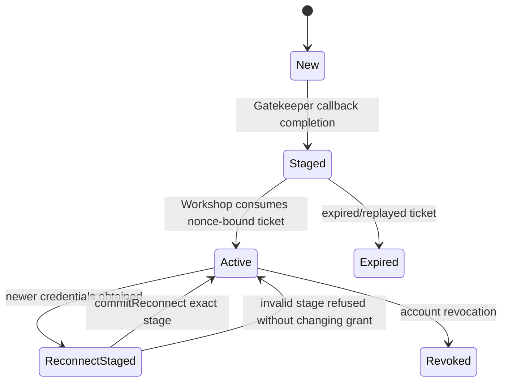
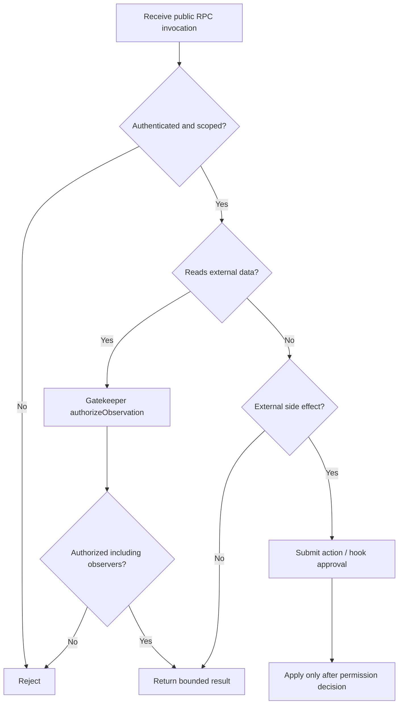

# `@gadgets/workshop-shared` Specification

> **Status:** Normative shared ABI specification. This package is the cross-runtime contract layer for Workshop backend, Workshop frontend and Gatekeeper Workers.

## 1. Mission

`workshop-shared` defines the TypeScript/RPC vocabulary that lets independently-built Cloudflare OS packages interoperate without importing each other's privileged implementation. It is the repository's ABI layer for public Workshop RPC, workspace/Gadget concepts, Gatekeeper capabilities, feature flags, Cloudflare-specific Workshop extension, platform limits and external-message ingress.

Changes here have broad blast radius and MUST be treated as compatibility-sensitive.

## 2. Public modules

The package currently exports:

- `./api` — Workshop public/authenticated/workspace/Gadget/UI RPC and shared domain types;
- `./gatekeeper` — Gatekeeper/vendor/account/resource/session/approval/observation/hook/UI contracts;
- `./feature-flags` — deployment/client flag vocabulary;
- `./cloudflare-gatekeeper` — privileged Workshop-only Cloudflare account extension;
- `./limits` — optional Cloudflare-hosted usage/balance policy defaults/types;
- `./external-message-gateway` — trusted service-to-backend asynchronous message ingress contract.

Implementation packages SHOULD depend on these public modules, not copy interface declarations locally.

## 3. RPC design principles

The backend/frontend API is capability-oriented RPC over a long-lived Cap'n Web WebSocket.

- Methods may return RPC stubs/capabilities that embody narrower authority.
- A returned capability is preferred over exposing guessable IDs plus global privileged methods.
- Capabilities passed to untrusted Gadget code MUST be the narrowest interface necessary.
- Public interfaces SHOULD remain serializable/compatible with the Workers/Cap'n Web RPC model.
- A TypeScript type being accessible does not itself grant authority; actual authority is represented by the runtime capability handed to the caller.

## 4. Workshop public API

`PublicApi` is the unauthenticated/deployment-entry surface. Its responsibilities include:

- read deployment/server configuration;
- initiate allowlisted Gatekeeper-backed sign-in and return a `LoginAttempt` capability;
- authenticate an existing session token;
- authenticate from verified Cloudflare Access context when the backend has established it;
- password login/signup where deployment policy permits;
- public Blueprint metadata/download access.

Authentication returns an `AuthenticatedApi` capability. Client code MUST NOT manufacture one from IDs or browser state.

### Password derivation contract

The current password flow derives a client-side hash using Argon2id with the shared service salt/username construction and declared parameters, then the backend hashes that derived value again for storage/comparison.

The precise derivation constants in `api.ts` are compatibility-sensitive for existing password accounts. They MUST NOT change silently. A cryptographic migration requires an explicit versioned login/storage strategy.

## 5. Authenticated/workspace API

`AuthenticatedApi` covers user-owned operations such as profile/models/onboarding, workspaces/Gadgets, Blueprints/outputs, connected Gatekeepers, gatekeeper management apps, deployment admin capability acquisition and optional billing/account selection.

The interface SHOULD delegate authority to `UserDurableObject`/`Overseer` capabilities rather than accumulate implementation logic in the shared declaration.

Workspace/Gadget APIs expose stable error/status codes where clients need programmatic recovery. New errors SHOULD prefer machine-readable codes plus human messages over matching free-form strings.

## 6. Workpiece and binding identity

`WorkpieceId` is a sequential identity from a workspace-wide namespace shared by Gadget and Gatekeeper workpieces. Consumers MUST NOT assume separate overlapping ID spaces by type.

### Binding names

`validateBindingName()` is the single source of truth for names that appear in agent/Gadget JavaScript `env` bindings.

A valid binding MUST:

- be a safe ASCII JavaScript identifier under the shared grammar;
- exclude JavaScript reserved words;
- exclude dangerous/confusing `Object.prototype`/prototype-related names used to prevent property/prototype pollution and semantic ambiguity.

ALL_CAPS is a convention for generated/fallback external-resource bindings, not a replacement for validation.

Any code creating or importing a binding name MUST use the shared validator rather than duplicate a weaker regex.

## 7. Gatekeeper vendor/account/resource ABI

### `GatekeeperVendor`

A vendor describes the connector, starts an account connection, lists supported resource types, exposes Gadget-facing `.d.ts` source, and optionally creates an account without OAuth when `autoProvisionsAccount` is declared.

`connectAccount()` accepts:

- `scopes: "auth" | "full"`;
- optional `resourceUrlPatterns` limiting which grantable resource classes need provider authorization.

Interactive connect URLs MUST be nonce-protected by implementation packages.

### `GatekeeperConnectCallback`

The Workshop callback owns connected-account lifecycle notifications:

- `complete(user, expiresAt?)` — persistent account connection established;
- `credentialsExpired()` — current credential can no longer be used/refreshed;
- `credentialsRestored(expiresAt?)` — reconnect restored it.

Gatekeepers SHOULD avoid duplicate expiry notifications but repeated calls must be safe.

### `GatekeeperUser`

The account capability is privileged and held by Workshop, not by Gadgets. It describes the account, resolves supported resources/facet classes, provides sandboxed resource configurators, supports revoke/reconnect, and may provide verifier/singleton/management app capabilities under the declared flags.

For connectors advertising authentication, `getAuthenticatedEmail()` MUST return only a provider-verified email suitable for account identity.

## 8. Resource definitions and resolution

`SupportedResource` defines a resource category with URL pattern, display metadata and grantability.

`resolveRequestedResource()` is the single source of truth for resolving a requested concrete resource into a supported category. Precedence is:

1. matching non-catch-all URLPattern;
2. whole-instance `https://*` catch-all if present;
3. sole resource if exactly one is advertised;
4. otherwise return a structured failure explaining that the caller must identify a resource.

Backend and frontend MUST use this shared rule rather than maintain separate matching heuristics.

`matchesResourceUrlPattern()` deliberately tolerates trailing-slash variants but does not special-case the catch-all; callers own catch-all precedence.

## 9. Gatekeeper resource/session ABI

A concrete resource Gatekeeper is the workspace-scoped authority that receives a session `ApprovalQueue`/authorizer and returns the narrow Gadget-facing session.

The shared Gatekeeper contract defines:

- resource description/suggested binding/session types;
- permissions/session creation;
- observer addition/removal/verification behavior;
- action application/rejection/reversion;
- optional catalogs/slash commands/hooks/auto-approval descriptors as declared by the concrete interface.

Implementation packages MUST NOT expose the privileged `GatekeeperUser` account directly to a Gadget in place of a resource facet/session.

## 10. Observation authorization

`ObservationAuthorizer.authorizeObservation(description)` is mandatory for every protected read.

Contract:

- the Gatekeeper calls it for **every observation**;
- it MUST await successful authorization before returning protected data to the Gadget;
- a strictly read-only provider request MAY happen first so the description can accurately name the observed content;
- a thrown authorization error MUST propagate/fail closed.

### Sharing policy signals

`ObservationDescription` may include:

- `ownerInvitesOnly` — the observed information may never be exposed to anyone except the owner; Workshop enforces the resulting restricted workspace policy;
- `excludeObservers` — named observer IDs must not see this observation; authorization succeeds only if Overseer can enforce that exclusion.

These are security signals, not presentation hints.

## 11. Action approval ABI

`ApprovalQueue.submitAction(actionId, description)` records a proposed side effect. Submission is asynchronous and may remain pending for hours/days.

The invariant is absolute: **all side effects are submitted before they are performed, including actions that may later be auto-approved.**

The Gatekeeper then receives the decision through:

- `applyAction(actionId)` — perform the actual side effect after approval;
- `rejectAction(actionId)` — discard staged state and optionally request a Gadget restart;
- `revertAction(actionId)` — attempt an inverse for an already-applied action.

`revertAction()` may return retry/restart/user-message details. A Gatekeeper MUST accurately set `implementsRevert`; unsupported inverses are not errors in the ABI but must be declared truthfully.

### `ActionDescription`

Action descriptions include a human title/body and policy fields such as:

- `implementsRevert`;
- optional `awaitDecision` when the agent should not continue before the world actually changes;
- optional `autoApprovable` gatekeeper verdict;
- optional stable `actionKind` (`tag` + display `label`).

`ActionKind.tag` is a stable policy identity and MUST be treated like a persisted enum. Labels may change for display; tags MUST NOT be casually renamed because user auto-approval policy may key on them.

## 12. Hook ABI

Persistent callbacks use `ApprovalQueue.bindHook(controller, callback, description)`.

The shared lifecycle is:

1. Gadget supplies a **persistent** callback stub;
2. Gatekeeper constructs a `HookController` capability containing registration parameters;
3. Gatekeeper calls `bindHook()`;
4. no durable external hook/driver state is created yet;
5. after approval, Overseer calls `controller.enable(HookInitiator, target)`;
6. Gatekeeper stores enough state to later call `HookInitiator.startHook()`;
7. event delivery starts a fresh session and returns the callback plus new approval/observation capability;
8. Gatekeeper authorizes the incoming observation then invokes the callback;
9. `disable()` removes delivery state.

A Gatekeeper MUST NOT persist a transient session-bound callback itself. The Overseer owns persistence/rebinding through the persistent stub/initiator mechanism.

## 13. Sandboxed Gatekeeper UI ABI

`GatekeeperUiFrame` / legacy alias `ResourceConfiguratorFrame` contains:

- complete self-contained `iframeHtml`;
- a narrow Gatekeeper-defined `ui` RPC capability.

Workshop hosts the HTML in a sandboxed iframe.

The resource configurator host/iframe RPC supports:

- obtaining the narrow Gatekeeper UI capability;
- pre-filling from a concrete requested resource URL/pattern;
- collecting the final concrete resource URL;
- readiness state;
- dynamic iframe sizing;
- viewport/window-resize events;
- forwarding scroll gestures.

Configurator/app frames MUST not depend on arbitrary same-origin DOM access to Workshop.

## 14. Agent catalog and slash commands

Optional Gatekeeper catalogs support progressive discovery of ambient capabilities/skills.

Catalog entries are bounded by shared constants (currently max 25 entries with bounded ID/title/description sizes). Provider packages MUST NOT return unbounded catalogs.

Slash-command providers expose a small picker catalog and `invoke(id,args,authorizer)`. Before returning expansion text derived from protected data, the provider MUST authorize the observation. Slash commands cannot use the authorizer to bypass action/hook policy.

## 15. Cloudflare Workshop-only extension

`CloudflareGatekeeperUser` extends the account capability with `getUsableAccessToken()` for Workshop AI Gateway/billing infrastructure.

This method is explicitly **not** part of Gadget authority. Code that hands it to a resource facet or generated session is a security defect.

## 16. Platform usage limits

`limits.ts` defines the shared vocabulary/defaults for the optional Cloudflare-hosted usage policy. Current defaults include:

- usage limits are optional and disabled for ordinary self-hosted deployments unless enabled;
- minimum funded Cloudflare balance threshold defaults to approximately USD 2;
- free platform-funded daily LLM request allowance defaults to 100 when the optional limits feature is enabled and no qualifying funded account is selected.

The backend is the enforcement authority. Frontend code may display these values/states but MUST NOT enforce them as the sole security/billing control.

Changing defaults is a product policy change and should update backend tests/docs/specs.

## 17. Feature flags

`feature-flags.ts` defines the typed client-visible UI flag registry/resolution shape. The current registry may be empty/placeholder. New flags MUST have explicit defaults and rollout semantics; a UI flag MUST NOT be used as the sole server-side security control.

## 18. External message gateway ABI

`external-message-gateway` defines trusted service-to-Workshop asynchronous ingress for external channels.

`SubmitExternalMessageInput` carries stable identities such as:

- trusted caller email/identity supplied by the trusted service binding;
- Gadget/workspace key;
- chat/thread key;
- message key for deduplication/correlation;
- optional Gadget title/prompt/message content;
- callback target for Gadget responses.

The Workshop-facing gateway MUST be idempotent because an external transport may redeliver after an acknowledgement failure. `messageKey` and related stable keys are part of this correctness contract.

`callerEmail` is trusted only because the RPC caller is a trusted service binding; if this API is ever exposed to untrusted HTTP, that assumption becomes invalid and the authentication model MUST be redesigned.

A response indicates accepted/rejected submission and, when accepted, the canonical chat path/reference.

## 19. Limits and bounds

Shared constants are intended to provide consistent system bounds for catalogs, identifiers and policy-related data. Packages SHOULD reuse them rather than choose inconsistent unbounded values.

Any bound visible in public behavior is compatibility-sensitive: lowering it can reject previously-valid persisted/provider data; raising it can affect Worker memory, generated prompt/type size or abuse surface.

## 20. Compatibility rules

The following changes are high risk:

- method removal/renaming on RPC interfaces;
- changing capability return types into plain IDs or vice versa;
- changing `SupportedResource.urlPattern` interpretation;
- changing binding-name validation;
- changing action-kind semantics;
- changing observation/hook approval requirements;
- changing password derivation constants;
- changing external-message idempotency key semantics;
- changing persisted enum/status string meanings used across packages.

A breaking ABI change requires coordinated updates of backend, frontend, all affected Gatekeepers, generated code/tests and specs in one transition.

Prefer additive optional fields/methods when the runtime/protocol can safely tolerate them.

## 21. Security invariants

- Shared interfaces define capability boundaries; implementations MUST not weaken them.
- Account capabilities remain Workshop-only.
- Every protected observation is authorized before disclosure.
- Every side effect is submitted before apply.
- Hook state starts only after enable.
- Provider-verified identity only for Gatekeeper sign-in.
- Binding names use the shared pollution-safe validator.
- Sandboxed UI receives only narrow RPC.
- Client-visible flags/metadata are never sole authorization.
- Trusted-service assumptions are explicit at external ingress boundaries.

## 22. Tests

Shared-contract tests SHOULD cover:

- binding-name validator reserved/prototype cases;
- resource resolution precedence and slash variants;
- Gatekeeper UI host/iframe protocol helpers;
- action/observation helper semantics;
- catalog/identifier bounds;
- stable error/status codes;
- password derivation compatibility fixtures where maintained;
- external message schema/idempotency semantics;
- feature-flag/default limit behavior.

Integration tests MUST catch backend/Gatekeeper/frontend compile/runtime incompatibilities after ABI changes.

## 23. Change checklist

- [ ] Contract is placed here only if it is genuinely shared.
- [ ] Capability authority is no broader than before unless explicitly designed.
- [ ] Backend, frontend and affected Gatekeepers compile against the new ABI.
- [ ] Persisted/status/action-tag compatibility is addressed.
- [ ] Security invariants have negative tests.
- [ ] Root and affected package specs are updated.

## 24. New public ABI and security-state contracts

### 24.1 Connection completion contract
GatekeeperConnectCallback.complete() and reconnectComplete(stageId) yield a ConnectHandoff for the initiating browser. A returned handoff is NOT proof that credentials have become live. GatekeeperUser.commitReconnect(stageId) activates the exact staged grant only after Workshop validates and consumes the handoff ticket. The account MUST pin identity/generation and reject stale stage IDs. PublicApi and AuthenticatedApi expose the corresponding start/confirm methods; these values are bearer capabilities and must be handled as such. New RPC members MUST include doc comments on every exported type, member, const and function.

### 24.2 ObservationDescription flags
The canonical flag for restricted data is containsRestrictedData. It causes manual action review and prevents public-web fetch for affected Gadget contexts; ownerInvitesOnly independently stops bearer share links/delegation and retains owner-direct invitations. These MUST NOT be conflated with old 'prohibit all sharing' terminology. Exclusion of individual observers uses the shared authorizer's explicit exclusion information. Authenticated observers are verified against actual provider content, not just 'same service connected'. ActionDescription.descriptionIsComplete MUST be surfaced to human approvers when false; unsafe/incomplete Git pushes are refused by the kernel.

### 24.3 Git workpieces and Blueprint ABI
Public workpieces distinguish Gadget and chat-private worktree records. Worktree summaries may carry baseCommit, headCommit, pinBase, title, id and chatId; these summaries are not a Gadget runtime capability. Changes to code paths are modeled as file changes and Git commit pins, not as a single mutable source blob. Blueprint release metadata includes a commitId that points to a validated release pack, and its lineage marks are meaningful for three-way merges and switching upstream sources. New API producers/consumers MUST use the shared schema rather than duplicating an almost-equivalent interface.

### 24.4 Constraints for API evolution
Changing RPC signatures, enum discriminators, promise pipelining, wire serialization, auth/passphrase hashing constants, workpiece IDs, action status names, hook controller lifecycle, or Blueprint commit metadata is a compatibility migration. Provide cross-package typechecked consumers, regression tests and an explicit rollout/backward-compatibility decision. Gatekeeper-client code MUST NOT reinterpret approval or sharing status on its own.